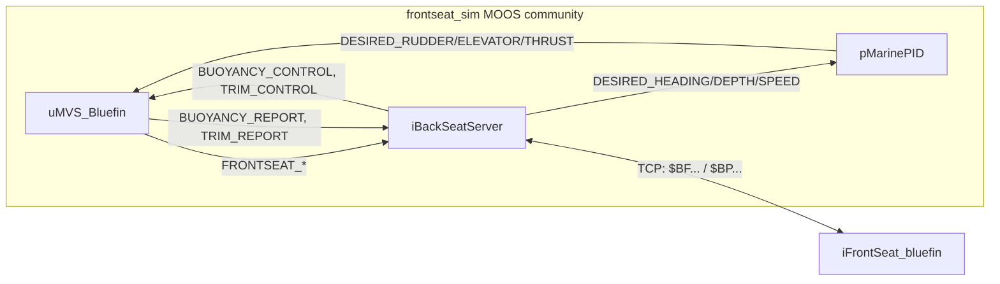

# iBackSeatServer

!!! warning "Inferred by Claude"
    Written by Claude from the source at `44da4e7`, not from a design document or by the app's
    authors.
    Each statement below is tagged: **[code]** read from the code, **[test]** observed in a test or
    a run, **[guess]** inferred intent that nobody has confirmed. Corrections are welcome; a
    maintainer sets `status: reviewed` once the page has been checked.

## Purpose

iBackSeatServer stands in for a Bluefin vehicle's frontseat computer ("Huxley") in simulation
**[guess]**. It serves Bluefin's backseat NMEA protocol on a TCP port, turning the simulated vehicle
state (`FRONTSEAT_*`, from [uMVS_Bluefin](uMVS_Bluefin.md)) into `$BFNVG`/`$BFNVR` navigation
sentences, and turning the backseat's `$BPRMB` requests into `DESIRED_HEADING`, `DESIRED_DEPTH` and
`DESIRED_SPEED` for pMarinePID **[code]**. In the M1 plan it runs in the `frontseat_sim` MOOS
community with uMVS_Bluefin, pMarinePID, uSimGPS, uSimDVL and iNoaaBathy, and Goby3's
`iFrontSeat_bluefin` on the vehicle connects to it as the backseat **[guess]**.



## Interfaces

### Subscribes

<!-- BEGIN GENERATED subscribes -->
| Name | Transport | Type / format | Handler | Meaning | Notes |
|---|---|---|---|---|---|
| `LAT_ORIGIN` | MOOS | double | `iBackSeatServer.cpp`, `OnNewMail` | new origin latitude; re-initialises the geodesy **[code]** | posted by the app itself at start-up, and by uMVS_Bluefin **[code]** |
| `LONG_ORIGIN` | MOOS | double | `iBackSeatServer.cpp`, `OnNewMail` | as `LAT_ORIGIN` **[code]** |  |
| `UMVS_BLUEFIN_STATUS` | MOOS |  | `iBackSeatServer.cpp` | registered, not used **[code]** |  |
| `TRUE_X` | MOOS |  | `iBackSeatServer.cpp` | registered, not used **[code]** |  |
| `TRUE_Y` | MOOS |  | `iBackSeatServer.cpp` | registered, not used **[code]** |  |
| `TIDE_HEIGHT` | MOOS |  | `iBackSeatServer.cpp` | registered, not used **[code]** |  |
| `SIMULATION_MODE` | MOOS |  | `iBackSeatServer.cpp` | registered, not used **[code]** |  |
| `FRONTSEAT_X` | MOOS | double (m) | `iBackSeatServer.cpp`, `OnNewMail` | local x, converted to the `$BFNVG` latitude/longitude **[code]** | from uMVS_Bluefin **[code]** |
| `FRONTSEAT_Y` | MOOS | double (m) | `iBackSeatServer.cpp`, `OnNewMail` | local y, as `FRONTSEAT_X` **[code]** |  |
| `FRONTSEAT_Z` | MOOS | double (m, negative down) | `iBackSeatServer.cpp`, `OnNewMail` | z; altitude = z − `BATHY_Z` **[code]** |  |
| `FRONTSEAT_YAW` | MOOS | double (rad) | `iBackSeatServer.cpp`, `OnNewMail` | yaw; gives the `$BFNVR` east/north velocities, and a yaw rate by differencing **[code]** |  |
| `FRONTSEAT_YAW_RATE` | MOOS |  | `iBackSeatServer.cpp` | registered, not used **[code]** |  |
| `FRONTSEAT_SPEED` | MOOS | double (m/s) | `iBackSeatServer.cpp`, `OnNewMail` | speed for the `$BFNVR` velocities **[code]** |  |
| `FRONTSEAT_RUDDER` | MOOS |  | `iBackSeatServer.cpp` | registered, not used **[code]** |  |
| `FRONTSEAT_PITCH` | MOOS | double (rad) | `iBackSeatServer.cpp`, `OnNewMail` | `$BFNVG` pitch (in degrees), and a pitch rate by differencing **[code]** |  |
| `FRONTSEAT_PITCH_RATE` | MOOS |  | `iBackSeatServer.cpp` | registered, not used **[code]** |  |
| `FRONTSEAT_HEADING` | MOOS | double (deg) | `iBackSeatServer.cpp`, `OnNewMail` | `$BFNVG` heading **[code]** |  |
| `FRONTSEAT_ELEVATOR` | MOOS |  | `iBackSeatServer.cpp` | registered, not used **[code]** |  |
| `FRONTSEAT_RPM` | MOOS | double | `iBackSeatServer.cpp`, `OnNewMail` | sent at once as `$BFRVL` **[code]** |  |
| `FRONTSEAT_DEPTH` | MOOS | double (m) | `iBackSeatServer.cpp`, `OnNewMail` | `$BFNVG` depth; with `dvl_ice_track = 1`, the depth the altitude is computed from **[code]** |  |
| `FRONTSEAT_BODY_VEL_X` | MOOS |  | `iBackSeatServer.cpp` | registered, not used **[code]** |  |
| `FRONTSEAT_BODY_VEL_Y` | MOOS |  | `iBackSeatServer.cpp` | registered, not used **[code]** |  |
| `BATHY_Z` | MOOS | double (m, negative water depth) | `iBackSeatServer.cpp`, `OnNewMail` | sea floor for the altitude **[code]** | from virtual_ocean iNoaaBathy **[code]**; 0 until it arrives **[code]** |
| `BUOYANCY_REPORT` | MOOS | string: `status=…,error=…,buoyancy=…` | `iBackSeatServer.cpp`, `OnNewMail` | sent at once as `$BFBOY` **[code]** | from uMVS_Bluefin **[code]** |
| `TRIM_REPORT` | MOOS | string: `status=…,error=…,trim_pitch=…,trim_roll=…` | `iBackSeatServer.cpp`, `OnNewMail` | sent at once as `$BFTRM` **[code]** | also posted as `NMEA_TO_BACKSEAT` **[code]** |
| `INJECT_TO_BACKSEAT` | MOOS | string | `iBackSeatServer.cpp`, `OnNewMail` | written to the clients as it is, with CR LF **[code]** | for testing a backseat by hand **[guess]** |
| `GPS_SIM_UPDATE_RECEIVED` | MOOS | any | `iBackSeatServer.cpp`, `OnNewMail` | a GPS fix: the `$BFNVG` position quality is 1 for 2 s after it, else 0 **[code]** | from virtual_ocean uSimGPS **[code]** |
| `HYDROMAN_SIM_DVL_U` | MOOS | double (m/s) | `iBackSeatServer.cpp`, `OnNewMail` | DVL forward velocity; once U, V and W have all arrived, one `$BFDVL` is sent **[code]** | from virtual_ocean uSimDVL **[code]** |
| `HYDROMAN_SIM_DVL_V` | MOOS | double (m/s) | `iBackSeatServer.cpp`, `OnNewMail` | DVL starboard velocity, as `_U` **[code]** |  |
| `HYDROMAN_SIM_DVL_W` | MOOS | double (m/s) | `iBackSeatServer.cpp`, `OnNewMail` | DVL down velocity, as `_U` **[code]** |  |
| `HYDROMAN_SIM_DVL_TIME` | MOOS |  | `iBackSeatServer.cpp` | registered, not used **[code]** |  |
| `SIMULATE_LOST_DVL_LOCK` | MOOS | double (s) | `iBackSeatServer.cpp`, `OnNewMail` | for this long, `$BFDVL` sentences carry no velocities **[code]** | for testing how a backseat handles a lost lock **[guess]** |
<!-- END GENERATED subscribes -->

### Publishes

<!-- BEGIN GENERATED publishes -->
| Name | Transport | Type / format | Where | Meaning | Notes |
|---|---|---|---|---|---|
| `NMEA_TO_BACKSEAT` | MOOS | string | `iBackSeatServer.cpp` | the `$BFTRM` sentence sent for a `TRIM_REPORT` **[code]** | trim reports only **[code]** |
| `ACTUAL_ALTITUDE` | MOOS | double (m) | `iBackSeatServer.cpp` | altitude before the DVL range limit **[code]** | read by virtual_ocean uSimDVL **[code]**; posted on every batch of mail **[code]** |
| `FRONTSEAT_ALTITUDE` | MOOS | double (m) | `iBackSeatServer.cpp` | altitude sent in `$BFNVG`: 0 outside the DVL range with `simulate_dvl_range = 1` **[code]** | posted on every batch of mail **[code]** |
| `LAT_ORIGIN` | MOOS | double | `iBackSeatServer.cpp` | `LatOrigin`, on connecting **[code]** |  |
| `LONG_ORIGIN` | MOOS | double | `iBackSeatServer.cpp` | `LongOrigin`, on connecting **[code]** |  |
| `RAW_MSG_FROM_BACKSEAT` | MOOS | string | `iBackSeatServer.cpp` | each line from a client, as received **[code]** | smoke-tested **[test]** |
| `DESIRED_HEADING` | MOOS | double (deg) | `iBackSeatServer.cpp` | `$BPRMB` field 2 **[code]** | to pMarinePID **[guess]**; smoke-tested **[test]** |
| `DESIRED_DEPTH` | MOOS | double (m) | `iBackSeatServer.cpp` | `$BPRMB` field 3 **[code]** | the depth mode (field 4) is ignored, so an altitude or pitch request is taken as a depth **[code]** |
| `DESIRED_SPEED` | MOOS | double (m/s) | `iBackSeatServer.cpp` | `$BPRMB` field 5 **[code]** | the speed mode (field 6) is ignored, so an RPM request is taken as a speed **[code]** |
| `USBL_MESSAGE` | MOOS | string: `BPNPU,<fields 1–9>` | `iBackSeatServer.cpp` | a `$BPNPU` position update from the backseat, re-joined without `$` and checksum **[code]** | no consumer in lamss3 **[code]** |
| `FRONTSEAT_SILENT` | MOOS | string: `true`/`false` | `iBackSeatServer.cpp` | `$BPSIL` field 2 non-zero **[code]** | no consumer in lamss3 **[code]** |
| `BUOYANCY_CONTROL` | MOOS | string: `true` | `iBackSeatServer.cpp` | on `$BPBOY` **[code]** | to uMVS_Bluefin **[code]** |
| `TRIM_CONTROL` | MOOS | string: `true` | `iBackSeatServer.cpp` | on `$BPTRM` **[code]** | to uMVS_Bluefin **[code]** |
<!-- END GENERATED publishes -->

### Configuration

<!-- BEGIN GENERATED config -->
| Parameter | Type | Default | Required | Meaning |
|---|---|---|---|---|
| `BackSeatPort` | int | `9113` | no | TCP port of the Huxley server **[code]**; the missions use 29504 **[code]** |
| `LatOrigin` | double |  | yes | global (mission file); the app exits without it **[code]** |
| `LongOrigin` | double |  | yes | global (mission file); the app exits without it **[code]** |
| `dvl_ice_track` | number `0`/`1` | `0` | no | 1: the DVL tracks the ice above, altitude = depth − (ice roughness + `ice_thickness`) **[code]** |
| `ice_thickness` | double (m) | `0` | no | with `dvl_ice_track = 1` **[code]** |
| `ice_roughness_mean` | double (m) | `0` | no | meant as the mean of the random ice roughness, but has no effect (see open questions) **[code]** |
| `ice_roughness_stdev` | double (m) | `0` | no | as `ice_roughness_mean` **[code]** |
| `simulate_dvl_range` | number `0`/`1` | `0` | no | 1: an altitude outside [`dvl_min_range`, `dvl_max_range`] is sent as 0 **[code]** |
| `dvl_max_range` | double (m) | `200` | no | with `simulate_dvl_range = 1` **[code]** |
| `dvl_min_range` | double (m) | `3` | no | with `simulate_dvl_range = 1` **[code]** |
<!-- END GENERATED config -->

Example (from `iBackSeatServer.moos`, the configuration the missions ran with):

```
LatOrigin  = 42.358
LongOrigin = -71.087

ProcessConfig = iBackSeatServer
{
    AppTick   = 4
    CommsTick = 4

    // TCP port iFrontSeat_bluefin connects to
    BackSeatPort = 29504

    dvl_ice_track = 0
    ice_thickness = 0
    ice_roughness_mean = 0
    ice_roughness_stdev = 0
    simulate_dvl_range = 0
}
```

### Files, devices and external programs

- A TCP server on `BackSeatPort`, on all interfaces, through Goby's `goby::util::TCPServer`
  **[code]**. Every sentence goes to all connected clients **[code]**. The app exits if the port
  cannot be bound **[code]**.
- Every sentence sent and received is logged on standard output **[code]**.

## Behaviour

Sentences are NMEA: `$`, comma-separated fields, `*`, a two-digit lower-case hex checksum, CR LF
**[code]**. Times are UTC `hhmmss.sss` **[code]**. Lines from the backseat must end in CR LF too
(Goby's `TCPServer` default) **[code]**.

Sent to the backseat **[code]**:

| Sentence | When | Fields after the time |
|---|---|---|
| `$BFMSC` | every iteration | `Running` |
| `$BFNVG` | every iteration | latitude `ddmm.mmmm`, `N`/`S`, longitude `dddmm.mmmm`, `E`/`W`, position quality (1 within 2 s of `GPS_SIM_UPDATE_RECEIVED`, else 0), altitude, depth, heading, roll (always 0), pitch (deg), time |
| `$BFNVR` | every iteration, after `$BFNVG` | east, north and down velocity (m/s), pitch rate, `1`, `0.0`, yaw rate, time (see open questions) |
| `$BFACK` | for every sentence received | sentence ID without the `BP` talker, the received sentence's field 1 (its time), `1`, `2` (successfully processed), `0`, `general ack` |
| `$BFRVL` | on `FRONTSEAT_RPM` | RPM, empty speed |
| `$BFDVL` | once `HYDROMAN_SIM_DVL_U`, `_V` and `_W` have all arrived | u, v, w, four zero beam ranges, 15.0 °C, time; empty velocities and ranges while a lost lock is simulated |
| `$BFBOY` | on `BUOYANCY_REPORT` | status, error, `report`, buoyancy |
| `$BFTRM` | on `TRIM_REPORT` | status, error, `report`, trim pitch, trim roll |

Received from the backseat **[code]**:

| Sentence | Effect |
|---|---|
| `$BPRMB` | `DESIRED_HEADING` (field 2), `DESIRED_DEPTH` (3), `DESIRED_SPEED` (5); the mode fields are ignored |
| `$BPBOY` | `BUOYANCY_CONTROL = true` |
| `$BPTRM` | `TRIM_CONTROL = true` |
| `$BPSIL` | `FRONTSEAT_SILENT` |
| `$BPNPU` | `USBL_MESSAGE` |
| `$BPLOG,ACK,ON` / `OFF` | stored, but acks are sent either way |
| anything else (`$BPSTS`, other `$BPLOG`s, `$BPRCE`, …) | acknowledged only |

- Each iteration (`AppTick`, 4 Hz in the missions) **[code]**:
    - sends `$BFMSC`;
    - reads every complete line from the clients, posts it as `RAW_MSG_FROM_BACKSEAT`, splits it with
      Goby's `NMEASentence` without checking its checksum, acknowledges it and acts on it; a line
      that is not NMEA is logged and skipped;
    - converts `FRONTSEAT_X/Y` to latitude and longitude and sends `$BFNVG` and `$BFNVR`; before the
      first `FRONTSEAT_X/Y` the position is the origin;
    - with `dvl_ice_track = 1`, draws a new ice roughness.
- `$BFMSC` in every iteration is what puts `iFrontSeat_bluefin` into its accepting-commands state
  with its default `accepting_commands_hook: BFMSC_TRIGGER` **[code]** (Goby3
  `bluefin_incoming.cpp`). The app never sends `$BFMIS`, so the `BFMIS_RUNNING_TRIGGER` hook would
  not work **[code]**.
- `iFrontSeat_bluefin` checks the checksum of every sentence, and matches each `$BFACK` by sentence
  ID to the sentence it sent last **[code]** (Goby3 `bluefin.cpp`). The general ack satisfies this
  for every sentence, including heartbeats (`$BPSTS`) and log requests (`$BPLOG`) **[code]**. The
  `$BPLOG` requests do not change what the app sends **[code]**.
- Altitude, recomputed on every batch of mail **[code]**:
    - `dvl_ice_track = 0`: `FRONTSEAT_Z − BATHY_Z`. Without `BATHY_Z` (no iNoaaBathy) it is minus
      the depth **[code]**: `-0.2` at 0.2 m in the smoke test **[test]**;
    - `dvl_ice_track = 1`: `FRONTSEAT_DEPTH − (ice roughness + ice_thickness)` **[code]**;
    - posted as `ACTUAL_ALTITUDE`, then, after the DVL range limit, as `FRONTSEAT_ALTITUDE` and in
      `$BFNVG` **[code]**.
- The pitch and yaw rates are the change between successive `FRONTSEAT_PITCH`/`FRONTSEAT_YAW`
  posts divided by the time between the batches of mail that carried them **[code]**.

## Running it

- No mission component launches it yet. The M1 plan
  ([plan 10](../../../../core/src/doc/plan/claude/10-milestone-mbat-macrura.md)) puts it in the macrura
  `frontseat_sim` community, with `iFrontSeat_bluefin`'s `huxley_tcp_address` and
  `huxley_tcp_port` pointing at it **[guess]**.
- Standalone, from `autonomy/src/bin/iBackSeatServer/`: `MOOSDB iBackSeatServer.moos &` then
  `iBackSeatServer iBackSeatServer.moos` (the process name is always `iBackSeatServer`) **[code]**.
  `nc -C localhost 29504` shows the sentences, and typing `$BPRMB,000000.00,90,10,0,1.5,1,0` posts
  `DESIRED_*` **[code]**.
- Tested by `lamss_autonomy_moos_smoke`, next to uMVS_Bluefin **[test]**:
    - a TCP client receives `$BFMSC … Running`, a `$BFNVG` at the origin (`4221.4800,N,07105.2199,W`)
      with a depth, and a `$BFNVR`, all with valid checksums;
    - a `$BPRMB` as `iFrontSeat_bluefin` sends it gives `DESIRED_HEADING`, `DESIRED_DEPTH`,
      `DESIRED_SPEED` and `RAW_MSG_FROM_BACKSEAT`, and a `$BFACK` for `RMB`.

## Known issues and open questions

- `$BFNVR` carries one field more than the layout `iFrontSeat_bluefin` reads (east, north and down
  velocity, pitch rate, roll rate, yaw rate) **[code]**. The driver reads a roll rate of `1` deg/s
  and a yaw rate of `0.0`, and never sees the computed yaw rate **[code]**. Is the `1` a leftover?
- `OnConnectToServer` declares a local `ice_roughness_dist`, so the member that `Iterate` draws from
  keeps its default, a standard normal: `ice_roughness_mean` and `ice_roughness_stdev` have no
  effect **[code]**. This only matters with `dvl_ice_track = 1`.
- A latitude below 1° gets three leading zeros instead of two: both the `< 1` and the `< 10`
  padding apply, where the longitude uses `else if` **[code]**.
- `$BPRMB`'s depth and speed modes are ignored **[code]**. With `use_rpm_table_for_speed`,
  `iFrontSeat_bluefin`'s RPM would be taken as a speed; its zero-speed request (rudder and pitch
  modes, all zeros) gives `DESIRED_HEADING`, `DESIRED_DEPTH` and `DESIRED_SPEED` of 0 **[code]**.
- Every sentence is acknowledged as successfully processed, including the ones the app ignores
  (`$BPRCE`, `$BPABT`, …) **[code]**.
- The yaw and pitch rates divide by the time since the previous post: 0 when two posts arrive in one
  batch of mail, and the time since 1970 for the first post **[code]**.
- `FRONTSEAT_ALTITUDE` and `ACTUAL_ALTITUDE` are posted on every batch of mail, whatever it carried
  **[code]**.
- Twelve registered variables are never used (see Subscribes) **[code]**.
- `$BFDVL` reports a fixed 15.0 °C and zero beam ranges **[code]**.

## History

- From GobySoft/lamss `src/moos/iBackSeatServer/` (imported at lamss 3186a63) **[code]**. Written by
  Arjuna Balasuriya from 2011 (first commit 2011-05-17); 51 commits before the port **[code]**:
    - Keja Rowe fixed the TCP reader (2011);
    - Arjuna Balasuriya moved it from `$BFSIMNVG` to Bluefin's `$BFNVG`, and added `$BFMSC`, the
      buoyancy and trim handshakes and the general ack (2012–2013);
    - Henrik Schmidt fixed the latitude/longitude conversion (2012), and moved the
      `FRONTSEAT_LATITUDE/LONGITUDE` posts to uMVS_Bluefin (2022);
    - Toby Schneider ported it to MOOS 10 and Goby's geodesy, fixed a rounding bug in the
      latitude/longitude minutes, and added `$BFRVL`, `$BFDVL` and the GPS quality flag (2013–2019);
    - Supun Randeni added the ice-tracking DVL, the lost DVL lock and the DVL range limits (2020).
- lamss3 port, for M1:
    - formatted with clang-format; licence headers set to GPL-3.0-or-later;
    - built with `lamss_add_app`; Goby's `NMEASentence` replaces lib_anrp_util's `NMEAMessage`, and
      the app's own `doubleToString`/`intToString` replace MBUtils';
    - the vehicle state and the DVL and ice options start at 0 instead of uninitialised;
    - `iBackSeatServer.moos` carries the missions' configuration.
