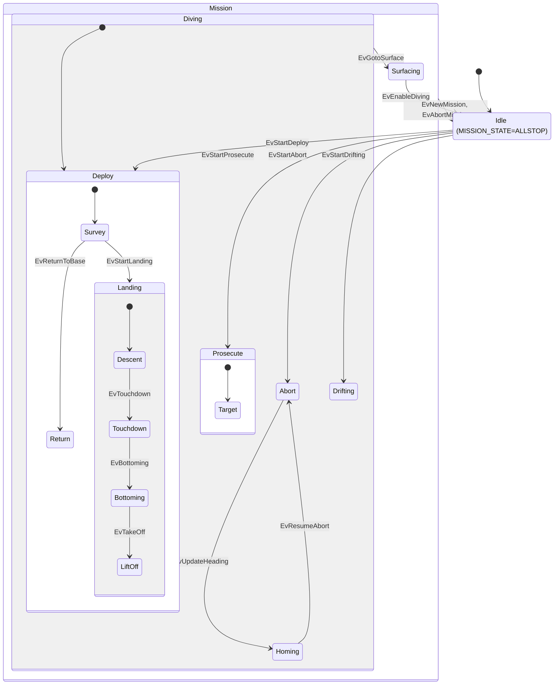

# pLamssMissionManager

!!! warning "Inferred by Claude"
    Written by Claude from the source at `992a171`, not from a design document or by the app's
    authors.
    Each statement below is tagged: **[code]** read from the code, **[test]** observed in a test or
    a run, **[guess]** inferred intent that nobody has confirmed. Corrections are welcome; a
    maintainer sets `status: reviewed` once the page has been checked.

## Purpose

pLamssMissionManager is the vehicle's mission state machine **[code]**. It accepts deploy,
prosecute and transit commands (`LAMSS_*_IN`, protobuf) addressed to this vehicle, keeps a mission
state (`MISSION_STATE`), and turns each command into the many update variables that the
pHelmIvP behaviors read **[code]**. It also watches for lost communications or navigation and
aborts towards a fixed abort location, homes on a beacon there, handles landing on the seabed,
and re-posts frontseat navigation as `NAV_*` **[code]**. Commands normally arrive over the acoustic
link from the topside through pAcommsHandler **[guess]**; the app also sends commands to itself
(initial deploy, re-deploys, homing return) **[code]**.

## Interfaces

### Subscribes

<!-- BEGIN GENERATED subscribes -->
| Name | Transport | Type / format | Handler | Meaning | Notes |
|---|---|---|---|---|---|
| `LAT_ORIGIN` | MOOS | double | `handle_lat_origin` | new local-grid origin latitude **[code]** | subscribed only with `dynamic_utm` **[code]**; NaN and changes below 1e-6 ignored **[code]** |
| `LONG_ORIGIN` | MOOS | double | `handle_lon_origin` | new local-grid origin longitude **[code]** | as `LAT_ORIGIN` |
| `MODE` | MOOS | string | `handle_helm_mode` | pHelmIvP mode **[code]** | only `MISSION:DIVING:DEPLOY:TRANSIT` matters: it enables pruning of the transit route **[code]** |
| `LAMSS_STATUS_IN` | MOOS | protobuf `lamss.core.LAMSS_STATUS` | `handle_status` | received status report **[code]** | one from `topside_id` resets the comms timer **[code]** |
| `LAMSS_DEPLOY_IN` | MOOS | protobuf `lamss.autonomy.LAMSS_DEPLOY` | `handle_deploy` | deploy command **[code]**; the main input of the state machine **[code]** | ignored unless `_rcv_id` is this vehicle's `VEHICLE_ID` or an `additional_modem_id` **[code]**; the app also posts its own commands here **[code]**; smoke-tested **[test]** |
| `LAMSS_PROSECUTE_IN` | MOOS | protobuf `lamss.autonomy.LAMSS_PROSECUTE` | `handle_prosecute` | prosecute (target) command **[code]** | same ID filter; ignored unless a mission is active **[code]** |
| `LAMSS_TRANSIT_IN` | MOOS | protobuf `lamss.autonomy.LAMSS_TRANSIT` | `handle_transit_route` | transit route **[code]** | accepted only when `_rcv_id == VEHICLE_ID` (not the additional IDs) **[code]** |
| `LAMSS_STOVEPIPE_IN` | MOOS | protobuf `lamss.autonomy.LAMSS_STOVEPIPE` | `handle_stovepipe_message` | add, move or (negative ID) delete an elliptical obstacle **[code]** | "stovepipes" are under-ice obstacles in ICEX **[guess]** |
| `MISSION_STATE` | MOOS | string | `handle_mission_state` | its own state output, read back **[code]** | only `DRIFTING`, posted by someone else, has an effect: it starts Drifting **[code]** |
| `VEHICLE_ID` | MOOS | double | `handle_vehicle_id` | own modem ID **[code]** | until it arrives every command is ignored **[code]**; smoke-tested **[test]** |
| `VEHICLE_NAME` | MOOS | string | `handle_vehicle_name` | own name **[code]** | stored but not used **[code]** |
| `COLLABORATOR_ID` | MOOS | double | `handle_collaborator_id` | collaborating vehicle ID **[code]** | stored but not used **[code]** |
| `COLLABORATOR_NAME` | MOOS | string | `handle_collaborator_name` | collaborating vehicle name **[code]** | used in `ADAPTIVE_DEPTH` when the deploy names no collaborator **[code]** |
| `HYDROMAN_NAV_DATA` | MOOS | protobuf `goby.middleware.frontseat.protobuf.NodeStatus` | `handle_hydroman_data` | navigation from HydroMAN **[code]** | subscribed only with `navigating_with_hydroman` **[code]** |
| `IFS_DATA_IN` | MOOS | protobuf `goby.middleware.frontseat.protobuf.InterfaceData` | `handle_ifs_data` | frontseat data; its `node_status` is the navigation **[code]** | subscribed unless `navigating_with_hydroman` **[code]**; from the Goby frontseat interface **[guess]** |
| `OPREG_TRAJECTORY_PERIM_DIST` | MOOS | double (m) | `handle_opbox_distance` | distance from the planned track to the operation-region edge **[code]** | below `min_opbox_distance` it re-deploys **[code]**; from pHelmIvP's OpRegion behavior **[guess]** |
| `DESIRED_DEPTH` | MOOS | double (m) | `handle_desired_depth` | helm depth command **[code]** | only used for `DEPTH_MISMATCH` **[code]** |
| `GOTO_SURFACE` | MOOS | string | `handle_goto_surface` | `TRUE` starts Surfacing; anything else ends it **[code]** | the app posts `FALSE` itself on each prosecute command **[code]** |
| `TRACKING` | MOOS | string | `handle_tracking` | tracker state **[code]** | `TRACKING` while homing returns to Abort with `TARGET_BEARING` as the new heading **[code]** |
| `TARGET_BEARING` | MOOS | double (deg) | `handle_target_bearing` | bearing to the homing beacon **[code]** | used only by `TRACKING` **[code]** |
| `SURVEY_COMPLETED` | MOOS | string | `handle_survey_flag` | `TRUE` re-sends the initial deploy **[code]** | the app posts `TRUE` itself when it forces a re-deploy, and `FALSE` on each deploy **[code]** |
| `IN_TRACK` | MOOS | string | `handle_in_track` | `TRUE` while on a survey trackline **[code]** | blocks origin updates and racetrack moves **[code]** |
| `HOMING_LOCK` | MOOS | string | `handle_homing_lock` | `TRUE` while pTetraHoming has a good beacon fix **[code]** | blocks `BEACON_UPDATE` from the camp estimate **[code]** |
| `SURVEY_WPT_INDEX` | MOOS | double | `handle_survey_wpt_index` | current survey waypoint index **[code]** | blocks origin updates once past the first waypoint **[code]** |
| `TRANSIT_WPT_INDEX` | MOOS | double | `handle_transit_wpt_index` | current transit waypoint index **[code]** | reached waypoints are pruned from the stored route **[code]** |
| `TRANSIT_COMPLETED` | MOOS | string | `handle_transit_flag` | `TRUE` clears the stored route and sets `TRANSIT_MODE=DIRECT` **[code]** |  |
<!-- END GENERATED subscribes -->

### Publishes

The state machine thread also posts, through the queue shown as `publish_queue_.front()` below
**[code]**:

| Name | Type / format | Meaning |
|---|---|---|
| `MISSION_STATE` | string: `ALLSTOP`, `DEPLOY`, `PROSECUTE`, `ABORT`, `DRIFTING`, `SURFACING` | state entered (`Mission_StateEnum` without prefix) **[code]**; smoke-tested for `ALLSTOP` and `DEPLOY` **[test]** |
| `LANDING_STATE` | string: `DESCENT`, `TOUCHDOWN`, `BOTTOMING`, `LIFTOFF` | landing sub-state entered **[code]** |
| `HOMING_ACTIVE` | string: `true`/`false` | entering and leaving Homing **[code]** |

<!-- BEGIN GENERATED publishes -->
| Name | Transport | Type / format | Where | Meaning | Notes |
|---|---|---|---|---|---|
| `OPREGION_UPDATE` | MOOS | string: `polygon=<XYPolygon spec>` | `LamssMissionManager.cpp` | operation region **[code]** | only with `dynamic_opregion`, at start-up **[code]** |
| `BEACON_UPDATE` | MOOS | string: `beacon_x=…,beacon_y=…` | `LamssMissionManager.cpp` | estimated homing beacon position = abort location **[code]** | at start-up **[code]**; read by pTetraHoming **[code]** |
| `HOMING_X` | MOOS | double | `LamssMissionManager.cpp` | abort location x **[code]** | smoke-tested **[test]** |
| `HOMING_Y` | MOOS | double | `LamssMissionManager.cpp` | abort location y **[code]** | posts the x value in `update_deploy_parameters` (see open questions) **[code]** |
| `HOMING_BEACON_FREQUENCY` | MOOS | double (Hz) | `LamssMissionManager.cpp` | `homing_beacon_frequency` **[code]** | at start-up if > 0, and before each homing prosecute **[code]** |
| `LAT_ORIGIN` | MOOS | double | `LamssMissionManager.cpp` | new origin at the vehicle position **[code]** | with `dynamic_utm`, in Deploy, off-track, before the first survey waypoint, when more than `update_offset` from the origin, at most every 30 s **[code]** |
| `LONG_ORIGIN` | MOOS | double | `LamssMissionManager.cpp` | as `LAT_ORIGIN` **[code]** |  |
| `SURVEY_COMPLETED` | MOOS | string | `LamssMissionManager.cpp` | `TRUE` when it forces a re-deploy, `FALSE` on each deploy **[code]** | it subscribes to this too, so `TRUE` also re-sends the initial deploy **[code]** |
| `PROSECUTE_REMAINING` | MOOS | double | `LamssMissionManager.cpp` | seconds left of the prosecute **[code]** | slow loop, in Prosecute **[code]** |
| `SONAR_CONTROL` | MOOS | string: `ON`/`OFF` | `LamssMissionManager.cpp` | sonar on/off **[code]** | from the deploy command; `ON` on prosecute; `OFF` on a timeout abort **[code]** |
| `SONAR_PROCESS` | MOOS | string: `ON`/`OFF` | `LamssMissionManager.cpp` | sonar processing on/off **[code]** | as `SONAR_CONTROL` |
| `USBL_ENABLED` | MOOS | string: `TRUE`/`FALSE` | `LamssMissionManager.cpp` | USBL homing on/off **[code]** | `TRUE` only with `homing_array: USBL` **[code]** |
| `DEPTH_MODE` | MOOS | string: `SINGLE`, `YOYO`, … (`Depth_ModeEnum` without prefix) | `LamssMissionManager.cpp` | depth mode for the helm **[code]** | `SINGLE` on prosecute; `ADAPTIVE_ACOMMS` on auto depth adaptation **[code]** |
| `ACOMMS_DEPTH` | MOOS | string: `depth=…` | `LamssMissionManager.cpp` | depth for acoustic communication **[code]** | the deploy upper depth at the first deploy; the current depth in adaptive-acomms mode **[code]** |
| `DEPLOY_REMAINING` | MOOS | double | `LamssMissionManager.cpp` | seconds before a timeout abort **[code]** | slow loop, only if the deploy has a duration **[code]** |
| `ABORT_REMAINING` | MOOS | double | `LamssMissionManager.cpp` | travel time to the abort location (s) **[code]** | slow loop, in Abort **[code]** |
| `LAMSS_DEPLOY_IN` | MOOS | string | `LamssMissionManager.cpp` | commands to itself: initial deploy, re-deploy, homing return **[code]** | addressed to its own `VEHICLE_ID` **[code]** |
| `TRACKER_COMMAND` | MOOS | string: `RESET` | `LamssMissionManager.cpp` | resets the tracker before a homing prosecute **[code]** |  |
| `SENSOR_DEPTH_TRACKING` | MOOS | string: `depth=…` | `LamssMissionManager.cpp` | depth while tracking **[code]** | deploy upper depth, or `abort_depth` for homing **[code]** |
| `SENSOR_DEPTH_DEPLOY` | MOOS | string: `depth=…` | `LamssMissionManager.cpp` | deploy depth **[code]** | as above |
| `LAMSS_PROSECUTE_IN` | MOOS | string | `LamssMissionManager.cpp` | homing prosecute to itself, target number 2 at the abort location **[code]** | only with `homing_array: TOWED` **[code]** |
| `ABORT_HEADING` | MOOS | string: `heading=…#duration=…` | `LamssMissionManager.cpp` | heading (deg) and travel time to the abort location **[code]** | slow loop outside Abort/Drifting/Homing and in Abort **[code]**; also from `TRACKING` **[code]** |
| `ABORT_SPEED` | MOOS | string: `speed=…` | `LamssMissionManager.cpp` | `abort_speed` **[code]** |  |
| `ABORT_DEPTH` | MOOS | string: `depth=…` | `LamssMissionManager.cpp` | `abort_depth` **[code]** |  |
| `ABORT_LOCATION` | MOOS | string: `points=x,y` | `LamssMissionManager.cpp` | abort location **[code]** |  |
| `publish_queue_.front()` (built at run time) | MOOS |  | `LamssMissionManager.cpp` | posts queued by the state machine thread: `MISSION_STATE`, `LANDING_STATE`, `HOMING_ACTIVE` **[code]** | see Behaviour **[code]** |
| `LAMSS_TRANSIT_IN` | MOOS | string | `LamssMissionManager.cpp` | `initial_transit` sent to itself with the initial deploy **[code]** |  |
| `NAV_DATA` | MOOS | string | `LamssMissionManager.cpp` | navigation re-posted from `IFS_DATA_IN` or `HYDROMAN_NAV_DATA` **[code]** |  |
| `NAV_X` | MOOS | double | `LamssMissionManager.cpp` | navigation re-posted for MOOS apps **[code]** | the `NAV_*` group comes from whichever nav input is configured **[code]** |
| `NAV_Y` | MOOS | double | `LamssMissionManager.cpp` | as `NAV_X` **[code]** |  |
| `NAV_LAT` | MOOS | double | `LamssMissionManager.cpp` | as `NAV_X` **[code]** | from the local fix through the origin for HydroMAN **[code]** |
| `NAV_LONG` | MOOS | double | `LamssMissionManager.cpp` | as `NAV_X` **[code]** |  |
| `NAV_Z` | MOOS | double | `LamssMissionManager.cpp` | as `NAV_X` **[code]** |  |
| `NAV_DEPTH` | MOOS | double | `LamssMissionManager.cpp` | as `NAV_X` **[code]** |  |
| `NAV_YAW` | MOOS | double | `LamssMissionManager.cpp` | minus heading, in rad, wrapped to ±π **[code]** | uses π = 3.14159 **[code]** |
| `NAV_HEADING` | MOOS | double (deg) | `LamssMissionManager.cpp` | as `NAV_X` **[code]** |  |
| `NAV_SPEED` | MOOS | double | `LamssMissionManager.cpp` | speed over ground **[code]** |  |
| `NAV_PITCH` | MOOS | double (rad) | `LamssMissionManager.cpp` | as `NAV_X` **[code]** |  |
| `NAV_ROLL` | MOOS | double (rad) | `LamssMissionManager.cpp` | as `NAV_X` **[code]** |  |
| `NAV_ALTITUDE` | MOOS | double (m) | `LamssMissionManager.cpp` | as `NAV_X` **[code]** |  |
| `GPS_UPDATE_RECEIVED` | MOOS | string: `Timestamp=…` | `LamssMissionManager.cpp` | a navigation message with a GPS source arrived **[code]** | read by uMVS_Bluefin to reset its drift **[code]** |
| `SURVEY_WPT_FLAG` | MOOS | double | `LamssMissionManager.cpp` | reset to 0 on each deploy **[code]** |  |
| `IN_TRACK` | MOOS | string: `FALSE` | `LamssMissionManager.cpp` | reset on each deploy **[code]** |  |
| `DEPLOY_MISSION` | MOOS | string: `LOITER`, `RETURN`, … (`Deploy_ModeEnum` without prefix) | `LamssMissionManager.cpp` | current deploy mode **[code]** | read by pTetraHoming and helm conditions **[guess]** |
| `DEPLOY_STATION` | MOOS | string: `point=x,y#speed=…` | `LamssMissionManager.cpp` | station-keeping point **[code]** |  |
| `ORBIT_RADIUS` | MOOS | double | `LamssMissionManager.cpp` | loiter radius **[code]** |  |
| `SENSOR_DEPLOY` | MOOS | string: `polygon=radial:x,y,r,n#clockwise=…#speed=…` | `LamssMissionManager.cpp` | loiter polygon **[code]** |  |
| `SENSOR_RACETRACK` | MOOS | string: `points=x,y#heading=…#track_length=…#track_width=…#clockwise=…#speed=…` | `LamssMissionManager.cpp` | racetrack behavior update **[code]** | only for a new deploy, not on an origin change **[code]** |
| `ZIGZAG_CONFIG` | MOOS | string: `heading=…#period=…#amplitude=…#speed=…` | `LamssMissionManager.cpp` | zigzag behavior update **[code]** | only for a new deploy **[code]** |
| `ZIGZAG_STATUS` | MOOS | string: `points=zigzag:x,y,hdg,len,period,width#currix=…` | `LamssMissionManager.cpp` | zigzag path **[code]** |  |
| `SURVEY_CONFIG` | MOOS | string: `points=format=lawnmower,…#speed=…#currix=…` | `LamssMissionManager.cpp` | lawnmower survey update **[code]** |  |
| `SPIRAL_UPDATE` | MOOS | string | `LamssMissionManager.cpp` | spiral behavior update **[code]** | no spiral behavior is ported **[guess]** |
| `DEPLOY_TRACK_FRONT_UPDATE` | MOOS | string | `LamssMissionManager.cpp` | front-tracking behavior update **[code]** | behavior not ported **[guess]** |
| `DEPLOY_HELIX_UPDATE` | MOOS | string | `LamssMissionManager.cpp` | helix behavior update **[code]** | behavior not ported **[guess]** |
| `TGT_TO_CLASS` | MOOS | string: `tgt_x=…#tgt_y=…` | `LamssMissionManager.cpp` | deploy point as a target to classify **[code]** | consumer unknown |
| `SAMPLE_UPDATE` | MOOS | string | `LamssMissionManager.cpp` | sampling behavior update **[code]** | consumer unknown |
| `SENSOR_DEPTH_ALTERNATE` | MOOS | string: `depth=…` | `LamssMissionManager.cpp` | deploy lower depth **[code]** |  |
| `SENSOR_ALTITUDE` | MOOS | string: `altitude=…` | `LamssMissionManager.cpp` | deploy altitude **[code]** |  |
| `GPS_CONFIGURATION` | MOOS | string: `period=…` | `LamssMissionManager.cpp` | GPS surfacing interval from the deploy **[code]** |  |
| `SENSOR_YOYO` | MOOS | string: `min_depth=…#max_depth=…` | `LamssMissionManager.cpp` | yoyo depth limits **[code]** |  |
| `SMART_YOYO` | MOOS | string: `min_depth=…#max_depth=…#period=…` | `LamssMissionManager.cpp` | SmartYoyo update **[code]** | posted twice per deploy with different periods; the second wins **[code]** |
| `DEPLOY_SPEED` | MOOS | string: `speed=…` | `LamssMissionManager.cpp` | deploy speed **[code]** |  |
| `SURVEY_HEADING` | MOOS | string: `heading=…` | `LamssMissionManager.cpp` | survey heading **[code]** |  |
| `ADAPTIVE_DEPTH` | MOOS | string: `contact=…` | `LamssMissionManager.cpp` | collaborator for adaptive depth **[code]** |  |
| `TOGGLE_UPPER_DEPTH` | MOOS | double | `LamssMissionManager.cpp` | deploy upper depth **[code]** |  |
| `TOGGLE_LOWER_DEPTH` | MOOS | double | `LamssMissionManager.cpp` | deploy lower depth **[code]** |  |
| `HOMING_CONFIG` | MOOS | string: `center_assign=x,y` | `LamssMissionManager.cpp` | loiter centre at the deploy point for USBL return **[code]** | pTetraHoming posts the same variable **[code]** |
| `HOMING_STATION` | MOOS | string: `points=x,y#radius=…#nm_radius=…` | `LamssMissionManager.cpp` | recovery waypoint at the abort location for USBL recovery **[code]** | pTetraHoming posts the same variable in another format **[code]** |
| `GLIDER_TRANSIT_YOYO` | MOOS | string: `min_depth=…#max_depth=…[#glideslopes=…#glidespeeds=…#utilities=…]` | `LamssMissionManager.cpp` | glider yoyo update **[code]** | glide parameters from `glide_parameters` **[code]** |
| `GOTO_SURFACE` | MOOS | string: `FALSE` | `LamssMissionManager.cpp` | cancels surfacing on a prosecute **[code]** |  |
| `PROSECUTE_MISSION` | MOOS | string (`Prosecute_TypeEnum` without prefix) | `LamssMissionManager.cpp` | prosecute type **[code]** |  |
| `TARGET_ID` | MOOS | string: `TGT_=n` | `LamssMissionManager.cpp` | target ID **[code]** | format looks wrong, see open questions |
| `MY_TARGET` | MOOS | string: `contact=n` | `LamssMissionManager.cpp` | target number **[code]** |  |
| `PRIORITY_TRK` | MOOS | string: `contact=TGT_n` | `LamssMissionManager.cpp` | target to track **[code]** |  |
| `CURRENT_TARGET` | MOOS | string: `contact=TGT_n` | `LamssMissionManager.cpp` | as `PRIORITY_TRK` **[code]** |  |
| `ARRAY_TRACK_ANGLE` | MOOS | string: `bearing_mode=…#desired_angle=…` | `LamssMissionManager.cpp` | array angle for prosecute **[code]** |  |
| `TARGET_CUE` | MOOS | string: `tgt_id=…,tgt_x=…,tgt_y=…,tgt_dep=…,tgt_hdg=…,tgt_spd=…,tgt_utc=…` | `LamssMissionManager.cpp` | target cue **[code]** | read by the sonar track manager **[guess]** |
| `NODE_REPORT` | MOOS | string: MOOS-IvP NodeRecord spec, type `track` | `LamssMissionManager.cpp` | target cue as a node report `TGT_n` **[code]** |  |
| `TARGET_NUMBER` | MOOS | double | `LamssMissionManager.cpp` | target number **[code]** |  |
| `PROSECUTE_DURATION` | MOOS | double (s) | `LamssMissionManager.cpp` | prosecute duration **[code]** |  |
| `TRANSIT_MODE` | MOOS | string: `ROUTE`/`DIRECT` | `LamssMissionManager.cpp` | transit mode **[code]** |  |
| `TRANSIT_DEPTH` | MOOS | string: `depth=…` | `LamssMissionManager.cpp` | transit depth **[code]** |  |
| `TRANSIT_ROUTE` | MOOS | string: `speed=…#points=x,y:x,y…` | `LamssMissionManager.cpp` | remaining transit route **[code]** | reversed in RETURN mode **[code]** |
| `DEPTH_MISMATCH` | MOOS | double | `LamssMissionManager.cpp` | absolute difference between depth and `DESIRED_DEPTH` (m) **[code]** |  |
| `OBSTACLE_ALERT` | MOOS | string: `name=…#polygon= format=ellipse ,label=stvp_n, x=…, y=…, degs=…, pts=…, major=…, minor=…` | `LamssMissionManager.cpp` | stovepipe obstacle for an avoidance behavior **[code]** | first post named `_stvp_n`, later ones `avd_obstacle_stvp_n` **[code]** |
<!-- END GENERATED publishes -->

### Configuration

The configuration is the protobuf message `lamss.autonomy.LamssMissionManagerConfig`
(`LamssMissionManager_config.proto`) **[code]**.

<!-- BEGIN GENERATED config -->
| Parameter | Type | Default | Required | Meaning |
|---|---|---|---|---|
| `common` | GobyMOOSAppConfig |  | no | standard Goby MOOS app settings (`app_tick`, `comm_tick`, log, origin) **[code]** |
| `min_opbox_distance` | double | `500` | no | re-deploy when `OPREG_TRAJECTORY_PERIM_DIST` drops below this (m), after the initial deploy **[code]** |
| `operation_radius` | double | `10000` | no | in Prosecute, re-deploy when farther than `operation_radius_percent` % of this from the deploy point (m); 0 disables **[code]** |
| `operation_radius_percent` | double | `95` | no | see `operation_radius` **[code]** |
| `dynamic_opregion` | bool | `false` | no | build and post the OpRegion from `opbox_vertex`; enables camp following, which needs ICEX tracking messages that no longer arrive **[code]** |
| `dynamic_utm` | bool | `false` | no | move the local-grid origin with the vehicle, and follow `LAT_ORIGIN`/`LONG_ORIGIN` **[code]** |
| `update_offset` | double | `1000` | no | distance from the origin before a new origin is posted (m) **[code]** |
| `opregion_update_period_sec` | int32 | `600` | no | period of OpRegion updates when following the camp (s) **[code]** |
| `opbox_vertex` | repeated OpBoxVertex |  | no | OpRegion vertices (local x, y); must be convex **[code]** |
| `deploy_duration` | double | `1000` | no | not read by the code **[code]**; the timeout comes from the deploy command **[code]** |
| `prosecute_duration` | double | `1200` | no | duration put in the homing prosecute command (s) **[code]** |
| `deploy_location` | DeployLocationEnum | `STATION` | no | `STATION`: a forced re-deploy keeps the last deploy point; `CURRENT`: it uses the current position and forces LOITER and SINGLE depth **[code]** |
| `topside_id` | int32 | `1` | no | modem ID of the topside: its commands and status reset the comms timer **[code]** |
| `topside_name` | string | `camp_sargo` | no | not read by the code **[code]** |
| `minimum_altitude` | double | `5` | no | altitude at or above which the vehicle is at operating altitude; ends LiftOff (m) **[code]** |
| `touchdown_altitude` | double | `1.25` | no | altitude at or below which Touchdown becomes Bottoming (m); HydroMAN navigation uses 1.0 instead **[code]** |
| `abort_x_offset` | double | `0` | no | abort (and homing beacon) location, local x (m) **[code]**; offset from the ice camp in ICEX **[guess]** |
| `abort_y_offset` | double | `0` | no | abort location, local y (m) **[code]** |
| `abort_depth` | double | `30` | no | abort depth (m); also the upper depth of automatic re-deploys and the homing depth **[code]** |
| `abort_speed` | double | `1.5` | no | abort speed (m/s); also used for the abort travel time **[code]** |
| `initial_deploy` | LAMSS_DEPLOY |  | no | deploy command sent to itself 30 s after start, once GPS navigation has arrived; also the template for re-deploys and homing return **[code]** |
| `initial_transit` | LAMSS_TRANSIT |  | no | transit route sent to itself with the initial deploy **[code]** |
| `homing_array` | HomingArrayEnum | `NONE` | no | `USBL`, `TOWED` or `NONE`: how the vehicle homes on the beacon when aborting **[code]** |
| `homing_beacon_frequency` | double | `0` | no | posted as `HOMING_BEACON_FREQUENCY` (Hz) **[code]** |
| `homing_interval` | double | `600` | no | with `TOWED`, time between homing prosecutes during Abort (s) **[code]** |
| `homing_duration` | double | `300` | no | length of a homing prosecute (s) **[code]** |
| `prosecute_center_frequency` | double | `900` | no | centre frequency in the homing prosecute command (Hz) **[code]** |
| `prosecute_bandwidth` | double | `200` | no | bandwidth in the homing prosecute command (Hz) **[code]** |
| `navigating_with_hydroman` | bool | `false` | no | take navigation from `HYDROMAN_NAV_DATA` instead of `IFS_DATA_IN` **[code]** |
| `additional_modem_id` | repeated uint32 |  | no | further modem IDs accepted as this vehicle for deploy and prosecute commands **[code]** |
| `auto_depth_adaptation` | bool | `false` | no | after half the deploy duration without comms, switch to `ADAPTIVE_ACOMMS` depth mode **[code]** |
| `glide_parameters` | repeated GlideParameters |  | no | glider slope/speed/utility table for `GLIDER_TRANSIT_YOYO`; needs at least one positive and one non-positive slope or the app exits **[code]** |
| `use_geo_commands` | bool | `false` | no | commands it sends to itself carry latitude/longitude instead of x/y **[code]** |
<!-- END GENERATED config -->

Example (from `pLamssMissionManager.moos`):

```
ProcessConfig = pLamssMissionManager
{
  common {
    app_tick: 4
    comm_tick: 10
  }
  min_opbox_distance: 500
  operation_radius: 10000
  prosecute_duration: 1200
  topside_name: "topside"
  abort_x_offset: 0
  abort_y_offset: 0
  abort_depth: 30
  initial_deploy {
    Deploy_Mode: DEPLOY_MODE_LOITER
    Depth_Mode: DEPTH_MODE_SINGLE
    Deploy_X: 0
    Deploy_Y: 0
    Deploy_Speed: 1.8
    Deploy_Upper_Depth: 15
    Loiter_Radius: 200
    Loiter_Segments: 8
  }
}
```

### Files, devices and external programs

None **[code]**. The goby_frontseat_bluefin library is linked only so that its protobuf extensions
are registered **[code]**.

## Behaviour

### Threads and timing

- The state machine (boost::statechart, `LamssMissionManager_fsm.h`) runs in its own thread with a FIFO event queue **[code]**. MOOS handlers queue events; states set shared flags (`mission_active_`, `deploy_mode_active_`, …) under a mutex and queue their MOOS posts, which `loop()` publishes **[code]**.
- `loop()` runs at `app_tick` **[code]**:
    - applies a new origin;
    - publishes the queued posts;
    - 30 s after start, once a GPS fix has arrived, sends `initial_transit` and `initial_deploy` to itself;
    - every 15 s runs the slow loop.
- The slow loop **[code]**:
    - with `dynamic_utm`, posts a new origin;
    - in Descent, checks for touchdown;
    - in Prosecute, re-deploys when the prosecute time is up or the vehicle is near `operation_radius`;
    - checks the deploy timeout, adaptive acomms depth, and abort and homing timing (below).

### State machine

Events, and the inputs that queue them **[code]**:

| Event | Queued when |
|---|---|
| `EvStartDeploy` | a deploy command for this vehicle (any mode but `ABORT`) |
| `EvReturnToBase` | with `EvStartDeploy`, for mode `RETURN` |
| `EvStartLanding` | with `EvStartDeploy`, for mode `LANDING` |
| `EvStartAbort` | a deploy in mode `ABORT`; or, in a mission outside Abort/Drifting/Homing, the deploy duration is exceeded since the command or since the last GPS fix |
| `EvStartProsecute` | a prosecute command while a mission is active and not in Abort |
| `EvUpdateHeading` | a prosecute command while in Abort (including its own homing prosecute) |
| `EvResumeAbort` | in Homing, `homing_duration` − 15 s has passed, or `TRACKING=TRACKING` arrives |
| `EvStartDrifting` | `MISSION_STATE=DRIFTING` arrives during a mission |
| `EvGotoSurface` / `EvEnableDiving` | `GOTO_SURFACE` is `TRUE` / anything else |
| `EvTouchdown` | slow loop in Descent: within twice the loiter radius of the deploy point and altitude ≤ deploy altitude + 10 m (deploy altitude defaults to 10 m) |
| `EvBottoming` | navigation in Touchdown with altitude ≤ `touchdown_altitude` |
| `EvTakeOff` | a new deploy command while in Bottoming |
| `EvNewMission` | before each of the `EvStart*` events above when a mission is already active |
| `EvAbortMission` | never queued |



- `MISSION_STATE` is posted on entry to Idle (`ALLSTOP`), Deploy, Prosecute, Abort, Drifting and Surfacing **[code]**. Mission, Diving, Survey, Return, Landing, Target and Homing post nothing of their own **[code]**.
- Every new command for an active mission goes through Idle (`EvNewMission`, then the new start event), so `MISSION_STATE` briefly reads `ALLSTOP` **[code]**.
- `Abort → Homing` enters Prosecute, so `MISSION_STATE` reads `PROSECUTE` while homing **[code]**.
- Blocking actions **[code]**:
    - entering Idle blocks the state machine thread until the first deploy command;
    - leaving Descent blocks until both touchdown conditions are met (see open questions);
    - leaving LiftOff blocks until the altitude is at least `minimum_altitude`.
- Surfacing returns to Idle, not to the previous state **[code]**.

### Deploy commands

On a deploy command for this vehicle **[code]**:

- it stores the command and its deploy point, in both x/y and lat/lon, so that a new origin can move it;
- it resets the comms timer if the sender is `topside_id`;
- it posts the behavior updates listed under Publishes: station, loiter, racetrack, zigzag, lawnmower, yoyo, depths, speed and the USBL settings;
- it queues the state events.

### Abort and homing

- Timeout abort **[code]**:
    - applies when the deploy command has `deploy_duration` > 0;
    - the duration is counted from the command time and from the last GPS fix;
    - sonar is turned off, and with USBL homing `USBL_ENABLED=TRUE`;
    - the state goes to Abort.
- In a mission, outside Abort, Drifting and Homing, every slow loop posts `ABORT_HEADING`, `ABORT_SPEED`, `ABORT_DEPTH` and `ABORT_LOCATION` for the fixed abort location **[code]**.
- In Abort **[code]**:
    - while the travel time is 150 s or more, it keeps updating the abort heading;
    - with `TOWED`, it starts a homing prosecute every `homing_interval`.
- When the travel time drops below 150 s **[code]**:
    - with `USBL`, it sends itself a `RETURN` deploy with homing enabled;
    - otherwise it only logs.
- With `auto_depth_adaptation`, after half the deploy duration without comms it switches to `DEPTH_MODE=ADAPTIVE_ACOMMS` at the current depth **[code]**.

### Navigation

Each `IFS_DATA_IN` (or `HYDROMAN_NAV_DATA`) is re-posted as `NAV_DATA` and `NAV_*` **[code]**. A fix
whose position source is GPS posts `GPS_UPDATE_RECEIVED` and refreshes the GPS timer **[code]**.
Altitude drives the landing states **[code]**.

## Running it

- No mission component launches it yet.
- Standalone, from `autonomy/src/bin/pLamssMissionManager/`: `MOOSDB pLamssMissionManager.moos &` then `pLamssMissionManager pLamssMissionManager.moos` **[code]**. Then post `VEHICLE_ID` and a `LAMSS_DEPLOY_IN` addressed to it.
- Tested by `lamss_autonomy_moos_smoke` **[test]**:
    - it starts in `ALLSTOP` and posts `HOMING_X`;
    - after `VEHICLE_ID=2`, a `LAMSS_DEPLOY_IN` (`@PB[lamss.autonomy.LAMSS_DEPLOY] _rcv_id: 2 … Deploy_Mode: DEPLOY_MODE_LOITER …`) moves it to `DEPLOY`.
- The DCCL encoding of its command messages is tested by `lamss_autonomy_protobuf_dccl` **[test]**.

## Known issues and open questions

- **Landing can hang the state machine.** `~Descent` clears `descent_state_active_` and then waits for `touchdown_altitude_reached_` and `touchdown_location_reached_` **[code]**. Only the slow loop sets those flags, and only while `descent_state_active_` is true **[code]**. Any exit from Descent other than `EvTouchdown` therefore blocks the state machine thread for good. Examples: a new deploy, `GOTO_SURFACE` or a timeout abort.
- The touchdown flags are never reset, so a second landing in the same run can skip the altitude check **[code]**.
- `update_deploy_parameters` posts `HOMING_Y` with the abort **x** value (`LamssMissionManager.cpp`, `publish("HOMING_Y", abort_x)`) **[code]**. The start-up post uses `abort_y`.
- `last_tracking_msg` is never assigned since the ICEX tracking handler was removed **[code]**. It is read in `handle_deploy`, `update_stovepipes` and `update_deploy_parameters`. `camp_x_last`/`camp_y_last` are read uninitialised unless `dynamic_opregion` is set and GPS has arrived **[code]**. `got_first_tracking_msg` can no longer become true, so the camp-following code in `update_deploy_parameters` is unreachable **[code]**. Should camp following be removed from autonomy, or move to the icex toolbox with the tracking handler?
- `lat_origin_`/`lon_origin_` are not initialised **[code]**. `handle_lat_origin` compares against them, and a `LAT_ORIGIN` without a `LONG_ORIGIN` re-initialises the grid with an indeterminate longitude.
- `initial_transit()` sends `cfg.initial_transit` but fills `initial_transit_x/y/lat/lon` from the member `initial_transit_cmd_`, which is never set; those vectors are never read either **[code]**.
- The glider yoyo period is `(2 * lower - lower) / cos(15°)`, i.e. `lower / cos(15°)` **[code]**. Was `2 * lower - upper` (or `lower - upper`) intended? `SMART_YOYO` is posted twice per deploy, and this second value overrides the first (`…#period=survey_period`) **[code]**.
- `handle_stovepipe_message` tests `has_stovepipe_latitude(), has_stovepipe_longitude()` with the comma operator, so only the longitude is checked **[code]**. It also logs the ID before it is copied, so the log always shows 0 **[code]**.
- `TARGET_ID` is posted as `TGT_=<n>` while `PRIORITY_TRK` uses `TGT_<n>` **[code]**. Which does the consumer expect?
- The timeout abort fires on time since the command (`deploy_time`), not time since the last acomms; its log message says "w/o acomms or gps" **[code]**. Intended?
- In Abort without USBL, once the travel time is below 150 s the abort heading is no longer updated **[code]**. Does the vehicle then just run out the last heading?
- While homing (Prosecute/Homing entered from Abort), the Prosecute checks run: a vehicle more than 95 % of `operation_radius` from the last deploy point is re-deployed **[code]**. Intended during an abort?
- Transit commands are matched against `VEHICLE_ID` only, deploy and prosecute against `VEHICLE_ID` and `additional_modem_id` **[code]**.
- HydroMAN navigation uses a hard-coded 1.0 m touchdown altitude instead of `touchdown_altitude` **[code]**. `UTM2LatLong` failure leaves `NAV_LAT`/`NAV_LONG` indeterminate **[code]**.
- `handle_tracking` reads `homing_mode_active_` even when its `try_lock` fails **[code]**.
- `deploy_duration` and `topside_name` in the config are not read **[code]**. `EvAbortMission`, `handle_gps_update`, `collaborator_id_`, `vehicle_name_` and `new_transit_wpt_index` are unused **[code]**.
- Magic numbers **[code]**: the 30 s start delay; the 15 s slow loop; 150 s (10 slow loops) before the homing return; the 30 s minimum between origin updates; π = 3.14159 in the `NAV_YAW` conversion. Should any be configurable?

## History

- From GobySoft/lamss-shared `src/moos/pLamssMissionManager/` (imported at lamss-shared 043f556) **[code]**. First commit 2015-09-30 (Henrik Schmidt, "added pLamssMissionManager"). 247 commits before the port, to 2024-08-30: about 220 by Henrik Schmidt, 20 by Toby Schneider, 5 by Supun Randeni, and one each by Nick Rypkema and an "MIT LAMSS" account. Recent work (2023–2024) added landing and lift-off handshakes, glide parameters, HydroMAN navigation and `use_geo_commands`.
- lamss3 Phase 2 port (GobySoft/lamss3#21):
    - removed, to go to the icex toolbox: the ICEX20 tracking-result handler (`ICEX20_TRACKING_VEHICLE_POS_IN`), the tracking-signal handler (`ICEX_TRACKING_SIGNAL_UPDATE_IN`) and the `ICEX_VEHICLE_TRANSMIT_SELECTION_IN` modem swap, with config fields `tracking_message`, `track_signal_update_message`, `standard_mac`, `legacy_mac` and `beacon_depth` (numbers reserved);
    - removed the unpublished `platform_info` and its `modemidlookup.txt` read;
    - config proto moved to `package lamss.autonomy`;
    - `-Wall -Wextra` fixes with no change in behaviour;
    - a short example `.moos`;
    - formatted with clang-format.
