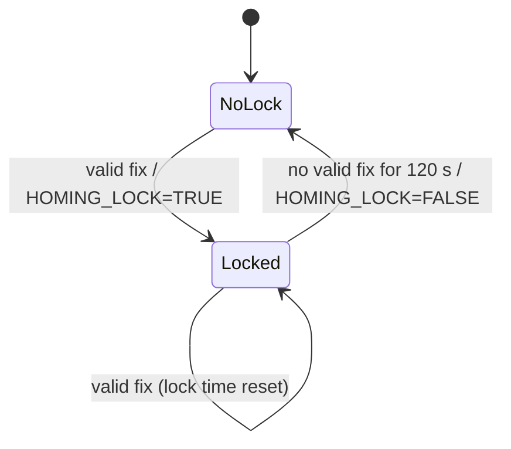

# pTetraHoming

!!! warning "Inferred by Claude"
    Written by Claude from the source at `992a171`, not from a design document or by the app's
    authors.
    Each statement below is tagged: **[code]** read from the code, **[test]** observed in a test or
    a run, **[guess]** inferred intent that nobody has confirmed. Corrections are welcome; a
    maintainer sets `status: reviewed` once the page has been checked.

## Purpose

pTetraHoming steers a vehicle back to an acoustic homing beacon **[guess]**. It takes relative
range and bearing fixes on the beacon (`S-MOCAB_*`) and, while the vehicle is returning or
aborting, turns the latest good fix into behavior updates: a loiter centre and waypoint during
`DEPLOY` with `RETURN`/`RECOVERY`, and a heading and duration during `ABORT` **[code]**. When no
good fix has arrived for 120 s it falls back on the beacon position that pLamssMissionManager posts
in `BEACON_UPDATE` **[code]**. The name refers to a tetrahedral receiving array used for homing
**[guess]**. The fixes come from uSimAcoBeaconRngBrg in simulation **[code]**; on a vehicle they
would come from a USBL or array processor **[guess]**.

## Interfaces

### Subscribes

<!-- BEGIN GENERATED subscribes -->
| Name | Transport | Type / format | Handler | Meaning | Notes |
|---|---|---|---|---|---|
| `NAV_SPEED` | MOOS | double | `TetraHoming.cpp` | own speed (m/s) **[code]** | divides the range in abort mode; starts at 1 **[code]** |
| `NAV_X` | MOOS | double | `TetraHoming.cpp` | own position, local x **[code]** | added to `S-MOCAB_TGT_X` **[code]** |
| `NAV_Y` | MOOS | double | `TetraHoming.cpp` | own position, local y **[code]** | added to `S-MOCAB_TGT_Y` **[code]** |
| `DEPLOY_MISSION` | MOOS | string | `TetraHoming.cpp` | current deploy mode **[code]**; acts only on `RETURN` and `RECOVERY` **[code]** | posted by pLamssMissionManager **[code]** |
| `MISSION_STATE` | MOOS | string | `TetraHoming.cpp` | mission state **[code]**; acts only on `DEPLOY` and `ABORT` **[code]** | posted by pLamssMissionManager **[code]** |
| `S-MOCAB_TGT_X` | MOOS | double | `TetraHoming.cpp` | beacon x relative to the vehicle (m) **[code]** | converted to absolute with the last `NAV_X` **[code]**; posted by virtual_ocean uSimAcoBeaconRngBrg in simulation **[code]** |
| `S-MOCAB_TGT_Y` | MOOS | double | `TetraHoming.cpp` | beacon y relative to the vehicle (m) **[code]** | as above |
| `S-MOCAB_STD_AZIMUTH` | MOOS | double | `TetraHoming.cpp` | standard deviation of the beacon bearing (rad) **[code]** | compared with `VALID_AZIMUTH_STDDEV`; starts at π **[code]** |
| `S-MOCAB_STD_RANGE` | MOOS | double | `TetraHoming.cpp` | standard deviation of the beacon range (m) **[code]** | compared with `VALID_RANGE_STDDEV`; starts at 500 **[code]** |
| `BEACON_UPDATE` | MOOS | string: `beacon_x=…,beacon_y=…` | `TetraHoming.cpp` | mission manager's estimate of the beacon position **[code]** | used when there is no valid fix for 120 s **[code]** |
<!-- END GENERATED subscribes -->

### Publishes

<!-- BEGIN GENERATED publishes -->
| Name | Transport | Type / format | Where | Meaning | Notes |
|---|---|---|---|---|---|
| `HOMING_LOCK` | MOOS | string | `TetraHoming.cpp` | `TRUE` when the latest fix is valid, `FALSE` once no valid fix has arrived for 120 s **[code]** | only in RETURN/RECOVERY or ABORT **[code]**; read by pLamssMissionManager **[code]** |
| `m_return_update_var` (built at run time) | MOOS | string: `center_assign = x,y` | `TetraHoming.cpp` | loiter centre for homing **[code]**; an update to a loiter behavior **[guess]** | name from `RETURN_UPDATE_VAR`, default `HOMING_CONFIG` **[code]**; every iteration in RETURN/RECOVERY **[code]** |
| `HOMING_X` | MOOS | double | `TetraHoming.cpp` | loiter centre x **[code]** |  |
| `HOMING_Y` | MOOS | double | `TetraHoming.cpp` | loiter centre y **[code]** |  |
| `HOMING_STATION` | MOOS | string: `point=x,y` | `TetraHoming.cpp` | same centre as a waypoint **[code]**; update for a waypoint homing behavior **[guess]** |  |
| `m_abort_update_var` (built at run time) | MOOS | string: `heading=…#duration=…` | `TetraHoming.cpp` | heading to the beacon (deg) and time to reach it at `NAV_SPEED` (s) **[code]** | name from `ABORT_UPDATE_VAR`, default `ABORT_HEADING` **[code]**; only in ABORT with a valid fix **[code]** |
<!-- END GENERATED publishes -->

### Configuration

<!-- BEGIN GENERATED config -->
| Parameter | Type | Default | Required | Meaning |
|---|---|---|---|---|
| `VALID_AZIMUTH_STDDEV` | double (deg) | `7` | no | largest bearing standard deviation accepted as a valid fix **[code]** |
| `VALID_RANGE_STDDEV` | double (m) | `10` | no | largest range standard deviation accepted as a valid fix **[code]** |
| `LOITER_X` | double | `0` | no | initial target x, before any fix **[code]** |
| `LOITER_Y` | double | `0` | no | initial target y **[code]** |
| `RETURN_UPDATE_VAR` | string | `HOMING_CONFIG` | no | variable for the loiter-centre update **[code]** |
| `ABORT_UPDATE_VAR` | string | `ABORT_HEADING` | no | variable for the abort heading update **[code]** |
| `FOO` |  |  | no | template placeholder; recognised but has no effect **[code]** |
| `BAR` |  |  | no | template placeholder; recognised but has no effect **[code]** |
<!-- END GENERATED config -->

Example (from `pTetraHoming.moos`):

```
ProcessConfig = pTetraHoming
{
   AppTick   = 4
   CommsTick = 4

   VALID_AZIMUTH_STDDEV = 7.0         // azimuth std. dev. must be < to update homing/abort
   VALID_RANGE_STDDEV = 10.0          // range std. dev. must be < to update homing/abort
   LOITER_X = 0.0                     // initial loiter position for homing
   LOITER_Y = 0.0
   RETURN_UPDATE_VAR = HOMING_CONFIG  // update homing loiter position to this MOOSVar
   ABORT_UPDATE_VAR = ABORT_HEADING   // update homing abort heading to this MOOSVar
}
```

### Files, devices and external programs

None **[code]**.

## Behaviour

Each iteration (`AppTick`, 4 Hz in the example) **[code]**:

- A fix is *valid* when both `S-MOCAB_STD_AZIMUTH ≤ VALID_AZIMUTH_STDDEV` and `S-MOCAB_STD_RANGE ≤ VALID_RANGE_STDDEV` **[code]**. Until the first fixes arrive the standard deviations are π and 500 m, so nothing is valid **[code]**.
- `MISSION_STATE = DEPLOY` with `DEPLOY_MISSION` `RETURN` or `RECOVERY` **[code]**:
    - valid fix: the loiter centre becomes the beacon position, `HOMING_LOCK = TRUE`, and the lock time is reset;
    - no valid fix for more than 120 s: the loiter centre becomes the `BEACON_UPDATE` position and `HOMING_LOCK = FALSE`;
    - otherwise the previous centre is kept (hysteresis);
    - in every case it posts the centre to `RETURN_UPDATE_VAR`, `HOMING_X`/`HOMING_Y` and `HOMING_STATION`.
- `MISSION_STATE = ABORT` **[code]**:
    - valid fix: posts heading and travel time to the beacon on `ABORT_UPDATE_VAR` and `HOMING_LOCK = TRUE`;
    - no valid fix for more than 120 s: `HOMING_LOCK = FALSE`, and no heading update.
- Any other state: nothing is posted **[code]**.
- It prints the two standard deviations and their limits to stdout every iteration in those modes **[code]**.



The diagram shows the lock logic only while the app is active (RETURN/RECOVERY or ABORT); the
code keeps no explicit state variable, just the time of the last valid fix **[code]**.

## Running it

- No mission component launches it yet.
- Standalone, from `autonomy/src/bin/pTetraHoming/`: `MOOSDB pTetraHoming.moos &` then `pTetraHoming pTetraHoming.moos` **[code]**. `--alias=<name>` or a second argument sets the process name; `-e`, `-h`, `-i` and `-v` print an example, help, interface and version **[code]**. The `-i` output is a template left-over and does not describe this app **[code]**.
- Tested by `lamss_autonomy_moos_smoke`: with `BEACON_UPDATE` at (30, 40) and `DEPLOY_MISSION=RETURN` (the mission manager in `DEPLOY`), it checks `HOMING_STATION=point=30,40`, `HOMING_CONFIG=center_assign = 30,40` and `HOMING_LOCK=FALSE` **[test]**.

## Known issues and open questions

- `m_aco_beacon_x`/`m_aco_beacon_y` are not initialised **[code]**. In RETURN mode with no valid fix and no `BEACON_UPDATE` yet, the first iteration posts an indeterminate loiter centre (the 120 s timeout has already expired because the lock time starts at 0) **[code]**. pLamssMissionManager posts `BEACON_UPDATE` at start-up, which normally hides this **[code]**.
- pLamssMissionManager also posts `HOMING_CONFIG` (`center_assign=…`) and `HOMING_STATION` (`points=…#radius=…`, a different format) in USBL return and recovery modes, and `ABORT_HEADING` in abort **[code]**. Are both apps meant to run together, and which one should win?
- `S-MOCAB_TGT_X`/`_Y` are made absolute with the `NAV_X`/`NAV_Y` known when the fix arrives, not when it was measured **[code]**. Is the latency small enough to ignore?
- In ABORT, a `NAV_SPEED` of 0 gives an infinite duration **[code]**.
- The 120 s stale-lock time is hard-coded **[code]**. Should it be a parameter?
- `FOO` and `BAR` configuration keys, `m_iterations` and `m_timewarp` are template left-overs with no effect **[code]**.
- The `-i` interface text describes `NODE_MESSAGE`, not this app **[code]**.

## History

- From GobySoft/lamss-shared `src/moos/pTetraHoming/` (imported at lamss-shared 043f556) **[code]**. It was moved there from GobySoft/lamss-internal on 2020-02-20; that earlier history is grafted in, so `git log --follow` reaches its origin. First commit 2017-04-25 (Nick Rypkema), "a MOOSApp to home in and loiter around beacon". 10 commits before the port, mostly by Henrik Schmidt (2019–2020), who added `HOMING_STATION`, `BEACON_UPDATE`, `HOMING_X`/`_Y` and `HOMING_LOCK` with its hysteresis.
- lamss3 Phase 2 port (GobySoft/lamss3#21–#23): builds as a plain CMOOSApp without Goby (`NO_GOBY`); `pTetraHoming.moos` carries the MOOS globals; author banners replaced by copyright and SPDX headers; formatted with clang-format.
