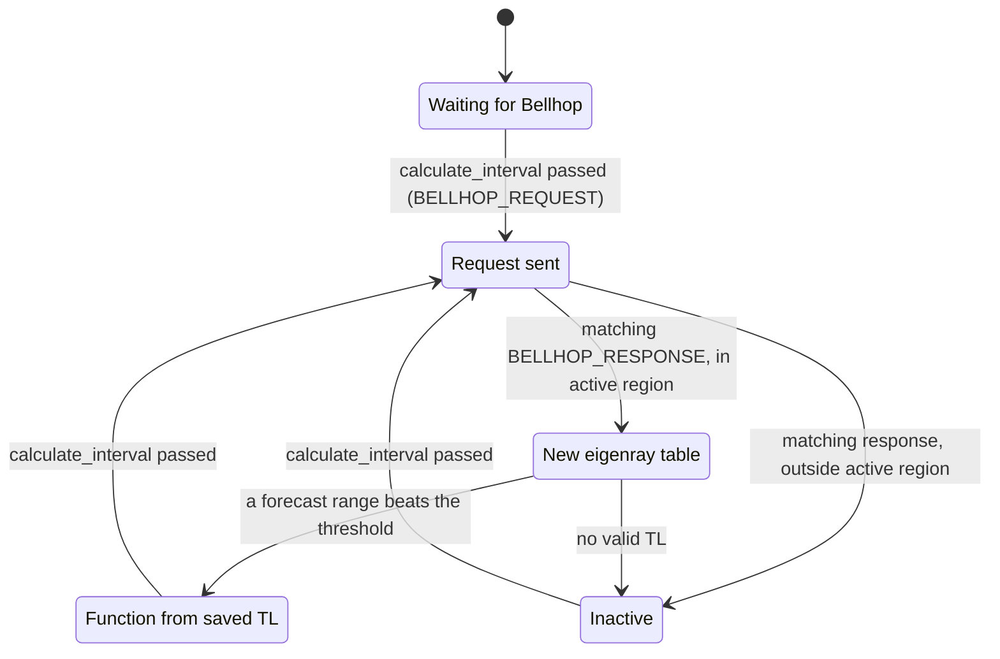

# OptAcommsDepth

!!! warning "Inferred by Claude"
    Written by Claude from the source at `992a171`, not from a design document or by the app's
    authors.
    Each statement below is tagged: **[code]** read from the code, **[test]** observed in a test or
    a run, **[guess]** inferred intent that nobody has confirmed. Corrections are welcome; a
    maintainer sets `status: reviewed` once the page has been checked.

## Purpose

`BHV_OptAcommsDepth` is an IvP behavior that asks the helm for the depth with the best acoustic
path to a collaborating node: least transmission loss (TL), best signal-to-noise ratio (SNR), best
signal excess (SE), or least noise (NL) **[code]**. It sends the environment to a Bellhop ray
tracer (`BELLHOP_REQUEST`, netsim's `iBellhop`), reads back an eigenray table, and turns TL, the
noise profile and the array gain into a utility over depth **[code]**. It is for keeping acoustic
communications with a topside or another vehicle as the range changes **[guess]**.
pLamssMissionManager posts `ADAPTIVE_DEPTH` = `contact=<name>`, which reads like this behavior's
`updates` variable **[guess]**. It is only built when netsim is found **[code]**.

## Interfaces

### Subscribes

<!-- BEGIN GENERATED subscribes -->
| Name | Transport | Type / format | Handler | Meaning | Notes |
|---|---|---|---|---|---|
| `BELLHOP_RESPONSE` | MOOS (helm) | string: serialised `netsim.protobuf.iBellhopResponse` | `BHV_OptAcommsDepth.cpp` | Bellhop result: the path of an eigenray (arrivals) file **[code]** | used only if `requestor` is `pHelmIvP` and the request number matches **[code]** |
| `AMBIENT_NL_DEPTH` | MOOS (helm) | string: `depths=...,NL=...` or `depths=...,delta=...` | `BHV_OptAcommsDepth.cpp` | noise level versus depth, dB **[code]** | needed for `snr`, `se` and `nl`; `inf` allowed **[code]** |
| `VLA_ARRAY_GAIN` | MOOS (helm) | string: `elevation=...,AG=...` | `BHV_OptAcommsDepth.cpp` | array gain versus elevation angle, dB **[code]** | needed for `se` only; producer not in lamss3 |
| `NAV_DEPTH` | MOOS (helm) | double | `BHV_OptAcommsDepth.cpp` | vehicle depth, m **[code]** | centre of the depth envelope and of the pitch estimate **[code]** |
| `NAV_SPEED` | MOOS (helm) | double | `BHV_OptAcommsDepth.cpp` | vehicle speed **[code]** | only its presence is used (it overwrites the `NAV_DEPTH` flag) **[code]** |
| `LOGGER_DIRECTORY` | MOOS (helm) | string: directory path | `BHV_OptAcommsDepth.cpp` | pLogger's log directory **[guess]** | the behavior's log goes one level above it **[code]** |
| `SVP_RESPONSE` | MOOS (helm) | string: serialised `netsim.SVP.protobuf.Response` | `BHV_OptAcommsDepth.cpp` | sound-speed profile along the path **[code]** | copied into later Bellhop requests **[code]**; producer not in lamss3 |
| `LAT_ORIGIN` | MOOS (helm) | double | `BHV_OptAcommsDepth.cpp` | local-grid origin latitude **[code]** | read once, for the SVP request positions **[code]** |
| `LONG_ORIGIN` | MOOS (helm) | double | `BHV_OptAcommsDepth.cpp` | local-grid origin longitude **[code]** | as `LAT_ORIGIN` |
| `NAV_X` | MOOS (helm) | double | `BHV_OptAcommsDepth.cpp` | vehicle position, local grid **[code]** | SVP request only **[code]** |
| `NAV_Y` | MOOS (helm) | double | `BHV_OptAcommsDepth.cpp` | vehicle position, local grid **[code]** | SVP request only **[code]** |
| `NAV_HEADING` | MOOS (helm) |  | `BHV_OptAcommsDepth.cpp` | registered but not read **[code]** |  |
| `_RANGE` | MOOS (helm) |  | `BHV_OptAcommsDepth.cpp` | extractor artefact: the suffix of `<CONTACT>_RANGE` below |  |
| `_RATE` | MOOS (helm) |  | `BHV_OptAcommsDepth.cpp` | extractor artefact: the suffix of `<CONTACT>_RATE` below |  |
| `_ARR_FILE` | MOOS (helm) |  | `BHV_OptAcommsDepth.cpp` | `<CONTACT>_ARR_FILE`: registered but not read **[code]** |  |
| `std::string(boost::to_upper_copy(collaborator_) + "_RANGE")` (built at run time) | MOOS (helm) | double | `BHV_OptAcommsDepth.cpp` | `<CONTACT>_RANGE`: range to the collaborator, m **[code]** | name built at run time; producer not in lamss3 |
| `std::string(boost::to_upper_copy(collaborator_) + "_RATE")` (built at run time) | MOOS (helm) | double | `BHV_OptAcommsDepth.cpp` | `<CONTACT>_RATE`: range rate, m/s, positive opening **[code]** | name built at run time |
| `boost::to_upper_copy(collaborator_) + "_NAV_X"` (built at run time) | MOOS (helm) | double | `BHV_OptAcommsDepth.cpp` | `<CONTACT>_NAV_X`: collaborator position **[code]** | name built at run time; SVP request only |
| `boost::to_upper_copy(collaborator_) + "_NAV_Y"` (built at run time) | MOOS (helm) | double | `BHV_OptAcommsDepth.cpp` | `<CONTACT>_NAV_Y`: collaborator position **[code]** | name built at run time; SVP request only |
<!-- END GENERATED subscribes -->

### Publishes

<!-- BEGIN GENERATED publishes -->
| Name | Transport | Type / format | Where | Meaning | Notes |
|---|---|---|---|---|---|
| `BELLHOP_REQUEST` | MOOS (helm) | string: serialised `netsim.protobuf.iBellhopRequest` | `BHV_OptAcommsDepth.cpp` | arrival-times run for the receiver depths, forecast ranges and beam fan **[code]** | at most every `calculate_interval`; repeatable post **[code]** |
| `BHV_ACOUST_DEPTH_UNFILT` | MOOS (helm) | string: `domain={...},range={...}` | `BHV_OptAcommsDepth.cpp` | utility over depth before the peak filter **[code]** | debug output, always on (`debug` is hard-coded true) **[code]** |
| `BHV_SNR_DEPTH_FUNC` | MOOS (helm) | string: `domain={...},range={...}` | `BHV_OptAcommsDepth.cpp` | final utility over depth, `optimize = snr` **[code]** | debug output, every iteration |
| `BHV_NL_DEPTH_FUNC` | MOOS (helm) | string: `domain={...},range={...}` | `BHV_OptAcommsDepth.cpp` | final utility, `optimize = nl` **[code]** | debug output |
| `BHV_SE_DEPTH_FUNC` | MOOS (helm) | string: `domain={...},range={...}` | `BHV_OptAcommsDepth.cpp` | final utility, `optimize = se` **[code]** | debug output |
| `BHV_TL_DEPTH_FUNC` | MOOS (helm) | string: `domain={...},range={...}` | `BHV_OptAcommsDepth.cpp` | final utility, `optimize = tl` **[code]** | debug output |
| `SVP_REQUEST` | MOOS (helm) | string: serialised `netsim.SVP.protobuf.Request` | `BHV_OptAcommsDepth.cpp` | sound-speed profile between the vehicle and the collaborator, in lat/lon **[code]** | every 41 s once both positions are known; request id fixed at 11 **[code]** |
<!-- END GENERATED publishes -->

The objective function goes to the helm over `depth` **[code]**.

### Configuration

<!-- BEGIN GENERATED config -->
| Parameter | Type | Default | Required | Meaning |
|---|---|---|---|---|
| `look_ahead_seconds` | int, s | `120` | no | how far ahead the range is forecast **[code]** |
| `calculate_interval` | int, s | `10` | no | least time between Bellhop requests **[code]** |
| `collaborator` | string | none | yes | node to communicate with; `<NAME>_RANGE` etc. are upper-cased from it **[code]** |
| `contact` | string | none | yes | same as `collaborator` **[code]** |
| `max_pitch` | double, degrees | `20` | no | stored, not used **[code]** |
| `sonar` | string | passive | no | `active` doubles the TL (two-way) **[code]** |
| `depth_min` | double, m | `2000` | no | shallowest receiver depth in the request and the function **[code]** |
| `depth_max` | double, m | `5000` | no | deepest receiver depth **[code]**; must lie inside the helm's `depth` domain, see Behaviour |
| `number_depths` | int | `301` | no | receiver depths between `depth_min` and `depth_max` **[code]** |
| `theta_min` | double, degrees (truncated to int) | `-60` | no | lowest Bellhop beam angle **[code]** |
| `theta_max` | double, degrees (truncated to int) | `60` | no | highest Bellhop beam angle **[code]** |
| `number_theta` | int | `1000` | no | number of Bellhop beams **[code]** |
| `adapt_tl_threshold` | double, dB | `0.5` | no | TL gain over the mean needed to choose a forecast range; lowered by 0.5 dB after a choice (hysteresis) **[code]** |
| `multipath_penalty` | int (parsed as double, truncated) | `0` | no | > 0: power × (1 − ratio of the second-strongest arrival within 20 ms)^penalty **[code]** |
| `bounce_penalty` | int (parsed as double, truncated), dB | `0` | no | TL added per surface or bottom bounce of the strongest ray **[code]** |
| `max_number_bounces` | int | `6` | no | rays with more bounces are dropped when reading the eigenray table **[guess]** |
| `depth_envelope` | double, m | `1000` | no | width of the Gaussian weight that favours depths near the current one **[code]** |
| `depth_uncertainty` | double, m | `50` | no | length of the RC filter that smooths caustics (`peak_filter`) **[code]** |
| `activation_range` | double, m | none | no | sets both `departure_range` and `approach_range` **[code]** |
| `departure_range` | double, m | `20000` | no | active when opening beyond this range **[code]** |
| `approach_range` | double, m | `30000` | no | active when closing inside this range **[code]** |
| `range_max` | double, m | `45000` | no | longest forecast range used **[code]** |
| `peak_filter` | bool (`true` / other) | `true` | no | smooth the utility over depth **[code]** |
| `optimize` | `tl`, `snr`, `se`, `nl` (or `transmission_loss`, `signal-noise-ratio`, `signal-excess`, `noise_level`) | `tl` | yes in practice, see open questions | quantity to optimise **[code]** |
| `water_depth` | double, m | `6000` | no | RAP ray model; its result is not used **[code]** |
| `surface_sound_speed` | double, m/s | `1480` | no | RAP ray model; not used in effect **[code]** |
| `sound_speed_gradient` | double, 1/s | `0.016` | no | RAP ray model; not used in effect **[code]** |
| `beam_width` | double, degrees | `6` | no | RAP dip window; not used in effect **[code]** |
| `minutil` |  |  |  | not a behavior parameter: a `ZAIC_Vector::getParam` key the extractor matched |
| `maxutil` |  |  |  | not a behavior parameter: a `ZAIC_Vector::getParam` key |
<!-- END GENERATED config -->

`setParam` returns true for every parameter, including unknown ones, and parses numbers with
`goby::util::as` **[code]**. The standard IvPBehavior parameters (`name`, `pwt`, `condition`,
`updates`, `endflag` and the others) are handled first by `IvPBehavior::setParam` **[code]**. The
helm must have a `depth` domain; without one the behavior returns no function **[code]**.

Example (from `autonomy/src/test/moos_smoke/smoke.bhv`):

```
Behavior = BHV_OptAcommsDepth
{
  name = opt_acomms_depth
  contact = topside
  look_ahead_seconds = 120
  calculate_interval = 17
  depth_min = 10
  depth_max = 200
  number_depths = 20
  optimize = snr
  condition = MODE == SMOKE
}
```

### Files, devices and external programs

- Log file `BHV_OptAcommsDepth_<YYYYMMDDTHHMMSS>.txt`, in the parent of `LOGGER_DIRECTORY` or, if
  that is not posted, in pHelmIvP's working directory; opened on the first run and written every
  iteration (parameters, requests, TL tables) **[code]**.
- Reads the eigenray (arrivals) file named in `BELLHOP_RESPONSE` with
  `lamss::core::CEigenRayTable::readEigenRayTable` **[code]**.
- Relies on netsim's `iBellhop` (Bellhop requests) and an SVP service answering `SVP_REQUEST`, both
  outside lamss3 **[guess]**.

## Behaviour



Each iteration **[code]**:

1. Every 41 s, request a sound-speed profile between the vehicle and the collaborator
   (`SVP_REQUEST`); a later `SVP_RESPONSE` is kept and copied into the next Bellhop request.
2. TL (`tl`, `snr`, `se`): every `calculate_interval`, forecast the range over
   `look_ahead_seconds` from `<CONTACT>_RANGE` and `_RATE` (capped at `range_max`, 10 ranges) and
   post a `BELLHOP_REQUEST` for receivers from `depth_min` to `depth_max`.
3. On a matching response, check the active region: opening (`_RATE` > 0) beyond
   `departure_range`, or closing inside `approach_range`. Outside it, no function.
4. For each forecast range, compute the incoherent TL at each depth from the eigenrays (with the
   multipath and bounce penalties) and pick the range whose best depth beats the mean TL by
   2 × `adapt_tl_threshold`, or by `adapt_tl_threshold` with less pitch needed; that range's TL
   over depth is kept for later iterations.
5. Noise (`snr`, `se`, `nl`): add the interpolated `AMBIENT_NL_DEPTH` to the TL, or use it alone
   for `nl`.
6. Array gain (`se`): subtract `VLA_ARRAY_GAIN` interpolated at the strongest ray's elevation.
7. Normalise to 0–100 (lower loss is better), smooth with the RC filter if `peak_filter`, weight
   by 0.5 × (1 + Gaussian of width `depth_envelope` around the current depth), renormalise, add a
   zero-utility point at depth 0 when `depth_min` > 0, and replace NaNs by neighbours.
8. Build a piecewise-linear `ZAIC_Vector` on `depth`, weighted by `pwt`. `ZAIC_Vector` keeps the
   depths only if all lie inside the helm's `depth` domain and increase strictly; otherwise it
   returns no function.

## Running it

- No mission component launches it yet. It runs inside pHelmIvP **[code]**.
- It is built into `liblamss_autonomy_behaviors.so` (`autonomy/src/lib/behaviors/CMakeLists.txt`,
  with `ZAIC_Vector.cpp`) only when `find_package(NETSIM)` succeeds, linking
  `netsim_acousticstoolbox` and defining `LAMSS_AUTONOMY_HAVE_NETSIM` **[code]**. The build then
  links `libBHV_OptAcommsDepth.so` to the library in `autonomy/src/lib/behaviors/ivp_behaviors/`
  (installed in `<prefix>/lib/lamss/ivp_behaviors/`), and `create_behavior.cpp` returns this class
  for `BHV_OptAcommsDepth` **[code]**. Point pHelmIvP at the directory with `ivp_behavior_dir`
  (or `IVP_BEHAVIOR_DIRS`) **[code]**.
- Standalone: `MOOSDB`, netsim's `iBellhop`, and pHelmIvP (process name `pHelmIvP`) with a
  `depth` domain and the example above; post `<CONTACT>_RANGE`, `<CONTACT>_RATE`, `NAV_DEPTH` and,
  for `snr`, `AMBIENT_NL_DEPTH` **[guess]**.
- Tested by `lamss_autonomy_behaviors_load` (`autonomy/src/test/moos_smoke/behaviors_load.sh`
  with `smoke.bhv`) when netsim is present: pHelmIvP loads and builds the behavior and reaches
  `DRIVE` **[test]**. Without netsim the script drops it from `smoke.bhv` **[code]**. No test
  runs Bellhop.

## Known issues and open questions

- Out-of-bounds reads: [GobySoft/lamss3#29](https://github.com/GobySoft/lamss3/issues/29). Two
  places in the code read past the end of a vector: the NaN filter for the last depth uses
  `range[i + 1]`, and the array-gain interpolation loops `j <= m` over `dom_ag[j]` **[code]**. Does
  #29 cover both?
- `get_tl`, `get_nl` and `get_ag` are only set by `optimize`; without it they are uninitialised,
  although `optimize_tl` defaults to true **[code]**. `valid_nl`, `valid_ag` and `request_id`
  (compared with incoming responses before the first request) are also uninitialised **[code]**.
- `ag_int` stays uninitialised if no elevation interval matches **[code]**.
- `multipath_penalty` and `bounce_penalty` are `int`, so fractional values are truncated (0.5
  becomes 0, disabling the penalty) **[code]**. Are fractional values meant to work?
- `NAV_SPEED`'s presence overwrites the `NAV_DEPTH` flag, so the depth envelope is applied when
  speed is known, not depth **[code]**.
- `optimize` is logged but never stored, so the log shows it empty **[code]**.
- `max_pitch`, `NAV_HEADING`, `<CONTACT>_ARR_FILE` and the RAP model (`water_depth`,
  `surface_sound_speed`, `sound_speed_gradient`, `beam_width`, giving `dip_min`/`dip_max` for a
  commented-out filter) have no effect **[code]**. Can they go?
- The SVP request uses the geodesy even if the origin is not known yet, and its id is always 11
  **[code]**. `svp_ready` becomes true as soon as any `SVP_RESPONSE` is in the buffer, before it
  is parsed, so a request may carry an empty water column **[guess]**.
- Responses are accepted only from requestor `pHelmIvP` **[code]**. A helm launched under another
  name never gets its responses **[guess]**.
- `debug` is hard-coded true, so five debug variables are posted every iteration **[code]**.
- Which apps post `<CONTACT>_RANGE`/`_RATE`, `VLA_ARRAY_GAIN` and `SVP_RESPONSE` on a vehicle?
  None in lamss3 do.
- The posting of `ACOMMS_DEPTH` is commented out **[code]**. Was it replaced by
  pLamssMissionManager's `ACOMMS_DEPTH`?

## History

- From GobySoft/lamss-shared `src/lib/lib_behaviors-henrik/BHV_OptAcommsDepth.{h,cpp}` and
  `ZAIC_Vector.{h,cpp}`; first commit 2016-03-18 (Toby Schneider), as a copy of
  BHV_OptAcoustDepth (not imported); 28 commits, mostly Henrik Schmidt, before the port. Main
  changes: renamed from BHV_OptCohAcoustDepth (2020-04-27); multipath (2019) and bounce (2020)
  penalties; SVP request/response (2019); NaN handling (2020); Goby3 and netsim namespace updates
  (2019–2020, Toby Schneider).
- lamss3 port (GobySoft/lamss3#21): clang-format, classes moved into `lamss::autonomy`, the
  shared `create_behavior.cpp`, built only with netsim, `CEigenRays`/`CRapRays` from
  `lamss::core::henrik_util`, `goby_time()` replaced by a local function on `SystemClock`, and some
  locals initialised to 0 for gcc warnings.
