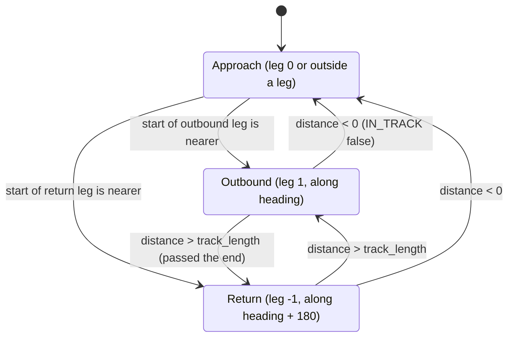

# RaceTrack

!!! warning "Inferred by Claude"
    Written by Claude from the source at `992a171`, not from a design document or by the app's
    authors.
    Each statement below is tagged: **[code]** read from the code, **[test]** observed in a test or
    a run, **[guess]** inferred intent that nobody has confirmed. Corrections are welcome; a
    maintainer sets `status: reviewed` once the page has been checked.

## Purpose

`BHV_RaceTrack` is an IvP behavior that drives the vehicle round a racetrack: two parallel legs of
`track_length`, `track_width` apart, along `heading` and back **[code]**. It holds the vehicle on
each trackline with a cross-track correction, and posts `IN_TRACK` and `ON_TRACKLINE` so that other
behaviors and apps know when the vehicle is on a straight leg **[code]**. It is for towed-array or
sensor surveys that need long straight runs **[guess]**. BHV_SmartYoyo advances its depth cycle
only while `IN_TRACK` is `TRUE`, and pLamssMissionManager reads `IN_TRACK` and posts
`SENSOR_RACETRACK` = `points=x,y#heading=…#track_length=…#track_width=…#clockwise=…#speed=…`,
which reads like this behavior's `updates` variable **[code]** / **[guess]**.

## Interfaces

### Subscribes

<!-- BEGIN GENERATED subscribes -->
| Name | Transport | Type / format | Handler | Meaning | Notes |
|---|---|---|---|---|---|
| `NAV_X` | MOOS (helm) | double | `BHV_RaceTrack.cpp` | vehicle position, local grid, m **[code]** | also the start point when `points` is not set **[code]** |
| `NAV_Y` | MOOS (helm) | double | `BHV_RaceTrack.cpp` | vehicle position, local grid, m **[code]** |  |
| `CURRENT_X` | MOOS (helm) | double | `BHV_RaceTrack.cpp` | east water current, m/s **[guess]** | read once, when the track is placed; used with `current_compensator = on` **[code]** |
| `CURRENT_Y` | MOOS (helm) | double | `BHV_RaceTrack.cpp` | north water current, m/s **[guess]** | as `CURRENT_X` |
| `LAT_ORIGIN` | MOOS (helm) | double | `BHV_RaceTrack.cpp` | local-grid origin latitude **[code]** | the track is placed only once the origin is known; a change moves the track so it stays fixed in lat/lon **[code]** |
| `LONG_ORIGIN` | MOOS (helm) | double | `BHV_RaceTrack.cpp` | local-grid origin longitude **[code]** | as `LAT_ORIGIN` |
<!-- END GENERATED subscribes -->

### Publishes

<!-- BEGIN GENERATED publishes -->
| Name | Transport | Type / format | Where | Meaning | Notes |
|---|---|---|---|---|---|
| `IN_TRACK` | MOOS (helm) | string: `TRUE` / `FALSE` | `BHV_RaceTrack.cpp` | vehicle is between the ends of the current leg **[code]** | posted on change, and `FALSE` from the constructor **[code]**; read by BHV_SmartYoyo and pLamssMissionManager **[code]** |
| `ON_TRACKLINE` | MOOS (helm) | string: `TRUE` / `FALSE` | `BHV_RaceTrack.cpp` | heading correction is within `approach_angle`, i.e. close to the line **[code]** | posted on change; consumer unknown |
| `DIST_TRAVELED` | MOOS (helm) | double, m | `BHV_RaceTrack.cpp` | distance along the current leg **[code]** | every iteration |
| `RACETRACK_LEG` | MOOS (helm) | double | `BHV_RaceTrack.cpp` | current leg: 1 outbound, −1 return **[code]** | every iteration |
| `COMPENSATED_HEADING` | MOOS (helm) | double, degrees | `BHV_RaceTrack.cpp` | heading after current compensation **[code]** | only with `current_compensator = on` |
| `VIEW_POLYGON` | MOOS (helm) | string: XYSegList spec | `BHV_RaceTrack.cpp` | the racetrack, for pMarineViewer **[code]** | after the behavior has run 2 s; an inactive copy on idle and completion **[code]** |
| `VIEW_POINT` | MOOS (helm) | string: XYPoint spec | `BHV_RaceTrack.cpp` | the point the vehicle is steering to **[code]** | label `<vehicle>_waypoint`, type `waypoint`; pViewMessage forwards these **[guess]** |
<!-- END GENERATED publishes -->

The objective function goes to the helm over `course` and `speed` **[code]**.

### Configuration

The generated rows below are the keys of `handleVisualHint`, which the extractor matched; nothing
calls that function, so they cannot be set **[code]**. The behavior's real parameters, read in
`setParam` with `g_param ==`, are in the second table.

<!-- BEGIN GENERATED config -->
| Parameter | Type | Default | Required | Meaning |
|---|---|---|---|---|
| `nextpt_color` | color |  | no | visual hint, not settable (see above) **[code]** |
| `nextpt_lcolor` | color |  | no | visual hint, not settable **[code]** |
| `vertex_color` | color |  | no | visual hint, not settable **[code]** |
| `edge_color` | color |  | no | visual hint, not settable **[code]** |
| `edge_size` | double | `1` | no | visual hint, not settable **[code]** |
| `vertex_size` | double | `5` | no | visual hint, not settable **[code]** |
| `label` | string |  | no | visual hint, not settable **[code]** |
<!-- END GENERATED config -->

| Parameter | Type | Default | Required | Meaning |
|---|---|---|---|---|
| `speed` | double ≥ 0, m/s | none | yes (no default) | speed to hold **[code]** |
| `heading` | double ≥ 0, degrees | `0` | no | heading of the outbound leg **[code]** |
| `track_length` | double > 0, m | `500` | no | length of each leg **[code]** |
| `track_width` | double ≥ 0, m | `100` | no | distance between the legs **[code]** |
| `clockwise` | `true` / `false` | `false` | no | return leg to the right of the outbound leg (clockwise) or to the left **[code]** |
| `points` | string: `x,y` or `present_position` | present position | no | start of the outbound leg, local grid **[code]**; setting it restarts the track **[code]** |
| `approach_angle` | double > 0, degrees | `80` | no | largest heading correction towards the line **[code]** |
| `distance_tolerance` | double > 0, m | `10` | no | cross-track scale of the correction **[code]** |
| `peak_width` | double 0–180, degrees | `30` | no | course ZAIC peak width **[code]** |
| `summit_delta` | double 0–100 | `50` | no | course ZAIC summit delta **[code]** |
| `current_compensator` | `on` / `off` | `off` | no | correct the heading for `CURRENT_X`/`CURRENT_Y` **[code]** |

The standard IvPBehavior parameters (`name`, `pwt`, `condition`, `updates`, `endflag` and the
others in `setParamCommon`) also apply **[code]**. The helm must have `course` and `speed`
domains **[code]**.

Example (from `autonomy/src/test/moos_smoke/smoke.bhv`):

```
Behavior = BHV_RaceTrack
{
  name = racetrack
  track_length = 400
  track_width = 100
  distance_tolerance = 10
  approach_angle = 60
  heading = 270
  speed = 1.5
  peak_width = 30
  summit_delta = 50
  points = 500.0, 200.0
  clockwise = true
  condition = MODE == SMOKE
}
```

### Files, devices and external programs

None **[code]**.

## Behaviour



- Placing the track: on the first iteration after the local-grid origin is known, the outbound
  leg starts at `points` (or the vehicle position) and the start is stored in lat/lon **[code]**.
  The return leg is offset `track_width` to the left (or right with `clockwise`) **[code]**.
- Distance along a leg is the projection of the vehicle position on the leg's direction from the
  leg's start **[code]**. Past `track_length`, the behavior switches to the other leg and steers
  for its end **[code]**. A negative distance (behind the leg's start) sets `IN_TRACK` false
  **[code]**.
- Approach (first iteration, or `IN_TRACK` false): head straight for the nearer leg start,
  `ON_TRACKLINE` false **[code]**.
- On a leg: let *diff* be the angle between the leg heading and the bearing to the leg's end, and
  *dist* the cross-track distance it implies. The heading is the leg heading + *diff* × e^(4 ×
  *dist* / `distance_tolerance`) while that is less than `approach_angle` (then `ON_TRACKLINE`
  true), otherwise the leg heading ± `approach_angle` **[code]**.
- With `current_compensator = on`, the heading is corrected for the current as in BHV_ZigZag
  **[code]**.
- The function couples a `ZAIC_PEAK` on `course` (summit at the heading, `peak_width`, base width
  180 − `peak_width`, `summit_delta`, wrapping) with a `ZAIC_PEAK` on `speed` (peak width 0.5,
  summit delta 100), weighted by `pwt` **[code]**.
- Display: after the behavior has run 2 s it posts the track as `VIEW_POLYGON` and the steering
  point as `VIEW_POINT`, and posts inactive copies to erase them on idle and completion **[code]**.
- `onIdleState` re-places the track on the next activation **[code]**.

## Running it

- No mission component launches it yet. It runs inside pHelmIvP **[code]**.
- It is built into `liblamss_autonomy_behaviors.so` (`autonomy/src/lib/behaviors/CMakeLists.txt`).
  The build links `libBHV_RaceTrack.so` to that library in
  `autonomy/src/lib/behaviors/ivp_behaviors/` (installed in `<prefix>/lib/lamss/ivp_behaviors/`),
  and `create_behavior.cpp` returns this class for `BHV_RaceTrack` **[code]**. Point pHelmIvP at
  the directory with `ivp_behavior_dir` (or `IVP_BEHAVIOR_DIRS`) **[code]**.
- Standalone: `MOOSDB`, and pHelmIvP with `course` and `speed` domains and the example above;
  post `LAT_ORIGIN`, `LONG_ORIGIN`, `NAV_X` and `NAV_Y` **[guess]**.
- Tested by `lamss_autonomy_behaviors_load` (`autonomy/src/test/moos_smoke/behaviors_load.sh`
  with `smoke.bhv`): pHelmIvP loads and builds the behavior with the example parameters and
  reaches `DRIVE` **[test]**. The test posts no origin or navigation, so the track is never placed
  (see open questions) and the steering is not tested **[code]**.

## Known issues and open questions

- The track is placed only if `LAT_ORIGIN` and `LONG_ORIGIN` are in the helm's buffer on the
  behavior's *first* iteration **[code]**. Otherwise the leg start (`deploy_x_out`,
  `deploy_y_out`) is never set and is read uninitialised; and when the origin arrives later, the
  start is recomputed from a lat/lon that was never set **[code]**. Should placing the track wait
  for the origin instead of clearing `first_iteration`?
- `speed` has no default: without it the speed function uses an indeterminate value **[code]**.
- `handleVisualHint` is never called, so the colours, sizes and label cannot be set; the colours
  are empty **[code]**. Was a `visual_hints` parameter dropped?
- `VIEW_POLYGON` is posted with the label `<vehicle>_(d)bhv_racetrack` but erased with
  `<vehicle>_bhv_racetrack` (the erasing function strips `(d)`) **[code]**. If `getDescriptor()`
  keeps the `(d)`, the erase does not match and the track stays on the display **[guess]**.
- In `updateStart`, an `x,y` that is not two numbers is still parsed with `atof` (the `isNumber`
  check only guards one statement) **[code]**; a malformed `points` with other than two fields
  leaves the previous start **[code]**.
- `deploy_x`/`deploy_y` are set from the position but not used **[code]**.
- `extractOF()`/`couple()` results are not checked for null before `setPWT` **[code]**.
- Who reads `ON_TRACKLINE`, `DIST_TRAVELED` and `RACETRACK_LEG`? Nothing in lamss3 subscribes to
  them.

## History

- From GobySoft/lamss `src/lib/lib_behaviors-henrik/BHV_RaceTrack.{h,cpp}`; first commit
  2011-04-28 (Toby Schneider); 5 commits by Toby Schneider and Henrik Schmidt before the port. Main
  changes: IvP syntax and ZAIC parameters (2011), dynamic UTM support (2021).
- lamss3 port (GobySoft/lamss3#21): clang-format, the class moved into `lamss::autonomy`, the
  shared `create_behavior.cpp`, and `theta` in `currentCompensatedHeading` initialised to 0.
