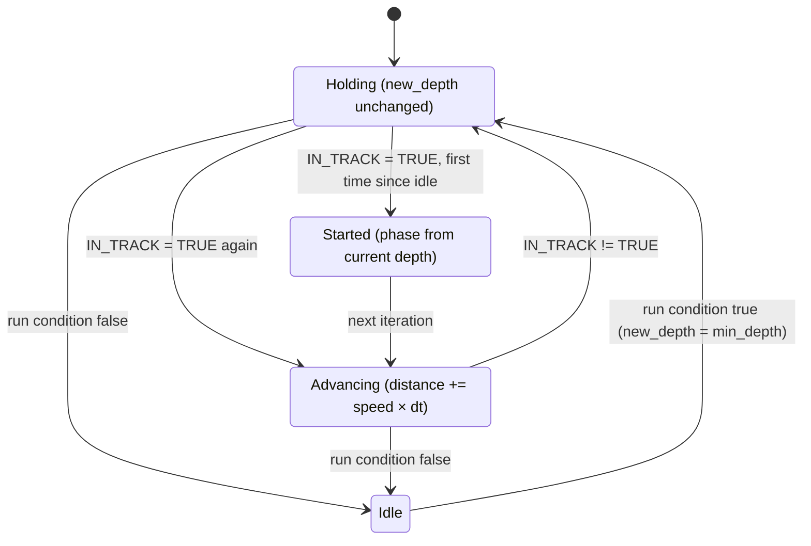

# SmartYoyo

!!! warning "Inferred by Claude"
    Written by Claude from the source at `992a171`, not from a design document or by the app's
    authors.
    Each statement below is tagged: **[code]** read from the code, **[test]** observed in a test or
    a run, **[guess]** inferred intent that nobody has confirmed. Corrections are welcome; a
    maintainer sets `status: reviewed` once the page has been checked.

## Purpose

`BHV_SmartYoyo` is an IvP behavior that makes the vehicle oscillate in depth between `min_depth`
and `max_depth` as a function of the distance it has travelled, with a sine or triangle profile
**[code]**. "Smart" refers to two things in the code: the deepest point is raised to stay
`min_altitude` above the bottom, and the oscillation only advances while `IN_TRACK` is `TRUE`
**[code]**. It is for sampling the water column along a survey track (BHV_RaceTrack posts
`IN_TRACK`) **[guess]**. pLamssMissionManager posts `SMART_YOYO` =
`min_depth=…#max_depth=…#period=…`, which reads like this behavior's `updates` variable
**[guess]**.

## Interfaces

### Subscribes

<!-- BEGIN GENERATED subscribes -->
| Name | Transport | Type / format | Handler | Meaning | Notes |
|---|---|---|---|---|---|
| `NAV_DEPTH` | MOOS (helm) | double | `BHV_SmartYoyo.cpp` | vehicle depth, m **[code]** | sets the starting phase; not checked for presence **[code]** |
| `NAV_SPEED` | MOOS (helm) | double | `BHV_SmartYoyo.cpp` | speed, m/s, integrated into the distance travelled **[code]** | not checked for presence **[code]** |
| `NAV_ALTITUDE` | MOOS (helm) | double | `BHV_SmartYoyo.cpp` | DVL altitude, m **[code]** | NaN or a non-positive water depth disables the bottom limit **[code]** |
| `IN_TRACK` | MOOS (helm) | string: `TRUE` / `FALSE` | `BHV_SmartYoyo.cpp` | the oscillation advances only when `TRUE` **[code]** | posted by BHV_RaceTrack and pLamssMissionManager **[code]** |
<!-- END GENERATED subscribes -->

### Publishes

<!-- BEGIN GENERATED publishes -->
| Name | Transport | Type / format | Where | Meaning | Notes |
|---|---|---|---|---|---|
<!-- END GENERATED publishes -->

Nothing is posted to the MOOSDB; the objective function goes to the helm over `depth` **[code]**.

### Configuration

The behavior's own parameters, read in `setParam` **[code]**. The extractor does not list them yet
(this code uses `g_param ==`), so they are in a separate table below the generated one.

<!-- BEGIN GENERATED config -->
| Parameter | Type | Default | Required | Meaning |
|---|---|---|---|---|
<!-- END GENERATED config -->

| Parameter | Type | Default | Required | Meaning |
|---|---|---|---|---|
| `min_depth` | double ≥ 0, m | `0` | yes in practice, see open questions | shallowest depth of the oscillation **[code]** |
| `max_depth` | double ≥ 0, m | `0` | yes | deepest depth of the oscillation **[code]** |
| `min_altitude` | double ≥ 0, m | `0` | no | if > 0, the deepest point is raised to stay this far above the bottom **[code]** |
| `period` | double > 0, m | `300` | no | length of one full oscillation, as distance travelled (the code comment says metres) **[code]** |
| `period_segments` | double > 0 | `200` | no | the target depth is updated every `period` / `period_segments` metres **[code]** |
| `depth_function` | string: `linear` or anything else | `cosine` | no | `linear` gives a triangle profile; any other value a cosine **[code]** |
| `inverted_dvl` | bool | `false` | no | meant to drop the bottom limit under ice **[guess]**; has no effect, see open questions **[code]** |

The standard IvPBehavior parameters (`name`, `pwt`, `condition`, `updates`, `endflag` and the
others in `setParamCommon`) also apply **[code]**. The helm must have a `depth` domain **[code]**.

Example (from `autonomy/src/test/moos_smoke/smoke.bhv`):

```
Behavior = BHV_SmartYoyo
{
  name = smart_yoyo
  min_depth = 10
  max_depth = 20
  min_altitude = 5
  period = 120
  period_segments = 60
  depth_function = sine
  condition = MODE == SMOKE
}
```

### Files, devices and external programs

None **[code]**.

## Behaviour



- Each iteration the deepest depth is `max_depth`, or the water depth (`NAV_DEPTH` +
  `NAV_ALTITUDE`) minus `min_altitude` when that is shallower, the water depth is a positive
  number and `min_altitude` > 0 **[code]**.
- While `IN_TRACK` is `TRUE` **[code]**:
    - On the first such iteration, the distance travelled is set so that the profile passes through
      the current depth (the current depth becomes the target) **[code]**.
    - Afterwards, the distance travelled grows by `NAV_SPEED` × the time since the last iteration
      **[code]**.
    - When it has grown by `period` / `period_segments` since the last update, a new target depth
      is computed **[code]**:
        - cosine: mean + (deepest − mean) × cos(2π × distance / `period`);
        - linear: a triangle wave between `min_depth` and the deepest depth, with half a `period`
          each way.
    - The target is never shallower than `min_depth` **[code]**.
- While `IN_TRACK` is not `TRUE`, the previous target is kept and the distance does not advance
  **[code]**. The time of the last iteration is not updated, so the first iteration after a pause
  adds the whole pause × speed to the distance **[code]**.
- Every iteration returns a `ZAIC_PEAK` on `depth` with summit at the target, peak width 2, base
  width 5000, summit delta 50 and utility 0–100, weighted by `pwt` **[code]**.
- `onIdleState` resets the phase and sets the target to `min_depth` **[code]**.

## Running it

- No mission component launches it yet. It runs inside pHelmIvP **[code]**.
- It is built into `liblamss_autonomy_behaviors.so` (`autonomy/src/lib/behaviors/CMakeLists.txt`).
  The build links `libBHV_SmartYoyo.so` to that library in
  `autonomy/src/lib/behaviors/ivp_behaviors/` (installed in `<prefix>/lib/lamss/ivp_behaviors/`),
  and `create_behavior.cpp` returns this class for `BHV_SmartYoyo` **[code]**. Point pHelmIvP at
  the directory with `ivp_behavior_dir` (or `IVP_BEHAVIOR_DIRS`) **[code]**.
- Standalone: `MOOSDB`, and pHelmIvP with a `depth` domain and the example above; post
  `NAV_DEPTH`, `NAV_SPEED`, `NAV_ALTITUDE` and `IN_TRACK=TRUE` to see the target move **[guess]**.
- Tested by `lamss_autonomy_behaviors_load` (`autonomy/src/test/moos_smoke/behaviors_load.sh`
  with `smoke.bhv`): pHelmIvP loads and builds the behavior with the example parameters and
  reaches `DRIVE` **[test]**. The depth profile itself is not tested.

## Known issues and open questions

- `inverted_dvl` has no effect: it zeroes the altitude *after* the water depth has been computed
  from it **[code]**. Under ice the bottom limit is then computed from the distance to the ice
  **[code]**. Was the intent to skip the bottom limit under ice?
- The target depth (`new_depth`) is not initialised in the constructor; it is set by `min_depth`
  in `setParam` and by `onIdleState` **[code]**. A behavior without `min_depth` that runs before
  `IN_TRACK` is `TRUE` reads an indeterminate value **[code]**.
- A missing `NAV_ALTITUDE` (read as 0) or an altitude of 0 makes the water depth equal to the
  vehicle depth, so the deepest point becomes `NAV_DEPTH` − `min_altitude` and the yo-yo climbs
  **[guess]**. Only NaN is treated as "no altitude" **[code]**. Which value does the navigation
  post without bottom lock?
- `period` is a distance, not a time **[code]**. Is that what the mission manager's `SMART_YOYO`
  `period` assumes? (Its transit yo-yo computes the period from depths.)
- With `min_depth` equal to the deepest depth, the cosine start-up divides by zero **[code]**.
- `smoke.bhv` sets `depth_function = sine`, which selects the cosine profile like any value other
  than `linear` **[code]**.
- `deploy_speed`, `deploy_depth`, `mark_time` and `start_time` are declared or set but not used
  **[code]**.
- `extractOF()` is not checked for a null result before `setPWT` **[code]**.

## History

- From GobySoft/lamss `src/lib/lib_behaviors-henrik/BHV_SmartYoyo.{h,cpp}`; first commit
  2011-04-28 (Toby Schneider); 5 commits by Toby Schneider and Henrik Schmidt before the port. Main
  changes: ZAIC tuning (2016), inverted DVL for ICEX (2020), NaN altitude (2021). The `IN_TRACK`
  input dates from GLINT08 (code comment).
- lamss3 port (GobySoft/lamss3#21–#23): clang-format, the class moved into `lamss::autonomy`, and
  the shared `create_behavior.cpp`; behaviour unchanged.
