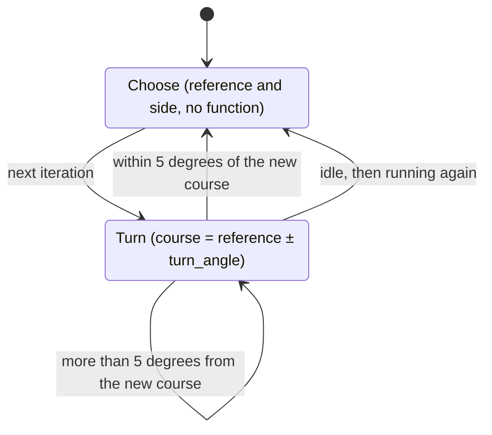

# WiggleTail

!!! warning "Inferred by Claude"
    Written by Claude from the source at `992a171`, not from a design document or by the app's
    authors.
    Each statement below is tagged: **[code]** read from the code, **[test]** observed in a test or
    a run, **[guess]** inferred intent that nobody has confirmed. Corrections are welcome; a
    maintainer sets `status: reviewed` once the page has been checked.

## Purpose

`BHV_WiggleTail` is an IvP behavior that turns the vehicle `turn_angle` to one side of a reference
heading, and when the turn is done, picks a new reference and turns again **[code]**. The
reference is the target cue heading (`PROSECUTE_HEADING`) if there is one, otherwise the current
heading **[code]**. Its purpose is to manoeuvre a towed array so that the left/right ambiguity of a
bearing can be resolved ("wiggling the tail") **[guess]**; the descriptor is `bhv_1BTrack`
**[code]**.

## Interfaces

### Subscribes

<!-- BEGIN GENERATED subscribes -->
| Name | Transport | Type / format | Handler | Meaning | Notes |
|---|---|---|---|---|---|
| `NAV_X` | MOOS (helm) | double | `BHV_WiggleTail.cpp` | vehicle position **[code]** | only checked for presence **[code]** |
| `NAV_Y` | MOOS (helm) | double | `BHV_WiggleTail.cpp` | vehicle position **[code]** | only checked for presence **[code]** |
| `PROSECUTE_HEADING` | MOOS (helm) | double | `BHV_WiggleTail.cpp` | target cue heading, degrees, used as the reference heading **[code]** | pLamssTrackManager posts it as a string `heading=<deg>`, so it is never found as a double **[code]**; see open questions |
| `heading_variable` (built at run time) | MOOS (helm) | double | `BHV_WiggleTail.cpp` | heading of the array or vehicle, degrees **[code]** | named by the `heading_variable` parameter |
| `bearing_variable` (built at run time) | MOOS (helm) | string: `key=value,...` (`state`, `x`, `y`, `heading`, `speed`, `time`) | `BHV_WiggleTail.cpp` | target track; only `heading` affects the result (the turn direction) **[code]** | named by the `bearing_variable` parameter; required **[code]** |
<!-- END GENERATED subscribes -->

### Publishes

<!-- BEGIN GENERATED publishes -->
| Name | Transport | Type / format | Where | Meaning | Notes |
|---|---|---|---|---|---|
<!-- END GENERATED publishes -->

Nothing is posted to the MOOSDB; the objective function goes to the helm over `course` **[code]**.

### Configuration

<!-- BEGIN GENERATED config -->
| Parameter | Type | Default | Required | Meaning |
|---|---|---|---|---|
| `turn_angle` | double > 0, degrees | `120` | no | how far to turn from the reference heading **[code]** |
| `heading_variable` | string | `AEL_HEADING` | no | MOOS variable with the heading **[code]** |
| `bearing_variable` | string | `BEARING_STAT` | no | MOOS variable with the target track **[code]** |
<!-- END GENERATED config -->

`setParam` returns true for every parameter, including unknown ones **[code]**. The standard
IvPBehavior parameters (`name`, `pwt`, `condition`, `updates`, `endflag` and the others in
`setParamCommon`) also apply **[code]**. The constructor sets `unifbox = course=3` and
`gridbox = course=9` **[code]**. The helm must have a `course` domain **[code]**.

Example (from `autonomy/src/test/moos_smoke/smoke.bhv`):

```
Behavior = BHV_WiggleTail
{
  name = wiggle_tail
  turn_angle = 30
  heading_variable = NAV_HEADING
  bearing_variable = BEARING_STAT
  condition = MODE == SMOKE
}
```

### Files, devices and external programs

None **[code]**.

## Behaviour



- No function unless the heading, `NAV_X`, `NAV_Y` and the bearing variable are all present
  **[code]**.
- Choose **[code]**: the reference is `PROSECUTE_HEADING` if present, else the current heading.
  The turn is to the side given by the sign of the cross product of the reference and the target
  `heading` from the bearing variable. The behavior returns no function on this iteration.
- Turn **[code]**: a `ZAIC_PEAK` on `course` with summit at reference ± `turn_angle`, peak width
  60, base width 120, summit delta 50, wrapping, weighted by `pwt`. Once the heading is within 5°
  of that course, the next iteration chooses again.
- Without `PROSECUTE_HEADING`, the new reference is the heading just reached, so with the same
  side the vehicle keeps turning in the same direction by `turn_angle` each time **[code]**. The
  code that alternated the side is commented out **[code]**.
- `AOF_WiggleTail` (in the same directory, compiled into the library) scores courses near ±90° from
  a fixed course, but nothing uses it **[code]**.

## Running it

- No mission component launches it yet. It runs inside pHelmIvP **[code]**.
- It is built into `liblamss_autonomy_behaviors.so` (`autonomy/src/lib/behaviors/CMakeLists.txt`,
  with `AOF_WiggleTail.cpp`). The build links `libBHV_WiggleTail.so` to that library in
  `autonomy/src/lib/behaviors/ivp_behaviors/` (installed in `<prefix>/lib/lamss/ivp_behaviors/`),
  and `create_behavior.cpp` returns this class for `BHV_WiggleTail` **[code]**. Point pHelmIvP at
  the directory with `ivp_behavior_dir` (or `IVP_BEHAVIOR_DIRS`) **[code]**.
- Standalone: `MOOSDB`, and pHelmIvP with a `course` domain and the example above; post the
  heading, `NAV_X`, `NAV_Y` and the bearing variable **[guess]**.
- Tested by `lamss_autonomy_behaviors_load` (`autonomy/src/test/moos_smoke/behaviors_load.sh`
  with `smoke.bhv`): pHelmIvP loads and builds the behavior and reaches `DRIVE` **[test]**. The
  turns are not tested.

## Known issues and open questions

- `PROSECUTE_HEADING` is read with `getBufferDoubleVal`, but pLamssTrackManager posts it as the
  string `heading=<deg>` (`sonar/src/bin/pLamssTrackManager/LamssTrackManager.cpp`) **[code]**. The
  cue heading is therefore never used and the reference is always the current heading **[guess]**
  (the 2021 change "Use target cue heading as initial heading" has no effect). Which format is
  right?
- The turn side depends on a `heading` key in the bearing variable. `BEARING_STAT` as written by
  `CTrack::bearingState` has no `heading` key **[code]**, so the side is computed from an
  uninitialised member **[code]**. What variable and format was this written for?
- `setParam` accepts any parameter, so a misspelt one is silently ignored **[code]**. It also
  ignores the result of `setParamCommon` **[code]**.
- `NAV_X`/`NAV_Y` are required but not used, and `state`, `x`, `y`, `speed`, `time` are parsed but
  not used **[code]**.
- `AOF_WiggleTail` is unused **[code]**. Can it be removed?
- `extractOF()` is not checked for a null result before `setPWT` **[code]**.

## History

- From GobySoft/lamss `src/lib/lib_behaviors-henrik/BHV_WiggleTail.{h,cpp}` and
  `AOF_WiggleTail.{h,cpp}`; first commit 2011-04-28 (Toby Schneider); 3 commits before the port, by
  Toby Schneider and Henrik Schmidt. Main changes: a fix in 2017, and the target cue heading as
  reference (2021).
- lamss3 port (GobySoft/lamss3#21–#23): clang-format, the classes moved into `lamss::autonomy`,
  and the shared `create_behavior.cpp`; behaviour unchanged.
