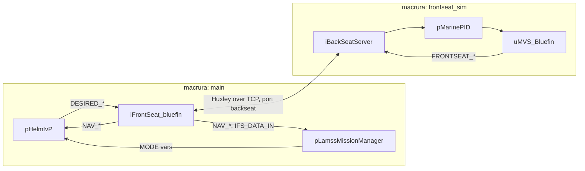

# Mission components and platforms

*This page written by Claude*

`autonomy` adds the vehicle's decision making and its link to the vehicle computer to the [core components](../../../../core/src/doc/missions/components.md), and the propeller-driven AUV platforms built from them. The classes live in [`autonomy/missions/`](../../../missions).

## Platforms

| Platform | Subclass of | Adds |
|---|---|---|
| [`propellor`](../../../missions/platform/auv/propellor/propellor.py) | `auv` | `mission_manager`, `ivp` |
| [`bluefin21`](../../../missions/platform/auv/propellor/bluefin21/bluefin21.py) | `propellor` | `frontseat` (Bluefin) on `main`; in simulation a `frontseat_sim` subsystem with `interprocess`, `health`, `logging`, `frontseat_sim` (Bluefin) and `optional("gps_sim")` |

The `mit` toolbox's [`macrura`](../../../../mit/src/doc/missions/mbat.md) is a `bluefin21`.

## Components

| Component | Processes | Notes |
|---|---|---|
| [`mission_manager`](#mission_manager) | `pLamssMissionManager` | needs the platform's `topside` |
| [`ivp`](#ivp) | `pBasicContactMgr`, `pHelmIvP` | renders `lamss.bhv`; requires `mission_manager` |
| [`frontseat`](#frontseat) (Bluefin) | `iFrontSeat_bluefin` | Goby3's driver, from the `goby3-moos` package |
| [`frontseat_sim`](#frontseat_sim) (Bluefin) | `uMVS_Bluefin`, `pMarinePID`, `iBackSeatServer` | simulation only; port `backseat` |

### mission_manager

[`mission_manager.py`](../../../missions/component/mission_manager/mission_manager.py): the [pLamssMissionManager](../apps/pLamssMissionManager.md) state machine. Thirty seconds after its first GPS fix it carries out `initial_transit` and then `initial_deploy`, as if the topside had sent them.

| Parameter | Default | Meaning |
|---|---|---|
| `initial_deploy` | loiter at (0, 0), 200 m radius, 6 segments, 15 m at 1.8 m/s | `mode`, `depth_mode`, `x`, `y`, `speed`, `upper_depth`, `lower_depth`, `altitude`, `loiter_radius`, `loiter_segments`, `survey_*`, `clockwise`, as in `lamss.autonomy.LAMSS_DEPLOY` |
| `initial_transit` | `DIRECT` at 10 m, 1.6 m/s | `mode`, `depth`, `speed` |
| `operation_radius` | 5000 | m |
| `min_opbox_distance` | 100 | m |
| `deploy_duration`, `prosecute_duration` | 4800, 3600 | s |
| `abort` | 50 m east, 50 m north, 5 m deep | `x_offset`, `y_offset`, `depth` |

`topside` (derived) is the platform's `topside`. Its `modem_id` becomes `topside_id`.

### ivp

[`ivp.py`](../../../missions/component/ivp/ivp.py): `pHelmIvP` loading the [LAMSS behaviors](../../lib/behaviors/README.md) from `<prefix>/lib/lamss/ivp_behaviors`, with the behavior file [`lamss.bhv.j2`](../../../missions/component/ivp/lamss.bhv.j2), and `pBasicContactMgr`. `lamss.bhv.j2` is the macrura behavior set of `missions-lamss` (mode tree driven by `pLamssMissionManager`) with these changes:

- The vehicle, topside, `operation_radius`, the cruise's `op_box` and its `gateway_buoy` are filled in.
- Parameters renamed in MOOS-IvP 24.8: `active_grade` is `pwt_grade`, `BHV_Trail`'s `max_range` is `pwt_outer_dist`, and `all_clear_distance` is gone.
- `BHV_AvoidObstacle` is `BHV_AvoidObstacleV24` with MOOS-IvP 24.8 or later, which no longer has the old behavior (its `buffer_dist` is dropped). The parameter `moos_ivp_version` decides; `auto`, the default, reads `pHelmIvP --version` when the mission is generated (Ubuntu 22.04's packages have 19.8.1, 24.04's have 24.8).
- `BHV_ZigZag` is `BHV_LamssZigZag`.

The template reads `cruise.op_box` (a list of `[x, y]` vertices) and `cruise.gateway_buoy` (`x`, `y`), so a cruise using `ivp` must set both.

### frontseat

[`frontseat/bluefin/bluefin.py`](../../../missions/component/frontseat/bluefin/bluefin.py): `iFrontSeat_bluefin` connects to the Huxley server at `huxley_address`:`huxley_port`. When `huxley_port` is unset, it uses the `backseat` port of the platform's `frontseat_sim` subsystem. It turns the helm's `DESIRED_*` into commands and publishes `NAV_*` (`legacy_cfg.publish_nav`) and `IFS_DATA_IN` for the mission manager.

### frontseat_sim

[`frontseat_sim/bluefin_sim/bluefin_sim.py`](../../../missions/component/frontseat_sim/bluefin_sim/bluefin_sim.py): stands in for the Bluefin's own computer.
- [uMVS_Bluefin](../apps/uMVS_Bluefin.md) simulates the vehicle dynamics, starting at `launch` (`x`, `y`, `depth`, `heading`).
- `pMarinePID` is the vehicle's autopilot.
- [iBackSeatServer](../apps/iBackSeatServer.md) serves the Huxley protocol on the subsystem's `backseat` port.
