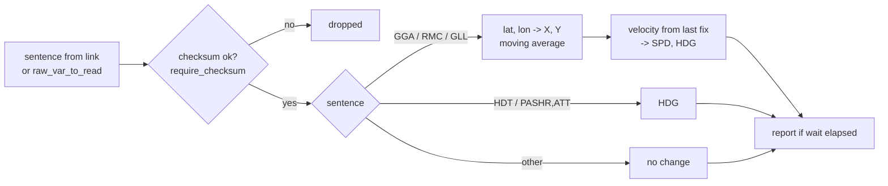

# iSerialNMEA

!!! warning "Inferred by Claude"
    Written by Claude from the source at `992a171`, not from a design document or by the app's
    authors.
    Each statement below is tagged: **[code]** read from the code, **[test]** observed in a test or
    a run, **[guess]** inferred intent that nobody has confirmed. Corrections are welcome; a
    maintainer sets `status: reviewed` once the page has been checked.

## Purpose

iSerialNMEA reads NMEA 0183 sentences, either from a serial or TCP link or from a MOOS variable, and
turns the position (GGA, RMC, GLL) and heading (HDT, PASHR) they carry into a node-report string
`NAME=…,TYPE=…,X=…,Y=…,LAT=…,LON=…,SPD=…,HDG=…,DEPTH=…` **[code]**. It reports another platform,
not the vehicle it runs on: a ship, a buoy or a hydrophone with its own GPS, named by
`vehicle_name` and `vehicle_type` **[guess]** (the README says it was written for the R/V Point Sur
in 2007; the plan uses it for the ICEX hydrophones). The gateway plugin posts `<NAME>_GPS_IN` with the
RMC and GGA sentences received over acomms "for iSerialNMEA" **[code]**, so on a topside it reads
those **[guess]**. Who consumes the report in lamss3 is not known; autonomy's pGateway posts the same
format to `NODE_REPORT_NMEA_SHIP` **[code]**.

## Interfaces

### Subscribes

<!-- BEGIN GENERATED subscribes -->
| Name | Transport | Type / format | Handler | Meaning | Notes |
|---|---|---|---|---|---|
| `cfg_.raw_var_to_read()` (built at run time) | MOOS | string: NMEA 0183 sentence | `iSerialNMEA.cpp` | the `raw_var_to_read` parameter: NMEA sentences, one per post **[code]** | subscribed only with `input: INPUT_MOOSDB` **[code]**; e.g. `<NAME>_GPS_IN` from the gateway plugin **[guess]**. The `depth_updates_var` subscription is missing from this table (extractor miss): its double value replaces `fixed_depth` **[code]** |
<!-- END GENERATED subscribes -->

### Publishes

<!-- BEGIN GENERATED publishes -->
| Name | Transport | Type / format | Where | Meaning | Notes |
|---|---|---|---|---|---|
| `cfg_.raw_var_to_write()` (built at run time) | MOOS | string | `iSerialNMEA.cpp` | the `raw_var_to_write` parameter: every line read from the link, trimmed **[code]** | only with `input: INPUT_PORT` **[code]**; posted before parsing, so bad sentences are passed on too **[code]** |
| `cfg_.out_status_var()` (built at run time) | MOOS | string: `NAME=…,TYPE=…,MOOSDB_TIME=-1,UTC_TIME=…,X=…,Y=…,LAT=…,LON=…,SPD=…,HDG=…,DEPTH=…` | `iSerialNMEA.cpp` | the `out_status_var` parameter: node report for `vehicle_name` **[code]** | at most once per `wait` seconds, after any recognised or unrecognised sentence that did not fail to parse **[code]**; a GGA sentence on `SHIP_NMEA_IN` gives `NAME=ship,…` **[test]** |
<!-- END GENERATED publishes -->

### Configuration

<!-- BEGIN GENERATED config -->
| Parameter | Type | Default | Required | Meaning |
|---|---|---|---|---|
| `common` | GobyMOOSAppConfig |  | no | standard Goby MOOS app settings; `lat_origin`/`lon_origin` (from `LatOrigin`/`LongOrigin`) set the local grid for X and Y **[code]** |
| `fixed_depth` | int32 | `0` | no | depth reported instead of the GGA value, when set **[code]**; overwritten at run time by `depth_updates_var` **[code]**. An int32, so a depth update is truncated to whole metres **[code]** |
| `depth_updates_var` | string |  | no | MOOS variable (double) whose value replaces `fixed_depth` **[code]** |
| `vehicle_name` | string |  | yes | `NAME=` in the report **[code]** |
| `vehicle_type` | string |  | yes | `TYPE=` in the report **[code]** |
| `wait` | uint32 |  | no | minimum seconds between reports **[code]**; unset or 0 reports after every sentence **[code]** |
| `input` | InputType | `INPUT_PORT` | no | `INPUT_PORT` (open the link in `connection_type`) or `INPUT_MOOSDB` (read `raw_var_to_read`) **[code]** |
| `raw_var_to_write` | string |  | no | variable for the raw lines read from the link (`INPUT_PORT`) **[code]** |
| `raw_var_to_read` | string |  | no | variable to read sentences from (`INPUT_MOOSDB`) **[code]** |
| `out_status_var` | string |  | no | variable for the report **[code]** |
| `connection_type` | ConnectionType | `CONNECTION_SERIAL` | no | serial, TCP client or TCP server, for `INPUT_PORT` **[code]**; `CONNECTION_DUAL_UDP_BROADCAST` is not supported **[code]** |
| `serial_port` | string |  | no | serial device **[code]** |
| `serial_baud` | uint32 |  | no | baud rate; no default **[code]** |
| `tcp_server` | string |  | no | host for `CONNECTION_TCP_AS_CLIENT` **[code]** |
| `tcp_port` | uint32 |  | no | port to connect to or serve on **[code]** |
| `require_checksum` | bool | `true` | no | reject sentences without a valid `*hh` checksum **[code]** |
| `gps_filter_length` | int32 | `1` | no | length of the moving average applied to X and Y **[code]** |
| `speed_filter_length` | int32 | `10` | no | length of the moving average of the X and Y velocity, from which SPD and HDG are computed **[code]** |
<!-- END GENERATED config -->

Example (from `iSerialNMEA.moos`):

```
ProcessConfig = iSerialNMEA
{
  vehicle_name: "ship"
  vehicle_type: "ship"
  wait: 1
  input: INPUT_MOOSDB
  raw_var_to_read: "SHIP_NMEA_IN"
  out_status_var: "NODE_REPORT_NMEA_SHIP"
}
```

### Files, devices and external programs

- With `input: INPUT_PORT`: a serial port, TCP client or TCP server (`goby::util::SerialClient`,
  `TCPClient`, `TCPServer`), opened in the constructor **[code]**. The README notes that the user
  needs permission to open the serial port.
- None with `input: INPUT_MOOSDB` **[code]**.

## Behaviour



- Input: with `INPUT_PORT`, `loop()` (Goby `app_tick`) reads every waiting line, posts it raw and
  parses it **[code]**; with `INPUT_MOOSDB`, each post of `raw_var_to_read` is parsed **[code]**.
- Sentences are matched on the sentence ID whatever the talker (`GPGGA`, `INGGA`, …), and on the
  whole first field for `PASHR` and `PSIMSSB` **[code]**.
  - GGA: time, latitude, longitude; DEPTH is the negated antenna altitude (field 9) **[code]**.
  - RMC, GLL: latitude and longitude; RMC also the time **[code]**. GLL has no time, so it does not
    update the time used for speed **[code]**.
  - HDT, PASHR `ATT`: heading **[code]**.
  - PSIMSSB (NURC OEX): checked but not parsed ("fill this in") **[code]**. VTG: parser present but
    not called **[code]**.
- Time: the NMEA `hhmmss.ss` is taken as today's UTC date **[code]**.
- Position: latitude and longitude are converted to local X and Y with `LatOrigin`/`LongOrigin`,
  then averaged over `gps_filter_length` fixes **[code]**.
- Speed and heading: on each fix at least 0.5 s after the last used one, `dx/dt` and `dy/dt` are
  averaged over `speed_filter_length` samples; SPD is their magnitude and HDG their direction
  **[code]**. This course over ground replaces any HDT or PASHR heading at the next fix **[code]**.
- Report: after each sentence, if parsing did not fail and `wait` has passed since the last report,
  the report is posted with the latest values **[code]**. `MOOSDB_TIME` is always -1 **[code]**.
  DEPTH is `fixed_depth` if set (or updated), else the GGA value **[code]**.

## Running it

- No mission component launches it yet (`launched_by: []`).
- Standalone, from `core/src/bin/iSerialNMEA/`: `MOOSDB iSerialNMEA.moos`, then
  `iSerialNMEA iSerialNMEA.moos`; post a GGA sentence to `SHIP_NMEA_IN` (e.g. with `uPokeDB`) and read
  `NODE_REPORT_NMEA_SHIP`.
- Tested by `lamss_core_moos_smoke` (`core/src/test/moos_smoke/moos_smoke.sh`): a `$GPGGA` sentence on
  `SHIP_NMEA_IN` produces a `NODE_REPORT_NMEA_SHIP` with `NAME=ship` **[test]**. The serial and TCP
  inputs have no test.

## Known issues and open questions

- `m_best_time` is not initialised **[code]**. If the first fix is a GLL sentence, the speed estimate
  reads it uninitialised (`iSerialNMEA.cpp`, `parseNMEA`).
- Fields are read without checking the sentence length **[code]**: RMC checks for 6 fields but
  reads field 6; HDT, PASHR and PSIMSSB check nothing. A short sentence is undefined behaviour.
  GGA reads field 9 with `as<double>(9)`, which throws `std::out_of_range`; only
  `std::runtime_error` is caught, so a GGA with fewer than 10 fields stops the app **[guess]**.
- The "unsupported connection type", "no lat_origin or lon_origin" and "could not initialize
  geodesy" errors are logged as `glog.is(VERBOSE) && glog << die`, so they stop the app only when
  the log verbosity is at least VERBOSE **[code]**. Otherwise the app continues: with an unsupported
  connection type it calls `start()` on an uninitialised pointer **[code]**.
- `fixed_depth` is an int32, so depth updates are truncated to whole metres **[code]**. Intended?
- The time is assumed to be from today's UTC date **[code]**; around midnight UTC a fix can jump a
  day, and `dt` becomes negative or very large. Is GPS speed near midnight a concern?
- Unrecognised sentences still trigger a report (with unchanged values) **[code]**. Intended?
- The first speed sample uses the initial `(0, 0)` position and time 0 as the previous fix **[code]**;
  with `speed_filter_length` 10 it biases the first ten speeds **[guess]**.
- If `raw_var_to_write` or `out_status_var` is not set, the app posts to an empty variable name
  **[code]**. Should these be required?
- The heading from HDT/PASHR is overwritten by the course over ground at the next fix **[code]**. Which
  one is the report meant to carry?

## History

- From GobySoft/lamss. The imported history shows only lamss3 paths; the first commit, 2011-04-20 by
  Toby Schneider, is "initial structure with moos-ivp-local/src/tes apps" **[guess]** for the origin
  (`moos-ivp-local/src/tes`). The README dates the app to 2007 (PN'07 exercises).
- 26 commits before the port, mainly by Toby Schneider (19) and Henrik Schmidt (3), plus shared lab
  accounts. The 2020 changes, for ICEX **[guess]**: depth updates from a MOOS variable, no speed update
  for fixes less than 0.5 s apart, GPS and speed filters.
- lamss3 port (GobySoft/lamss3#9–#12, 2026-10-29): clang-format; built with `lamss_add_app` against
  `lamss_core_henrik_util`; config proto moved to `package lamss.core`; Goby's legacy
  `ptime2unix_double` replaced by `goby::time::convert`; example `.moos` file reduced to a runnable
  `INPUT_MOOSDB` configuration. No interface change.
