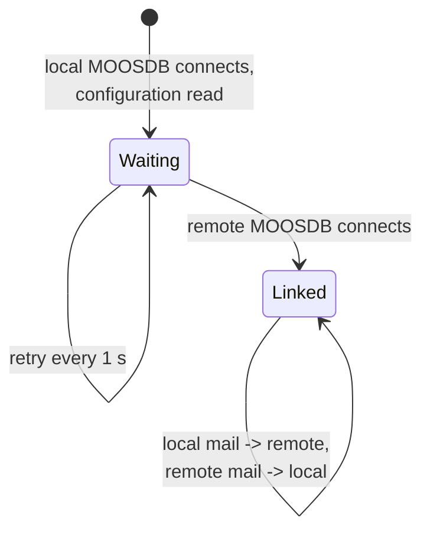

# pMOOSLink

!!! warning "Inferred by Claude"
    Written by Claude from the source at `992a171`, not from a design document or by the app's
    authors.
    Each statement below is tagged: **[code]** read from the code, **[test]** observed in a test or
    a run, **[guess]** inferred intent that nobody has confirmed. Corrections are welcome; a
    maintainer sets `status: reviewed` once the page has been checked.

## Purpose

pMOOSLink connects to a second, remote MOOSDB and copies chosen variables between it and the local
one, optionally renaming them **[code]**. `out` lines push local variables to the remote MOOSDB and
`in` lines pull remote variables into the local one **[code]**. It joins two MOOS communities on the
same machine or network, for example a vehicle and its simulators **[guess]** (plan
[10](../plan/claude/10-milestone-mbat-macrura.md) uses it between the vehicle and the sim
subsystems). The plan expects Goby3 interprocess to replace it **[guess]**.

## Interfaces

### Subscribes

<!-- BEGIN GENERATED subscribes -->
| Name | Transport | Type / format | Handler | Meaning | Notes |
|---|---|---|---|---|---|
<!-- END GENERATED subscribes -->

The extractor finds nothing here, because the names come from the `in`/`out` lines:

- local MOOSDB: the local name of each `out` line, any type **[code]**, handled in `OnNewMail` **[code]**;
- remote MOOSDB: the remote name of each `in` line, any type **[code]**, fetched in `Iterate` **[code]**.

### Publishes

<!-- BEGIN GENERATED publishes -->
| Name | Transport | Type / format | Where | Meaning | Notes |
|---|---|---|---|---|---|
<!-- END GENERATED publishes -->

- remote MOOSDB: the remote name of each `out` line, with the local message's value **[code]**;
- local MOOSDB: the local name of each `in` line, with the remote message's value **[code]**.

The copy keeps the original message's value type, source and time; only the key changes **[code]**.

### Configuration

<!-- BEGIN GENERATED config -->
| Parameter | Type | Default | Required | Meaning |
|---|---|---|---|---|
| `remote_server` | string |  | yes | host of the remote MOOSDB; required, the app exits without it **[code]** |
| `remote_port` | int |  | yes | port of the remote MOOSDB; required **[code]** |
| `community` | string |  | yes | read as the global `Community`; required **[code]**. The app registers with the remote MOOSDB as `pMOOSLink@<community>` **[code]** |
<!-- END GENERATED config -->

Not in the table (read by parsing the configuration block's lines **[code]**):

| Parameter | Type | Default | Required | Meaning |
|---|---|---|---|---|
| `out` | string: `LOCAL[:REMOTE]`, repeatable | | no | post local variable `LOCAL` to the remote MOOSDB as `REMOTE` (default: same name) **[code]** |
| `in` | string: `REMOTE[:LOCAL]`, repeatable | | no | post remote variable `REMOTE` to the local MOOSDB as `LOCAL` (default: same name) **[code]** |
| `AppTick`, `CommsTick` | double | MOOS defaults | no | `Iterate` rate, which sets how often remote mail is copied **[code]**; `CommsTick` is also the remote client's comms frequency **[code]** |

Example (from `pMOOSLink.moos`):

```
ProcessConfig = pMOOSLink
{
  AppTick    = 4
  CommsTick  = 4

  // a second MOOSDB, e.g. `MOOSDB --moos_port=9001`
  remote_server = localhost
  remote_port = 9001

  out = A:B // post local var "A" as remote var "B"
  out = C // post local var "C" as remote var "C"

  in = D:E // post remote var "D" as local var "E"
  in = F // post remote var "F" as local var "F"
}
```

### Files, devices and external programs

- A second MOOS client connection (`CMOOSCommClient`) to `remote_server:remote_port` **[code]**.
- Logs every message it copies to standard output **[code]**.

## Behaviour



- On the first local connection it reads the configuration, starts the remote client and blocks,
  printing "Waiting for connection" every second until the remote MOOSDB answers **[code]**. It
  waits forever if the remote MOOSDB never starts **[code]**.
- Every (re)connection to the local MOOSDB registers the `out` names; every (re)connection to the
  remote MOOSDB registers the `in` names **[code]**. Both register with interval 0 (every change)
  **[code]**.
- Local mail is copied out as soon as it arrives (`OnNewMail`) **[code]**. Remote mail is fetched and
  copied in on each `Iterate`, at `AppTick` **[code]**.
- A name may be mapped several times; each mapping gets its own copy **[code]**.
- Nothing stops a loop: mapping `out = X:Y` and `in = Y:X` sends each post back and forth forever
  **[guess]**.

## Running it

- No mission component launches it yet (`launched_by: []`). Plan
  [06](../plan/claude/06-missions-framework.md) expects the acomms/gateway component to write its
  configuration when two MOOSDBs share a machine **[guess]**.
- Standalone, from `core/src/bin/pMOOSLink/`: `MOOSDB pMOOSLink.moos` (port 9000),
  `MOOSDB --moos_port=9001` and `pMOOSLink pMOOSLink.moos`. A post of `A` on port 9000 appears as `B`
  on port 9001 **[code]**.
- Tested by `lamss_core_moos_smoke` (`core/src/test/moos_smoke/moos_smoke.sh`): it starts two MOOSDBs
  and checks both directions, `out = SMOKE_OUT:SMOKE_REMOTE_IN` and `in = SMOKE_REMOTE_OUT:SMOKE_IN`
  **[test]**.

## Known issues and open questions

- The example `.moos` file puts `// …` comments after the `out`/`in` values. Whether MOOS strips them
  from `GetConfiguration` lines, or they become part of the variable name, was not checked; the smoke
  test uses lines without comments.
- `ReadConfiguration` blocks inside `OnConnectToServer` until the remote MOOSDB is up **[code]**. Is
  blocking the local connect callback safe with MOOS v10's threaded comms?
- `parse_request` splits on the first `:`; spaces around the names are not trimmed by the app
  **[code]** (MOOS may trim them).
- There is no protection against copy loops between the two MOOSDBs (see Behaviour).

## History

- From GobySoft/lamss. First commit 2013-11-18 by Toby Schneider ("Added new pMOOSLink"); the
  imported history shows only lamss3 paths.
- 8 commits before the port, all in November 2013: 6 by Toby Schneider (building against old MOOS),
  2 from a shared lab account (read the configuration once; register the remote variables on every
  remote connect).
- lamss3 port (GobySoft/lamss3#9–#12, 2026-10-29): clang-format, build with
  `lamss_add_app(… MOOS NO_GOBY)`, and the example `.moos` file made runnable (second MOOSDB on
  port 9001). No interface change.
