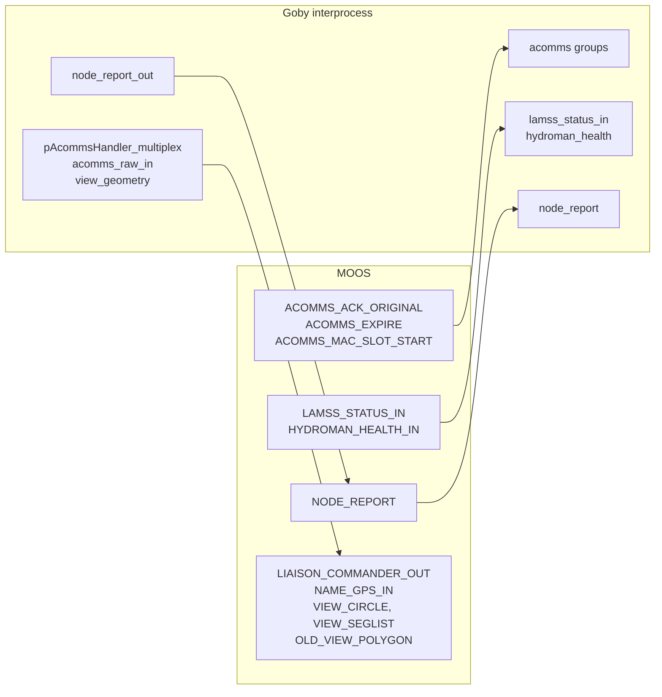

# moos_gateway_plugin

!!! warning "Inferred by Claude"
    Written by Claude from the source at `992a171`, not from a design document or by the app's
    authors.
    Each statement below is tagged: **[code]** read from the code, **[test]** observed in a test or
    a run, **[guess]** inferred intent that nobody has confirmed. Corrections are welcome; a
    maintainer sets `status: reviewed` once the page has been checked.

## Purpose

moos_gateway_plugin (`liblamss_core_moos_gateway_plugin.so`) is a plugin for Goby3's
`goby_moos_gateway` **[code]**. It translates between LAMSS MOOS variables and Goby3 interprocess
groups: acomms events, `LAMSS_STATUS_IN`, `HYDROMAN_HEALTH_IN` and `NODE_REPORT` go from MOOS to
Goby, and node reports, view geometry, raw GPS sentences and messages for pAcommsHandler go from Goby
to MOOS **[code]**. It lets native Goby3 apps (such as the ICEX tracker and Liaison) work alongside the
MOOS apps during the transition **[guess]**. The `lamss_goby_moos_gateway` script runs
`goby_moos_gateway` with this plugin and Goby's coroner plugin loaded **[code]**.

## Interfaces

### Subscribes

<!-- BEGIN GENERATED subscribes -->
| Name | Transport | Type / format | Handler | Meaning | Notes |
|---|---|---|---|---|---|
| `lamss::core::groups::acomms_raw_in` | Goby interprocess | lamss::core::NamedModemRaw | `moos_gateway_plugin.cpp` | raw modem sentences, tagged with the modem's `name` **[code]** | group `lamss::moos::acomms_raw_in`; RMC and GGA sentences are posted to MOOS `<NAME>_GPS_IN` (name upper-cased) "for iSerialNMEA" **[code]**; others are ignored **[code]**. Nothing in lamss3 publishes this group **[code]** |
| `lamss::core::groups::node_report_out` | Goby interprocess | lamss::core::LegacyNodeReport | `moos_gateway_plugin.cpp` | node report to post to MOOS **[code]** | group `lamss::moos::NODE_REPORT::out`; posted as MOOS `NODE_REPORT`, `KEY=value,…` **[code]**; checked by `lamss_core_moos_smoke` **[test]** |
| `lamss::core::groups::view_geometry` | Goby interprocess | lamss::core::ViewCircle, lamss::core::VIEW_SEGLIST | `moos_gateway_plugin.cpp` | circles and segment lists to draw **[code]** | group `lamss::moos::view_geometry`; `ViewCircle` → MOOS `VIEW_CIRCLE`; `VIEW_SEGLIST` → MOOS `VIEW_SEGLIST` (dark red) and `OLD_VIEW_POLYGON` **[code]** |
<!-- END GENERATED subscribes -->

Not found by the extractor:

| Name | Transport | Type / format | Handler | Meaning | Notes |
|---|---|---|---|---|---|
| `lamss::core::groups::pAcommsHandler_multiplex` | Goby interprocess | any protobuf (`subscribe_type_regex`) | `pAcommsHandlerMultiplexTranslation` | messages to hand to pAcommsHandler **[guess]** | group `lamss::goby::pAcommsHandler_multiplex`; posted to MOOS `multiplex_moos_var` **[code]** |
| `ACOMMS_ACK_ORIGINAL`, `ACOMMS_EXPIRE`, `ACOMMS_MAC_SLOT_START` | MOOS | string: Goby MOOS protobuf encoding (type name and message) | `add_trigger` | pAcommsHandler events **[guess]** | republished on the matching Goby group; unparseable strings are logged and dropped **[code]** |
| `HYDROMAN_HEALTH_IN` | MOOS | string: Goby MOOS protobuf encoding | `add_trigger` | HydroMAN health **[guess]** | → `hydroman_health` **[code]** |
| `LAMSS_STATUS_IN` | MOOS | string: Goby MOOS protobuf encoding | `add_trigger` | vehicle status received **[guess]** | → `lamss_status_in` **[code]** |
| `NODE_REPORT` | MOOS | string: `NAME=…,TYPE=…,UTC_TIME=…,X=…,Y=…,…` | `add_trigger` | node report **[code]** | parsed by a `MOOSTranslator` entry, keys matched to `LegacyNodeReport` fields **[code]**; pNodeReporter's `DEP` is read as `depth` **[code]** |

### Publishes

<!-- BEGIN GENERATED publishes -->
| Name | Transport | Type / format | Where | Meaning | Notes |
|---|---|---|---|---|---|
| `lamss::core::groups::acomms_ack_original` | Goby interprocess |  | `moos_gateway_plugin.cpp` | from MOOS `ACOMMS_ACK_ORIGINAL` **[code]** | group `lamss::moos::ACOMMS_ACK_ORIGINAL`; the type is whatever protobuf the MOOS string names **[code]** |
| `lamss::core::groups::acomms_expire` | Goby interprocess |  | `moos_gateway_plugin.cpp` | from MOOS `ACOMMS_EXPIRE` **[code]** | group `lamss::moos::ACOMMS_EXPIRE`; type from the MOOS string **[code]** |
| `lamss::core::groups::acomms_mac_slot_start` | Goby interprocess |  | `moos_gateway_plugin.cpp` | from MOOS `ACOMMS_MAC_SLOT_START` **[code]** | group `lamss::moos::ACOMMS_MAC_SLOT_START`; type from the MOOS string **[code]** |
| `lamss::core::groups::hydroman_health` | Goby interprocess |  | `moos_gateway_plugin.cpp` | from MOOS `HYDROMAN_HEALTH_IN` **[code]** | group `lamss::groups::hydroman_health` (not `lamss::moos::`) **[code]**; type from the MOOS string |
| `lamss::core::groups::lamss_status_in` | Goby interprocess |  | `moos_gateway_plugin.cpp` | from MOOS `LAMSS_STATUS_IN` **[code]** | group `lamss::moos::LAMSS_STATUS_IN`; a `lamss.core.LAMSS_STATUS` received over acomms **[guess]** |
| `lamss::core::groups::node_report` | Goby interprocess |  | `moos_gateway_plugin.cpp` | from MOOS `NODE_REPORT`, as `lamss.core.LegacyNodeReport` **[code]** | group `lamss::moos::NODE_REPORT`; `time` and `utc_time` are copied to each other when only one is set **[code]**; checked by `lamss_core_moos_smoke` **[test]** |
| `goby::middleware::frontseat::groups::node_status` | Goby interprocess |  | `moos_gateway_plugin.cpp` | from MOOS `NODE_REPORT` when its `LAT` and `LON` are finite numbers, as `goby.middleware.frontseat.protobuf.NodeStatus` **[code]** | for Goby clients of positions such as goby_liaison's map **[code]**; `TYPE` maps to `VehicleType` when it names one **[code]** |
<!-- END GENERATED publishes -->

Not found by the extractor (all posted with `moos().comms()`):

| Name | Transport | Type / format | Where | Meaning | Notes |
|---|---|---|---|---|---|
| `multiplex_moos_var` (default `LIAISON_COMMANDER_OUT`) | MOOS | string: Goby MOOS protobuf encoding, binary when needed | `moos_gateway_plugin.cpp` | any message on `pAcommsHandler_multiplex` **[code]** | the name suggests Liaison's commander output, which pAcommsHandler reads **[guess]** |
| `<NAME>_GPS_IN` | MOOS | string: NMEA RMC or GGA sentence | `moos_gateway_plugin.cpp` | GPS of the modem node `<NAME>` **[code]** | input for iSerialNMEA **[code]** (comment) |
| `NODE_REPORT` | MOOS | string: `KEY=value,…` (`LegacyNodeReport`) | `moos_gateway_plugin.cpp` | from `node_report_out` **[code]** | |
| `VIEW_CIRCLE` | MOOS | string: XYCircle spec | `moos_gateway_plugin.cpp` | from `ViewCircle` on `view_geometry` **[code]** | for pMarineViewer **[guess]** |
| `VIEW_SEGLIST` | MOOS | string: XYSegList spec | `moos_gateway_plugin.cpp` | from `VIEW_SEGLIST` on `view_geometry` **[code]** | active only if it has points; edges and vertices dark red **[code]** |
| `OLD_VIEW_POLYGON` | MOOS | string: `active,true:label,…:edge_size,0:vertex_size,0:x,y:…` | `moos_gateway_plugin.cpp` | the same seglist in an older drawing format, "for GEOV" **[code]** | always `active,true`, even with no points **[code]** |

### Configuration

<!-- BEGIN GENERATED config -->
| Parameter | Type | Default | Required | Meaning |
|---|---|---|---|---|
<!-- END GENERATED config -->

The extractor does not read the plugin's configuration, which is an extension of
`goby.apps.moos.protobuf.GobyMOOSGatewayConfig` (field 1000, `[lamss.core.goby_gateway_config]`)
**[code]**:

| Parameter | Type | Default | Required | Meaning |
|---|---|---|---|---|
| `multiplex_moos_var` | string | `LIAISON_COMMANDER_OUT` | no | MOOS variable for messages from `pAcommsHandler_multiplex` **[code]** |

Field 2 (`load_shared_library`) is reserved. The protobuf libraries whose types MOOS strings may name go in the gateway's `app { load_shared_library }`, which goby loads before any translator thread starts; loading them from a translator thread crashed the gateway about one start in ten, as it raced the other threads' descriptor lookups **[test]**.

The gateway's own settings (`interprocess`, `moos { server port }`) apply as usual **[code]**.

Example (from `core/src/test/moos_smoke/moos_smoke.sh`):

```
interprocess { platform: "…" }
moos { server: "localhost" port: 9000 }
[lamss.core.goby_gateway_config] { }
```

### Files, devices and external programs

- Protobuf libraries named in `app { load_shared_library }`, loaded by goby **[code]**.
- The plugin is found through `GOBY_MOOS_GATEWAY_PLUGINS`, which `lamss_goby_moos_gateway` sets to this
  plugin and `goby_coroner_moos_gateway_plugin` **[code]**.

## Behaviour



- Four translator threads, started by `goby3_moos_gateway_load`: pAcommsHandler multiplex and acomms,
  nav status, node report, and view geometry **[code]**.
- MOOS strings for the acomms, status and health variables are parsed with
  `dynamic_parse_for_moos`, so the protobuf type comes from the string, not from the code **[code]**.
  The type must be linked in or loaded with `app { load_shared_library }` **[guess]**.
- `NODE_REPORT` goes both ways: posts from MOOS are published on `node_report`, and messages on
  `node_report_out` are posted to MOOS `NODE_REPORT` **[code]**. Using two groups keeps a Goby
  publisher from receiving its own report back **[guess]**.
- `<NAME>_GPS_IN`: only sentences whose characters 3–5 are `RMC` or `GGA`, so only two-letter
  talker IDs (`$GPRMC`, `$GNGGA`) **[code]**.
- View geometry: circles keep their label and active flag; seglists are drawn active when they have
  points, and the message's `active` and `polytype` fields are not used **[code]**.

## API

- `goby3_moos_gateway_load(handler)` and `goby3_moos_gateway_unload(handler)`: the C entry points
  `goby_moos_gateway` looks up after `dlopen`; they launch and join the four threads **[code]**.
- `pAcommsHandlerMultiplexTranslation`, `NavStatusTranslation`, `NodeReportTranslation`,
  `ViewGeometryTranslation`: `goby::moos::Translator` subclasses, one per thread **[code]**.
- The global `lamss::core::LAMSS_STATUS unused` forces `liblamss_core_protobuf` to be linked, so its
  types can be parsed by name **[code]**.

Used by: `goby_moos_gateway` through the `lamss_goby_moos_gateway` script **[code]**. No mission
component launches it yet (`launched_by: []`).

Tests:

- `lamss_core_moos_gateway_plugin_load` opens the plugin with `dlopen`, finds both entry points and
  checks the configuration extension (field 1000) **[test]**.
- `lamss_core_moos_gateway_plugin_example_config`: `goby_moos_gateway --example_config` with the
  plugin lists `[lamss.core.goby_gateway_config]` **[test]**.
- `lamss_core_moos_smoke`: `NODE_REPORT` from MOOS to Goby and from Goby to MOOS **[test]**. The
  acomms, status, view geometry, GPS and multiplex translations have no test.

## Known issues and open questions

- `NodeReportTranslation` dereferences the result of `std::dynamic_pointer_cast<LegacyNodeReport>`
  without checking it **[code]**. If the translator returned a dynamically created message rather
  than the generated type, this would crash **[guess]**.
- Does the gateway receive its own `NODE_REPORT` posts back from the MOOSDB? If so, every report on
  `node_report_out` is republished on `node_report` too.
- `ViewCircle` and `VIEW_SEGLIST` bound their coordinates to ±180/±90 with 4–5 decimals in DCCL, like
  longitude and latitude, but the plugin draws them as local X and Y metres **[code]**. Which is
  intended? (pViewMessage converts lon/lat to local coordinates before drawing.)
- Who reads `OLD_VIEW_POLYGON`? See the same question on [pViewMessage](../apps/pViewMessage.md).
- Nothing in lamss3 publishes `acomms_raw_in`, `view_geometry` or `pAcommsHandler_multiplex`, or
  subscribes to the acomms, `lamss_status_in` or `hydroman_health` groups **[code]**. Which Goby apps
  are expected to use them (ICEX, Liaison, HydroMAN)?
- The `<NAME>_GPS_IN` check misses three-letter talker IDs and proprietary sentences **[code]**; the
  code comment calls the sentence ID the "talker".

## History

- From GobySoft/lamss, where the source inventory calls it `lib_goby3_lamss_gateway`; the imported
  history shows only lamss3 paths. First commit 2019-07-11 by Toby Schneider ("Added stub for goby3 -
  MOOS gateway lib").
- 24 commits before the port: 23 by Toby Schneider, 1 by Henrik Schmidt. They added the ICEX, netsim
  and Liaison translations (2020) and `load_shared_library` (2020-06).
- lamss3 port (GobySoft/lamss3#9–#12, 2026-10-29): the netsim translation (`TRANSMISSION_GRP_VEL`,
  `PERFORMANCE_REQUEST`/`_RESPONSE`) and the ICEX translation (hydrophone depths, `ACOMMS_CONFIG`,
  `ACOMMS_QSIZE`, `ACOMMS_QUEUE_RECEIVE`, `ACOMMS_MODEM_TRANSMIT`/`_RECEIVE`, `ACOMMS_FLUSH_QUEUE`) were
  removed, to go to virtual_ocean and icex plugins; built as `lamss_core_moos_gateway_plugin`
  against `lamss.core` groups and protos; relicensed GPL-3.0-or-later because it links MOOS-IvP's GPL
  geometry library.
