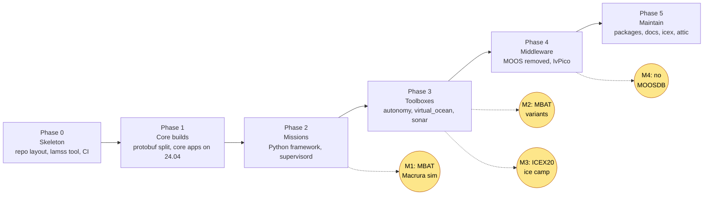
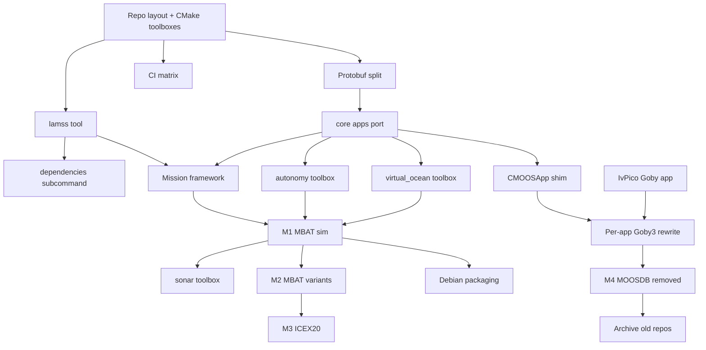
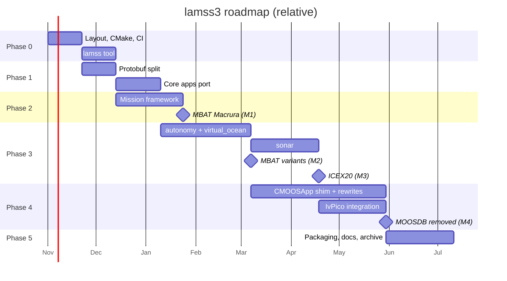

# LAMSS 3 migration: overview and roadmap

*This document written by Claude*

This is the top-level plan for turning `lamss`, `lamss-shared`, `lamss-internal` and `missions-lamss` into `lamss3`: one repository of CMake "toolboxes" that builds on current Ubuntu LTS, runs on Goby3 instead of MOOS, and is maintained as an open source project. It expands the human-written [core plan](../core.md). Each section links to a detailed plan document.

## Goals

1. **Builds on a fresh Ubuntu 24.04 (and 26.04) install** with `apt` dependencies only, plus MOOS-IvP and Goby3 from their upstream packages.
2. **One repository, many toolboxes.** `core` is always on; `autonomy`, `sonar`, `virtual_ocean` ship in-tree but opt-in; `mit`, `icex`, `attic` and user toolboxes are git submodules.
3. **One CLI**, `lamss` (alias `lm`), for building, dependencies, toolbox management and running missions.
4. **A mission framework** that keeps the object-oriented cruise/fleet/platform/component model of `missions-lamss` but uses Python 3 + Jinja2 and launches with `supervisord`.
5. **Goby3 as the only middleware** at the end, with MOOS retained as a transitional dependency so that nothing has to be rewritten before it can be run.
6. **Maintainability**: CI on every toolbox, clang-format, LGPL/GPL headers, Debian packages, documented maintainers.

## Document map

| Doc | Topic |
|---|---|
| [01-source-inventory](01-source-inventory.md) | What exists in the old repos and where each piece lands (toolbox or attic) |
| [02-repository-layout-and-build](02-repository-layout-and-build.md) | Directory layout, CMake toolbox mechanism, activation, `build/usr` |
| [03-lamss-tool](03-lamss-tool.md) | The `lamss` C++ CLI: bootstrap, subcommands, state files |
| [04-dependencies-ci-packaging](04-dependencies-ci-packaging.md) | Ubuntu 24.04 dependency set, CI matrix, Debian packaging |
| [05-middleware-moos-to-goby3](05-middleware-moos-to-goby3.md) | Migration levels, CMOOSApp shim, pHelmIvP to IvPico |
| [06-missions-framework](06-missions-framework.md) | Python class model, Jinja2 rendering, supervisord output |
| [07-protobuf-split](07-protobuf-split.md) | Breaking `lib_lamss_protobuf` across toolboxes |
| [08-code-style-licensing-maintenance](08-code-style-licensing-maintenance.md) | clang-format, licenses, maintainers, docs |
| [09-toolboxes](09-toolboxes.md) | Per-toolbox plans: core, autonomy, sonar, virtual_ocean, mit, icex, attic |
| [10-milestone-mbat-macrura](10-milestone-mbat-macrura.md) | The first end-to-end target: Macrura in MBAT simulation |

## Guiding decisions

These are the choices the detailed plans assume. Change them here first if you disagree.

- **MOOS stays as a build dependency through Phase 3.** Goby3 ships `libgoby_moos` (`goby::moos::GobyMOOSApp`) and `goby_moos_gateway`, so every existing app can be recompiled against Goby3 + MOOS-IvP 24.8 and run unchanged while the middleware migration proceeds app by app. The alternative (rewrite first, run later) delays any runnable milestone by months.
- **The mission framework is built before the middleware shift.** It generates whatever files the apps need today (`.moos`, `.bhv`, `.pb.cfg`) and swaps templates as apps migrate. It is also the test harness for the migration.
- **`pAntler` is replaced by `supervisord` from day one** of the mission framework. There is no reason to generate the `ProcessConfig = ANTLER` block when every process will be launched from a `supervisord.conf` anyway.
- **pHelmIvP is replaced by [IvPico](https://github.com/GobySoft/IvPico)**, not by a MOOS bridge. Until IvPico's Goby app exists, pHelmIvP runs under `goby_moos_gateway`. The IvPico protobuf interface is the contract the autonomy toolbox codes against.
- **Protobuf messages are split by toolbox and get a `lamss::<toolbox>` package.** Wire compatibility with old DCCL messages is kept only where a message crosses the acoustic link to a platform that will not be upgraded (none known today).
- **`attic` is a submodule, not a branch.** Deprecated apps stay buildable in isolation but never block the main build.
- **HydroMAN 3 is a wrapper toolbox.** HydroMAN lives in its own git repository and runs as its own process group (`pHM3_BasicModel`, `pHM3_VelProcessor`, `iHydroMAN_Gateway`, `pHM_SensorFusion`, …). lamss3 carries a thin `hydroman/` toolbox that holds that repository as a submodule plus the lamss3-side glue: `iHydroMAN_LAMSS`, `iHydroMAN_PHINS`, the hydroman protos and the `hydroman` mission component ([02](02-repository-layout-and-build.md#wrapper-toolboxes)). The internal HydroMAN 1.x toolbox in lamss-shared (seven `pHydroMAN_*` apps, 14k lines) goes to `attic`; `autonomy` has no HydroMAN dependency.
- **Nothing is ported without a consumer.** An app moves out of the old repos only when a mission in `mit` or a toolbox test needs it. Everything else goes to `attic` by default.

## Phases

### Phase 0: skeleton

- Create the directory layout and top-level CMake with the toolbox activation mechanism ([02](02-repository-layout-and-build.md)).
- Write the `lamss` tool with `build`, `toolbox` and `dependencies` subcommands ([03](03-lamss-tool.md)). `mission` comes in Phase 2.
- CI: build each toolbox alone and all together on Ubuntu 24.04 ([04](04-dependencies-ci-packaging.md)).
- Adopt `.clang-format`, license headers and the `DEPENDENCIES` format ([08](08-code-style-licensing-maintenance.md)).

Exit criterion: `git clone && ./bootstrap.sh && lm b` builds an empty `core` on 24.04 in CI.

### Phase 1: core toolbox builds

- Split `lib_lamss_protobuf` ([07](07-protobuf-split.md)); only the `core` portion is needed first.
- Port the core apps (`pCoroner`, `pMOOSLink`, `pViewMessage`, `pInitializer`, `iMOOS2SQL` and the shared libraries) with `git mv`-style history preservation ([09](09-toolboxes.md#core)).
- Compile against Goby3 3.6, DCCL 4, Protobuf from 24.04, MOOS-IvP 24.8.1, C++17.
- Run `clang-format` once over the ported tree.

Exit criterion: `core` apps run under `goby_moos_gateway` + MOOSDB in a hand-written test configuration; CI green.

### Phase 2: mission framework

- Implement the Python package `lamss.mission` with the concept classes and the Jinja2 render step ([06](06-missions-framework.md)).
- Templates for the core apps, gobyd, goby_logger, supervisord.
- `lamss mission run|sim`.
- Port `cruise/mbat` + `auv/macrura` as the first cruise ([10](10-milestone-mbat-macrura.md)); this pulls the minimum autonomy and virtual_ocean apps along with it.

Exit criterion (**M1**): `lm m sim mbat` launches a Macrura + topside simulation on one machine.

### Phase 3: remaining toolboxes

- `autonomy`: mission manager, frontseat drivers, behaviors.
- `hydroman`: wrapper toolbox around the HydroMAN 3 repository.
- `virtual_ocean`: ocean model, modem network and sensor simulators.
- `sonar`: processing chains and sonar simulators actually used by the live missions.
- MBAT variants (**M2**) and the ICEX20 cruise (**M3**) as the forcing functions.

### Phase 4: middleware shift

- Apps already on `GobyMOOSApp` are rewritten to native Goby3 applications.
- Remaining `CMOOSApp` apps are either rebuilt on the CMOOSApp shim or retired ([05](05-middleware-moos-to-goby3.md)).
- pHelmIvP replaced by IvPico's Goby app.
- `goby_moos_gateway` and MOOSDB removed from the launch set (**M4**).

### Phase 5: maintain

- Debian packages per toolbox, release CI, documentation site, training topics (acomms sim, sonar sim, autonomy missions).
- `icex` and `attic` submodules populated; old repositories archived with a pointer to `lamss3`.

## Dependency graph between work items

## Rough schedule

Durations assume one primary developer with review from the lab. They are deliberately coarse; the milestones matter more than the dates.

## Risks

| Risk | Mitigation |
|---|---|
| Old apps depend on Goby2-era APIs that Goby3's `libgoby_moos` dropped | Phase 1 is sized to find these early; the survey in [01](01-source-inventory.md) flags known API users |
| MOOS-IvP 24.8 changed behaviour/library APIs since the ~2016 era the code targets | Behaviors are rebuilt first and alone; IvP behaviors have the most stable API in MOOS-IvP |
| Dead code gets ported "just in case" | The "nothing without a consumer" rule; the attic submodule is cheap |
| Mission framework becomes a second gpp | Framework scope is fixed to the five concepts; templates stay dumb (no logic beyond loops and conditionals) |
| IvPico not ready when Phase 4 arrives | pHelmIvP under `goby_moos_gateway` is a supported fallback indefinitely |
| Proprietary/third-party code (HydroMAN, MSEAS, Bluefin SDK) blocks open-sourcing | Inventory flags each; HydroMAN is reachable only through its submodule, the rest go to `icex`/`mit` submodules or `attic`, never `core` |
