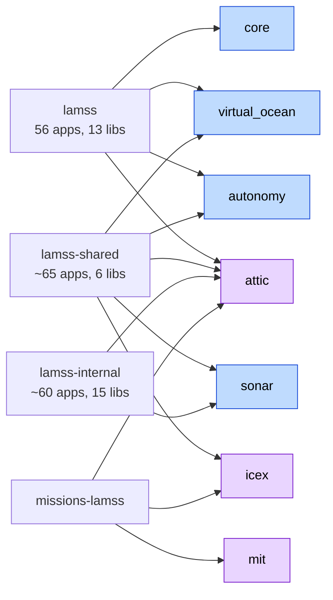

# Source inventory and toolbox assignment

*This document written by Claude*

What the four source repositories contain, as surveyed in October 2026, and where each piece goes in `lamss3`. This supersedes the 2025 [first-pass classification](../sources/2025-05-07-lamss-future.md) where they differ. "Live" means referenced by a current mission (`mbat`, `irminger`, `arctic`, `icex20`) or touched in git since 2023.

## Repositories at a glance

| Repo | Commits visible | Range | Code | Build target | Middleware |
|---|---|---|---|---|---|
| `lamss` | 96 (bulk import of 2005–2014 CVS/bzr code) | 2021-12 → 2025-07 | 48k lines apps, 75k lib (34k vendored newmat + json) | Ubuntu 22.04 (`DEPENDENCIES` has jammy, no noble) | Goby3 + MOOS 10 + MOOS-IvP; `find_package(GOBY 3 ... moos)` |
| `lamss-shared` | 127 (shallow, grafted 2022-03) | 2022-03 → 2025-12 | 92k apps, 6k lib, 7k python, 92k matlab | 18.04/20.04 per README; builds on 22.04 | Goby3 (33 `GobyMOOSApp`), MOOS, netsim required |
| `lamss-internal` | 125 (shallow, cut 2018-09) | 2018-09 → 2024-05 | ~60k apps/libs, 170k thirdparty | 22.04 last known good | Goby3 goby_moos only |
| `missions-lamss` | shallow, cut 2021-03 | → 2024-09 | 4.5k files of `gpp` templates, data, docs | n/a | MOOS `.moos`/`.bhv` + Goby `.pb.cfg` |

Common facts that drive the plan:

- **All three code repos already compile against Goby3**, using Goby3's `libgoby_moos` for the `GobyMOOSApp` base class. Goby2-only code exists only in disabled apps (`pCommsStateTracker`, `arithmetic_tool`, `sandbox/tes`) and two tiny DCCL load hooks.
- **The repos are coupled by sibling directories, not packages**: `FindLAMSS.cmake` reads `../lamss/lib`, `../netsim/build`, `../HydroMAN`, `~/moos-ivp`. Build order is netsim → lamss → lamss-shared → lamss-internal. `build/usr` + `find_package` in [02](02-repository-layout-and-build.md) replaces this.
- **[netsim](https://github.com/GobySoft/netsim) is a hard dependency** of all three (`netsim_messages`, `netsim_acousticstoolbox` for Bellhop/SVP, `netsim_tcp`). It is a GobySoft package (`libnetsim-dev`), so it stays a dependency rather than being absorbed.
- **No tests and no CI anywhere.** `enable_testing()` is set in all three; zero `add_test()` calls.
- **Build outputs are written into the source tree** (`bin/`, `lib/`, `include/`), with committed symlinks and stray `CMakeCache.txt` files.
- **Licensing is mixed**: `COPYING` is GPLv3 in all three, ~90 files carry GPLv3/GPLv2+ headers, ~350 files in `lamss` alone carry no header, and `iMOOSGateway`/`payload_interface` carry an "unreleased BETA, no permission" notice.

## Where things go

Blue toolboxes are in-tree; purple are submodules. Counts below are of items that survive to a toolbox; everything not listed goes to `attic` by default (the "no consumer, no port" rule in [00](00-overview.md#guiding-decisions)).

### core

| Item | From | Base | Lines | Notes |
|---|---|---|---|---|
| `lib_lamss_protobuf` (core subset) | lamss | proto | 3.7k total | Split per [07](07-protobuf-split.md) |
| `lib_goby3_lamss_gateway` | lamss | Goby3 gateway plugin | 426 | Native Goby3 already; seed for `core` groups |
| `lib_henrik_util` | lamss | lib | 11.9k | Acoustic model, ray tracing, Kalman, NetCDF. Split: generic math stays in core, acoustics to virtual_ocean/sonar |
| `lib_supun_util` | lamss | header-only | 23k (22.9k is vendored `json.h`) | Replace vendored json with `nlohmann-json3-dev`; keep the UTM/coordinate helpers |
| `pCoroner` | lamss | CMOOSApp | 393 | Process watchdog; becomes a supervisord event listener + Goby health publisher |
| `pViewMessage` | lamss | GobyMOOSApp | 724 | VIEW_* ↔ compact protobuf for acomms; active 2024 |
| `iSerialNMEA`, `iLineBasedComms` | lamss | GobyMOOSApp | 795 / 240 | Generic serial/TCP line I/O; Goby3 has `io::SerialThreadLineBased`, so these shrink to config |
| `pPBNodeReport`, `uTopsideSetup` | lamss-shared | GobyMOOSApp | 256 / 255 | Node report conversions |
| `pInitializer` | lamss | GobyMOOSApp | 55 | Duplicate of Goby's; drop once missions use Goby3 config |
| `pMOOSLink` | lamss | CMOOSApp | 316 | Bridges two MOOSDBs; needed only until M4, then attic |
| `iMOOS2SQL` | lamss | GobyMOOSApp | 895 | GEOV feed; **attic candidate**, keep only if GEOV is still used |
| `lib_pylamss`, `lib_pybellhop` | lamss-shared | python3 | ~2k | Log tools, Bellhop readers |
| `scripts/km`, `.bash_lamss` | lamss | sh | | Replaced by `lamss env` and `lamss mission stop` |

### autonomy

| Item | From | Base | Lines | Notes |
|---|---|---|---|---|
| `pLamssMissionManager` | lamss-shared | GobyMOOSApp (boost statechart) | 3.5k | Core autonomy FSM; active 2024 |
| `pLamssSurfaceMissionManager` | lamss-shared | GobyMOOSApp | 1.5k | 2024 |
| `pLamssMissionScript` | lamss-shared (SRToolbox) | AppCasting | 954 | Scheduled deploy scripting; 2024 |
| `pLamssTrackManager` | lamss-shared | GobyMOOSApp | 2.4k | Could sit in sonar; autonomy because it feeds the mission FSM |
| `iLamssFrontSeat`, `pFrontSeatData` | lamss | GobyMOOSApp | 443 / 201 | 2023 frontseat bridge to Goby3 `InterfaceData` |
| `iEmbeddedFrontseat` | lamss-shared | GobyMOOSApp | 441 | |
| `pControlEngine_Vlamss`, `pActuatorMap_HybridUUV`, `uSimUnderseaVehicle_Vlamss` | lamss-shared (SRToolbox) | AppCasting | 1.3k / 1.6k / 3.1k | Hybrid UUV control and 6-DOF frontseat sim; 2022–24 |

| `pDepthAdapt` | lamss-shared | GobyMOOSApp | 3k | Adaptive depth via Bellhop; uses `$LAMSS_HOME` paths to fix |
| `pTetraHoming` | lamss-shared (dup in internal) | CMOOSApp | 505 | |
| `pEnvtGrad` | lamss | CMOOSApp | 1.1k | Thermocline detection for adaptive yoyo |
| `pGateway` | lamss | CMOOSApp | 304 | Fixed gateway/buoy node |
| `uSimArrayMooring` | lamss | CMOOSApp | 467 | Moored node sim; active 2024 |
| `uMVS_Bluefin` | lamss | CMOOSApp | 5.6k | Bluefin 6-DOF frontseat sim; only user of newmat |
| `uSimMarine_DUTM` | lamss | AppCasting | 3k | uSimMarine fork with dynamic UTM; try to upstream to moos-ivp first |
| `pMissionMonitor` | lamss | CMOOSApp | 501 | |
| `pNMEASender` | lamss-internal | GobyMOOSApp | 126 | |
| Behaviors: `lib_behaviors-henrik` (lamss: 13; shared: 3; internal: ~8), `-spetillo` (lamss: 1; internal: 6 front-tracking), `-tes` (1), `-don` (5), `-emf43` (5), `-ayaari` (1), `-arthura` (1), `-arjuna` (1) | all | IvP behaviors | ~30k | Only behaviors referenced by live `.bhv` files are ported (see missions survey); one `lamss_behaviors` plugin library, grouped by topic not author. Loaded by pHelmIvP now, IvPico later |
| `lib_lamss_protobuf` (deploy/status/prosecute/stovepipe/hybrid_uuv/hydroman) | lamss | proto | | [07](07-protobuf-split.md) |

### hydroman (wrapper toolbox around the HydroMAN 3 repository)

| Item | From | Base | Lines | Notes |
|---|---|---|---|---|
| HydroMAN 3 repository | external git | MOOS apps: `pHM3_BasicModel`, `pHM3_VelProcessor`, `pHM_SensorFusion`, `pHM_Manager`, `pHM_ModelCalibrator`, `pHM_LBLProcessor`, `pHM_DVLProcessor`, `pHM_TargetSLAM`, `iHydroMAN_Gateway` | n/a | Submodule at `hydroman/upstream`; built by its own CMake; not modified by lamss3 |
| `iHydroMAN_LAMSS` | lamss-shared | CMOOSApp | 1.2k | Vehicle-side TCP/protobuf client of `iHydroMAN_Gateway` (`hydroman_tcp`, `hydroman_protobuf`) |
| `iHydroMAN_PHINS` | lamss-shared | CMOOSApp | 3.8k | iXblue PHINS INS driver (stdbin, pcap replay) |
| `hydroman_command/health/internal.proto` | lamss | proto | | `lamss.hydroman` package |
| `auv/hydroman_ext` subsystem (`hydroman_ext.def`, `hydroman_ext_plugs/*`) | missions-lamss | templates | | Becomes the `hydroman` mission component and `nav` subsystem |

### sonar

| Item | From | Base | Lines | Notes |
|---|---|---|---|---|
| `pLamssCBF`, `pLamssAEL`, `pLamssBearingTracker` | lamss-shared | GobyMOOSApp | 2.6k / 411 / 1.8k | Passive chain |
| `pGeoTracker` (+ `lib_track`) | lamss-shared | CMOOSApp | 2.2k + 576 | |
| `pSonarPingControl` | lamss-shared | CMOOSApp | 1.1k | |
| `uSimPassiveSonar` | lamss-shared | GobyMOOSApp | 4k | Most active app in the lab (2024–25) |
| `uSimActiveSonar`, `uSimActiveContacts`, `uSimAEL`, `uSimTowedArray`, `uSimTargetBearings` | lamss-shared | CMOOSApp | 5.2k / 1.1k / 292 / 5k / 953 | |
| `uSimNoiseCovariance`, `uSimSelfNoise`, `uSimSourceArray`, `uSimTargets`, `uSimTrackDVL` | lamss-shared | mixed | 1k / 287 / 262 / 631 / 567 | Array-centric sims; Dec 2025 commits |
| `uTDA` | lamss-shared | CMOOSApp + FLTK | 3.4k | MOOS-IvP derived GPL viewer; keep only if used |
| `iDurip` + `lib_durip` + DM7820 userspace lib + kernel driver | lamss-internal | GobyMOOSApp | 337 + 1.1k + 6k + 4k | The one live hardware driver; kernel module needs DKMS packaging for 6.x kernels |
| `iMCC1608FS` | lamss-internal | CMOOSApp | 2.7k | Tetra-array DAQ; keep if tetra array is still used |
| `pPostFile` | lamss-internal | CMOOSApp | 404 | Referenced 2024 |
| `lib_lamss_protobuf` (sonarcontrol/contacts/tracks/btr/targetsim/pinger/ArrayNavigation/BeamformingVars) | lamss | proto | | |

### virtual_ocean

| Item | From | Base | Lines | Notes |
|---|---|---|---|---|
| `uSVP_OceanModel`, `uSimCTD_OceanModel`, `uSimADCP_OceanModel` | lamss-shared | GobyMOOSApp | 1.2k / 354 / 294 | NetCDF (MSEAS/HYCOM) ocean models |
| `uSimModemNetwork`, `uSimModemRange`, `uSimModemSignal`, `iNetSimManager` | lamss-shared | GobyMOOSApp | 3k / 416 / 1.2k / 300 | netsim front ends |
| `iNoaaBathy`, `iMseasBathy`, `iGdemSoundSpeed` | lamss | CMOOSApp | 416 / 425 / 379 | Bathy/SSP request services |
| `iCTD_OceanModel`, `iADCP_OceanModel`, `uSimBathy`, `uSimCTD`, `uSimGPS`, `uFldOceanEnvSensor` | lamss | CMOOSApp | 861 / 823 / 536 / 406 / 277 / 968 | Simple sensor sims |
| `uSimShipNMEA`, `uSimAcoBeaconRngBrg` | lamss-shared | mixed | 323 / 672 | |
| HydroMANSimUtilities: `uSimDVL`, `uSimLBL`, `uSimPhinsINS`, `uSimReplayPCAP` | lamss-shared | CMOOSApp | 2.3k | Nav sensor sims |
| `uSimBearingRange` | lamss-internal | CMOOSApp | 285 | Referenced 2021 |
| `lib_netsim_processor` | lamss | Goby3 netsim plugin | 539 | |
| `lib_henrik_util` acoustics subset | lamss | lib | | CAcousticModel, CRapRays, CEigenRays, CLamssNetcdf |
| `lib_lamss_protobuf` (modem_sim, model_param, environment_update, adcp/ctd) | lamss | proto | | |

### icex (submodule)

| Item | From | Notes |
|---|---|---|
| `uSimHydroholeNav`, `uSimICEXMotion`, `uSimICEXTracker` | lamss-shared | GobyMOOSApp |
| `iICEXTracker` | lamss-shared | Not built (Octave pre-4.4 API); attic unless rewritten |
| `lamss_icex_tracker`, `icex_buoy_multiplexer`, `icex_optimizer`, `lib_liaison-icex` | lamss-shared `src/goby` | **Native Goby3 `MultiThreadApplication`** but disabled in the build; Boost.Python + OpenCV deps |
| `icex_tracking*.proto`, `optimizer_data.proto`, `icex_groups.h` | lamss | |
| `icex_eeof_lib` (MATLAB), `ICEX_Analysis` | lamss-internal | Field analysis tooling, 2020 |
| `BHV_OpRegion_ICEX` | lamss | |
| `cruise/icex20` (M3), `cruise/arctic`, `topside/icex_sim` | missions-lamss | Mission content |

### mit (submodule or in-tree, see [02](02-repository-layout-and-build.md#open-questions-for-the-human-plan))

All of `missions-lamss` that is live: `cruise/mbat`, `cruise/irminger`, platforms `auv/macrura`, `auv/unicorn`, `auv/sandshark`, `auv/sensor_sim`, `auv/frontseat_sim`, `topside`, `ship`, `mooring/*`, re-expressed in the Python framework of [06](06-missions-framework.md). Details in the missions survey section below.

### attic (submodule)

Everything not named above. Highlights so nobody goes looking:

| Group | Items |
|---|---|
| Kayak / PLUSNet hardware (2005–2008) | `i3DM_GX*`, `iArduinoDIO`, `iBackSeatServer`, `iCTD`, `iDAS`, `iGSC_16AO16`, `iHuxley`, `iKayakControlBoard`, `iMetaCompass`, `iNMEASpeedTransducer`, `iOS5000`, `iPWMController`, `iWifi`, `iWebsite`, `pHystereticThermostat`, `MOOSBlink`, `iMultiStaticSonar`, `lib_anrp_util` (unless iSerialNMEA needs a piece) |
| Superseded by Goby/MOOS-IvP stock apps | `iModemSim` (netsim), `zLoggerNG`, `uTPB`, `pMailReader`, `pMOOSLink` (after M4), `pInitializer` |
| Superseded in-house | `pBearingTracker` → `pLamssBearingTracker`; `pAEL` → `pLamssAEL`; `pActiveSonarProcessor`, `pActiveSonarProcess`, `pActiveTargetProcess`; `pClusterPriority`; `pCommsStateTracker` |
| Internal HydroMAN 1.x (replaced by the HydroMAN 3 repository via the `hydroman` toolbox) | `pHydroMAN_{BasicModel,ModelCalibrator,LBLProcessor,DVLProcessor,SensorFusion,Manager,ModelEstimator}`, `pHydroMAN_ICEXManager` (14k lines, armadillo + embedded Python); the `hydroman`/`hydroman_3` mission flags and `auv/macrura/macrura_plugs/pHydroMAN_BasicModel.plug` |
| Dead science code (hardcoded `/home/<user>` paths, thesis chains) | emf43 scattering chain (8 apps), `pImagePro`, `pROI`, `lib_arjuna_util`, `pRBTracker`, `pMBTracker`, `p1HTracker`, `pTrackManager`, `pTargetTracker`, `pTwostateTracker` (OpenCV < 3), `pActiveRangeTracker`, `pActiveGeoTracker` (OpenCV < 3), `lib_metrics` |
| Glider | `pHelmToSlocum`, `uSimSlocum`, `glider/` missions |
| MATLAB / Octave | `lamss-shared/src/matlab` (92k lines, 35 MB), `iMseas` + `lib_readhops` (MCR 2008a), `pOctaverMIT`, `uSimSoundVelocityMSEAS`, `src/octave` |
| Lua | `iChauffeur`, `iLivery`, `pLuaScript`, `lib_lua` |
| Web | `display-center` (Bokeh 2.2 dashboard), `uPlot` servers; revisit against Goby Liaison |
| Thirdparty | `at`/`at_2010` Acoustics Toolbox (netsim's package covers Bellhop), QccPack, svm_light, `Macrura_piUSBL_ICEX`, `octoport` (Python 2), `python-moos` |
| Docs | 413 MB of PDFs/PPTX in `lamss/src/doc`, 31 MB in lamss-shared; move to a `lamss-docs` archive, not a submodule anyone builds |
| Licensing conflicts | `iMOOSGateway`, `payload_interface` ("no permission granted") until the authors clear them |
| Secrets | `lamss-internal/src/tools/durip/readme*.txt` contains credentials; **do not migrate**, scrub before the attic push |

## Cross-cutting findings

### Dependencies to carry forward

| Dep | Used by | 24.04 status |
|---|---|---|
| Goby3 (`libgoby3-dev`, `goby3-moos`, `goby3-gui`) | everything | GobySoft apt repo; 3.6.x current |
| DCCL 4 | protobuf | GobySoft apt repo |
| MOOS 10 + MOOS-IvP (`libmoos-ivp-dev`, `moos-ivp-apps/gui`) | everything until M4 | GobySoft apt repo / `ppa:tes/lamss-moos10` today; **verify noble builds exist** |
| netsim 1.3 (`libnetsim-dev`, `netsim-apps`) | virtual_ocean, sonar, autonomy (pDepthAdapt, behaviors) | GobySoft apt repo; noble amd64/arm64/armhf built by netsim's own CI; exports `netsim-config` for `find_package(NETSIM)` |
| Boost ≥ 1.65 (date_time, thread, system, program_options, filesystem, regex, serialization, statechart) | wide | 1.83 in noble |
| Protobuf, GSL, NetCDF C/C++4, HDF5, armadillo, FLTK 1.3, libpcap, hidapi/libusb, nlohmann-json | per app | all in noble; `libgsl0-dev` → `libgsl-dev`, `libnetcdf-cxx-legacy-dev` → `libnetcdf-c++4-dev` |
| OpenCV | `henrik_util` core only (CKalmanFilter dropped for ≥ 3) | drop the dependency by removing/replacing CKalmanFilter |
| Octave, MATLAB MCR, Lua, mysqlclient, Wt | attic / icex liaison | not in core |
| Python: pymoos, bokeh 2.2.3, websockets, pandas, numpy, scipy, netCDF4, jinja2 | python tools, missions | apt `python3-*`; PEP 668 forbids system `pip install` |
| HydroMAN 3 | `hydroman` wrapper toolbox | git submodule, own CMake build; repository access controls who can activate the toolbox |

### Engineering debt to fix during the port (not after)

- Replace vendored `newmat10` (21.7k lines) with Eigen in `uMVS_Bluefin`, `iHydroMAN_LAMSS`, SRToolbox, sonar sims; or keep as a `core` thirdparty lib if the arithmetic must match bit-for-bit. **Recommendation: keep newmat in `core/src/thirdparty` for Phase 1–3, swap per app in Phase 4.**
- Remove `$LAMSS_HOME`, `IS_LAMSS_VEHICLE`, `/tmp/<contact>` and `missions-lamss/.tmp` assumptions from `pDepthAdapt`, `uPlot`, `icex_tracker`, the SWIG wrapper.
- Resolve DCCL ID collisions in `lib_lamss_protobuf` ([07](07-protobuf-split.md)).
- Delete committed build artifacts and `bin/` symlinks; never commit `CMakeCache.txt`.
- Fix the `project()` before `cmake_minimum_required()` ordering and the phantom `Fortran` language.

## missions-lamss

4,468 files, 1.1 GB (890 MB of it environment data under `cruise/`). History visible 2021-04 → 2025-12; the last commit says "baseline macrura (bf21 and hybrid) missions operational for mbat and irminger". Mechanics are described in [06](06-missions-framework.md#what-missions-lamss-does-today-and-what-must-survive).

### Cruises

| Cruise | Ship / vehicles | What | Last edit | Disposition |
|---|---|---|---|---|
| `irminger` | pelagia / macrura | Irminger Sea, EEOF sound speed, mission script, 20 sim scripts | 2025-12 | **mit: live, most active** |
| `mbat` | resolution / macrura, unicorn | Mass Bay AUV Testbed; the baseline | 2025-12 | **mit: live, M1 target** |
| `icex20` | sea_dragon / hydrohole, macrura | ICEX 2020 ice camp, 153 MB ocean files | 2021-10 | **icex: M3 target** |
| `arctic` | camp_sargo / macrura | Generic Beaufort ICEX-style sim, IRIS modem | 2023-06 | icex, after icex20 |
| `preicex`, `charles*`, `ashumet_pond`, `jenkins_pond` | resolution / sandshark, macrura | 2019–2021 shallow tests | ≤2021 | attic (sandshark platform kept in mit if the vehicle still exists) |
| `bayex14`, `prebayex14`, `bayex_dock`, `goats14`, `swamsi11` | CMRE ships / unicorn | NATO CMRE 2011–2014 | ≤2021 | attic |
| `mab_sw06`, `sw06_acoust`, `florida_gulf`, `atlantic`, `noise09`, `posydon16`, `sbcex16`, `lab05`, `rap10`, `autec`, `wespac`, `gibraltar_sim`, `cyborg_may12` | various | 2005–2016 | ≤2021 | attic |

### Platforms

| Directory | Disposition |
|---|---|
| `auv/macrura` (+ `frontseat_sim`, `sensor_sim`, `hydroman_ext`, `secondary_payload_nano`) | mit; the reference platform |
| `auv/unicorn` | mit |
| `auv/sandshark` | mit if the vehicle is still operated, else attic |
| `auv/neptune`, `auv/discovery`, `auv/spermwhale`, `auv/remus_sim` | attic |
| `auv/arrays/*` (38 array payload definitions) | `durip`, `tetra` and whatever irminger/mbat use → sonar `mission/data/arrays`; rest attic |
| `topside`, `topside/net_sim` | mit (core topside platform + virtual_ocean netsim component) |
| `topside/icex_sim` | icex |
| `ship/resolution` (2024, incomplete: includes a missing `ship/ship.def`) | mit, finish during port |
| `mooring/hydrohole` | icex; other moorings attic |
| `usv/`, `kayak/`, `glider/`, `shore/` | attic (goby2 `goby_bridge` era) |

### Apps actually launched by live scenarios

Evaluated across 33 communities (mbat baseline + hybrid, irminger, icex20, arctic IRIS, charles, plus runtime macrura/topside): **85 distinct apps** are enabled, out of 269 non-attic `ProcessConfig` names in the repo. This is the port list; everything else needs a named consumer before it moves. Grouped:

| Group | Apps |
|---|---|
| Every community | `pPBNodeReport`, `pLogger`, `pCoroner`, `uXMS`, `pInitializer`, `pEchoVar`, `MOOSDB` |
| Core / comms / display | `pAcommsHandler`, `pViewMessage`, `pMarineViewer`, `iBellhop`, `pMOOSLink`, `pGateway`, `iMOOS2SQL`, `pEnvtGrad`, `gobyd`, `lamss_goby_moos_gateway`, `goby_coroner`, `goby_logger`, `goby_liaison` |
| Autonomy | `pLamssMissionManager`, `pLamssTrackManager`, `pBasicContactMgr`, `pHelmIvP`, `iFrontSeat_bluefin`, `pTetraHoming`, `pClusterPriority`, `pDepthAdapt`, `pMarinePID`, `iBackSeatServer`, `uMVS_Bluefin`, `iLamssFrontSeat`, `pFrontSeatData`, `uSimUnderseaVehicle_Vlamss`, `pActuatorMap_HybridUUV`, `pControlEngine_Vlamss`, `iHydroMAN_PHINS`, `iHydroMAN_LAMSS`, `iHydroMAN_Gateway` + `pHM_*`/`pHM3_*` (HydroMAN repo, `hydroman_ext` subsystem), `pHydroMAN_*` (internal 1.x, icex20 as recorded; replaced by HydroMAN 3 in lamss3), `nav_stub`, `pLamssMissionScript` |
| Passive sonar | `pLamssCBF`, `pLamssBearingTracker`, `pLamssAEL`, `pGeoTracker`, `uSimTowedArray`, `uSimPassiveSonar`, `uSimNoiseCovariance`, `uSimTargets`, `uSimAcoBeaconRngBrg`, `iDurip` (runtime) |
| Virtual ocean | `iNoaaBathy`, `uSimCTD`, `uSimGPS`, `uSimDVL`, `uSimPhinsINS`, `uSVP_OceanModel`, `uSimCTD_OceanModel`, `uSimADCP_OceanModel`, `uSimModemNetwork`, `uSimModemRange`, `iNetSimManager`, `netsim_manager`, `netsim_udp` |
| ICEX | `uSimICEXMotion`, `iSerialNMEA` (hydrophones), `pNMEASender`, `iIRISLAMSS`, `lamss_icex_tracker`, `lamss_icex_optimizer`, `goby_liaison_icex`, `lamss_icex_buoy_multiplexer` |
| Python displays | `btr_plot`, `tloss_display`, `eeof_plot`, `small_uVis`, `tda_plot`, `lamssDC_server` |
| uField (charles only) | `uFldNodeBroker`, `uFldMessageHandler`, `pHostInfo`, `pNodeReporter`, `pShare` |

Not in any lamss repo but referenced live: `iBellhop`, `netsim_*` (netsim package), `pMarinePID`, `pBasicContactMgr`, `pEchoVar`, `uFld*` (MOOS-IvP), `iHydroMAN_Gateway`/`pHM_*`/`pHM3_*` (HydroMAN repository), `iIRISLAMSS` (IRIS). `BHV_Attractor`, `BHV_RubberBand` and `BHV_MaintainHeading` are used by live plugs but exist in no lamss repo; they are stock MOOS-IvP behaviors from `lib_behaviors-marine` (confirm against the 24.8.1 source when porting). Template references to `$(MISSION_ROOT)/../moos-ivp-local` are stale: that repository is what became `lamss*`, and the references are in cruises older than the plan cares about (`swamsi11`, `cyborg_may12`, `kayak`, old array definitions).

### Behaviors used live

Stock MOOS-IvP: Waypoint, Loiter, StationKeep, ConstantDepth/Speed/Heading, GoToDepth, Trail, OpRegion, AvoidCollision, AvoidObstacle, MaxDepth, MemoryTurnLimit, PeriodicSurface, Attractor, RubberBand, MaintainHeading. LAMSS: SmartYoyo, MaintainBearing, WiggleTail, RaceTrack, ZigZag, MinAltitude, ConstantBuoyancy, ConstantAltitude, OpRegion_ICEX (lamss); GlideSlopeSpeed, OptAcommsDepth (lamss-shared); SpiralOut, FollowTheLeader, FrontTrack*, Waypoint_modelaided (lamss-internal, variants only). That is ~15 LAMSS behaviors to port out of ~60 in the repos.

### Data

`data/acomms/*.pb.cfg` (42 DCCL message configs, edited 2024) → the owning toolbox's `mission/data/acomms`. `data/replicas` (modem/sonar waveforms) → virtual_ocean. `cruise/*/data` environment files: `mbat_lg_9840.xyz` is duplicated in 11 cruises (15 MB each); the 890 MB of NetCDF/bathy goes to a `lamss-environment` data repository or Git LFS in `mit`, never into the main tree.
