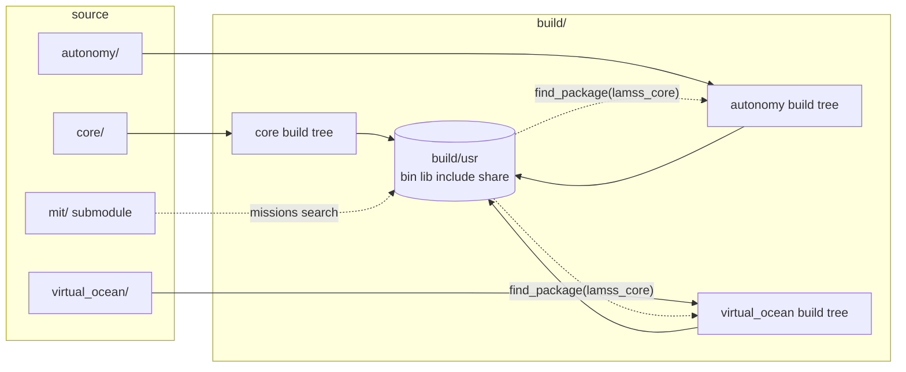
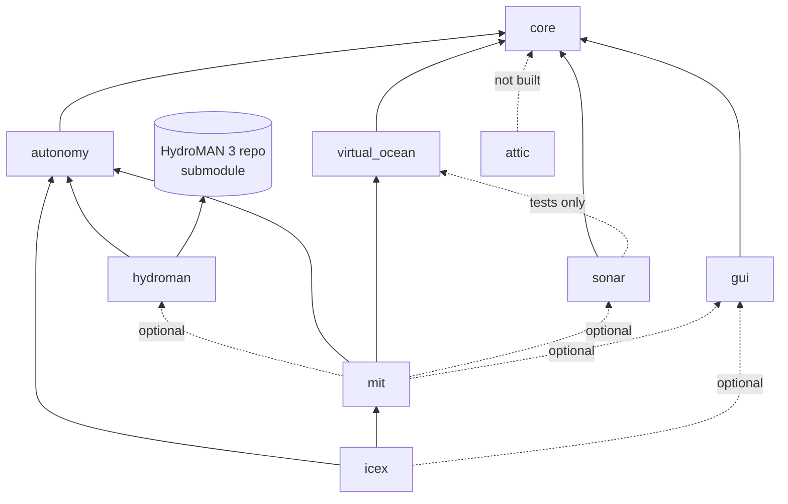

# Repository layout and build system

*This document written by Claude*

Detail for the "Toolboxes" and "Repository Layout" sections of the [core plan](../core.md).

## Layout

```
lamss3/
├── CMakeLists.txt            # top level: reads active toolbox list, add_subdirectory each
├── init.sh                   # installs core deps, builds the lamss tool, installs the symlink (Phase 0 bootstrap)
├── cmake/                    # shared CMake modules (LamssToolbox.cmake, FindXXX.cmake)
├── .lamss/
│   └── toolboxes             # active toolbox list, one name per line (tracked in git)
├── build/                    # all build artifacts (git-ignored)
│   ├── usr/                  # install prefix, mirrors /usr: bin lib include share
│   └── <toolbox>/            # per-toolbox CMake build tree
├── core/                     # always active
│   ├── CMakeLists.txt
│   ├── dependencies.yml
│   ├── src/
│   │   ├── bin/              # Goby applications (one dir per app)
│   │   ├── lib/              # C++ libraries (one dir per lib)
│   │   │   └── protobuf/     # lamss/core/*.proto -> liblamss_core_protobuf.so
│   │   ├── python/           # lamss python package(s)
│   │   ├── sh/               # installed shell scripts
│   │   ├── test/             # unit + integration tests
│   │   └── doc/              # documentation incl. plan/
│   └── missions/             # see 06-missions-framework.md
├── autonomy/                 # same shape as core
├── sonar/
├── virtual_ocean/
├── gui/                      # everything that needs a display library (Wt, FLTK, Bokeh)
├── hydroman/                 # wrapper toolbox: lamss3 glue + HydroMAN 3 repo as submodule
│   ├── CMakeLists.txt
│   ├── dependencies.yml
│   ├── upstream/   (submodule) # the HydroMAN repository, untouched
│   ├── src/                  # iHydroMAN_LAMSS, iHydroMAN_PHINS, lamss.hydroman protos
│   └── missions/             # hydroman component, nav subsystem templates
├── mit/        (submodule)   # cruises and platforms from missions-lamss
├── icex/       (submodule)
├── attic/      (submodule)
└── <user toolbox> (submodule)
```

Each toolbox is a self-contained CMake project (`project(lamss_<name>)`) so it can be built alone in CI, and a `add_subdirectory` target of the top level so it can be built together with the others. The same `CMakeLists.txt` serves both cases.

### Why `build/usr`

Every toolbox installs into `build/usr` (`CMAKE_INSTALL_PREFIX`) and downstream toolboxes find upstream ones there with `find_package(lamss_core)`. This replaces the old `lamss` → `lamss-shared` → `lamss-internal` chain of hard-coded include paths with ordinary CMake package config files, and it is exactly what a Debian package of a toolbox would install to `/usr`. `build/usr/bin` goes on `PATH` and `build/usr/lib` on `LD_LIBRARY_PATH` via `lamss env` (see [03](03-lamss-tool.md)).



## Toolbox activation

`.lamss/toolboxes` is a plain text list. It is the single source of truth for both CMake and the Python mission search, chosen over YAML/JSON so neither side needs a parser.

```
# .lamss/toolboxes  (managed by `lamss toolbox`; hand-editable)
core
autonomy
virtual_ocean
mit
```

Top-level CMake:

```cmake
cmake_minimum_required(VERSION 3.22...4.2)   # 3.22 = Ubuntu 22.04 (oldest supported LTS)
project(lamss3 NONE)
file(STRINGS "${CMAKE_SOURCE_DIR}/.lamss/toolboxes" LAMSS_TOOLBOXES REGEX "^[^#]")
list(PREPEND LAMSS_TOOLBOXES core)
list(REMOVE_DUPLICATES LAMSS_TOOLBOXES)
foreach(tb IN LISTS LAMSS_TOOLBOXES)
  if(NOT EXISTS "${CMAKE_SOURCE_DIR}/${tb}/CMakeLists.txt")
    message(FATAL_ERROR "toolbox '${tb}' is active but missing; run `lamss toolbox add ${tb}`")
  endif()
  add_subdirectory(${tb})
endforeach()
```

Rules:

- `core` is implicitly active and cannot be deactivated.
- A toolbox declares its toolbox dependencies in its `CMakeLists.txt` with `lamss_toolbox(NAME sonar REQUIRES core virtual_ocean)`; `OPTIONAL gui` names a toolbox whose parts are built only when it is active (icex's Liaison plugin), so the rest builds without it; the helper function in `cmake/LamssToolbox.cmake` checks they are active (joint build) or installed in `build/usr` (standalone build) and emits a clear error otherwise.
- External toolboxes are git submodules at the top level; `lamss toolbox add <url> [name]` runs `git submodule add` and appends to `.lamss/toolboxes`. Adding activates by default.
- Deactivating removes the line only; the directory stays. Removing an external toolbox deinits the submodule.

### Toolbox dependency graph



`mit` is a mission-only toolbox (no C++), but it still carries a `CMakeLists.txt` so it can install data files and be listed uniformly.

### Wrapper toolboxes

Some dependencies are git repositories with their own build system that lamss3 must not restructure: HydroMAN 3 is the first. For these, the toolbox directory is in-tree and thin, and the foreign repository sits beneath it as a submodule:

```cmake
# hydroman/CMakeLists.txt
lamss_toolbox(NAME hydroman REQUIRES autonomy)
lamss_toolbox_submodule(upstream)        # fails with "run `lamss toolbox add hydroman`" if not initialised
add_subdirectory(upstream EXCLUDE_FROM_ALL) # HydroMAN's own CMake, built into build/usr like everything else
add_subdirectory(src)                    # lamss3 glue that links HydroMAN's targets
```

- `lamss toolbox add hydroman` initialises the submodule and activates the toolbox; the directory, `CMakeLists.txt`, `dependencies.yml` and `missions/` are already in `lamss3`, so a user without access to the HydroMAN repository simply cannot activate it and nothing else breaks.
- If the foreign project's CMake cannot be used with `add_subdirectory` (clashing cache variables, in-source output directories), the wrapper falls back to `ExternalProject_Add` with `CMAKE_INSTALL_PREFIX=build/usr`. HydroMAN's build is to be checked for this in Phase 0.
- The wrapper owns everything lamss3-specific: adapter apps, protos, mission component and templates, and the `dependencies.yml` entries for the foreign project's own needs. Upstream is never patched from lamss3; fixes go to the HydroMAN repository and the submodule pointer is bumped.
- The same mechanism serves any future foreign dependency that the lab wants selectable as a toolbox (IvPico could be one until it is packaged).

## Per-toolbox CMake shape

```cmake
# autonomy/CMakeLists.txt
cmake_minimum_required(VERSION 3.22...4.2)
project(lamss_autonomy CXX)
include(${CMAKE_CURRENT_SOURCE_DIR}/../cmake/LamssToolbox.cmake OPTIONAL RESULT_VARIABLE _in_tree)
if(NOT _in_tree)
  find_package(lamss_core REQUIRED)   # standalone build: cmake modules come from installed core
  include(LamssToolbox)
endif()
lamss_toolbox(NAME autonomy REQUIRES core)

add_subdirectory(src/lib)        # includes src/lib/protobuf
add_subdirectory(src/bin)
add_subdirectory(src/python)
if(BUILD_TESTING)
  add_subdirectory(src/test)
endif()
lamss_toolbox_export()               # writes lamss_autonomyConfig.cmake into build/usr
```

Helpers provided by `LamssToolbox.cmake`:

| Function | Does |
|---|---|
| `lamss_toolbox(NAME REQUIRES...)` | Sets install prefix to `build/usr`, C++17, warning flags (`-DLAMSS_WERROR=ON` adds `-Werror`), `$ORIGIN` rpath, a `lamss_<tb>_all` target; checks required toolboxes are active (joint build) or installed (standalone) |
| `lamss_add_library(name ...)` | `add_library` + namespaced alias `lamss::<tb>_<name>` + install + export |
| `lamss_add_app(name ...)` | `add_executable` + install to `bin`; links Goby3's `goby` target unless `NO_GOBY`; optional `PROTOS` for the app's config |
| `lamss_add_proto(name PROTOS...)` | Called from the proto import root (`src/lib/protobuf`); runs `protoc` and the DCCL plugin keeping paths (`lamss/<tb>/x.pb.h`), with import dirs covering every active toolbox's proto root and installed toolboxes' `include/`, so cross-toolbox imports work in joint and standalone builds |
| `lamss_add_python(package)` | Installs a Python package to `build/usr/lib/python3/dist-packages` |
| `lamss_toolbox_export()` | Generates the `<tb>Config.cmake` and version file |

Ninja is the default generator; `lamss build` passes `-G Ninja` unless overridden.

## Source tree conventions inside a toolbox

| Directory | Contents | Naming |
|---|---|---|
| `src/bin/<app>/` | One Goby application: `app.cpp`, `config.proto`, `CMakeLists.txt`, `README.md` | Binary named `lamss_<app>` for new Goby3 apps; legacy MOOS names kept until rewritten (e.g. `pLamssMissionManager`) |
| `src/lib/<lib>/` | Library with public headers under `include/lamss/<tb>/<lib>/` | Target `lamss_<tb>_<lib>` |
| `src/lib/protobuf/lamss/<tb>/` | `.proto` files; package `lamss.<tb>`; library `lamss_<tb>_protobuf` | See [07](07-protobuf-split.md) |
| `src/python/lamss/<tb>/` | Python package; `lamss.mission` lives in `core` | |
| `src/sh/` | Scripts installed to `bin` | prefix `lamss_` |
| `src/test/` | ctest targets; integration tests may launch gobyd | |
| `missions/` | Mission concept classes and templates | See [06](06-missions-framework.md) |

## Install and runtime environment

- `lamss env` prints `export PATH=.../build/usr/bin:$PATH`, `LD_LIBRARY_PATH`, `PYTHONPATH`, `LAMSS_ROOT` for `eval`.
- Goby3 apps find DCCL/protobuf libraries through `dccl_load_library` entries in generated configs; the mission framework fills these from the active toolbox list, replacing the old `LAMSS_LIB_ROOT`/`LAMSS_SHARED_LIB_ROOT` macros.
- No source or build path is ever written into installed files; data files are located relative to `build/usr/share/lamss/<tb>/` (or `/usr/share/lamss/<tb>/` when packaged).

## Migration mechanics

History from the old repositories is preserved per app rather than per repo:

1. For each app or library to port, `git filter-repo --path src/moos/<app>` in a scratch clone of the old repo, then `git fetch` + `git merge --allow-unrelated-histories` into `lamss3` under its new path. This keeps `git log --follow` and `git blame` useful.
2. Apps going to `attic` are moved with the same mechanism into the `attic` submodule repository, not deleted.
3. The old repositories are archived read-only once `attic` and `mit` are populated.

## Open questions for the human plan

- `mit` is in-tree until M2, then a submodule (agreed).
- `gui` toolbox (decided): every viewer, Liaison plugin, mission viewer component and plotting server lives in `gui`, so that Wt, FLTK, OpenGL and Bokeh are installed only where it is activated (topside and developer machines, not vehicles or most CI jobs). Other toolboxes depend on it only through `OPTIONAL`.
- Boundary between `virtual_ocean` and `sonar` (decided): `virtual_ocean` is propagation and ocean models, including every sonar, array, noise and target simulator; `sonar` is hardware drivers, processing and tracking. `sonar` therefore depends on `virtual_ocean` only for tests.
