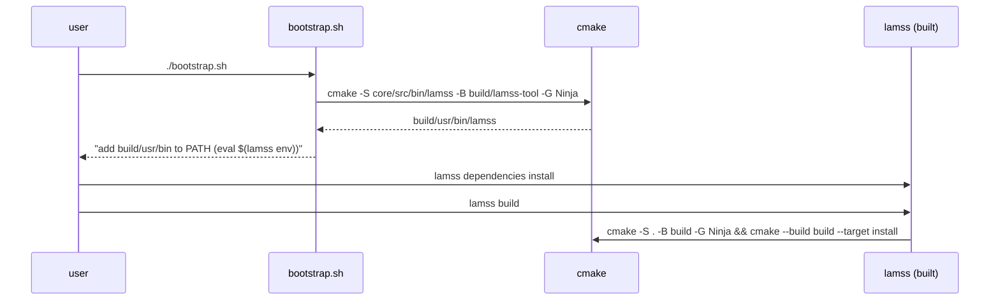
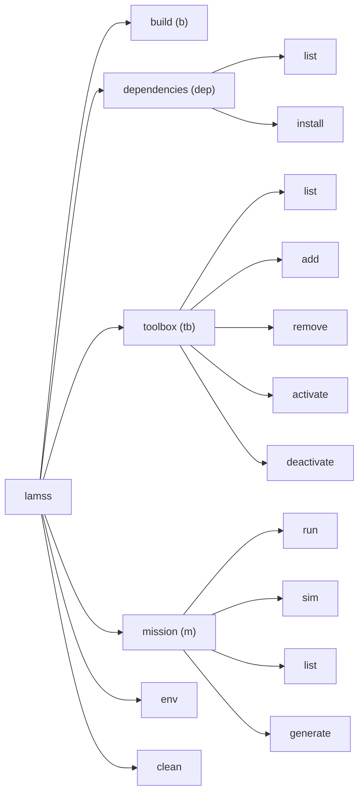

# The `lamss` command line tool

*This document written by Claude*

Detail for the "LAMSS Tool" section of the [core plan](../core.md).

## Requirements recap

- Modern subcommand CLI, `lamss <command> [<subcommand>] [options]`, with `lm` as a shell alias when free.
- Written in C++ (preferred), which needs a bootstrap step because the tool is what builds the project.
- Implicit help when a subcommand is required; `--help` everywhere.
- Subcommands: `build`, `dependencies`, `toolbox`, `mission`, plus `env` (added here).

## Bootstrap

The tool lives in `core/src/bin/lamss/` and depends only on a C++17 compiler, CMake and two vendored header-only libraries ([CLI11](https://github.com/CLIUtils/CLI11) for parsing, [nlohmann/json](https://github.com/nlohmann/json) for the small amount of structured state). It does **not** link Goby, Protobuf or Boost, so it builds on a bare system before `lamss dependencies install` has run.



`bootstrap.sh` is ~20 lines of POSIX shell: check for `cmake`, `ninja`/`make`, `c++`; build the tool; offer to append the `lm` alias and `eval "$(lamss env)"` to the user's shell rc. On systems where the tool is installed from a Debian package (Phase 5) bootstrap is unnecessary.

Rebuilding the tool is part of `lamss build` (the tool's own CMake project is also added at top level), so a changed tool source takes effect on the next build.

## Command tree



### `lamss build` / `lm b`

| Option | Effect |
|---|---|
| (none) | Configure if needed, then `cmake --build build --target install` |
| `--configure` | Force reconfigure (e.g. after editing `.lamss/toolboxes`; the tool does this automatically when the file is newer than `build/CMakeCache.txt`) |
| `--toolbox <tb>` | Build only that toolbox's targets (`--target lamss_<tb>_all`) |
| `--type Debug|Release|RelWithDebInfo` | `CMAKE_BUILD_TYPE`; default `RelWithDebInfo`, remembered in `build/` |
| `-j N` | Parallelism; default `nproc` |
| `--test` | Also run `ctest` |
| `-D KEY=VAL` | Passed through to CMake |

Exit status is CMake's. Output is streamed, not captured, so Ninja's progress and compiler errors look normal.

### `lamss dependencies list|install` / `lm dep`

Each toolbox has a `DEPENDENCIES` file. The old repos' format (one apt package per line) is kept but gains optional distro qualifiers and a comment syntax:

```
# core/DEPENDENCIES
# <package> [codename[,codename...]]   (no codename = all)
libgoby3-dev
libdccl4-dev
libprotobuf-dev
libboost-all-dev
moos-ivp              # built from source: see cmake/FindMOOSIvP.cmake
libnetcdf-c++4-dev    noble,resolute
libnetcdf-cxx-legacy-dev jammy
python3-jinja2
supervisor
```

- `list` prints the union over active toolboxes (or `--toolbox <tb>`), filtered by `lsb_release -cs`, with a `--all-distros` and `--format apt|json` option. Non-apt lines (`moos-ivp`) are listed under a separate "source builds" heading with the script that installs them (`core/src/sh/lamss_install_moos_ivp.sh`).
- `install` runs `sudo apt-get install` on the apt list, adds the GobySoft apt repository if `libgoby3-dev` is listed and absent, and runs the source-build scripts unless `--apt-only`. `--dry-run` prints the commands.

This is the only part of the tool that shells out to `sudo`; it prints the exact command first.

### `lamss toolbox list|add|remove|activate|deactivate` / `lm tb`

State is `.lamss/toolboxes` (see [02](02-repository-layout-and-build.md#toolbox-activation)) plus `.gitmodules` for externals.

| Subcommand | Does |
|---|---|
| `list` | Table: name, kind (in-tree / submodule / missing), active?, path, git describe |
| `add <url> [name]` | `git submodule add <url> <name>`, then activate. `add <name>` for a known in-tree toolbox is an alias for `activate` |
| `remove <name>` | Deactivate and `git submodule deinit`/`git rm`; refuses for in-tree toolboxes |
| `activate <name>` | Append to `.lamss/toolboxes`; check `REQUIRES` of the toolbox (parsed from its `CMakeLists.txt` `lamss_toolbox(...)` call) and activate those too, with a note |
| `deactivate <name>` | Remove from list; refuse if another active toolbox requires it (`--force` to cascade); refuse for `core` |

A changed list marks the build as needing reconfigure.

### `lamss mission run|sim|list|generate` / `lm m`

```
lamss mission sim  <cruise> [--generate] [--execute] [--platform P] [--subsystem S] [--variant V]... [--set key=value]...
lamss mission run  <cruise>  --platform P [--subsystem S] [--generate] [--execute] ...
lamss mission list [cruise]
lamss mission generate <cruise> ...        # alias for --generate only
```

The tool does not implement mission logic. It locates the active toolboxes' `mission/` directories, sets `PYTHONPATH`, and execs `python3 -m lamss.mission` with the same arguments (see [06](06-missions-framework.md)). Keeping the mission engine in Python avoids a C++ ↔ Python boundary for the one subcommand that is inherently Python. `run` requires `--platform` and refuses to run in simulation mode; `sim` defaults to all platforms of the cruise's fleet.

### `lamss env`

Prints shell exports for `PATH`, `LD_LIBRARY_PATH`, `PYTHONPATH`, `LAMSS_ROOT` (repo root) and `LAMSS_PREFIX` (`build/usr`), for `eval "$(lamss env)"`. `--fish` and `--csh` variants if anyone asks.

### `lamss clean`

Removes `build/<toolbox>` trees and `build/usr`; `--all` removes `build/` except the tool itself. Asks for confirmation unless `--yes`.

## Finding the repository root

The tool walks up from the current directory looking for `.lamss/`, like `git` looks for `.git/`. `LAMSS_ROOT` overrides. Mission commands additionally accept being run from inside a toolbox's `mission/` tree.

## Alias installation

On first run (or `lamss alias install`), if `type lm` fails in the user's shell, the tool offers to append `alias lm=lamss` to `~/.bashrc`/`~/.zshrc`. It never writes without a yes. Subcommand shortcuts (`b`, `dep`, `tb`, `m`) are CLI11 aliases, not shell aliases.

## Implementation notes

- Single translation unit per subcommand under `core/src/bin/lamss/cmd/`, plus `repo.cpp` (root discovery, toolbox list I/O) and `process.cpp` (fork/exec with streamed output; no `system()` with string concatenation).
- All subprocess invocations are logged at `-v` so the user can reproduce by hand.
- Unit tests for toolbox list editing and `DEPENDENCIES` parsing (plain ctest, no framework needed beyond `assert`).
- Shell completion generated from the CLI11 tree (`lamss completion bash`).

## Open questions for the human plan

- Should `lamss build` also run `clang-format --dry-run` or is that CI-only? **Recommendation: CI-only, with `lamss format` as a convenience.**
- Is `lamss env` acceptable or should bootstrap install a symlink into `~/.local/bin`? Both can coexist.
