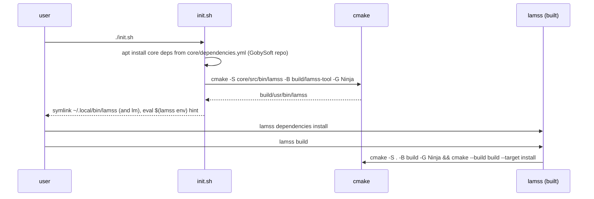
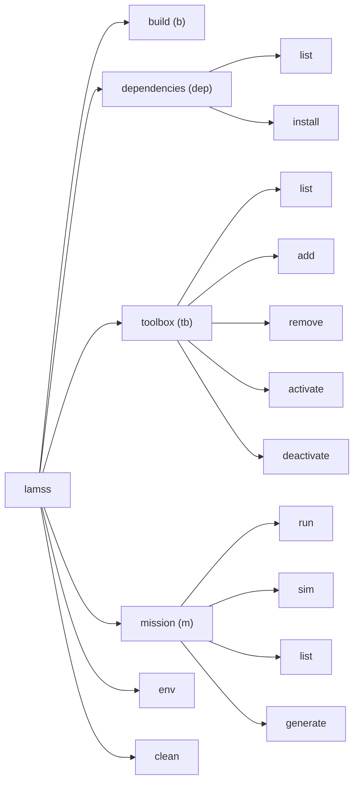

# The `lamss` command line tool

*This document written by Claude*

Detail for the "LAMSS Tool" section of the [core plan](../core.md).

## Requirements recap

- Modern subcommand CLI, `lamss <command> [<subcommand>] [options]`, with `lm` as a shell alias when free.
- Written in C++ on the Goby3 tool framework (`goby::middleware::ToolHelper`, protobuf-configured subcommands, the same conventions as the `goby` tool), which needs a bootstrap step because the tool is what builds the project.
- Implicit help when a subcommand is required; `--help` everywhere.
- Subcommands: `build`, `dependencies`, `toolbox`, `mission`, plus `env` (added here).

## Bootstrap

The tool lives in `core/src/bin/lamss/` and is built on Goby3's tool framework, so its subcommands, help and configuration follow the `goby` tool's conventions and it gets protobuf-defined options for free. The price is that `libgoby3-dev` must be installed before the tool can be built; `init.sh` therefore installs the `core` apt dependencies (adding the GobySoft repository if needed) before building the tool. The dependency parsing for that first step is a few lines of shell reading `core/dependencies.yml`.



`init.sh` is a short POSIX shell script: add the GobySoft apt repository, install the `core` apt dependencies, build the tool, install symlinks `~/.local/bin/lamss` and `~/.local/bin/lm` (if `lm` is free), and print the `eval "$(lamss env)"` hint. On systems where the tool is installed from a Debian package (Phase 5) `init.sh` is unnecessary.

Rebuilding the tool is part of `lamss build` (the tool's own CMake project is also added at top level), so a changed tool source takes effect on the next build.

## Command tree



### `lamss build` / `lm b`

| Option | Effect |
|---|---|
| (none) | Configure if needed, then `cmake --build build --target install` |
| `--configure` | Force reconfigure (e.g. after editing `.lamss/toolboxes`; the tool does this automatically when the file is newer than `build/CMakeCache.txt`) |
| `--toolbox <tb>` | Build only that toolbox's targets (`--target lamss_<tb>_all`) |
| `--type Debug|Release|RelWithDebInfo` | `CMAKE_BUILD_TYPE`; default `RelWithDebInfo`, remembered in `build/` |
| `-j N` | Parallelism; default `nproc` |
| `--test` | Also run `ctest` |
| `-D KEY=VAL` | Passed through to CMake |

Exit status is CMake's. Output is streamed, not captured, so Ninja's progress and compiler errors look normal.

### `lamss dependencies list|install` / `lm dep`

Each toolbox has a `dependencies.yml` file, replacing the old `DEPENDENCIES` Makefile:

```yaml
# core/dependencies.yml
apt:
  all: [libgoby3-dev, libdccl5-dev, libprotobuf-dev, libboost-all-dev, libmoos-ivp-dev, python3-jinja2, supervisor]
  jammy: [libnetcdf-cxx-legacy-dev]
  noble: [libnetcdf-c++4-dev]
  resolute: [libnetcdf-c++4-dev]
apt_repositories:
  - name: gobysoft
    url: http://packages.gobysoft.org/ubuntu/release/
    key: cmake/keys/gobysoft.asc
source:
  - name: rtd-dm7820-dkms
    script: src/sh/lamss_install_dm7820.sh
```

- `list` prints the union over active toolboxes (or `--toolbox <tb>`), filtered by `lsb_release -cs`, with a `--all-distros` and `--format apt|yaml` option. `source` entries are listed under a separate heading with the script that installs them.
- `install` adds any listed apt repositories that are absent (keyring file under `/etc/apt/keyrings/`), runs `sudo apt-get install` on the apt list, and runs the source-build scripts unless `--apt-only`. `--dry-run` prints the commands.

This is the only part of the tool that shells out to `sudo`; it prints the exact command first.

### `lamss toolbox list|add|remove|activate|deactivate` / `lm tb`

State is `.lamss/toolboxes` (see [02](02-repository-layout-and-build.md#toolbox-activation)) plus `.gitmodules` for externals.

| Subcommand | Does |
|---|---|
| `list` | Table: name, kind (in-tree / submodule / missing), active?, path, git describe |
| `add <url> [name]` | `git submodule add <url> <name>`, then activate. `add <name>` for a known in-tree toolbox is an alias for `activate` |
| `remove <name>` | Deactivate and `git submodule deinit`/`git rm`; refuses for in-tree toolboxes |
| `activate <name>` | Append to `.lamss/toolboxes`; check `REQUIRES` of the toolbox (parsed from its `CMakeLists.txt` `lamss_toolbox(...)` call) and activate those too, with a note |
| `deactivate <name>` | Remove from list; refuse if another active toolbox requires it (`--force` to cascade); refuse for `core` |

A changed list marks the build as needing reconfigure.

### `lamss mission run|sim|list|generate` / `lm m`

```
lamss mission sim  <cruise> [variant] [--generate] [--execute] [--platform P] [--subsystem S] [--set key=value]...
lamss mission run  <cruise> [variant] --platform P [--subsystem S] [--generate] [--execute] ...
lamss mission list [cruise]
lamss mission generate <cruise> [variant] ...   # alias for --generate only
```

`variant` is an optional second positional argument naming one variant class; combinations of variants are themselves defined as named variants in Python, never composed on the command line ([06](06-missions-framework.md#variants)).

The tool does not implement mission logic. It locates the active toolboxes' `missions/` directories, sets `PYTHONPATH`, and execs `python3 -m lamss.mission` with the same arguments (see [06](06-missions-framework.md)). Keeping the mission engine in Python avoids a C++ ↔ Python boundary for the one subcommand that is inherently Python. `run` requires `--platform` and refuses to run in simulation mode; `sim` defaults to all platforms of the cruise's fleet.

### `lamss env`

Prints shell exports for `PATH`, `LD_LIBRARY_PATH`, `PYTHONPATH`, `LAMSS_ROOT` (repo root) and `LAMSS_PREFIX` (`build/usr`), for `eval "$(lamss env)"`. `--fish` and `--csh` variants if anyone asks.

### `lamss clean`

Removes `build/<toolbox>` trees and `build/usr`; `--all` removes `build/` except the tool itself. Asks for confirmation unless `--yes`.

## Finding the repository root

The tool walks up from the current directory looking for `.lamss/`, like `git` looks for `.git/`. `LAMSS_ROOT` overrides. Mission commands additionally accept being run from inside a toolbox's `missions/` tree.

## Alias installation

`init.sh` installs `~/.local/bin/lamss` and, if `lm` is not already a command, `~/.local/bin/lm` as symlinks to `build/usr/bin/lamss`; `lamss alias install` repeats that step. Subcommand shortcuts (`b`, `dep`, `tb`, `m`) are aliases in the tool's own subcommand table, not shell aliases.

## Implementation notes

- Goby3 tool framework: one `lamss.proto` config with a message per subcommand, one translation unit per subcommand under `core/src/bin/lamss/cmd/`, plus `repo.cpp` (root discovery, toolbox list I/O) and `process.cpp` (fork/exec with streamed output; no `system()` with string concatenation).
- All subprocess invocations are logged at `-v` so the user can reproduce by hand.
- Unit tests for toolbox list editing and `dependencies.yml` parsing (plain ctest, no framework needed beyond `assert`).
- Shell completion as provided by the Goby3 tool framework.

## Open questions for the human plan

- `lamss build` does not run clang-format; CI checks it and `lamss format` exists as a convenience (decided).
- `init.sh` installs the `~/.local/bin` symlinks; `lamss env` remains for `LD_LIBRARY_PATH`/`PYTHONPATH` (decided).
