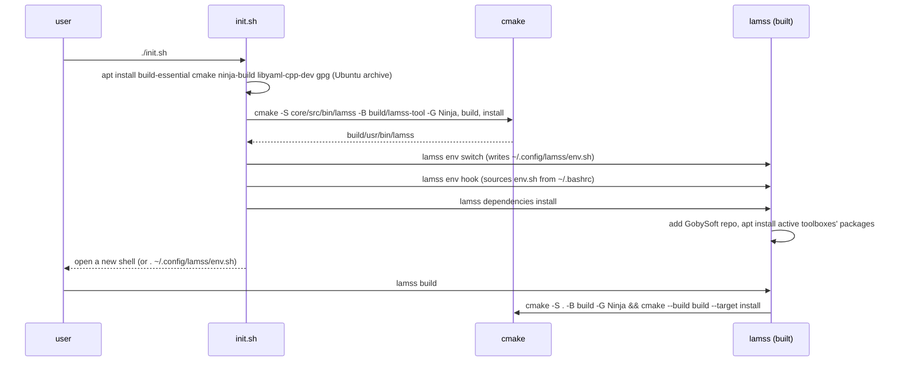
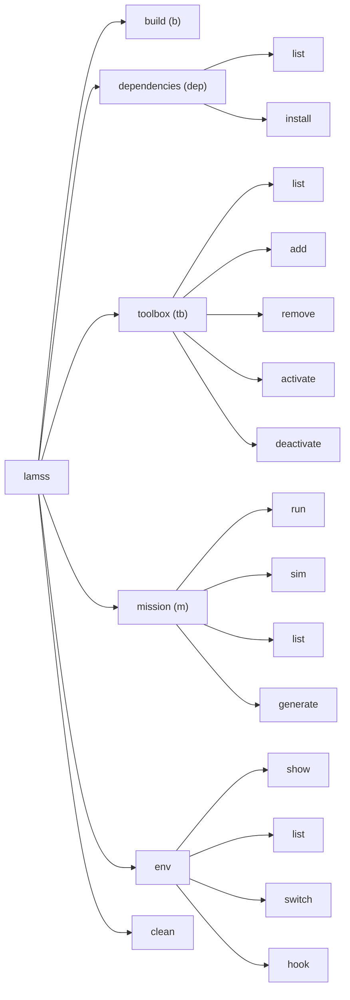

# The `lamss` command line tool

*This document written by Claude*

Detail for the "LAMSS Tool" section of the [core plan](../core.md).

## Requirements recap

- Modern subcommand CLI, `lamss <command> [<subcommand>] [options]`, with `lm` as a shell alias when free.
- Written in C++17 with no dependencies beyond the standard library and yaml-cpp, so it builds before anything else is installed; it is the tool that installs the rest (Goby3 included). An earlier draft used the Goby3 tool framework, which forced `init.sh` to install Goby3 before the tool could exist.
- Implicit help when a subcommand is required; `--help` everywhere.
- Subcommands: `build`, `dependencies`, `toolbox`, `mission`, plus `env` (added here).

## Bootstrap

The tool lives in `core/src/bin/lamss/`, which is also a CMake project of its own. `init.sh` installs only what that project needs from the Ubuntu archive (a compiler, CMake, Ninja, yaml-cpp, gpg), builds the tool, and then runs `lamss dependencies install`, which adds the GobySoft repository and installs the active toolboxes' packages. There is one `dependencies.yml` parser, in the tool.



`init.sh` is a short POSIX shell script that runs these as numbered steps (install the tool's build packages, build the tool, make this the active checkout, add the shell hook, install the dependencies). Each step prints exactly what it will run and asks `[Y/n/q]`; a step that is already satisfied says so and does not ask, and `--yes` accepts every step. On systems where the tool is installed from a Debian package (Phase 5) `init.sh` is unnecessary.

Rebuilding the tool is part of `lamss build` (the tool's own CMake project is also added at top level), so a changed tool source takes effect on the next build.

## Command tree



### `lamss build` / `lm b`

| Option | Effect |
|---|---|
| (none) | Configure if needed, then `cmake --build build --target install` |
| `--configure` | Force reconfigure (e.g. after editing `.lamss/toolboxes`; the tool does this automatically when the file is newer than `build/CMakeCache.txt`) |
| `--toolbox <tb>` | Build only that toolbox's targets (`--target lamss_<tb>_all`) and install them (`cmake --install build/<tb>`) |
| `--type Debug|Release|RelWithDebInfo` | `CMAKE_BUILD_TYPE`; default `RelWithDebInfo`, remembered in `build/` |
| `-j N` | Parallelism; default `nproc` |
| `--test` | Also run `ctest` |
| `-D KEY=VAL` | Passed through to CMake |

Exit status is CMake's. Output is streamed, not captured, so Ninja's progress and compiler errors look normal.

### `lamss dependencies list|install` / `lm dep`

Each toolbox has a `dependencies.yml` file, replacing the old `DEPENDENCIES` Makefile:

```yaml
# core/dependencies.yml
apt:
  all: [libgoby3-dev, libdccl5-dev, libprotobuf-dev, libboost-all-dev, libmoos-ivp-dev, python3-jinja2, supervisor]
  jammy: [libnetcdf-cxx-legacy-dev]
  noble: [libnetcdf-c++4-dev]
  resolute: [libnetcdf-c++4-dev]
apt_repositories:
  - name: gobysoft
    url: http://packages.gobysoft.org/ubuntu/release/
    key: cmake/keys/gobysoft.asc
source:
  - name: rtd-dm7820-dkms
    script: src/sh/lamss_install_dm7820.sh
```

- `list` prints the union over active toolboxes (or `--toolbox <tb>` and the toolboxes it requires), filtered by `lsb_release -cs`, with a `--all-distros` and `--format apt|yaml` option. `source` entries are listed under a separate heading with the script that installs them.
- `install` adds any listed apt repositories that are absent (keyring file under `/etc/apt/keyrings/`; an entry without `components` is a flat repository, suite `<codename>/`, like packages.gobysoft.org), runs `sudo apt-get install` on the apt list, and runs the source-build scripts unless `--apt-only`. `--dry-run` prints the commands.

This is the only part of the tool that shells out to `sudo`; it prints the exact command first.

### `lamss toolbox list|add|remove|activate|deactivate` / `lm tb`

State is `.lamss/toolboxes` (see [02](02-repository-layout-and-build.md#toolbox-activation)) plus `.gitmodules` for externals.

| Subcommand | Does |
|---|---|
| `list` | Table: name, kind (in-tree / submodule / missing), active?, path, git describe |
| `add <url> [name]` | `git submodule add <url> <name>`, then activate. `add <name>` for a known in-tree toolbox is an alias for `activate` |
| `remove <name>` | Deactivate and `git submodule deinit`/`git rm`; refuses for in-tree toolboxes |
| `activate <name>` | Append to `.lamss/toolboxes`; check `REQUIRES` of the toolbox (parsed from its `CMakeLists.txt` `lamss_toolbox(...)` call) and activate those too, with a note |
| `deactivate <name>` | Remove from list; refuse if another active toolbox requires it (`--force` to cascade); refuse for `core` |

A changed list marks the build as needing reconfigure.

### `lamss mission run|sim|list|generate` / `lm m`

```
lamss mission sim  <cruise> [variant] [--generate] [--execute] [--platform P] [--subsystem S] [--set key=value]...
lamss mission run  <cruise> [variant] --platform P [--subsystem S] [--generate] [--execute] ...
lamss mission list [cruise]
lamss mission generate <cruise> [variant] ...   # alias for --generate only
```

`variant` is an optional second positional argument naming one variant class; combinations of variants are themselves defined as named variants in Python, never composed on the command line ([06](06-missions-framework.md#variants)).

The tool does not implement mission logic. It locates the active toolboxes' `missions/` directories, sets `PYTHONPATH`, and execs `python3 -m lamss.mission` with the same arguments (see [06](06-missions-framework.md)). Keeping the mission engine in Python avoids a C++ ↔ Python boundary for the one subcommand that is inherently Python. `run` requires `--platform` and refuses to run in simulation mode; `sim` defaults to all platforms of the cruise's fleet.

### `lamss env show|list|switch|hook`

*This section written by Claude*

Shells load the **active** checkout from one file, so nobody has to `eval` anything, and several checkouts can live side by side:

| File | Written by | Holds |
|---|---|---|
| `~/.config/lamss/env.sh` (`$XDG_CONFIG_HOME` honoured) | `lamss env switch` | Exports of `LAMSS_ROOT`, `LAMSS_PREFIX` (`build/usr`), `PATH`, `LD_LIBRARY_PATH`, `PYTHONPATH` for the active checkout (first removing the previously active one's entries), the `lm` alias when no `lm` exists, and a `lamss` shell function that re-sources the file after `lamss env switch` |
| `~/.config/lamss/checkouts` | `lamss env switch` | Every checkout made active so far, for `list` and switching by name |
| marked block in `~/.bashrc` (and `~/.zshrc` if present) | `lamss env hook` | Sources `env.sh` in every new interactive shell |

| Subcommand | Does |
|---|---|
| `show` | Prints the exports for the checkout you are in, for scripts: `eval "$(lamss env show)"` |
| `list` | The known checkouts, `*` on the active one, each marked built, not built or missing |
| `switch [path\|name]` | Makes a checkout active (default: the one you are in); the current shell follows through the `lamss` function |
| `hook [--remove] [--rc FILE]` | Adds or removes the rc block; adding twice is a no-op |

`env.sh` is static shell rather than a call to the tool, so shells start without running the binary and still start when a build is broken. Non-interactive contexts (CI, cron, supervisord) source `env.sh` or use `lamss env show` explicitly rather than relying on `~/.bashrc`. Only POSIX shells (bash, zsh, dash) are supported.

### `lamss clean`

Removes `build/<toolbox>` trees, the top-level CMake files and `build/usr`, but keeps the tool (`build/usr/bin/lamss` and its bootstrap tree `build/lamss-tool`); `--all` removes all of `build/` including the tool, after which `./init.sh --no-deps` rebuilds it. Asks for confirmation unless `--yes`.

## Finding the repository root

The tool walks up from the current directory looking for `.lamss/`, like `git` looks for `.git/`. `LAMSS_ROOT` overrides. Mission commands additionally accept being run from inside a toolbox's `missions/` tree.

## Alias installation

`env.sh` puts `build/usr/bin` on `PATH` and defines `lm` as a shell alias for `lamss` when no other `lm` is a command. Aliases only expand in interactive shells, so scripts call `lamss`. Subcommand shortcuts (`b`, `dep`, `tb`, `m`) are aliases in the tool's own command table, not shell aliases.

## Implementation notes

- `cli.cpp`: a small command table (subcommands, aliases, options, positionals, generated help, exit status 2 on usage errors). One translation unit per subcommand under `core/src/bin/lamss/cmd/`, plus `repo.cpp` (root discovery, toolbox list I/O) and `process.cpp` (fork/exec with streamed output; no `system()` with string concatenation).
- All subprocess invocations are logged at `-v` so the user can reproduce by hand.
- Unit tests for toolbox list editing and `dependencies.yml` parsing (plain ctest, no framework needed beyond `assert`).
- Shell completion is not provided yet; it can be generated from the command table.

## Open questions for the human plan

- `lamss build` does not run clang-format; CI checks it and `lamss format` exists as a convenience (decided).
- `init.sh` loads the environment through `~/.config/lamss/env.sh` and a `~/.bashrc` hook rather than `~/.local/bin` symlinks; `lm` is a shell alias (decided).
