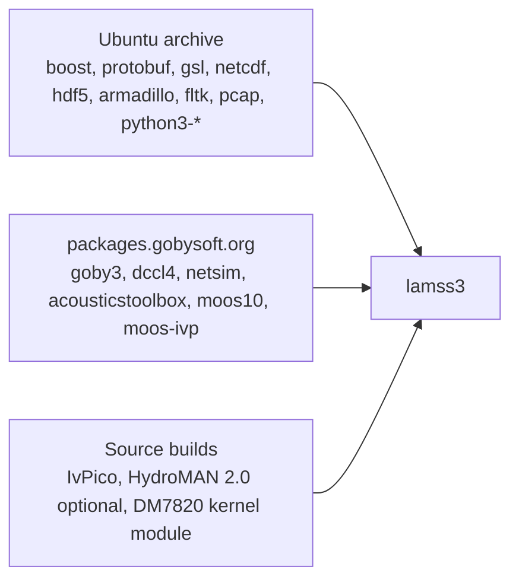
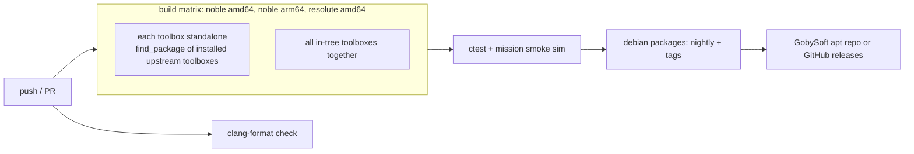

# Dependencies, CI and packaging

*This document written by Claude*

## Target platforms

| Platform | Role |
|---|---|
| Ubuntu 24.04 (noble), amd64 | Primary: developer machines, topside, CI |
| Ubuntu 24.04, arm64 | Vehicle payload computers (Jetson, PC/104 replacements); CI cross-check |
| Ubuntu 26.04 (resolute) | Secondary from Phase 5; Goby3 3.5+ already supports it |
| Ubuntu 22.04 (jammy) | Not supported by lamss3; the old repos remain the 22.04 option |

CMake range `3.22...4.2` lets 22.04's CMake configure the tree if someone tries, but no CI runs on it.

## Dependency sources

The old `DEPENDENCIES` Makefile pulled MOOS and MOOS-IvP from `ppa:tes/lamss-moos10` and `packages.gobysoft.org`. The plan assumes GobySoft continues to publish `libmoos10-dev`, `libmoos-ivp-dev`, `moos-ivp-apps` for noble; **verify this first thing in Phase 0** and fall back to a `cmake/BuildMOOSIvP.cmake` `ExternalProject` from the `moos-ivp` 24.8.1 release if not.

## `DEPENDENCIES` files

Format defined in [03](03-lamss-tool.md#lamss-dependencies-listinstall--lm-dep). Expected contents, derived from the old `DEPENDENCIES` and the survey ([01](01-source-inventory.md#dependencies-to-carry-forward)):

| Toolbox | apt packages | Source |
|---|---|---|
| core | `build-essential cmake ninja-build git libgoby3-dev libgoby3-moos-dev goby3-apps goby3-moos libdccl4-dev dccl4-compiler libprotobuf-dev protobuf-compiler libboost-all-dev libmoos10-dev moosdb10 moos10-essential libmoos-ivp-dev moos-ivp-apps nlohmann-json3-dev libnetcdf-dev libnetcdf-c++4-dev libgsl-dev python3-jinja2 python3-yaml supervisor` | — |
| autonomy | `libarmadillo-dev libpcap-dev python3-dev python3-matplotlib libnetsim-dev` | HydroMAN 2.0 (optional) |
| sonar | `libgsl-dev libhdf5-dev libfltk1.3-dev libhidapi-dev libusb-1.0-0-dev libnetsim-dev` | DM7820 DKMS |
| virtual_ocean | `libnetsim-dev netsim-apps acousticstoolbox libnetcdf-dev python3-netcdf4` | — |
| icex | `libboost-python-dev libopencv-core-dev libgoby3-gui-dev` | — |
| mit | `moos-ivp-gui` (pMarineViewer) `python3-pandas python3-numpy python3-scipy` | — |

Notes:

- Python packages come from apt only. The old `pip install -U bokeh websockets pymoos ...` is replaced; `pymoos` is not needed once the mission framework does not talk MOOS. Where a tool genuinely needs a pip package it runs in a venv created by `lamss dependencies install --python-venv`.
- `apt-key adv` is dead on 24.04; the GobySoft repo is added with a keyring file under `/etc/apt/keyrings/` and a `signed-by=` sources entry.
- `DEBIAN_FRONTEND=noninteractive` and `--no-install-recommends` for CI.

## CI

GitHub Actions on the `lamss3` repository (CircleCI is the alternative if the lab prefers; the workflow is the same).

Jobs:

| Job | Does |
|---|---|
| `format` | `clang-format --dry-run --Werror` over changed files |
| `build-<tb>-standalone` | Container with deps from `<tb>/DEPENDENCIES` + installed `.deb`s of required toolboxes from the previous stage; `cmake -S <tb>`; proves the toolbox is self-contained |
| `build-all` | `lm dep install && lm b --test` with every in-tree toolbox active |
| `mission-smoke` | `lm m sim mbat --variant smoke --execute` for 5 simulated minutes under `warp`; asserts supervisord shows all processes `RUNNING` and the mission manager reached `DEPLOY` |
| `package` | `cpack -G DEB` per toolbox; `lintian` |
| `docs` | Renders the mermaid figures and the Markdown docs into a static site (mkdocs-material) |

Submodule toolboxes (`mit`, `icex`, `attic`) run their own CI in their own repositories, triggered on `lamss3` tags, and are **not** part of the `lamss3` required checks. `attic` CI is allowed to be red.

Containers: one `ghcr.io/gobysoft/lamss3-ci:<codename>` image per distro, rebuilt weekly from `core/DEPENDENCIES` so dependency drift shows up in the image build and not in every PR.

## Debian packaging (Phase 5)

- One source package per toolbox, `lamss3-<tb>`, producing `lamss3-<tb>` (apps + data), `liblamss3-<tb>-dev` (headers, CMake config, proto files) and `python3-lamss3-<tb>` where applicable.
- Generated with `cpack` from the same `install()` rules that fill `build/usr`, so packaging cannot drift from the developer build.
- `lamss3-core` ships the `lamss` tool and `bootstrap.sh` is unnecessary on packaged systems.
- Kernel module for DURIP as `rtd-dm7820-dkms`.
- Versioning: `lamss3` uses `MAJOR.MINOR.PATCH` git tags; toolboxes share the version (one tag releases all in-tree toolboxes). Submodule toolboxes declare the `lamss3` version they were tested against in their `lamss_toolbox()` call.

## Developer containers

`core/docker/Dockerfile` (replacing the old VNC/apache/mysql image) builds the CI image plus a user; `lamss docker` is deliberately **not** a subcommand: `docker run -v $PWD:/lamss3 ghcr.io/gobysoft/lamss3-ci:noble` is enough.

## Open questions for the human plan

- GitHub Actions vs CircleCI: the lab's other projects use which?
- Who hosts the `.deb`s: `packages.gobysoft.org` alongside Goby3, or GitHub Releases + a small apt repo?
- arm64 CI needs either GitHub's arm64 runners or QEMU emulation; the latter is slow (hours for the sonar toolbox). Fine for nightly, not for PRs.
