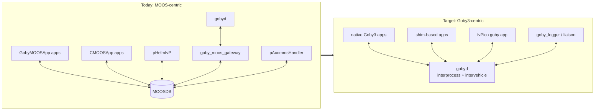
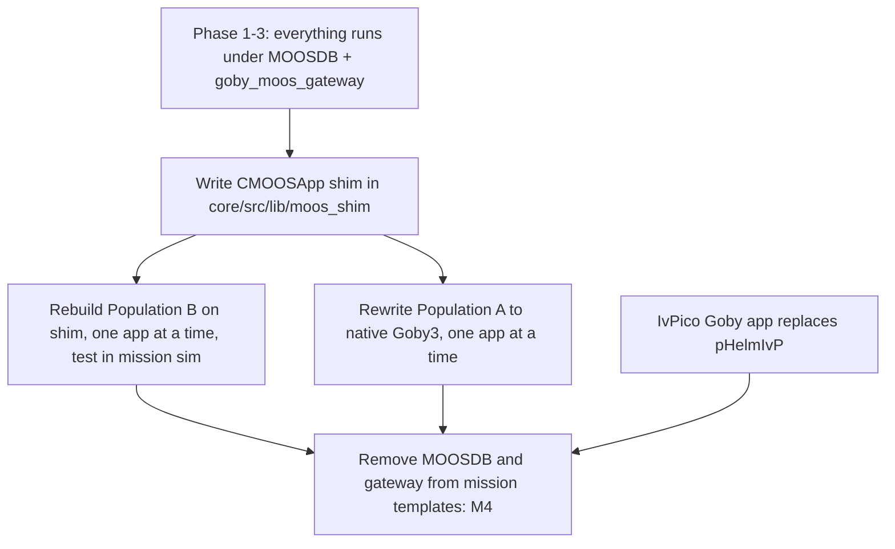
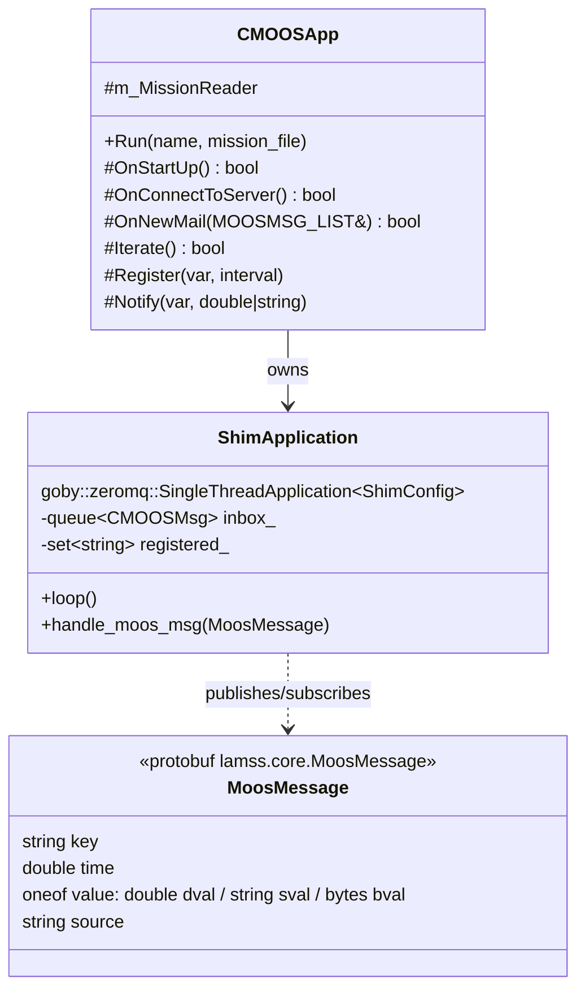
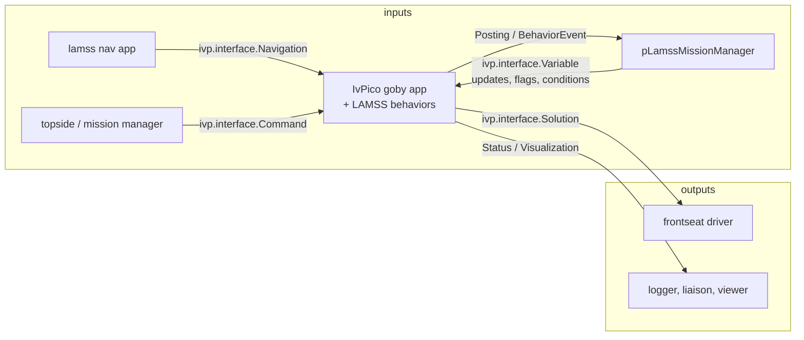

# Middleware shift: MOOS to Goby3

*This document written by Claude*

Detail for the "Middleware shift" section of the [core plan](../core.md), plus the pHelmIvP to IvPico replacement.

## Where the code stands today

The survey in [01](01-source-inventory.md) found three populations of applications:

| Population | Base class | Count (approx.) | Examples |
|---|---|---|---|
| **A** GobyMOOSApp | `goby::moos::GobyMOOSApp` (from Goby3's `libgoby_moos`) | ~33 in lamss-shared, more in lamss | pLamssMissionManager, pLamssCBF, uSimPassiveSonar, uSimModemNetwork, uSVP_OceanModel |
| **B** plain MOOS | `CMOOSApp` / `AppCastingMOOSApp` | ~30 in lamss-shared, most of lamss | pTetraHoming, iHydroMAN_LAMSS, SRToolbox, uSimActiveSonar, uSimTowedArray; HydroMAN 3 itself (foreign repo) |
| **C** native Goby3 | `goby::zeromq::MultiThreadApplication` | 3 (icex_*), all currently disabled in the build | lamss_icex_tracker |
| — | MOOS-IvP itself | pHelmIvP, pMarineViewer, uXMS, pLogger, MOOSDB, pShare, uFld* | |

`lamss-shared` already configures with `find_package(GOBY 3 ... moos)`, so Goby3 compatibility of the MOOS layer is established; the remaining Goby2 users (`pCommsStateTracker`, `arithmetic_tool`) are disabled and go to `attic`.

## Target architecture

The end state has no MOOSDB, no `goby_moos_gateway`, and acoustic comms handled by `gobyd`'s intervehicle layer (which already contains the DCCL/MAC/driver stack that `pAcommsHandler` wrapped). One accepted exception: HydroMAN 3 is a foreign MOOS project running in its own `nav` subsystem, so that subsystem keeps a MOOSDB (and the gateway) until HydroMAN itself moves; the vehicle-side `iHydroMAN_LAMSS` talks to it over TCP and is unaffected.

## Migration levels

The core plan names three levels. Evaluation:

| Level | What it means | Regression risk | New code | Verdict |
|---|---|---|---|---|
| 1. Network protocol mimic | Implement the MOOS wire protocol on top of Goby3 so unmodified MOOS binaries connect to a Goby-backed "MOOSDB" | Low per app, but MOOSDB semantics (wildcard registration, `CMOOSCommClient` timing, appcasting) are large and subtle; MOOS-IvP's own apps would also talk to it | Large (a MOOSDB clone) | **Rejected.** Replaces one middleware dependency with a reimplementation of it |
| 2. CMOOSApp mimic (shim) | Recompile Population B against a stub `CMOOSApp` whose `Notify`/`Register`/`OnNewMail` map onto a Goby3 `SingleThreadApplication` | Low to medium: app logic unchanged, mail ordering and timing differ slightly | Medium, written once | **Adopt** for Population B apps that survive the inventory |
| 3. Partial application rewrite | Replace the pub/sub layer by hand with native Goby3 groups and typed protobuf messages | Medium per app, but each app is small | Per app | **Adopt** for Population A (already protobuf-based, mechanical) and for any B app worth owning long-term |

The shim is the bridge; the rewrite is the destination. Both can proceed in parallel because they do not touch the same apps.

### Sequencing

Each app migration is one PR that: moves the app, keeps its config proto, adds a short integration test under `src/test/`, and switches the mission template. Until the last MOOS-only app is gone, `goby_moos_gateway` keeps the two worlds in sync so migrated and unmigrated apps interoperate.

## Native Goby3 rewrite (Population A)

`GobyMOOSApp` apps already use protobuf for configuration and (mostly) for messages, so the rewrite is mechanical:

| GobyMOOSApp | Goby3 equivalent |
|---|---|
| `subscribe("VAR", &Handler)` | `interprocess().subscribe<group::var>({...})` |
| `publish("VAR", pb_msg)` via `moos_protobuf_helpers` | `interprocess().publish<group::var>(pb_msg)` |
| `publish("VAR", double)` | a small typed message (`lamss.core.Scalar`) or, better, a proper protobuf field on a real message |
| `cfg()` from `*_config.proto` extending `goby_moos_app.proto` | same proto, extending `goby.middleware.protobuf.AppConfig`; `MultiThreadApplication` if the app has blocking I/O |
| `loop()` at `AppTick` | `loop()` at `cfg().app().loop_freq()` |
| `MOOSTime()` / `goby/time/legacy.h` | `goby::time::SystemClock::now()` |
| `CMOOSGeodesy` | `goby::util::UTMGeodesy` |
| `pAcommsHandler` queue names | `intervehicle().publish<group>()` with DCCL messages; the `gobyd` intervehicle config carries the MAC/driver blocks |

Groups are declared once per toolbox in `src/lib/<tb>_groups/groups.h`, replacing the free-form MOOS variable names. The existing `lamss/lib_goby3_lamss_gateway/groups.h` is the seed for `core`.

### The MOOS variable → Goby group catalogue

Before any rewrite, generate a catalogue of every MOOS variable published/subscribed by the live missions (by grepping `Register`/`subscribe`/`Notify`/`publish` plus the `.moos` templates) and assign each to a Goby group and protobuf type. This is a one-off script in `core/src/python/lamss/tools/moos_var_catalogue.py` whose output becomes a table in [09-toolboxes](09-toolboxes.md). It is also what the shim uses for its default mapping.

## CMOOSApp shim (Population B)

### Design

`core/src/lib/moos_shim/` provides `CMOOSApp`, `AppCastingMOOSApp`, `CMOOSMsg`, `MOOSMSG_LIST` and the few `MOOSLib` helpers the apps use (`MOOSTime`, `MOOSTrace`, `MOOSToUpper`, `MOOSChomp`, `MOOSStrCmp`, `MOOSVectorFromString` …). The header names are the same as MOOS's so an app compiles with no source changes except its `CMakeLists.txt` (link `lamss::core_moos_shim` instead of `${MOOS_LIBRARIES}`).

- **Transport.** One protobuf type, `lamss.core.MoosMessage`, carrying key, time, source and a `oneof` of double/string/binary. Each MOOS variable maps to a Goby **dynamic group** named after the variable (`goby::middleware::DynamicGroup(key)`), so subscriptions stay per-variable and cheap. Static groups are preferred for the handful of hot variables (NAV_*, DESIRED_*) and are generated from the catalogue above.
- **Config.** `m_MissionReader` reads the same `ProcessConfig = pApp { ... }` block from a `.moos`-style file, so existing config templates work unchanged. The shim's own Goby `AppConfig` (loop frequency, glog) is a separate `.pb.cfg`.
- **Threading.** Everything runs on the Goby single-thread event loop; `OnNewMail` is called once per `loop()` with the queued messages, then `Iterate()`. This matches `CMOOSApp` semantics with `CommsTick == AppTick`.
- **AppCasting.** `AppCastingMOOSApp::reportRunWarning`/`buildReport` publish to a `lamss.core.AppCast` group so `goby_liaison` or a small `lamss_appcast_viewer` can show them. `uMAC`-style reports are not reproduced.
- **Not supported** (deliberately): `MOOSDB` wildcard registration (`*:*`), `CMOOSCommClient` direct use, `Comms().Post` with custom source names, `MOOSAsyncCommClient` callbacks. An app using these is flagged by the compiler and either patched or sent to `attic`.

### Interoperating with real MOOS during the transition

`goby_moos_gateway` already bridges MOOSDB variables to Goby3 using the same key/value structure. The shim's `MoosMessage` is kept identical to the gateway's `goby::moos::protobuf::MoosMessage`-style translation so a shimmed app and a real MOOS app see each other's variables through the gateway until MOOSDB is retired. Verify this early with a two-app test (one shimmed, one real).

## pHelmIvP to IvPico

[IvPico](https://github.com/GobySoft/IvPico) builds first-class IvP helm applications for non-MOOS middlewares. Its `src/lib/interface/ivp.proto` already defines the whole helm contract in protobuf (`Navigation`, `Variable`, `Command` in; `Solution`, `Posting`, `BehaviorEvent`, `Status`, `Configuration`, `Visualization`, `LifeEvent`, `OffboardMessage`, `ObjectiveFunction` out), using `openocean.Navigation` and `openocean.ControlSetpoint` from [openocean-messages](https://github.com/openocean-software/openocean-messages) for nav and setpoints. Its Goby app directory is still empty, so lamss3 is both a consumer and a driver of that work.

Plan:

1. **Phase 2-3**: pHelmIvP runs unchanged under MOOSDB. The autonomy toolbox's mission manager keeps publishing MOOS variables (via gateway or shim).
2. **Autonomy toolbox codes to the IvPico interface now.** The behavior-facing messages that `pLamssMissionManager` and `pLamssTrackManager` produce (`LAMSS_DEPLOY_*`, updates to behaviors, `MODE`/flag variables) are expressed as `ivp.interface.Variable`/`Command`, and a thin adapter publishes them to MOOS for pHelmIvP in the interim. This way the autonomy apps do not need to change again when IvPico lands.
3. **LAMSS behaviors** (`lib_behaviors-henrik`: `BHV_OptAcoustDepth`, `BHV_OptAcommsDepth`, `BHV_GlideSlopeSpeed`, plus whatever `lamss` carries) are kept as IvP behavior plugins, which IvPico loads the same way pHelmIvP does. Their MOOS-variable I/O goes through IvPico's `Variable`/`Posting` path; any direct MOOS use inside a behavior is removed.
4. **Nav input**: `openocean.Navigation` becomes the canonical nav message in `core` (replacing `NAV_X/Y/...` and `NODE_REPORT` strings). The frontseat driver and HydroMAN interface publish it; a `lamss_node_report` adapter keeps `NODE_REPORT` alive for pMarineViewer while it is still used.
5. **Phase 4**: swap the mission template from `pHelmIvP` + gateway to the IvPico Goby app. pMarineViewer, if still wanted, is fed by a `lamss_moos_viewer_bridge` (gateway in the other direction) or replaced by `goby_liaison` + geoview plugin.

IvPico-related work that lamss3 should contribute upstream rather than fork: the Goby app itself, a `Visualization` to Liaison plugin, and any `openocean` message fields LAMSS nav needs (e.g. altitude, DVL validity).

## pAcommsHandler to gobyd intervehicle

`pAcommsHandler` (Goby's MOOS acomms app) bundles DCCL encoding, queueing, MAC and the modem driver. In Goby3 these live in `gobyd`'s intervehicle layer. The migration is configuration, not code: the DCCL messages in `lib_lamss_protobuf` move into the toolboxes ([07](07-protobuf-split.md)), apps publish them on intervehicle groups, and the mission template emits the `intervehicle { ... }` block of `gobyd.pb.cfg` from the same `component/acomms` data that filled `pAcommsHandler.plug`. Modem simulators (`uSimModemNetwork`, `iNetSimManager`) keep working because Goby3 drivers can target netsim via the same TCP/UDP endpoints.

## Testing the migration

- **Replay harness.** `goby_logger` `.goby` logs from a MOOS-era simulation (recorded through the gateway) are replayed with `goby_playback` into a migrated app; outputs are diffed against the recorded ones. This catches semantic drift without needing the whole simulation.
- **Mission-level test.** `lm m sim mbat --variant smoke` runs for N simulated minutes in CI with `warp`; pass criterion is the mission manager reaching a given state and no app exiting.
- **Shim unit tests.** Message ordering, `Register` before connect, string/double round trips, `OnNewMail` batching.

## Open questions for the human plan

- Keep `pMarineViewer` (MOOS-only, FLTK) through a reverse bridge, or standardise on Goby Liaison? The former costs a small bridge, the latter a viewer plugin.
- Should the shim live in `core` or in `attic`? If the aim is to have no Population B apps left after Phase 4, `attic` is the honest place; `core` if some (SRToolbox, `iHydroMAN_LAMSS`, and possibly HydroMAN 3 if its owner wants to adopt the shim) will stay shimmed indefinitely. **Recommendation: `core` until M4, then decide based on what is left.**
- `goby::moos::GobyMOOSApp` depends on MOOS headers. Removing MOOS entirely means Population A must be fully rewritten, not just shimmed; confirm that is the intent.
