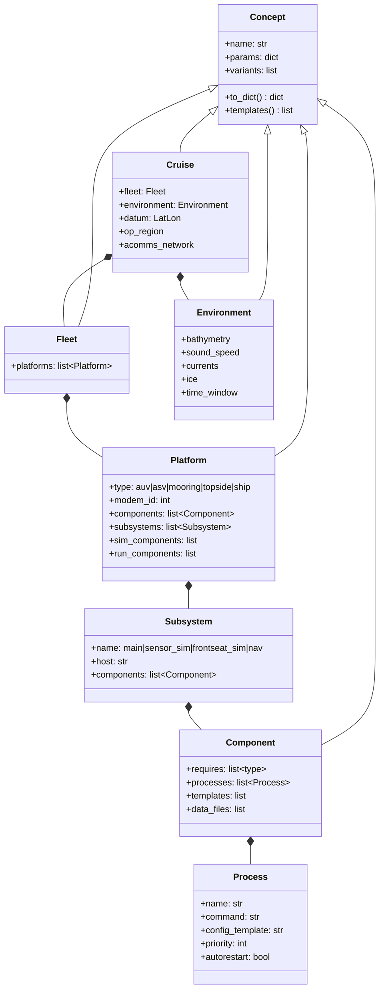
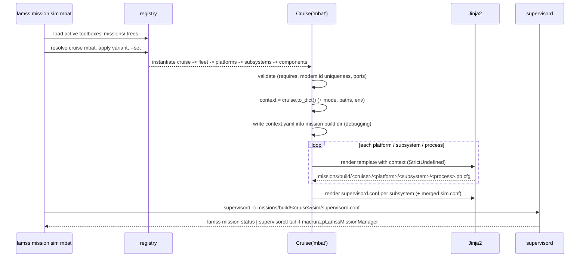
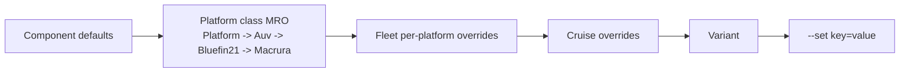

# Mission framework

*This document written by Claude*

Detail for the "Missions" section of the [core plan](../core.md). The framework replaces `missions-lamss`'s `gpp` preprocessor, `.class`/`.plug`/`.def` files and `pAntler` with Python 3 classes, Jinja2 templates and `supervisord`.

## What `missions-lamss` does today (and what must survive)

| gpp-era mechanism | What it achieves | lamss3 equivalent |
|---|---|---|
| `classes/*.class` single-inheritance chain (`node` → `auv` → `bluefin-auv`) | Platform taxonomy | Python class inheritance under `platform/` |
| Mix-in classes (`acomms.class`, `passive-sonar-processing.class`, `virtual-ocean.class`) | Optional capability bundles | `Component` classes, composed into platforms |
| `*.plug` (one `ProcessConfig` block or behavior group) | Per-app config fragment | One Jinja2 template per app, owned by the component that launches it |
| `all.def` → `auv.def` → `cruise.def` → `global.def` → `array.def` macro layering, last `#define` wins | Parameter overrides | Attribute dictionaries merged along the MRO plus explicit cruise/fleet/variant overrides, **first definition closest to the leaf wins** (the opposite of gpp, which silently let `auv.def` override `all.def`) |
| 143 `-D` flags in `flags.txt` | Feature switches | Variants (`lm m sim mbat hydroman`), options (`--set warp=10`), or removed (xterm/screen/popups) |
| `#ifdef simulation` / `#ifdef runtime` | Two instantiations of the same concept | `mode` in the render context plus `sim_components` / `run_components` on platforms |
| Subsystems as separate MOOS communities (`auv/macrura`, `frontseat_sim`, `sensor_sim`, `hydroman_ext`) | Parts of a platform on different computers | `Subsystem` objects; each gets its own output directory and `supervisord.conf` |
| `sim_scripts/*.sh` (60+ hand-written launch scripts) | A specific fleet + flag combination | `Cruise` subclasses and variants; `lm m sim <cruise>` |
| `@ANTLER Run = ...` + generated `ANTLER` block + `pAntler` | Process launch | `supervisord` program entries generated from the component list |
| `cruise/current` symlink, `cruise_config.sh` | Select a cruise | Argument to `lm m` |
| `data/acomms/*.pb.cfg` DCCL includes, `data/replicas`, `cruise/*/data` | Data files | `missions/data/` in the toolbox that owns the message or dataset; large environment files in S3, fetched on demand; referenced by path from the context |
| `$(MISSION_ROOT)/../lamss/lib` | Library location | `lamss env` prefix in the context |
| Unexpanded-macro check | Catch typos | Jinja2 `StrictUndefined` |

Things deliberately not reproduced: xterm/screen popups, `pMOOSBridge`/`pMOOSLink` community bridging (Goby3 interprocess replaces it; during the transition the acomms/gateway component emits `pMOOSLink` config when two MOOSDBs exist on one machine), `uXMS` auto-launch, the `goby1`/`goby2` switches. Where one of these still has a residual need, it is met in Python (a component property) or in a template, not by a new framework feature.

## Concepts



- **Cruise**: bounds the deployment. Owns the datum, op region, acomms network (modem IDs, MAC, frequency band), the fleet and the environment. `mbat`, `irminger`, `arctic`, `icex20` are cruises.
- **Fleet**: the platforms that take part, with per-cruise platform parameters (which vehicle is modem 4, what loiter depth). A fleet class is reusable across cruises (`mit_bf21` = resolution + macrura + unicorn).
- **Platform**: `auv` → `propellor` → `bluefin21` → `macrura`. Has a modem ID, a default component list, and one or more subsystems. The subsystem split differs between sim and runtime: in sim, `frontseat_sim` and `sensor_sim` exist; at runtime, `main` and optionally `nav` (external HydroMAN computer) and `secondary_payload`.
- **Component**: anything that contributes processes, config templates or parameters: `ivp` (helm + behaviors), `acomms/micromodem`, `mission_manager`, `frontseat/bluefin`, `hydroman/external`, `sonar/passive_chain`, `virtual_ocean/netcdf_ocean`, `logging`, `health`. Components declare `requires` so composition errors are caught at generate time, and they can be `sim_only` or `run_only`.
- **Environment**: bathymetry, sound speed, currents, ice, with a time window; only instantiated for simulation. The environment owns the virtual-ocean components that simulate it (ocean models, propagation, modem network, sonar/noise/target simulators), which run in the platforms' `sensor_sim` subsystems (and the topside's). Concrete environments (`global/atlantic/mass_bay`, `global/arctic/beaufort`, `global/atlantic/irminger`) are mission content and live in `mit`; `core` and `virtual_ocean` hold only the base classes.

Each concept resolves to a plain `dict` (its `params` merged along the MRO, plus children's dicts) and that dict is the only thing templates see.

## Directory layout

Per toolbox, mirroring the class tree. A directory `x/` holds `x.py` defining class `X`; subdirectories are subclasses.

```
core/missions/
├── cruise/cruise.py                      # class Cruise
├── fleet/fleet.py
├── platform/platform.py
│   ├── auv/auv.py                        # class Auv(Platform)
│   ├── topside/topside.py
│   └── mooring/mooring.py
├── component/component.py
│   ├── logging/logging.py                # goby_logger, glog config
│   ├── health/health.py                  # goby_coroner / supervisord event listener
│   ├── interprocess/interprocess.py      # gobyd (+ MOOSDB + gateway during transition)
│   ├── acomms/acomms.py                  # gobyd intervehicle block / pAcommsHandler
│   │   ├── micromodem/micromodem.py
│   │   ├── udp/udp.py
│   │   └── netsim/netsim.py
│   └── viewer/viewer.py                  # liaison / pMarineViewer bridge
├── environment/environment.py            # base class only; concrete environments live in mit
├── templates/                            # Jinja2, one per process config: gobyd.pb.cfg.j2 ...
└── data/                                 # acomms DCCL configs, replicas, modem id lookup

autonomy/missions/
├── platform/auv/propellor/propellor.py
│   └── bluefin21/bluefin21.py
├── component/ivp/ivp.py                  # pHelmIvP now, IvPico later; owns bhv templates
│   └── behaviors/*.bhv.j2
├── component/mission_manager/...
├── component/frontseat/{bluefin,hybrid,embedded}/...
└── templates/

virtual_ocean/missions/
└── environment/component/                # components attached to the Environment, not the platform
    ├── ocean_model/{netcdf_ocean,gdem,noaa_bathy}/...
    ├── modem_sim/{netsim,usim_modem_network}/...
    ├── sonar_sim/{passive,active,towed_array,noise,targets}/...
    └── sensor_sim/{ctd,adcp,gps,dvl,phins}/...

sonar/missions/
├── component/sonar/{passive_chain,active_chain,durip,tetra}/...
└── data/arrays/<array>/                  # array geometry (from auv/arrays/*)

hydroman/missions/
├── component/hydroman/hydroman.py        # iHydroMAN_LAMSS + iHydroMAN_PHINS on main; HM3 apps on the nav subsystem
└── templates/                            # pHM3_BasicModel, pHM3_VelProcessor, iHydroMAN_Gateway, pHM_* .moos fragments

mit/missions/
├── cruise/{mbat,irminger,icex20}/...
├── fleet/{mit_bf21,mit_bf21_hybrid,icex_camp}/...
├── platform/auv/propellor/bluefin21/{macrura,unicorn}/...
├── platform/topside/resolution/...
├── platform/mooring/hydrohole/...
├── environment/global/atlantic/{mass_bay,irminger}/..., arctic/beaufort/...
└── templates/                            # cruise-specific overrides only
```

Class discovery: `lamss.mission.registry` walks each active toolbox's `missions/` tree, imports every `<dir>/<dir>.py`, and registers classes by their path (`platform/auv/propellor/bluefin21/macrura`) and short name (`macrura`). Toolboxes extend each other's trees by placing a subdirectory at the same path (the `mit` toolbox adds `bluefin21/macrura` beneath `autonomy`'s `bluefin21`). A name clash is an error.

## Rendering pipeline



### Context dict shape

```python
{
  "mode": "sim",                        # or "run"
  "cruise": {"name": "mbat", "datum": {"lat": 42.40587, "lon": -70.5619}, "op_region": {...},
             "acomms": {"frequency_hz": 4000, "bandwidth_hz": 1000, "mac": "fixed", "slots": [...]},
             "ship": "resolution", ...},
  "fleet": {"name": "mit_bf21", "platforms": ["resolution", "macrura", "unicorn"]},
  "platform": {"name": "macrura", "type": "auv", "modem_id": 4, "max_depth": 190, ...},
  "subsystem": {"name": "main", "host": "localhost", "ports": {"gobyd": 9004, "moosdb": 9000}},
  "component": {"ivp": {...}, "acomms": {"driver": "netsim", ...}, "hydroman": {"host": "localhost", "port": 9604}},
  "environment": {"name": "mass_bay", "bathymetry": "/.../mbat_lg_9840.nc", "sound_speed": ...},
  "paths": {"prefix": "/.../build/usr", "data": {...}, "log": "/.../missions/log/2026-11-03T14-00Z/macrura/main",
            "run": "/.../missions/run/mbat/macrura/main", "proto_libs": ["liblamss_core_protobuf.so", ...]},
  "platforms": {"resolution": {...}, "unicorn": {...}}   # the other platforms, for contact/modem tables
}
```

The full context dict is also written as `context.yaml` into the mission build directory before any template is rendered, so a mission author can see exactly what the templates saw. Templates are plain Jinja2 with loops and conditionals only; anything needing arithmetic or lookups is computed in Python and placed in the dict (the gpp `#eval` lines become properties on the component). Custom filters: `pb_string` (quote/escape for TextFormat), `latlon`, `utm`.

### Parameter precedence



Later boxes override earlier ones. Each level is an explicit dict, so `lm m generate mbat --explain platform.macrura.max_depth` can print where a value came from. This fixes the gpp gotcha where `auv.def` silently overrode `all.def`.

## Variants

A variant is a class decorated with `@variant("name")` that subclasses a concept and is applied only when requested. Variants may change params, add or remove components, or swap a component implementation. Each variant lives in its own file next to the base class (`macrura.py` is the base; `macrura_hybrid.py`, `macrura_hydroman.py` are variants).

```python
# mit/missions/platform/auv/propellor/bluefin21/macrura/macrura.py
class Macrura(Bluefin21):
    modem_id = 4
    params = dict(max_depth=190, low_speed=1.2, high_speed=2.0)
    components = Bluefin21.components + [TetraHoming, PassiveSonarChain.with_array("durip")]
    sim_components = [FrontseatSim(UMVSBluefin), SensorSim(PassiveSonarSim, NetcdfOcean)]
```

```python
# mit/missions/platform/auv/propellor/bluefin21/macrura/macrura_hybrid.py
@variant("hybrid")
class MacruraHybrid(Macrura):
    components = replace(Macrura.components, FrontseatBluefin, FrontseatHybrid)
    sim_components = [FrontseatSim(UnderseaVehicleVlamss, ActuatorMapXL, ControlEngine)]
    params = dict(glideslope=(-30, 30))
```

```python
# mit/missions/platform/auv/propellor/bluefin21/macrura/macrura_hydroman.py
@variant("hydroman")
class MacruraHydroman(Macrura):
    components = Macrura.components + [Hydroman, PhinsIns]          # from the hydroman toolbox
    subsystems = Macrura.subsystems + [Subsystem("nav", components=[Hydroman.nav_side])]  # HM3 process group
```

Only one variant is named on the command line (`lm m sim mbat hybrid_hydroman`). Combinations are defined in a file as a named variant that inherits from the variants it combines (`class MacruraHybridHydroman(MacruraHydroman, MacruraHybrid)` in `macrura_hybrid_hydroman.py`), so every runnable configuration has a name, a file and a git history. Conflicts in such a combination (two parents replacing the same component differently) are reported at import time, not resolved silently.

Cruise and fleet variants work the same way (`@variant("two_auv")` adds `unicorn`; `@variant("smoke")` shrinks the fleet to one AUV + topside for CI).

### Flag mapping

The 143 `flags.txt` entries map to:

| gpp flag(s) | Becomes |
|---|---|
| `hydroman_ext` (→ `hydroman`), `hybrid_uuv`, `xl_hybrid`, `passive`, `active`, `bearingsim`, `icex_tracker`, `netsim`, `netsim_udp`, `tcp_modem`, `hw_modem`, `mseas`, `gdem`, `hycom`, `lamss_dc` | Variants on the platform, fleet or cruise (positional `variant` argument) |
| `iris`, `ufld` | Removed (IRIS modem and uField are not carried forward) |
| `warp=xx`, `run=xx`, `payload_ip=`, `frontseat_ip=`, `topside_ip=`, `bluefin_ip=` | `--set warp=10`, `--set platform.macrura.subsystem.main.host=…` |
| `simulation`, `runtime` | `sim` vs `run` subcommand |
| `frontseatsim`, `sensorsim`, `auv=xx` | Subsystem selection (`--subsystem`) and `--platform` |
| `quiet`, `screen`, `ums`, `no_pmv`, `generate_only`, `no_debug_logs` | `--generate`, log-level option, viewer component on/off; xterm/screen gone |
| `geo_msgs`, `goby1` | Removed (GEO messages are the only kind; Goby3 only) |
| `hydroman`, `auto_model_id` (internal HydroMAN 1.x), `hydroman_3` (selects HM3 apps inside `hydroman_ext`) | Removed; the `hydroman` variant always means HydroMAN 3 from the `hydroman` toolbox, and errors if that toolbox is not active |

## Output

```
<toolbox>/missions/
├── build/<cruise>/
│   ├── <platform>/<subsystem>/
│   │   ├── supervisord.conf          # [program:x] per process, [group:<platform>_<subsystem>]
│   │   ├── context.yaml              # the full context dict the templates saw
│   │   ├── gobyd.pb.cfg
│   │   ├── goby_logger.pb.cfg
│   │   ├── pLamssMissionManager.pb.cfg
│   │   ├── last.moos                 # transition only: MOOSDB + MOOS apps + gateway
│   │   ├── current.bhv
│   │   └── env.sh                    # PATH, LD_LIBRARY_PATH, LAMSS_* for the processes
│   └── sim/supervisord.conf          # [include] of every selected subsystem conf, one supervisord
├── log/<UTC timestamp>/<platform>/<subsystem>/   # supervisord stdout/stderr, goby_logger .goby, glog
└── run/<cruise>/<platform>/<subsystem>/          # pid, sockets, pty loopbacks, scratch
```

The `missions/build`, `log` and `run` directories live in the toolbox that owns the cruise (`mit/missions/...`), matching the core plan's layout; `lm m` prints the paths it used.

### supervisord

One `supervisord` instance per machine. `sim` on one machine merges every subsystem's fragment; `run --platform macrura --subsystem main` uses only that fragment. Generated entries look like:

```ini
[program:gobyd]
command=gobyd -c gobyd.pb.cfg
directory=%(here)s
priority=10
autorestart=unexpected
stdout_logfile=%(ENV_LAMSS_LOG)s/gobyd.out
environment=LAMSS_PLATFORM="macrura",LAMSS_WARP="%(ENV_LAMSS_WARP)s"

[program:pLamssMissionManager]
command=pLamssMissionManager last.moos
priority=50
startsecs=2
```

`priority` is derived from component ordering (interprocess → health/logging → sensors → autonomy → viewers) so `gobyd`/MOOSDB are up before clients, replacing `MSBetweenLaunches`. `lamss mission status|stop|restart|tail` wrap `supervisorctl` against the right socket. supervisord's HTTP monitor (`inet_http_server`) is enabled optionally (`--set supervisor.http_port=9001`) for watching a vehicle from topside. The health component installs an [event listener](http://supervisord.org/events.html) that publishes process state to Goby (`lamss.core.ProcessHealth`), taking over `pCoroner`'s role.

## Runtime (vehicle) deployment

- `lm m run <cruise> --platform macrura --subsystem main` on the payload computer generates into the local `missions/build` and starts supervisord. A `--remote host` option rsyncs the generated directory to the target and runs there, replacing the ad-hoc `payload_ip`/`rsync` plugs.
- On a vehicle, supervisord must come up at boot: `lamss mission install-service <cruise> --platform P --subsystem S` writes a systemd unit (`lamss-mission@<platform>-<subsystem>.service`) that runs `supervisord -n` on the generated configuration, so the mission survives reboots and can be started, stopped and journaled with `systemctl`.
- Hardware addresses (`/dev/ttyUSB1`, modem pool IPs, frontseat IPs) are platform/subsystem params with `run`-mode defaults; sim mode supplies loopbacks and simulator endpoints instead.
- Nothing in `missions/build` is committed; a `lamss mission freeze` copies it into `log/<timestamp>/config/` so a field run's exact configuration is logged.

## Transition: emitting MOOS files

Until M4, components that launch MOOS apps render `ProcessConfig` blocks into a shared `last.moos` template (the component contributes a fragment, the subsystem concatenates them with `MOOSDB`, `pLogger`, `goby_moos_gateway` entries) and the helm component renders `current.bhv`. The MOOS apps are still launched by supervisord individually (`pApp last.moos`), never by `pAntler`. When an app is rewritten to Goby3 its component switches from a `.moos` fragment to a `.pb.cfg` template and nothing else changes.

## Implementation plan

| Step | Deliverable |
|---|---|
| 1 | `lamss.mission` package skeleton: registry, `Concept` base, MRO param merge, `to_dict`, `--explain` |
| 2 | Jinja2 renderer, StrictUndefined, filters, output tree, `supervisord.conf` generation, `lm m` wiring |
| 3 | `core` components: interprocess (gobyd + MOOSDB + gateway), logging, health, viewer |
| 4 | Topside platform + MBAT environment + `mbat` cruise with topside only: `lm m sim mbat` launches gobyd/liaison/logger |
| 5 | Port `auv/macrura` baseline: platform chain, ivp, acomms, mission manager, frontseat sim, passive sonar chain, virtual ocean (M1, see [10](10-milestone-mbat-macrura.md)) |
| 6 | Variants: `hybrid`, `hydroman`, `hybrid_hydroman`, `two_auv`, `smoke`; CI smoke test |
| 7 | `irminger`, then `icex20` (M3) with their environments |
| 8 | Port remaining live platforms (unicorn, hydrohole mooring, resolution ship) |

Unit tests: registry discovery over a fixture tree, MRO merge order, variant composition, template rendering against golden files, supervisord conf validity (`supervisord -c ... -n` dry parse).

## Open questions for the human plan

- Context is a plain dict (decided), dumped to `context.yaml` for debugging.
- One `supervisord` per machine with groups (decided).
- The `sim_scripts` directory encodes ~60 scenario combinations. Most are historical; the plan ports `mbat` baseline/hybrid, `irminger` and `icex20` (with HydroMAN 3 replacing the internal toolbox) as named variants and leaves the rest to `attic`.
