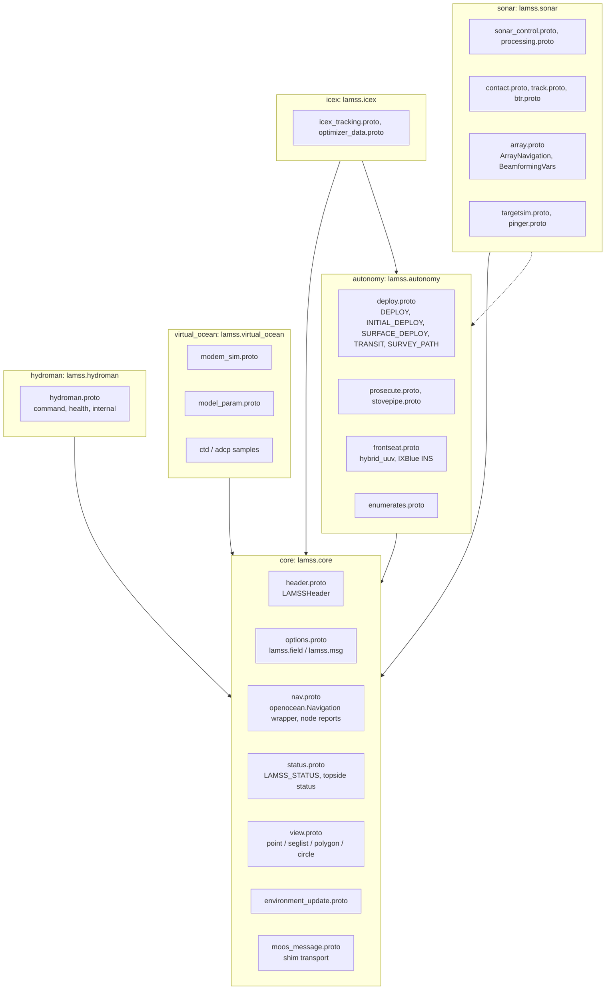
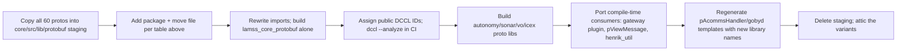

# Splitting `lib_lamss_protobuf`

*This document written by Claude*

Detail for the "Splitting up Protobuf messages" section of the [core plan](../core.md).

## What exists

`lamss/src/lib/lib_lamss_protobuf` holds 60 `.proto` files (3.7k lines) plus `icex_groups.h` and a Goby2-era `goby_dccl_load.cpp`. Almost all are proto2 with **no `package`**, so every message lives in the global C++ namespace. Options in use: `(dccl.msg).id/max_bytes/codec_version=3|4`, `(dccl.field)` bounds and units, custom `(lamss.field)` options from `option_extensions.proto`, and two leftover Goby2 `(goby.msg).queue` options. The library links `goby`, `goby_moos`, `dccl_arithmetic` and `netsim_messages`, so every consumer drags in all of them.

Six DCCL IDs are assigned twice (variants that were never meant to be loaded together):

| ID | Messages |
|---|---|
| 16 | `MCM_TRACKS`, `SONAR_TRACKS` |
| 17 | `LAMSS_TRANSIT`, `OOI_TRANSIT` |
| 18 | `LAMSS_DEPLOY`, `OOI_DEPLOY` |
| 20 | `LAMSS_STATUS`, `OOI_STATUS` |
| 21 | `NMEA_SHIP`, `MinimalStatus`, `LegacyNodeReport`, `OOI_*` |
| 22 | `NMEA_BUOY`, `MinimalNodeStatusDifference`, `OOI_*` |

Consumers at compile time are few (gateway plugin, `pViewMessage`, `henrik_util`, `iCTD_OceanModel`); most messages are loaded at runtime by `pAcommsHandler`/`gobyd` via `dccl_load_library` and used by name from MOOS strings.

## Target

Rules:

1. **Package per toolbox**: `package lamss.<toolbox>;` and files under `src/lib/protobuf/lamss/<toolbox>/`. Generated headers are `lamss/<toolbox>/<file>.pb.h`. Imports across toolboxes use the installed path (`import "lamss/core/header.proto";`), which `lamss_add_proto` resolves through `build/usr/include`.
2. **One generated library per toolbox**, `lamss_<tb>_protobuf` (`liblamss_<tb>_protobuf.so`), linking only `protobuf` and `dccl` (and `goby` only where a message imports a Goby proto, which is `nav`, `status` and `modem_sim`). `netsim_messages` is linked by `virtual_ocean` only.
3. **DCCL IDs are public IDs** allocated from the DCCL public ID registry that GobySoft maintains, not from private per-toolbox ranges, so lamss3 messages can coexist on a link with any other DCCL user. The allocation is recorded in `core/src/lib/protobuf/lamss/DCCL_IDS.md` (message, ID, toolbox). CI runs `dccl --analyze` over all active toolboxes' DCCL messages and fails on any duplicate ID. None of the old IDs are kept: no fielded platform needs wire compatibility.
4. **Variants go to attic**: `ooi_*`, `minimal_status`, `node_status` legacy variants, `mstiff_image`, `status_fillin` unless a live mission uses them.
5. **Nav converges on `openocean.Navigation`** (the type IvPico and goby3 frontseat expect). `LegacyNodeReport`/`NODE_REPORT` strings survive only in the pMarineViewer bridge.
6. **Custom options**: `option_extensions.proto` becomes `lamss/core/options.proto` with extension numbers registered against the in-house range (50000–99999, avoiding IvPico's 57400 and DCCL/Goby numbers).
7. **No `.proto.in`**: `@PROTOBUF_ALLOW_ALIAS@` templating goes away; protobuf ≥ 3 is a given.

## Config protos

Each app's `*_config.proto` moves with the app. For `GobyMOOSApp` apps it keeps extending `goby.moos.protobuf.GobyMOOSAppConfig` until the app is rewritten, then `goby.middleware.protobuf.AppConfig`. The config protos are **not** part of the toolbox proto library; they are private to the app target (`lamss_add_app(... PROTOS config.proto)`).

## Runtime loading

Today `pAcommsHandler.plug` lists `dccl_load_library: "$(LAMSS_LIB_ROOT)/liblamss_protobuf.so"`. The mission framework's acomms component emits one `dccl_load_library` line per active toolbox proto library it needs (`liblamss_core_protobuf.so`, `liblamss_autonomy_protobuf.so`, …), using the install prefix from `lamss env`. The Goby2 `goby_dccl_load()` hook and `lib_comms_state` are deleted.

## Migration steps

Each step is one PR. Step `c` is the Phase 1 exit criterion for protobuf.

## Phase 1 status

*This section written by Claude*

`lamss_core_protobuf` is built from eleven files imported with their history (103 commits from 2011): `header`, `options`, `status`, `status_topside`, `node_status`, `environment_update`, `tagged_acomms`, `view_point`, `view_polygon`, `view_seglist`, `view_circle`, all in `package lamss.core`. Decisions taken while doing it:

- File names lose the `lamss_` prefix (`lamss_status.proto` → `status.proto`, `option_extensions.proto` → `options.proto`); one file per message group is kept rather than merging the `view_*` files, so `git log --follow` and `git blame` stay useful.
- `node_status.proto` keeps only `LegacyNodeReport` (used in-process by the gateway plugin). `MinimalNodeStatus` and `MinimalNodeStatusDifference` are used by no live mission and go to attic; they also clashed with `LAMSS_STATUS_NMEA_SHIP`/`_BUOY` on DCCL IDs 21 and 22.
- lamss3 holds the public DCCL ID blocks 20–23 and 5120–5375 (migration step `d`). The three status messages keep 20–22; the view and environment messages moved to 5120–5123. [`DCCL_IDS.md`](../../../lib/protobuf/lamss/DCCL_IDS.md) is the registry for every toolbox; `lamss_core_protobuf_dccl` loads every core message into one `dccl::Codec` and checks each ID against that table and the blocks.
- Imports use `dccl/option_extensions.proto` (the `dccl/protobuf/` path is a deprecated forwarder), and unused `goby/protobuf/option_extensions.proto` imports are dropped; only `tagged_acomms.proto` needs Goby (`goby.acomms.protobuf.ModemTransmission`).

## Open questions for the human plan

- No fielded platform needs the old DCCL IDs (decided).
- `lamss_status.proto` stays one DCCL message for the acoustic link, built from split in-memory types (decided).
