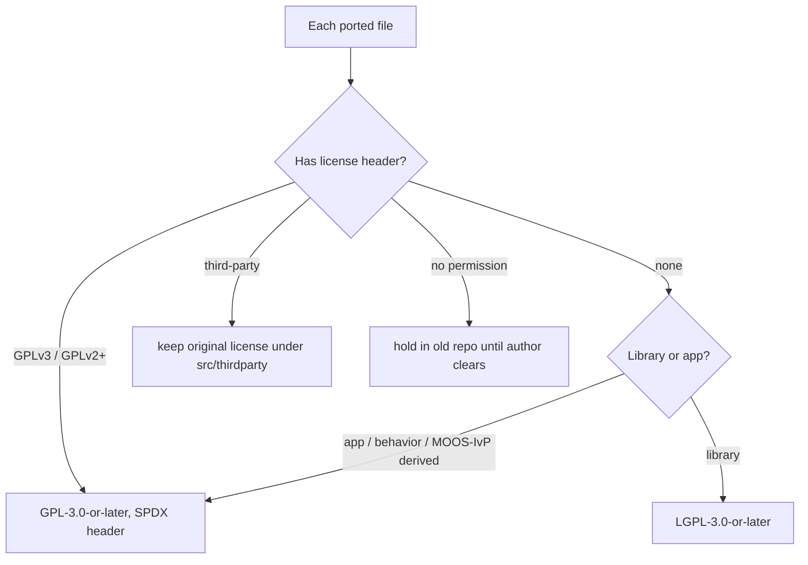

# Code style, licensing and maintenance

*This document written by Claude*

Detail for the "Reformatting code" section of the [core plan](../core.md) and the licensing and maintenance notes in the [2025 concept](../sources/2025-05-07-lamss-future.md).

## Code style

- **`.clang-format`** copied from [goby3](https://github.com/GobySoft/goby3/blob/3.0/.clang-format) (Allman braces, 4-space indent, 100 columns) at the repository root, applied to every toolbox. `lamss-shared` already carries a `.clang-format`; diff it against goby3's and keep goby3's.
- **One formatting commit per ported app**, immediately after the history-preserving move and before any functional change, so `git blame` can skip it (`.git-blame-ignore-revs`).
- **C++17**, `-Wall -Wextra`, no `-Werror` in developer builds but `-Werror` in CI for `core`.
- **Python**: `ruff` (format + lint) with the default rule set; `python3 -m lamss.mission` is type-annotated and checked with `mypy --strict` in CI.
- **CMake**: `cmake-format` with the default style; targets not variables; no `file(GLOB)` for sources.
- **Protobuf**: `clang-format` handles `.proto` too; package and file naming per [07](07-protobuf-split.md).
- **Naming**: new Goby3 binaries are `lamss_<snake_case>`; libraries `lamss_<toolbox>_<name>`; Python `lamss.<toolbox>`. Legacy MOOS app names stay until the app is rewritten.
- **Comments**: per `AGENTS.md`: default to none, explain *why* only.

## Licensing

Current state ([01](01-source-inventory.md#repositories-at-a-glance)): `COPYING` says GPLv3 in all three repos, ~90 files carry GPLv3 or GPLv2+ headers, hundreds carry none, two components carry "no permission" notices, and vendored third-party code has its own licenses.

Plan:

1. **Libraries LGPL-3.0-or-later, applications GPL-3.0-or-later**, as proposed in the 2025 concept. A `LICENSE` at the root with both texts and a table of which directories are which; each toolbox repeats the table for its own tree.
2. **SPDX headers** on every source file, added by a script during the port:
   ```cpp
   // Copyright 2011-2026 Massachusetts Institute of Technology
   // SPDX-License-Identifier: LGPL-3.0-or-later
   ```
   That example is for files ported from the old repositories. Files written new for lamss3 are `Copyright <year> GobySoft, LLC` with the same SPDX line.
   Files with existing GPLv2+ headers are relicensed to GPL-3.0-or-later (allowed by "or later"); files with no header are assumed MIT-owned work and get the toolbox's default. Authors listed in old headers are kept in an `AUTHORS` file per toolbox rather than per file.
3. **MIT TLO disclosure** per the [TLO open-source process](https://tlo.mit.edu/researchers-mit-community/protect/software-open-source-protection) before the first public tag. The inventory doc's attic list and the third-party table are the attachments the TLO asks for.
4. **Blocked content** stays out of `lamss3` until cleared: `iMOOSGateway`/`payload_interface` ("no permission"), anything derived from Bluefin SDK headers (`uMVS_Bluefin` carries Bluefin-era sources; confirm provenance), HydroMAN 3 (its own repository and license; reachable only through the `hydroman` submodule, never copied into lamss3).
5. **Third-party** code is either an apt dependency (nlohmann-json, Eigen) or lives under `<toolbox>/src/thirdparty/<name>/` with its original license file untouched (newmat, mstiff reader, DM7820 userspace library, which is RTD's and needs its redistribution terms checked).
6. **MOOS-IvP derived code** (`uTDA`, `uSimMarine_DUTM`, behaviors subclassing IvP classes) is GPL like MOOS-IvP itself; it goes in application directories, never in LGPL libraries.



## Maintenance

### Maintainers

| Area | Maintainers (2–3 each) |
|---|---|
| core + build + `lamss` tool | GobySoft + one lab member |
| autonomy | lab mission-manager owner + hybrid UUV owner |
| sonar | passive sonar sim owner + one more |
| virtual_ocean | ocean model owner + GobySoft (netsim) |
| gui | Display Center owner + GobySoft (Liaison) |
| icex | the ICEX lead, when active |
| mit (missions) | the cruise leads for irminger/mbat |
| attic | nobody; PRs accepted, CI may be red |

Recorded in a root `MAINTAINERS.md` and `CODEOWNERS` so GitHub requests reviews automatically.

### Process

- **Branches and PR titles** per `AGENTS.md` (`feature/x`, `bug/x`, `minor/x`).
- **Required checks** on the `3.y` development branch: format, build-all, each in-tree toolbox standalone, mission smoke.
- **Releases**: tag `3.y.z` on the `3.y` branch quarterly or before a cruise; packages built by CI ([04](04-dependencies-ci-packaging.md)). A cruise pins a tag in its cruise class (`lamss_version = "3.2"`), and `lm m` warns if the checkout differs.
- **Dependency bumps** (Goby3, MOOS-IvP, netsim, Ubuntu) are PRs that update `dependencies.yml` and the CI image together.
- **Issue triage**: labels per toolbox; a monthly 30-minute triage.

### Documentation

- Markdown under `<toolbox>/src/doc/`, rendered by `mkdocs-material` in CI to GitHub Pages. Mermaid for figures (rendered natively by GitHub and by `mkdocs-mermaid2`).
- Each app directory has a `README.md` with: purpose, publishes/subscribes (Goby groups and types), config example, and which components launch it. Generated tables of groups come from the Goby3 interface-export tool (`goby_clang_tool`) once apps are native.
- Training topics from the 2025 concept, written after the corresponding milestone: virtual ocean for acomms sim (after M1), sonar sim (after M2), autonomy missions (after M2), ICEX (after M3).
- The old `src/doc` PDF/PPTX collections (440 MB) move to a `lamss-docs-archive` repository with an index; nothing binary in `lamss3`.

### Retiring the old repositories

After M2: `lamss`, `lamss-shared`, `lamss-internal` and `missions-lamss` get a final commit with a README pointing at `lamss3`/`attic`, and are archived on GitHub. Until then they stay the 22.04 fallback.
