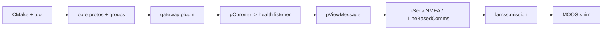
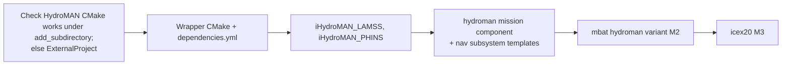

# Per-toolbox plans

*This document written by Claude*

What each toolbox contains at the end of Phase 3, what it needs from the old repos, and its specific risks. The item lists come from [01](01-source-inventory.md); this document is about order of work and design decisions inside each toolbox.

## core

**Contents**: `lamss` tool, CMake helpers, `lamss.core` protos and groups, `lamss.mission` Python package, the MOOS shim ([05](05-middleware-moos-to-goby3.md#cmoosapp-shim-population-b)), generic I/O apps, health and viewer glue (Liaison plugins, `goby_geov_gateway` configuration, OpenCPN support, the LAMSS Display Center), `henrik_util` math subset, `supun_util` coordinate helpers, newmat (thirdparty, transitional).

**Order of work**

**Decisions**

- `pCoroner` is not ported as an app. Its job (watch processes, publish a health summary) is done by a supervisord event listener in Python (`lamss_health_listener`) that publishes `lamss.core.ProcessHealth` through a tiny Goby3 publisher, plus `goby_coroner` for the Goby side.
- `pPBNodeReport`, `uTopsideSetup` and the `NODE_REPORT` string handling collapse into one `lamss_node_report` Goby3 app that converts between `openocean.Navigation`, Goby `NodeStatus`, and the `NODE_REPORT` string for pMarineViewer.
- `henrik_util` is split by a header-dependency walk: `CVectorUtils`, `CMeasAvg`, `CCovMat`, `CKalmanFilter` (rewritten without OpenCV), `Random` → `core`; `CAcousticModel`, `CRapRays`, `CEigenRays`, `CLamssNetcdf` → `virtual_ocean`; `CTarget`, `CTrack`, `CNoiseCovariance`, `Multistatic_SonarUtils` → `sonar`.
- GEOV is still used; `iMOOS2SQL` is replaced by Goby3's `goby_geov_gateway`, configured by the viewer component.

**Tests**: proto build, DCCL ID uniqueness, group catalogue export, mission registry/render tests, shim round-trip test.

## autonomy

**Contents**: mission managers, mission script, track manager, frontseat drivers (Bluefin via Goby3 frontseat, hybrid, embedded), hybrid UUV control stack (SRToolbox), adaptive depth, tetra homing, environmental gradient, gateway/buoy node, mooring/vehicle simulators (`uSimArrayMooring`, `uMVS_Bluefin`, `uSimUnderseaVehicle_Vlamss`, `uSimMarine_DUTM`), IvP behaviors, `lamss.autonomy` protos.

**Order of work**: what M1 needs first (mission manager, Bluefin frontseat, `uMVS_Bluefin`, behaviors used by `mbat`), then the hybrid stack for the `hybrid` variant, then the rest.

**Decisions**

- **Behaviors** become one plugin library `lamss_autonomy_behaviors` with one directory per behavior, grouped by function (`depth/`, `survey/`, `tracking/`, `glider/`) instead of by author. Only the ~15 live LAMSS behaviors are ported in Phase 3; the SandShark and front-tracking families wait for a consumer. Each behavior gets a `bhv.j2` template in the mission framework.
- **No HydroMAN here.** Everything HydroMAN-related is in the `hydroman` wrapper toolbox below, so `autonomy` builds and runs without access to the HydroMAN repository.
- **`uSimMarine_DUTM`**: try to upstream dynamic-UTM to `uSimMarine` in MOOS-IvP; fall back to carrying the fork.
- **IvPico**: the mission manager's behavior-facing outputs are typed as `ivp.interface.Variable`/`Command` from the start ([05](05-middleware-moos-to-goby3.md#phelmivp-to-ivpico)).
- `pClusterPriority` (2008) and `pMissionMonitor` are attic unless the mission manager owner objects.

**Risks**: `uMVS_Bluefin` carries Bluefin-era source (license); `boost::statechart` is header-only and fine on 24.04 but the FSM code is the hardest to shim.

## hydroman

**Contents**: the HydroMAN 3 repository as `hydroman/upstream` (submodule, built by its own CMake), `iHydroMAN_LAMSS`, `iHydroMAN_PHINS`, `lamss.hydroman` protos, the `hydroman` mission component with the `nav` subsystem templates (`pHM3_BasicModel`, `pHM3_VelProcessor`, `iHydroMAN_Gateway`, `pHM_SensorFusion`, `pHM_Manager`, `pHM_ModelCalibrator`, `pHM_LBLProcessor`, `pHM_DVLProcessor`, `pHM_TargetSLAM`), the vehicle hydrodynamic coefficient tables from `pHM3_BasicModel.plug` as data.

**Order of work**

**Decisions**

- HydroMAN 3 is the only version lamss3 configures; `pHM_BasicModel` (2.x) templates are not carried.
- The hydrodynamic coefficient blocks (hundreds of `add_param_*` lines per vehicle and mode in `pHM3_BasicModel.plug`) become per-platform data files (`hydroman/missions/data/models/<platform>_<mode>.cfg`) included by the template, not Jinja2 logic.
- The `nav` subsystem runs HydroMAN's MOOS apps under supervisord with its own MOOSDB, exactly as `hydroman_ext` does today; this is the one subsystem allowed to keep MOOSDB after M4 ([05](05-middleware-moos-to-goby3.md)).
- ICEX needs: `pHydroMAN_ICEXManager` (internal 1.x) handled under-ice LBL/tracker inputs. Confirm with the HydroMAN owner which HM3 app covers that before M3.

**Risks**: repository access for CI; HydroMAN's build conventions (in-source outputs, global `include_directories`) may force the `ExternalProject` route; version coupling between HM3 and `iHydroMAN_LAMSS`'s protobuf interface is tracked by the submodule pointer.

## sonar

**Contents**: hardware drivers (`iDurip` + DM7820, `iMCC1608FS`), processing and tracking (CBF, AEL, bearing tracker, geo tracker, ping control, active chain), array geometry data, `lamss.sonar` protos. All sonar, array, noise and target simulators are in `virtual_ocean`.

**Order of work**: passive chain (M1 baseline uses it), then `iDurip` for runtime, then the active chain.

**Decisions**

- **DM7820 kernel driver**: packaged as `rtd-dm7820-dkms`, built in CI against the 24.04 HWE kernel headers. If RTD's license forbids redistribution, document the manual install and keep the module out of the tree.
- `pActiveSonarProcessor`, `pBearingTracker`, `pActiveRangeTracker`, `pActiveGeoTracker` are attic (superseded or OpenCV < 3).
- `uTDA` (FLTK viewer): attic.
- The processing chain is tested in CI against `virtual_ocean`'s simulators with a tiny array and a flat environment (the `smoke` variant).

## virtual_ocean

**Contents**: propagation and ocean models: NetCDF ocean models (SVP/CTD/ADCP), bathymetry and sound-speed services (NOAA, MSEAS, GDEM), netsim front ends (`uSimModemNetwork/Range/Signal`, `iNetSimManager`, the netsim processor plugin), sensor sims (CTD, GPS, DVL, PHINS, LBL, bathy), ship NMEA sim, beacon sim, the sonar and array simulators (`uSimPassiveSonar`, `uSimActiveSonar`, `uSimActiveContacts`, `uSimAEL`, `uSimTowedArray`, `uSimTargetBearings`, `uSimNoiseCovariance`, `uSimSelfNoise`, `uSimSourceArray`, `uSimTargets`, `uSimTrackDVL`), `henrik_util` acoustics subset, modem replicas and `lamss.virtual_ocean` protos, the Environment-side component base classes for the mission framework.

**Order of work**: `iNoaaBathy`, `uSimCTD`, `uSimGPS`, `uSimDVL`, `uSimPhinsINS`, `uSimPassiveSonar`, `uSimTowedArray`, `uSimNoiseCovariance`, `uSimTargets` (M1), netsim front ends (M2), ocean-model trio for the `hycom` variant (M2), active sonar sims, MSEAS/GDEM services (M3 ICEX20).

**Decisions**

- The environment data (890 MB in `missions-lamss/cruise/*/data`) moves to an AWS S3 bucket fetched on demand by `lm m` (`environment.data_url`, cached under `missions/data/cache`), with a 1 MB flat-bottom synthetic environment in-tree for tests.
- `uSimCTD_OceanModel`, `uSimADCP_OceanModel`, `uSVP_OceanModel` share their NetCDF reader; merge into one `lamss_ocean_model` Goby3 app with three output groups when rewritten.
- Bellhop runs come from netsim: its `acousticstoolbox` library (`environment.proto`, `svp_request_response.proto`, `iBellhop_messages.proto`) and the `iBellhop` app ship in `libnetsim-dev`/`netsim-apps`, and `netsim_core`/`netsim_manager`/`netsim_udp` provide the modem network. `thirdparty/at` is not carried.
- lamss3's `lib_netsim_processor` is the *processor plugin* netsim needs to simulate propagation (netsim's own docs point at the old `github.mit.edu/lamss` repos for it). Once it lives in `virtual_ocean`, ask GobySoft to update netsim's documentation to point at lamss3.
- netsim links `libgoby_moos` and MOOS 10 for its `netsim_goby_moos_gateway` plugin, so removing MOOS from lamss3 (M4) does not by itself remove MOOS from a netsim host; that is a netsim decision.

**Risks**: NetCDF C++ API moved from `legacy` to `netcdf-cxx4`, affecting `CLamssNetcdf`; `uSimPassiveSonar` (4k lines) is the lab's most actively edited app, so port it early and in one piece to avoid merge pain with ongoing work in `lamss-shared`.

## mit

**Contents**: cruises (`mbat`, `irminger`), fleets, platforms (`macrura`, `unicorn`, `resolution`), concrete environments, cruise-specific templates and data (DCCL acomms configs, modem ID lookup, op regions).

**Decisions**: in-tree until M2 per [02](02-repository-layout-and-build.md#open-questions-for-the-human-plan); no C++; CI runs `lm m generate` for every cruise and the smoke sim for `mbat`.

## icex

**Contents**: ICEX simulators, the three native Goby3 topside apps and the Liaison plugin, the `icex20` cruise (M3), `hydrohole` mooring, `icex_sim` topside subsystem, `BHV_OpRegion_ICEX`, `lamss.icex` protos, ICEX analysis tooling, `iICEXTracker` (kept in the tree but not built).

**Decisions**: the native Goby3 apps have been disabled in the build since the import and use Boost.Python + OpenCV; getting them to compile against Goby3 3.6 is the first task and a good test of how far the native API has moved. `iICEXTracker` (Octave) is kept but not built.

**Order of work**: `icex20` is M3: the hydrohole mooring, `uSimICEXMotion`, `iSerialNMEA` hydrophones, `uSimModemNetwork/Range` under `netsim_udp`, HydroMAN 3 via the `hydroman` toolbox's variant, then the native Goby3 tracker/optimizer/multiplexer and the Liaison plugin. The `arctic` cruise is not ported (IRIS modem is dropped); it goes to attic.

**Risks**: nobody has run ICEX code since 2021; the `icex20` environment files are 150 MB; the recorded icex20 scenario used the internal HydroMAN toolbox (`pHydroMAN_ICEXManager` for under-ice LBL/tracker handling), so M3 depends on HydroMAN 3 covering that role.

## attic

**Contents**: everything in [01](01-source-inventory.md#attic-submodule). Structure mirrors the toolbox layout so an item can be promoted by moving a directory. It is **never built**: there is no CMake entry point, no CI, and `lamss toolbox activate attic` is refused. Promoting something out of attic means moving it into a real toolbox and making it build there.

## Cross-toolbox: the group catalogue

Each toolbox owns the Goby groups for the messages it defines and publishes a `groups.h` plus a generated `groups.md` table (name, type, publisher apps, subscriber apps). The union is the lamss3 interface document and the input for the per-app README tables ([08](08-code-style-licensing-maintenance.md#documentation)). The first version is generated from the MOOS variable catalogue script in [05](05-middleware-moos-to-goby3.md#the-moos-variable--goby-group-catalogue).
