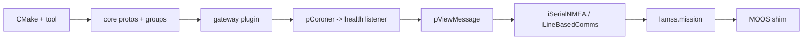

# Per-toolbox plans

*This document written by Claude*

What each toolbox contains at the end of Phase 3, what it needs from the old repos, and its specific risks. The item lists come from [01](01-source-inventory.md); this document is about order of work and design decisions inside each toolbox.

## core

**Contents**: `lamss` tool, CMake helpers, `lamss.core` protos and groups, `lamss.mission` Python package, the MOOS shim ([05](05-middleware-moos-to-goby3.md#cmoosapp-shim-population-b)), generic I/O apps, health and viewer glue, `henrik_util` math subset, `supun_util` coordinate helpers, newmat (thirdparty, transitional).

**Order of work**

**Decisions**

- `pCoroner` is not ported as an app. Its job (watch processes, publish a health summary) is done by a supervisord event listener in Python (`lamss_health_listener`) that publishes `lamss.core.ProcessHealth` through a tiny Goby3 publisher, plus `goby_coroner` for the Goby side.
- `pPBNodeReport`, `uTopsideSetup` and the `NODE_REPORT` string handling collapse into one `lamss_node_report` Goby3 app that converts between `openocean.Navigation`, Goby `NodeStatus`, and the `NODE_REPORT` string for pMarineViewer.
- `henrik_util` is split by a header-dependency walk: `CVectorUtils`, `CMeasAvg`, `CCovMat`, `CKalmanFilter` (rewritten without OpenCV), `Random` → `core`; `CAcousticModel`, `CRapRays`, `CEigenRays`, `CLamssNetcdf` → `virtual_ocean`; `CTarget`, `CTrack`, `CNoiseCovariance`, `Multistatic_SonarUtils` → `sonar`.
- `iMOOS2SQL` and GEOV: ask the lab whether GEOV is still used; default is attic.

**Tests**: proto build, DCCL ID uniqueness, group catalogue export, mission registry/render tests, shim round-trip test.

## autonomy

**Contents**: mission managers, mission script, track manager, frontseat drivers (Bluefin via Goby3 frontseat, hybrid, embedded), hybrid UUV control stack (SRToolbox), HydroMAN interface, adaptive depth, tetra homing, environmental gradient, gateway/buoy node, mooring/vehicle simulators (`uSimArrayMooring`, `uMVS_Bluefin`, `uSimUnderseaVehicle_Vlamss`, `uSimMarine_DUTM`), IvP behaviors, `lamss.autonomy` protos.

**Order of work**: what M1 needs first (mission manager, Bluefin frontseat, `uMVS_Bluefin`, behaviors used by `mbat`), then the hybrid stack for the `hybrid` variant, then HydroMAN, then the rest.

**Decisions**

- **Behaviors** become one plugin library `lamss_autonomy_behaviors` with one directory per behavior, grouped by function (`depth/`, `survey/`, `tracking/`, `glider/`) instead of by author. Only the ~15 live LAMSS behaviors are ported in Phase 3; the SandShark and front-tracking families wait for a consumer. Each behavior gets a `bhv.j2` template in the mission framework.
- **HydroMAN**: the internal 1.x toolbox (14k lines, CMOOSApp, armadillo + embedded Python) and the external 2.0 interface both exist. Port `iHydroMAN_LAMSS` + `iHydroMAN_PHINS` first (needed by `mbat` baseline via `hydroman_ext`); the internal toolbox only if ICEX (M3) needs it and HydroMAN 2.0 cannot replace it. **Needs a decision from the HydroMAN owner.**
- **`uSimMarine_DUTM`**: try to upstream dynamic-UTM to `uSimMarine` in MOOS-IvP; fall back to carrying the fork.
- **IvPico**: the mission manager's behavior-facing outputs are typed as `ivp.interface.Variable`/`Command` from the start ([05](05-middleware-moos-to-goby3.md#phelmivp-to-ivpico)).
- `pClusterPriority` (2008) and `pMissionMonitor` are attic unless the mission manager owner objects.

**Risks**: `uMVS_Bluefin` carries Bluefin-era source (license); HydroMAN 2.0 availability; `boost::statechart` is header-only and fine on 24.04 but the FSM code is the hardest to shim.

## sonar

**Contents**: passive chain (CBF, AEL, bearing tracker, geo tracker, ping control), passive and active simulators, array sims (towed array, noise covariance, self noise, source array, targets, bearings, track DVL), hardware drivers (`iDurip` + DM7820, `iMCC1608FS`), `uTDA`, array geometry data, `lamss.sonar` protos.

**Order of work**: passive chain + `uSimPassiveSonar` + `uSimTowedArray` + `uSimNoiseCovariance` (M1 baseline uses them), then `iDurip` for runtime, then active sonar, then the rest.

**Decisions**

- **DM7820 kernel driver**: packaged as `rtd-dm7820-dkms`, built in CI against the 24.04 HWE kernel headers. If RTD's license forbids redistribution, document the manual install and keep the module out of the tree.
- `pActiveSonarProcessor`, `pBearingTracker`, `pActiveRangeTracker`, `pActiveGeoTracker` are attic (superseded or OpenCV < 3).
- `uTDA` (FLTK viewer): attic unless `pDepthAdapt` users still run it; the data it shows can go to a Liaison plugin later.
- Towed-array and passive sonar sims depend on netsim's Bellhop; they can be exercised in CI with a tiny array and a flat environment (the `smoke` variant).

**Risks**: `uSimPassiveSonar` (4k lines) is the lab's most actively edited app; port it early and in one piece to avoid merge pain with ongoing work in `lamss-shared`.

## virtual_ocean

**Contents**: NetCDF ocean models (SVP/CTD/ADCP), bathymetry and sound-speed services (NOAA, MSEAS, GDEM), netsim front ends (`uSimModemNetwork/Range/Signal`, `iNetSimManager`, the netsim processor plugin), simple sensor sims (CTD, GPS, DVL, PHINS, LBL, bathy), ship NMEA sim, beacon sim, `henrik_util` acoustics subset, modem replicas and `lamss.virtual_ocean` protos, environment classes for the mission framework.

**Order of work**: `iNoaaBathy`, `uSimCTD`, `uSimGPS`, `uSimDVL`, `uSimPhinsINS` (M1), netsim front ends (M2), ocean-model trio for the `hycom` variant (M2), MSEAS/GDEM services (M3 Arctic).

**Decisions**

- The environment data (890 MB in `missions-lamss/cruise/*/data`) moves to a separate `lamss-environment` repository fetched on demand by `lm m` (`environment.data_url`), with a 1 MB flat-bottom synthetic environment in-tree for tests.
- `uSimCTD_OceanModel`, `uSimADCP_OceanModel`, `uSVP_OceanModel` share their NetCDF reader; merge into one `lamss_ocean_model` Goby3 app with three output groups when rewritten.
- Bellhop runs come from netsim (`acousticstoolbox` package); `thirdparty/at` is not carried.

**Risks**: `libnetsim-dev` must exist for noble (GobySoft); NetCDF C++ API moved from `legacy` to `netcdf-cxx4`, affecting `CLamssNetcdf`.

## mit

**Contents**: cruises (`mbat`, `irminger`, `arctic` shared bits), fleets, platforms (`macrura`, `unicorn`, `resolution`, `sandshark`?), cruise-specific templates and data (DCCL acomms configs, modem ID lookup, op regions).

**Decisions**: in-tree until M2 per [02](02-repository-layout-and-build.md#open-questions-for-the-human-plan); no C++; CI runs `lm m generate` for every cruise and the smoke sim for `mbat`.

## icex

**Contents**: ICEX simulators and HydroMAN ICEX manager, the three native Goby3 topside apps and the Liaison plugin, `icex20` and `arctic` cruises, `hydrohole` mooring, `icex_sim` topside subsystem, `BHV_OpRegion_ICEX`, `lamss.icex` protos, ICEX analysis tooling.

**Decisions**: the native Goby3 apps have been disabled in the build since the import and use Boost.Python + OpenCV; getting them to compile against Goby3 3.6 is the first task and a good test of how far the native API has moved. `iICEXTracker` (Octave) is attic.

**Risks**: nobody has run ICEX code since 2021; the `icex20` environment files are 150 MB.

## attic

**Contents**: everything in [01](01-source-inventory.md#attic-submodule). Structure mirrors the toolbox layout so an item can be promoted by moving a directory. Builds with `lamss_toolbox(NAME attic REQUIRES core)` but every app is behind an `option(ATTIC_BUILD_<app> OFF)`, so `attic` active + default options builds nothing and never breaks anyone. The MOOS shim makes some of it runnable later without further work; nobody commits to that.

## Cross-toolbox: the group catalogue

Each toolbox owns the Goby groups for the messages it defines and publishes a `groups.h` plus a generated `groups.md` table (name, type, publisher apps, subscriber apps). The union is the lamss3 interface document and the input for the per-app README tables ([08](08-code-style-licensing-maintenance.md#documentation)). The first version is generated from the MOOS variable catalogue script in [05](05-middleware-moos-to-goby3.md#the-moos-variable--goby-group-catalogue).
