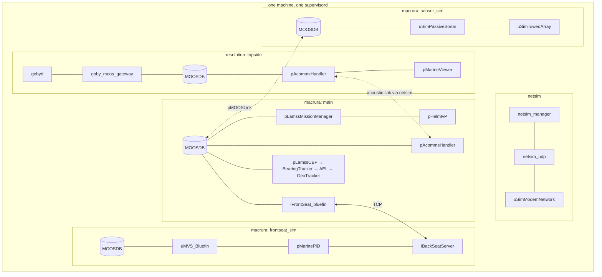
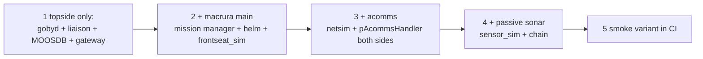

# Milestone M1: Macrura in MBAT simulation

*This document written by Claude*

The first end-to-end target from the [core plan](../core.md): "Add the basic Macrura mission in MBAT". This document fixes exactly what "basic" means, what has to be ported to get there, and how success is measured. M2 (MBAT variants) and M3 (ICEX20) are sketched at the end.

## Definition

`lm m sim mbat` on one Ubuntu 24.04 machine launches, under one `supervisord`:

- **topside** (`resolution`): gobyd, goby_logger, goby_liaison, goby_coroner, MOOSDB + `lamss_goby_moos_gateway` (transition), pAcommsHandler (netsim UDP driver), pViewMessage, pMarineViewer, pGateway (ship nav), iNoaaBathy, uSimCTD, iBellhop (netsim).
- **macrura/main**: MOOSDB, pLamssMissionManager, pLamssTrackManager, pBasicContactMgr, pHelmIvP + LAMSS behaviors, pAcommsHandler, iFrontSeat_bluefin (Goby3 Bluefin frontseat driver in sim mode), pViewMessage, iBellhop, pTetraHoming, the passive chain (pLamssCBF, pLamssBearingTracker, pLamssAEL, pGeoTracker), pMOOSLink to the sim subsystems (transition).
- **macrura/frontseat_sim**: MOOSDB, uMVS_Bluefin, pMarinePID, uSimGPS, uSimDVL, uSimPhinsINS, iBackSeatServer, iNoaaBathy.
- **macrura/sensor_sim**: MOOSDB, uSimTargets, uSimTowedArray, uSimPassiveSonar, uSimNoiseCovariance, uSimCTD, uSimAcoBeaconRngBrg, iBellhop.
- **netsim** (`topside/net_sim`): netsim_manager, netsim_udp, netsim_goby_moos_gateway, uSimModemNetwork.

This is the `macrura-hydroman-durip-mbat.sh` scenario of today **minus** `hydroman_ext`, `nav_stub` and the Python display servers (`lamss_dc`, `btr_plot`, `tloss_display`), which become the first M2 variants. Every community also has the health listener, logging and `pLogger` (transition).

## Port list for M1

Only these move before M1; everything else waits.

| Toolbox | Apps / libs | Lines (approx.) |
|---|---|---|
| core | `lamss_core_proto` (status, view, header, nav, options), gateway plugin, `pViewMessage`, health listener, `lamss.mission`, templates for gobyd/logger/liaison/coroner/MOOSDB/pLogger/gateway | ~2k C++ + Python |
| autonomy | `pLamssMissionManager`, `pLamssTrackManager`, Goby3 Bluefin frontseat config, `uMVS_Bluefin`, `pGateway`, `pTetraHoming`, behaviors: SmartYoyo, MaintainBearing, WiggleTail, RaceTrack, ZigZag, MinAltitude, ConstantBuoyancy, ConstantAltitude, OptAcommsDepth | ~15k |
| sonar | `pLamssCBF`, `pLamssBearingTracker`, `pLamssAEL`, `pGeoTracker` + `lib_track`, `uSimPassiveSonar`, `uSimTowedArray`, `uSimNoiseCovariance`, `uSimTargets`, `uSimAcoBeaconRngBrg`, durip array geometry | ~17k |
| virtual_ocean | `iNoaaBathy`, `uSimCTD`, `uSimGPS`, `uSimDVL`, `uSimPhinsINS`, `uSimModemNetwork`, `iNetSimManager`, `henrik_util` acoustics subset, MBAT environment (bathy + CTD from `cruise/mbat/data`) | ~8k |
| mit | `mbat` cruise, `mit_bf21` fleet, `macrura` + `resolution` platforms, `data/acomms` DCCL configs | Python + data |

Stock MOOS-IvP (`pHelmIvP`, `pMarinePID`, `pBasicContactMgr`, `pMarineViewer`, `pLogger`, `uXMS`, `MOOSDB`) and Goby3/netsim apps come from packages.

## Steps

1. **Topside only**: proves the framework, supervisord output, gateway plugin build, and the core protos. Liaison shows the topside platform.
2. **Macrura main + frontseat_sim**: the vehicle drives a LOITER at 15 m / 1.8 m/s (the `mbat` deploy defaults) in `uMVS_Bluefin`; pMarineViewer shows it; the mission manager transitions `DEPLOY`.
3. **Acomms**: topside sends `LAMSS_DEPLOY` over netsim, vehicle replies with `LAMSS_STATUS`; `pViewMessage` carries the op box.
4. **Passive sonar**: `uSimTargets` + `uSimPassiveSonar` produce BTR, the chain produces a track, `pLamssTrackManager` publishes a contact report to topside.
5. **Smoke variant**: single AUV, flat-bottom synthetic environment, `warp=10`, 5 simulated minutes, assertions on supervisord state and on the `.goby` log (mission state reached `DEPLOY`, at least one `LAMSS_STATUS` received topside, at least one track). Runs in CI on every PR.

## Acceptance

| Check | How |
|---|---|
| All processes `RUNNING` after 60 s | `supervisorctl status` |
| Vehicle follows the deploy command | NAV track inside op box, depth within ±2 m of 15 m after settling |
| Acoustic link works both ways | `goby_logger` shows ≥1 `LAMSS_DEPLOY` received on macrura and ≥1 `LAMSS_STATUS` on topside |
| Sonar chain produces a track | `pLamssTrackManager` publishes a track with bearing within 10° of truth |
| Reproducible | `lm m generate mbat` output is byte-identical across two runs (no timestamps in configs) |
| Documented | `mit/src/doc/mbat.md` walks a new user through install → `lm m sim mbat` in under a page |

## M2: MBAT variants

Each variant is a `@variant` class and a CI `generate` check (not all run in CI):

| Variant | Adds |
|---|---|
| `hydroman_ext` | `iHydroMAN_LAMSS`, `iHydroMAN_PHINS`, `nav` subsystem with external HydroMAN 2.0 |
| `hybrid` | `uSimUnderseaVehicle_Vlamss` + actuator map + control engine, `iLamssFrontSeat`, `pFrontSeatData`, glideslope domain, `BHV_GlideSlopeSpeed` |
| `hycom` | `uSVP_OceanModel`, `uSimCTD_OceanModel`, `uSimADCP_OceanModel` with the HYCOM environment |
| `two_auv` | adds `unicorn` (modem 3) to the fleet; MAC slot table grows |
| `displays` | `btr_plot`, `tloss_display`, `eeof_plot`, `small_uVis` (Python, Bokeh) or their Liaison replacements |
| `runtime` (not a variant, `lm m run`) | `hw_modem` serial ports, `iFrontSeat_bluefin` against the real vehicle, `iDurip` |

M2 is done when `irminger` is also expressed as a cruise reusing the same platform classes.

## M3: ICEX20

`icex20` cruise: `sea_dragon` topside, `hydrohole` mooring, macrura under the ice with `dvl_ice_track_mode` and `BHV_OpRegion_ICEX`, `uSimICEXMotion` ice drift, the hydrophone `iSerialNMEA`/`iNetSimManager` set, `netsim_udp` acomms, internal HydroMAN with `pHydroMAN_ICEXManager`, and the native Goby3 `lamss_icex_tracker`/`optimizer`/`buoy_multiplexer` plus `goby_liaison_icex` on topside. Requires the `icex` submodule and the native Goby3 ICEX apps compiling ([09](09-toolboxes.md#icex)). The `arctic` cruise (IRIS modem, Beaufort sim) follows as a variant once icex20 runs.
