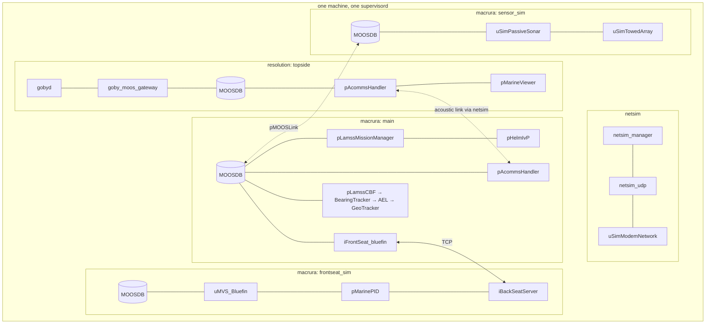
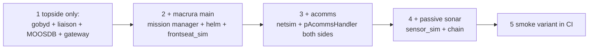

# Milestone M1: Macrura in MBAT simulation

*This document written by Claude*

The first end-to-end target from the [core plan](../core.md): "Add the basic Macrura mission in MBAT". This document fixes exactly what "basic" means, what has to be ported to get there, and how success is measured. M2 (MBAT variants) and M3 (ICEX20) are sketched at the end.

## Definition

`lm m sim mbat` on one Ubuntu 24.04 machine launches, under one `supervisord`:

- **topside** (`resolution`): gobyd, goby_logger, goby_coroner, goby_liaison and pMarineViewer (the viewer component, when `gui` is active), MOOSDB + `lamss_goby_moos_gateway` (transition), pAcommsHandler (netsim UDP driver), pViewMessage, pGateway (ship nav), iNoaaBathy, uSimCTD, iBellhop (netsim).
- **macrura/main**: MOOSDB, pLamssMissionManager, pLamssTrackManager, pBasicContactMgr, pHelmIvP + LAMSS behaviors, pAcommsHandler, iFrontSeat_bluefin (Goby3 Bluefin frontseat driver in sim mode), pViewMessage, iBellhop, pTetraHoming, the passive chain (pLamssCBF, pLamssBearingTracker, pLamssAEL, pGeoTracker), pMOOSLink to the sim subsystems (transition).
- **macrura/frontseat_sim**: MOOSDB, uMVS_Bluefin, pMarinePID, uSimGPS, uSimDVL, uSimPhinsINS, iBackSeatServer, iNoaaBathy.
- **macrura/sensor_sim**: MOOSDB, uSimTargets, uSimTowedArray, uSimPassiveSonar, uSimNoiseCovariance, uSimCTD, uSimAcoBeaconRngBrg, iBellhop.
- **netsim** (`topside/net_sim`, optional for M1): netsim_manager, netsim_udp, netsim_goby_moos_gateway, uSimModemNetwork. Without it, the acomms step uses Goby3's UDP driver directly between the two `pAcommsHandler`s.

This is the `macrura-hydroman-durip-mbat.sh` scenario of today **minus** `hydroman_ext` (HydroMAN 3, see M2), `nav_stub` and the Python display servers (`lamss_dc`, `btr_plot`, `tloss_display`), which become the first M2 variants. Every community also has the health listener, logging and `pLogger` (transition).

## Port list for M1

Only these move before M1; everything else waits.

| Toolbox | Apps / libs | Lines (approx.) |
|---|---|---|
| core | `lamss_core_protobuf` (status, view, header, nav, options), gateway plugin, `pViewMessage`, health listener, `lamss.mission`, templates for gobyd/logger/coroner/MOOSDB/pLogger/gateway | ~2k C++ + Python |
| autonomy | `pLamssMissionManager`, Goby3 Bluefin frontseat config, `uMVS_Bluefin`, `pGateway`, `pTetraHoming`, behaviors: SmartYoyo, MaintainBearing, WiggleTail, RaceTrack, ZigZag, MinAltitude, ConstantBuoyancy, ConstantAltitude, OptAcommsDepth | ~15k |
| sonar | `pLamssCBF`, `pLamssBearingTracker`, `pLamssAEL`, `pGeoTracker`, `pLamssTrackManager` + `lib_track`, durip array geometry | ~6k |
| virtual_ocean | `iNoaaBathy`, `uSimCTD`, `uSimGPS`, `uSimDVL`, `uSimPhinsINS`, `uSimPassiveSonar`, `uSimTowedArray`, `uSimNoiseCovariance`, `uSimTargets`, `uSimAcoBeaconRngBrg`, `uSimModemNetwork`, `iNetSimManager`, `henrik_util` acoustics subset | ~19k |
| mit | MBAT environment (bathy + CTD from `cruise/mbat/data`, served from S3) | data |
| mit | `mbat` cruise, `mit_bf21` fleet, `macrura` + `resolution` platforms, `data/acomms` DCCL configs | Python + data |
| gui | viewer component (goby_liaison, pMarineViewer); optional, the automated test runs without it | templates |

Stock MOOS-IvP (`pHelmIvP`, `pMarinePID`, `pBasicContactMgr`, `pMarineViewer`, `pLogger`, `uXMS`, `MOOSDB`) and Goby3/netsim apps come from packages.

## Steps

1. **Topside only**: proves the framework, supervisord output, gateway plugin build, and the core protos. Liaison shows the topside platform.

   *This section written by Claude*

   Status: the framework half is done with `core`'s `example` cruise (a topside with gobyd, MOOSDB, the gateway, goby_logger, goby_coroner, pViewMessage and, with `gui` active, goby_liaison; see [06](06-missions-framework.md#implementation-plan)). The `mit` toolbox now adds the `mass_bay` environment (flat 100 m until `iNoaaBathy` reads the MBAT data), the `resolution` topside, the `mit_bf21` fleet and the `mbat` cruise; `lm m sim mbat` runs the topside and `lamss_mit_mission_mbat` checks its Goby apps are healthy ([page](../../../../../mit/src/doc/missions/mbat.md)).

2. **Macrura main + frontseat_sim**: the vehicle drives a LOITER at 15 m / 1.8 m/s (the `mbat` deploy defaults) in `uMVS_Bluefin`; pMarineViewer shows it; the mission manager transitions `DEPLOY`.

   *This section written by Claude*

   Status: done. `autonomy` has the `propellor` and `bluefin21` platforms with the `mission_manager`, `ivp` (the macrura behavior set), Bluefin `frontseat` and `frontseat_sim` components, `iBackSeatServer` ported for the latter; `virtual_ocean` has `gps_sim` and `bathymetry`; `core` has `node_report` (pNodeReporter until `lamss_node_report`). The test checks macrura reaches 15 m. iNoaaBathy reads the Gulf of Maine grid, kept in `mit` since it is under 1 MB. Liaison's map (goby3 3.6.1+60) shows a vehicle from Goby `NodeStatus`, which the gateway plugin now publishes from `NODE_REPORT`.
3. **Acomms**: topside sends `LAMSS_DEPLOY` over netsim, vehicle replies with `LAMSS_STATUS`; `pViewMessage` carries the op box.

   *This section written by Claude*

   Status: done over UDP rather than netsim. `core`'s `acomms` component runs `pAcommsHandler` with `DRIVER_UDP` and the cruise's MAC slots and messages (`lamss_status` from `core`, `lamss_deploy` from `autonomy`, ported from `missions-lamss`), and replaces `pInitializer` with Goby initializers. The test checks macrura's status reaches resolution (and its Liaison map) and that a `LAMSS_DEPLOY` from resolution sends macrura to 25 m. A netsim implementation of `acomms` is left for M2; `pViewMessage` drawing the op box is not checked yet.
4. **Passive sonar**: `uSimTargets` + `uSimPassiveSonar` produce BTR, the chain produces a track, `pLamssTrackManager` publishes a contact report to topside.

   *This section written by Claude*

   Status: done with analytic ray tracing (`rap_acoustics`) instead of iBellhop. macrura gets a `sensor_sim` subsystem (`targets`, `passive_sonar_sim`, and `moos_link` to main) and the `sonar` `passive` chain on main; `lamss_track` carries `TRACK_REPORT` to the topside, where the track appears as a `NODE_REPORT` and on Liaison's map. The cruise's target is a broadband source at 500–1500 Hz, 1.8 km out: the `missions-lamss` target values (2–3 kHz tones, 5.4 km) were outside the DURIP chain's band and were not what the old topside ran (targets were created by an operator). uSimPassiveSonar crashed without `ray_acoustics` (contacts were only registered for Bellhop) and is fixed. iBellhop acoustics are a later item (below).
5. **Smoke variant**: single AUV, flat-bottom synthetic environment, `warp=10`, 5 simulated minutes, assertions on supervisord state and on the `.goby` log (mission state reached `DEPLOY`, at least one `LAMSS_STATUS` received topside, at least one track). Runs in CI on every PR.

   *This section written by Claude*

   Status: done, with the `mass_bay` environment rather than a synthetic one (its grid is in the repository). The `smoke` variant sets `warp` to 2, and the whole test (all of M1's steps) takes about 6 minutes. uSimPassiveSonar is the limit: at warp 10 it made 85% of its frames locally, and at warp 5 on CI (four shared cores) 55%, after which the bearing tracker held a stale bearing and the track was 48° off. ctest runs it with the bearing and generate checks; the real-time test is `-DLAMSS_MIT_MBAT_REALTIME_TEST=ON`. Under warp, pLamssMissionManager aborted the deploy at once, because it compared MOOS's warped clock with a navigation timestamp on another clock; fixed. `lamss mission test` now fails a test during which a process exited, and goby_liaison's commander offers the cruise's `commands` (`LAMSS_DEPLOY` for mbat).

## Acceptance

| Check | How |
|---|---|
| All processes `RUNNING` after 60 s | `supervisorctl status` |
| Vehicle follows the deploy command (automated) | A ctest-registered script replays the `.goby` log and asserts that Macrura reaches the first loiter waypoints in order and holds depth within ±2 m of the commanded 15 m after settling; this is the M1 gate |
| Acoustic link works both ways | `goby_logger` shows ≥1 `LAMSS_DEPLOY` received on macrura and ≥1 `LAMSS_STATUS` on topside |
| Sonar chain produces a track | `pLamssTrackManager` publishes a track with bearing within 10° of truth |
| Reproducible | `lm m generate mbat` output is byte-identical across two runs (no timestamps in configs) |
| Documented | `mit/src/doc/mbat.md` walks a new user through install → `lm m sim mbat` in under a page |

*This section written by Claude*

Status of the checks above, all in `lamss_mit_mission_mbat_smoke` unless noted:

| Check | Status |
|---|---|
| All processes `RUNNING` | the fixture waits for every process `RUNNING`; the test fails if any exits during it |
| Vehicle follows the deploy command | macrura settles at 15 m, then holds 15 ± 2 m within ±300 m of the deploy point for 40 s (count-0 expectations), and dives to 25 m on a deploy from resolution. `lamss_mit_mission_mbat_smoke_waypoints` replays macrura's log and checks it reaches at least 3 consecutive waypoints of the 200 m, 6-point loiter clockwise (the sonar deploy's direction), within 25 m of each, holding 15 ± 2 m from the first to the last; runs have reached 4 to 6 |
| Acoustic link both ways | `LAMSS_STATUS` (as `NODE_REPORT` and goby `NodeStatus`) at resolution; `LAMSS_DEPLOY` acted on by macrura |
| Sonar chain produces a track | a track `NODE_REPORT` at resolution; `lamss_mit_mission_mbat_smoke_bearing` checks its bearing is within 20° of the truth, not 10°: the errors seen were +1.6° at warp 1, +0.5° to +12.7° at warp 5 and +20° at warp 10 locally. The track is a bearings-only fit from a 200 m loiter, so its range (about 3 km for a target at 1.8 km) and speed are poor, and the bearing from macrura to it drifts as the target crosses; only the bearing is checked |
| Reproducible | `lamss_mit_mission_mbat_generate`: two generations of `mbat` and of `mbat smoke` are byte-identical |
| Documented | [`mit/src/doc/missions/mbat.md`](../../../../../mit/src/doc/missions/mbat.md) |

## M2: MBAT variants

Each variant is a `@variant` class and a CI `generate` check (not all run in CI):

| Variant | Adds |
|---|---|
| `hydroman` | needs the `hydroman` toolbox active: `iHydroMAN_LAMSS`, `iHydroMAN_PHINS` on main, `nav` subsystem running HydroMAN 3 (`pHM3_BasicModel`, `pHM3_VelProcessor`, `iHydroMAN_Gateway`, `pHM_*`) |
| `hybrid` | `uSimUnderseaVehicle_Vlamss` + actuator map + control engine, `iLamssFrontSeat`, `pFrontSeatData`, glideslope domain, `BHV_GlideSlopeSpeed` |
| `hycom` | `uSVP_OceanModel`, `uSimCTD_OceanModel`, `uSimADCP_OceanModel` with the HYCOM environment |
| `two_auv` | adds `unicorn` (modem 3) to the fleet; MAC slot table grows |
| `displays` | needs the `gui` toolbox active: LAMSS Display Center with `btr_plot`, `tloss_display`, `eeof_plot`, `small_uVis` fed from Goby3 groups |
| `bellhop` | iBellhop (netsim) in `sensor_sim` answering uSimPassiveSonar's `BELLHOP_REQUEST`s with eigenray tables for the Mass Bay environment, with `passive_sonar_sim.bellhop` on; and in `topside/net_sim` for the acoustic link (from the old configs' `iBellhop` blocks) |
| `hybrid_hydroman` | the combination of `hybrid` and `hydroman`, defined as its own variant file |
| `runtime` (not a variant, `lm m run`) | `hw_modem` serial ports, `iFrontSeat_bluefin` against the real vehicle, `iDurip` |

M2 is done when `irminger` is also expressed as a cruise reusing the same platform classes.

*This section written by Claude*

Status:

| Variant | Status |
|---|---|
| `two_auv` | done. `unicorn` (modem 3) and `macrura` are both `mit_bluefin21` platforms, which hold the towed array, acomms and `sensor_sim` that the two share, as in the old `auv/macrura` and `auv/unicorn` configs. The fleet variant launches unicorn and its initial loiter 600 m east of macrura's; the cruise variant adds its 12 s slot. `lamss_mit_mission_mbat_two_auv` (real time, about 4 minutes) checks both vehicles dive and report to resolution, and that a deploy addressed to unicorn moves only unicorn. |

## M3: ICEX20

`icex20` cruise: `sea_dragon` topside, `hydrohole` mooring, macrura under the ice with `dvl_ice_track_mode` and `BHV_OpRegion_ICEX`, `uSimICEXMotion` ice drift, the hydrophone `iSerialNMEA`/`iNetSimManager` set, `netsim_udp` acomms, HydroMAN 3 through the `hydroman` toolbox's variant (the internal toolbox the 2020 scenario used is not ported), and the native Goby3 `lamss_icex_tracker`/`optimizer`/`buoy_multiplexer` plus `goby_liaison_icex` on topside. Requires the `icex` submodule and the native Goby3 ICEX apps compiling ([09](09-toolboxes.md#icex)). The `arctic` cruise is not ported.
