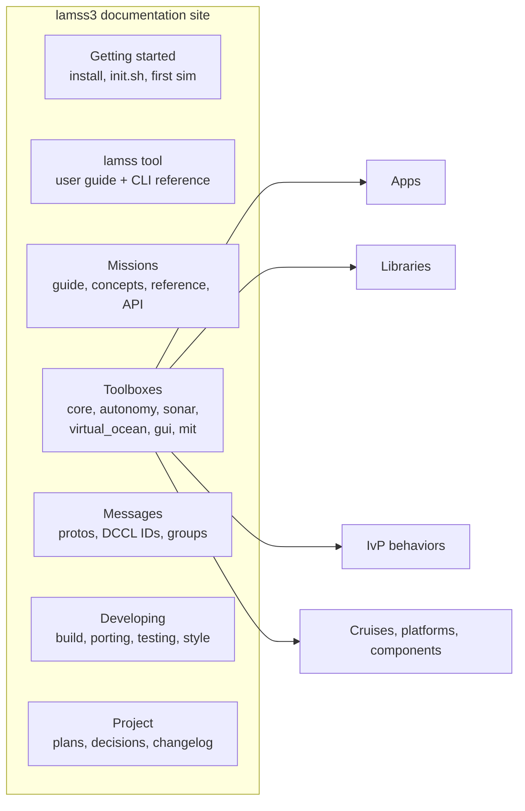
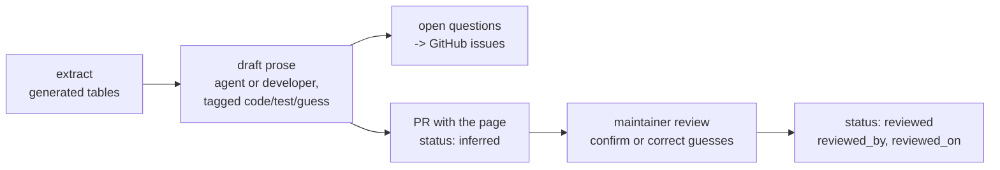
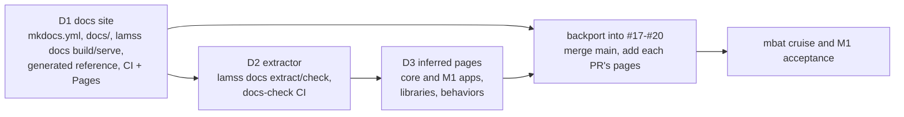

# Documentation

*This document written by Claude*

How lamss3 is documented: one site built with mkdocs-material from Markdown kept next to the code. Three kinds of pages feed it:

- **Authored** pages for what lamss3 adds: the `lamss` tool, the mission engine, toolboxes, how-tos.
- **Generated** reference pages for things that already have a precise source: protos, DCCL IDs, CLI help, config protos, the Python API.
- **Inferred** pages for code ported from the old repositories, which mostly has no documentation. These are written from the code, tagged by how each statement is known, and reviewed by a maintainer.

It replaces the short "Documentation" section of [08](08-code-style-licensing-maintenance.md#documentation).

## Site

- **Tool:** mkdocs-material, with Mermaid through its built-in `pymdownx.superfences` support, so `mkdocs-mermaid2` is not needed. Admonitions are used for the inferred-page banner, `mkdocstrings[python]` for the `lamss.mission` API, and `mike` for versions.
  - mkdocs-material and these plugins come from a pinned `docs/requirements.txt` installed into a venv. Ubuntu's packages lag and don't include every plugin.
- **Source layout:**
  - Each toolbox keeps its pages under `<toolbox>/src/doc/`: `apps/`, `libraries/`, `behaviors/`, `missions/`, `guide/`.
  - Site-wide pages and `mkdocs.yml` live in `docs/` at the top level.
  - The plans stay in `core/src/doc/plan/` and are published under "Project".
- **Assembly:** `lamss docs build|serve` collects `docs/`, every in-tree toolbox's `src/doc/` and every active submodule toolbox's `src/doc/` into one staging tree, runs the generators, and then runs `mkdocs`.
  - In-tree pages are always included, whether the toolbox is active or not, so the site and its links do not depend on what is built.
  - A user with a private (submodule) toolbox sees its pages in their local site.
- **Publishing:** a `docs` CI job builds the site with `--strict` on every PR, so broken links and missing pages fail.
  - On `main` it publishes to GitHub Pages for `GobySoft/lamss3` as version `dev`. Release tags publish a numbered version with `mike`.
  - Inferred pages are published before review, with their banner.

## Authored documentation for new functionality

| Area | Pages | Written when |
|---|---|---|
| Getting started | install (`init.sh`), `lamss env`, first build, first `lamss mission sim example` | Phase 2, with this plan |
| `lamss` tool | user guide per subcommand; CLI reference generated from the tool's own `--help` text (`cli.cpp` already holds it) | Phase 2 |
| Mission engine | concepts (cruise, fleet, platform, subsystem, component, environment); parameter precedence and `--explain`; variants; writing a cruise (a tutorial built on `example`); templates and the context dictionary; supervisord output; `lamss mission test` with `goby test`; adding a component; Python API (mkdocstrings) | Phase 2, once GobySoft/lamss3#17–#20 merge |
| Toolboxes | one overview page each: purpose, dependencies, what it provides, how to activate it | as each toolbox gains code |
| Developing | build and toolbox mechanism, porting an app (import procedure, formatting commit, headers), tests and CI, code style, DCCL ID allocation | Phase 2, from 02, 07, 08 and the Phase 1/2 practice |
| Training topics | acomms simulation (after M1), sonar simulation and autonomy missions (after M2), ICEX (after M3), as 08 planned | after each milestone |

Authored pages follow the repository's rule: `*This section written by <agent>*` under a heading an agent wrote ([AGENTS.md](../../../../../AGENTS.md)).

## Generated reference

Generators run in `lamss docs build` and in CI, and their output is never committed.

| Reference | Source | Generator |
|---|---|---|
| Messages | each toolbox's `.proto` files, including the DCCL options: ID, `max_bytes`, bounds, units | `protoc --descriptor_set_out` and a small Python script that renders one page per package. Field comments become descriptions |
| DCCL IDs | `core/src/lib/protobuf/lamss/DCCL_IDS.md` | included as is |
| Goby groups | each toolbox's `groups.h`, and later `goby_clang_tool` interface exports ([09](09-toolboxes.md#cross-toolbox-the-group-catalogue)) | script |
| App configuration | the config proto and `<app> -e` (GobyMOOSApps print an annotated example) | the inference extractor below fills the config table from these |
| CLI | `lamss <command> --help` | script |
| Python API | `lamss.mission` docstrings | mkdocstrings |

## Inferred documentation for ported code

Most of the ported code has no documentation beyond its source. Its interface (what it subscribes to, publishes and reads from configuration) can be recovered reliably from the code. Its purpose and behaviour can mostly be recovered, but with uncertainty. Inferred pages make that difference visible.

### The template

[`core/src/doc/templates/inferred-app.md`](../../templates/inferred-app.md), with a worked example in [`core/src/doc/apps/pViewMessage.md`](../../apps/pViewMessage.md). Every page has:

- **Front matter:** `toolbox`, `kind` (MOOS app, GobyMOOSApp, Goby app, IvP behavior, library), `source`, `inferred_by` (the agent or person who wrote it from the code, e.g. Claude), `inferred_from` (the commit it was written against), `status` (`inferred` or `reviewed`), `reviewed_by` and `reviewed_on`, and `launched_by` (the mission components that run it).
- **A banner** on every page whose status is `inferred`, naming who inferred it ("Inferred by Claude") and explaining the tags. It replaces the `*This section written by <agent>*` line for the whole page.
- **Purpose:** one paragraph.
- **Interfaces:** subscribes, publishes, configuration, and files, devices and external programs. The first three are tables between `BEGIN/END GENERATED` markers.
- **Behaviour:** filters, state machines (a Mermaid `stateDiagram`), timing.
- **Running it:** the launching component, a standalone run, and the tests.
- **Known issues and open questions:** links to issues, and questions for authors or maintainers.
- **History:** origin path, first commit and authors, and changes made in the port.

Every statement in prose or a table cell carries one of three tags:

- **[code]**: read directly from the code.
- **[test]**: observed in a test or a run.
- **[guess]**: inferred intent.

A reviewer either confirms a **[guess]**, which turns it into plain text, or corrects it.

### Extraction

`lamss docs extract <app>` reads an app's sources and fills the generated tables. Each row gets its `file:line` and the type or format where it can be determined.

| Pattern | Kind |
|---|---|
| `subscribe("VAR", …)`, `subscribe_pb("VAR", …)`, `m_Comms.Register("VAR", …)`, `Register("VAR", …)`, `AddMessageRouteToActiveQueueCallback` | MOOS subscriptions |
| `publish("VAR", …)`, `publish_pb("VAR", …)`, `m_Comms.Notify("VAR", …)`, `Notify("VAR", …)` | MOOS publications |
| `interprocess().subscribe<group, Type>` / `publish<group>`, `intervehicle()`, `interthread()` | Goby groups |
| config proto fields (types, defaults, `(goby.field).description`); `m_MissionReader.GetConfigurationParam("key", …)`, `GetValue`, `CMOOSApp::m_MissionReader` lookups | configuration |
| `fopen`, `ifstream`/`ofstream`, `nc_open`, `system(`, `popen(`, serial and socket opens | files, devices, external programs |
| IvP behaviors: `addInfoVars`, `getBufferStringVal`/`getBufferDoubleVal`, `postMessage`, `setParam` keys | behavior inputs, outputs, parameters |

- **Variable names built at run time:** a name assembled with `+` or a format string is listed with a `?` and flagged for review.
- **Re-running:** the extractor rewrites only the generated blocks. It keeps the Meaning and Notes columns by matching rows on name.
- **CI:** `docs-check` (`lamss docs check`) re-runs the extractor on every page and fails when a generated block differs from the code. A PR that changes an app's interface has to update its page in the same PR.

### Process

- **New ports:** from Phase 2 on, a port PR includes an inferred page for every app, library and behavior it brings in. Without the page the port isn't done.
- **Backfill:**
  - Phase 1: the four core apps and the gateway plugin.
  - Phase 2: the M1 autonomy, sonar and virtual_ocean apps and behaviors.
  - This is one PR per toolbox. Sub-agents can do it in parallel, using the same briefs as the ports plus the template.
- **Review:** the toolbox maintainer named in [08](08-code-style-licensing-maintenance.md#maintenance) reviews it. A page stays `inferred`, and is published with its banner, until then. Open questions become issues, as the Phase 2 bug issues did (GobySoft/lamss3#27–#34).
- **Native rewrites:** when an app is rewritten to native Goby3 (Phase 4), its page becomes an authored page. The interface tables then come from `goby_clang_tool` instead of the extractor.

## Sequence

*This section written by Claude*

Documentation is the next work in Phase 2, ahead of the `mbat` cruise. The mission framework PRs (GobySoft/lamss3#17–#20) wait for it, and get their pages before they merge.

| Step | Branch / PR | Contents |
|---|---|---|
| D1 | `feature/docs-site` | `mkdocs.yml`, `docs/` (home, getting started, `lamss` tool guide, developing), `docs/requirements.txt`, the `lamss.docs` Python package and `lamss docs build\|serve`, the generated messages, DCCL ID and CLI references, the `docs` CI job and publishing to GitHub Pages |
| D2 | `feature/docs-extract` | `lamss docs extract\|check` and the `docs-check` CI job |
| D3 | `feature/docs-inferred` | inferred pages for everything on `main`: the core apps, the gateway plugin and core libraries (Phase 1) and the M1 autonomy, sonar and virtual_ocean apps and behaviors |
| backport | GobySoft/lamss3#17–#20 | merge `main` into #17 and up the stack; each PR adds the pages for what it introduces (below) |

Pages each mission framework PR adds in the backport:

| PR | Pages |
|---|---|
| #17 `lamss.mission` engine | concepts (cruise, fleet, platform, subsystem, component, environment), the directory layout and registry, parameter precedence and `--explain`, variants, the Python API reference |
| #18 rendering and `lamss mission` | templates and the context dictionary, the generated output tree and supervisord, `lamss mission` user guide |
| #19 `lamss mission test` | writing a cruise test, `goby test` integration, running tests in CI |
| #20 core components and `example` | a tutorial built on the `example` cruise, one page per core component and platform, the `example` cruise page |

## Phase placement

| Phase | Documentation work |
|---|---|
| 2 (next, before `mbat`) | this plan and the template; `docs/` skeleton, `mkdocs.yml`, `lamss docs build/serve`, the `docs` CI job; getting started, `lamss` tool and mission engine pages; the extractor and `docs-check`; backfill of Phase 1 and Phase 2 inferred pages; mission engine pages backported into #17–#20 |
| 3 | an inferred page with every port; toolbox overviews; training topics after M1 and M2 |
| 4 | native rewrites turn inferred pages into authored ones, with `goby_clang_tool` tables |
| 5 | versioned site per release, polishing, the ICEX training topic, and the `lamss-docs-archive` index for the old PDF/PPTX collections ([08](08-code-style-licensing-maintenance.md#documentation)) |

## Decisions

- The template and its tags are accepted, with the inferring agent named in the banner and in `inferred_by`.
- Inferred pages are published before review, with their banner.
- The site is hosted on GitHub Pages for `GobySoft/lamss3`.
