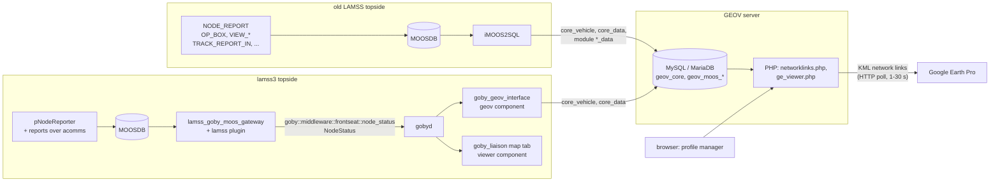
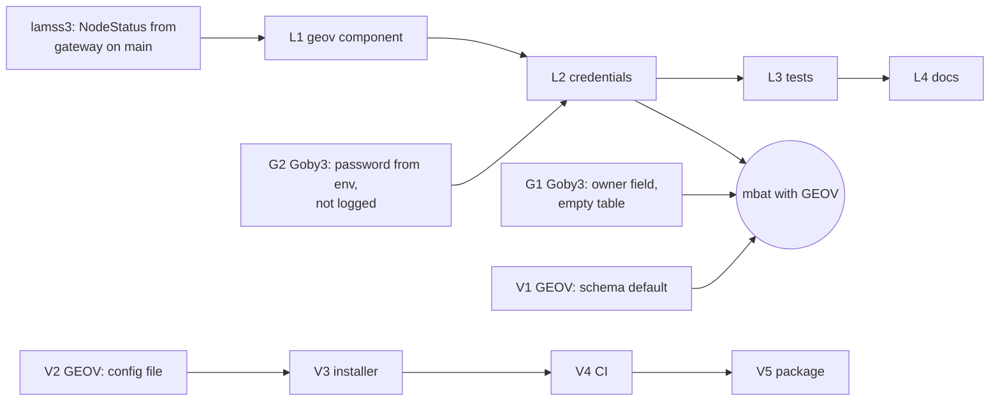

# GEOV

*This document written by Claude*

How lamss3 keeps feeding [GEOV](https://github.com/GobySoft/geov), the Google Earth Ocean Viewer, and what has to change in GEOV, Goby3 and lamss3 for that. The earlier plans said "GEOV is still used" and "`iMOOS2SQL` is replaced by `goby_geov_interface`" ([01](01-source-inventory.md), [09](09-toolboxes.md#core)) without reading GEOV; this plan checks both against the code and a test install.

Marks used below: **[tested]** was run in this session (see [Test install](#test-install)), **[code]** was read in the source, **[inferred]** is neither.

## What GEOV is today

GEOV (GobySoft/geov, HEAD `10a906c`, 2025-03-10) is a PHP web application over a MySQL database that serves KML network links to Google Earth.

| Part | What | Notes |
|---|---|---|
| Web application | 51 PHP files, about 12,000 lines, at `/geov` under the web root | `mysqli` throughout (ported to PHP 7 in "v1.0", 2018); credentials hard-coded in `connections/mysql.php` **[code]** |
| Database | `sql/1.0.sql`: `geov_core` (vehicles, positions, users, profiles, connections) and one database per module: `geov_moos_cp`, `_ctd`, `_depth`, `_mseas`, `_nafcon_target`, `_opgrid` | MyISAM, latin1/utf8; seeds 444 vehicles (mostly AIS), the module list and default vehicle images **[code]** |
| Modules | `core` (vehicles and tracks), `moos_opgrid` (op box, x/y grid, view point/polygon/circle), `moos_nafcon_target` (contacts and tracks), `moos_ctd`, `moos_cp`, `moos_mseas` (ocean-model overlays) | each has a `ge_viewer.php` that Google Earth polls every 1 to 30 s **[code]** |
| Installer | `scripts/geov_mirror` | interactive, run as root; installs Apache, PHP and `mysql-server`, resets the MySQL root password through `mysqld_safe --skip-grant-tables`, creates a database user with a fixed password, then downloads a data dump from gobysoft.org **[code]** |
| Feeders | `c++/src/iMOOS2SQL` (Goby 2-era MOOS app), `import_alog.php` (MOOS `.alog` import from a path on the server), `standalone/em3000.php` (sonar bathymetry to KML, offline) | the lamss copy of `iMOOS2SQL` is the same app ported to Goby 3's `GobyMOOSApp` **[code]** |

**How it is viewed.** An operator opens `http://<server>/geov/` in a browser, creates a user and a *profile* (realtime, playback or history; which vehicles, colours, track length, modules) and binds it to the IP address of the machine that runs Google Earth. Google Earth Pro (desktop) opens `geov_core_*.kml` from `dl_kml.php`, a network link to `networklinks.php`, which links each active module's `ge_viewer.php`; the server picks the profile by the client's address. Google Earth Pro desktop is the only client the README names; whether Google Earth on the web still refreshes network links is **[inferred]** not to be the case and was not checked.

### On current Ubuntu

| | 24.04 | 26.04 |
|---|---|---|
| PHP | 8.3.6 | 8.5.4 |
| Database | MariaDB 10.11.7 | MySQL 8.4.8 (`caching_sha2_password`) |
| Schema import (`sql/1.0.sql`) | works **[tested]** | works **[tested]** |
| All pages and module viewers return 200 | yes **[tested]** | yes **[tested]** |
| Log in, create profile, bind IP, save (web form) | works; PHP warnings only (undefined array keys) **[tested]** | same **[tested]** |
| Position from `goby_geov_interface` shown in `modules/core/ge_viewer.php` KML | only with strict SQL mode turned off **[tested]** | same **[tested]** |
| `goby_geov_interface` packaged (`goby3-apps`) | yes, `libmysqlclient21` | yes, `libmysqlclient24` (also 22.04) |

What breaks or is risky:

1. **Strict SQL mode.** Both MariaDB and MySQL default to `STRICT_TRANS_TABLES`. A feeder's `REPLACE INTO core_vehicle` omits `vehicle_owner`, which is `NOT NULL` without a default, so registering a new vehicle fails with error 1364; `goby_geov_interface` then writes every position with vehicle id 0 and the vehicle never appears **[tested]**. Vehicles already in `core_vehicle` are unaffected. Workaround: `sql_mode = NO_ENGINE_SUBSTITUTION` on the server.
2. **The installer does not fit 24.04/26.04.** It changes the root password and uses `mysql_native_password`, which MySQL 8.4 no longer enables by default, and its data comes from a gobysoft.org URL this session could not reach **[inferred; not run]**. The schema in `sql/` installs fine by hand **[tested]**.
3. **Default credentials in a public repository.** The web application's database user and password, and the root password the installer sets, are fixed strings in `connections/mysql.php` and `scripts/geov_mirror`. Any server installed this way has well-known credentials **[code]**.
4. **Network assumptions.** KML links are built from `SERVER_ADDR` and the fixed path `/geov/`; profiles are keyed on the client's IPv4 address (`char(15)`). A container with published ports, a reverse proxy, NAT or IPv6 breaks the links or merges users **[code]**.
5. **Web security.** Request parameters are concatenated into SQL (about 100 uses of `$_GET`/`$_POST`), `mysql_dump.php` returns the database to anyone, `phpinfo.php` is exposed and `import_alog.php` reads any path on the server **[code]**. Acceptable on an isolated ship LAN, not on the internet.
6. **No retention.** `core_data` grows forever (MyISAM; the seed's auto-increment is past 3.3 million) **[code]**.

## How data gets into GEOV

A feeder writes three kinds of rows:

- `geov_core.core_vehicle`: looked up by lower-case name and type; if absent, inserted with id `MAX(vehicle_id)+1` among ids below 10^8.
- `geov_core.core_data`: one row per position: vehicle id, user id, time, lat, lon, heading, speed, depth.
- `geov_<module>.<module>_data`: `(data_time, data_userid, data_variable, data_value)`, a MOOS variable name and its string value, read by that module's `ge_viewer.php`.

The user id is 0 for real data. In simulation mode the feeder looks up the profile bound to its own IP address (as the database server sees it) and writes that user's id, so simulated vehicles appear only in that profile.

### iMOOS2SQL and goby_geov_interface

| | `iMOOS2SQL` (lamss, `src/moos/iMOOS2SQL`) | `goby_geov_interface` (Goby3 `src/apps/zeromq/geov`) |
|---|---|---|
| Input | MOOS: `NODE_REPORT` (`status_var`) and any echoed variables | Goby3 interprocess: `goby::middleware::frontseat::node_status` (`NodeStatus`) |
| Vehicle key | MMSI, or name + type; takes `LOA`, `BEAM` from the report | name + `VehicleType` name, both lower-cased; no LOA/beam |
| Position | lat/lon, or x/y through the datum | `global_fix` lat/lon only |
| Rate limit | 1 s per vehicle | `position_report_interval` (default 1 s) |
| Module tables (`aux_db` echo) | yes: any MOOS variable into any module database | **no** |
| Reconnect | `MYSQL_OPT_RECONNECT` | the same; deprecated, prints a warning at start **[tested]** |
| Credentials | `mysql_host`, `mysql_user`, `mysql_password` in the config | the same, all plain config fields; also accepted on the command line **[tested]** |
| Status | attic | packaged on 22.04, 24.04 and 26.04 |

Code problems in `goby_geov_interface` **[code]**: the strict-mode failure above (it never writes `vehicle_owner`) and then caches id 0 for that vehicle until restart **[tested]**; `MAX(vehicle_id)+1` on an empty `core_vehicle` returns NULL, which is copied into a `std::string` (undefined behaviour); a failed connection logs `cfg().DebugString()`, and Goby3 logs the whole configuration at `DEBUG2`, both including the password; the Unix socket path is fixed to `/var/run/mysqld/mysqld.sock`.

### Field mapping

The lamss3 source of `NodeStatus` on a topside is the gateway plugin: every `NODE_REPORT` on the topside MOOSDB (its own `pNodeReporter` and vehicle reports received over acomms) becomes a `lamss.core.LegacyNodeReport` and, when it has a finite lat/lon, a `NodeStatus` on `goby::middleware::frontseat::node_status`. This is on the M1 branches (commits `54d7148`, `d185d5a`), not yet on `main`; goby_liaison's map tab reads the same group.

| `core_data` / `core_vehicle` column | `NodeStatus` (Goby3) | `LegacyNodeReport` / `NODE_REPORT` key |
|---|---|---|
| `vehicle_name` | `name`, lower-cased | `NAME` |
| `vehicle_type` | `VehicleType_Name(type)`, lower-cased: `auv`, `usv`, `ship`, ...; `unknown` when unset | `TYPE`, upper-cased and parsed as a `VehicleType`; a type that is not a `VehicleType` name, such as `KAYAK`, leaves it unset |
| `vehicle_owner`, `vehicle_loa`, `vehicle_beam` | not written | not carried |
| `data_vehicleid` | from the lookup above | |
| `data_time` | `time`, unwarped to UTC (needs the cruise's warp in `app.simulation`) | `TIME` or `UTC_TIME` |
| `data_lat`, `data_long` | `global_fix.lat`, `global_fix.lon` | `LAT`, `LON` |
| `data_heading` | `pose.heading` (degrees) | `HDG` |
| `data_speed` | `speed.over_ground` (m/s) | `SPD` |
| `data_depth` | `global_fix.depth` (m) | `DEPTH`, or pNodeReporter's `DEP` |
| `data_quality` | not written (default 10) | |
| `data_userid` | 0, or the simulation user | |

`core_vehicle_default` seeds images for types `auv`, `ship` and `kayak`; any other type, including `usv`, gets the default icon until set in `vehicle.php`.

### What iMOOS2SQL fed besides positions

The old topside plug (`missions-lamss/topside/topside_plugs/iMOOS2SQL.plug`, also in the expanded mbat topside configuration) echoed:

| Module database | MOOS variables | Shows | Producer in lamss3 (M1 branches) |
|---|---|---|---|
| `geov_moos_opgrid` | `LAT_ORIGIN`, `LONG_ORIGIN`, `OP_BOX`, `OLD_VIEW_POINT`, `OLD_VIEW_POLYGON`, `VIEW_CIRCLE` | op box, x/y grid on the datum, view geometry | `OP_BOX`: mission manager initializer (vehicle side); `OLD_VIEW_POINT`: `pViewMessage`; `OLD_VIEW_POLYGON`: gateway plugin. This answers the open question in the `pViewMessage` page: the `OLD_VIEW_*` variables are for GEOV |
| `geov_moos_nafcon_target` | `NAFCON_MESSAGES`, `ACTIVE_CONTACTS`, `CONTACT_MESSAGE`, `TRACK_REPORT_IN` | contacts and tracks | `TRACK_REPORT_IN`: sonar's `lamss_track` acomms message |
| `geov_moos_mseas` | `MSEAS_DISPLAY_TXT_FILE_PATH` (with `mseas_display`) | MSEAS ocean-model overlay | none |

`moos_ctd` was fed by a separate MATLAB process (`ctd_geov`). `goby_geov_interface` feeds none of the module databases. The op box can instead be typed into the opgrid module's profile (`profile_opbox`) in the web page.

## Options

| | (a) Feed GEOV as it is | (b) Modernise GEOV upstream | (c) Use Liaison / OpenCPN instead |
|---|---|---|---|
| What | `geov` mission component runs `goby_geov_interface` against a GEOV server set up by hand | (a), plus GEOV gets a schema fix, configuration outside the web root, a 24.04/26.04 installer or Debian package, CI and hardening | goby_liaison's map tab (already configured by the `viewer` component on the M1 branches) and `goby_opencpn_interface` |
| lamss3 cost | S | S | none beyond the viewer |
| Upstream cost | S (Goby3 fixes) | M to L (GEOV) | none; a KML export from Liaison would be new Goby3 work |
| Server | Apache + PHP + MySQL/MariaDB with credentials | the same, packaged | none |

What GEOV still offers that (c) does not: Google Earth's imagery and 3D globe (with its offline cache), per-user profiles shared by several machines on the ship LAN, a server-side history of every position with playback, `.alog` import, the module overlays (op grid, contacts and tracks, ocean models) and vehicle icons scaled to length and beam. What (c) offers: no database, web server or credentials, part of the mission, a browser instead of a desktop client, online chart and bathymetry layers (OSM, GEBCO, Esri, NOAA charts, OpenSeaMap), S-57 ENC overlays, and code that is maintained. The map tab is in the packaged `goby3-gui` (3.6.1+60 and later; `ProtobufMapConfig` in `liaison_config.proto`), not in the 3.6.1 source tag.

**Recommendation: (a) now, with the small part of (b) that removes known breakage; decide on the rest after M2.** GEOV stays an external service that lamss3 feeds but does not install or ship. The upstream fixes worth doing regardless are the Goby3 credential and strict-mode fixes and GEOV's schema default and configuration file (all S). Packaging, a container image and the security hardening (M to L) are worth it only if GEOV is still wanted once operators have used the Liaison map on a cruise.

| Decided by this plan (change here if you disagree) | Open for the owner |
|---|---|
| lamss3 feeds GEOV only through `goby_geov_interface`; `iMOOS2SQL` stays in the attic | Is GEOV wanted beyond the mbat cruise, or is the Liaison map enough after M2? |
| The feed is a separate, optional `geov` component in `gui`, not part of `viewer` | Are the module overlays (op box, contacts and tracks) needed in GEOV, or only vehicle positions? |
| No credential is ever a mission parameter or in any rendered file | Which machine runs the GEOV server on the ship, and who installs it? |
| GEOV is not installed by `lamss setup`/`init.sh` and not in any `dependencies.yml` | Debian package or container image for GEOV, if (b) goes ahead? |
| Strict SQL mode is fixed in the feeder (Goby3) and the schema (GEOV), not by asking users to relax it | |

## Work items

Sizes: S up to two days, M up to two weeks, L more. **mbat** marks a prerequisite for using GEOV on the mbat cruise.

### lamss3

| # | Item | Size | mbat |
|---|---|---|---|
| L0 | Merge the gateway plugin's `NodeStatus` publication (M1 branches) to `main` | S | yes |
| L1 | `gui/missions/component/geov/`: `Geov` component, process `goby_geov_interface geov.pb.cfg`, template `geov.pb.cfg.j2` (`app.pb.cfg.j2` include for warp and interprocess; `mysql_host`, `mysql_port`, `mysql_core_db_name`, `position_report_interval`, `simulation` params, `simulation` defaulting to true in `sim` mode); `optional("geov")` on `Topside`, off unless the cruise or `--set` turns it on; health on | S | yes |
| L2 | Credentials as below; the component raises `MissionError` at launch when they are missing | S | yes |
| L3 | Tests: a render test (component off by default; no password in `context.yaml`, `mission.yaml`, `supervisord.conf` or `geov.pb.cfg`); an integration test in CI with a MariaDB service container loaded from GEOV's `sql/1.0.sql`, publishing a `NodeStatus` (`goby zeromq publish` or `lamss mission test`) and asserting a `core_data` row. A mocked database is not useful: the SQL is inside the Goby3 binary | S | no |
| L4 | Docs: the component's page, an operator page "Using GEOV" (server setup pointing at GEOV's README, `sql_mode` until G1/V1 are released, credentials file, Google Earth Pro, binding a profile), and this plan's corrections in [01](01-source-inventory.md) and [09](09-toolboxes.md) | S | no |
| L5 | Module feeds, if the owner wants them and G4 is not done upstream: a small Goby3 app in `gui` writing `OP_BOX`, `OLD_VIEW_*` and `TRACK_REPORT_IN` rows to the opgrid and nafcon_target tables | M | no |

### Goby3 (`goby_geov_interface`)

| # | Item | Size | mbat |
|---|---|---|---|
| G1 | Write `vehicle_owner` (new optional `vehicle_owner` field, default `""`) so registration works under strict SQL mode; handle a NULL `MAX(vehicle_id)`; do not cache id 0 after a failed insert | S | yes, unless the server's `sql_mode` is relaxed or V1 is installed |
| G2 | `(goby.field).cfg.env` on `mysql_user` and `mysql_password` (`GOBY_GEOV_MYSQL_USER`, `GOBY_GEOV_MYSQL_PASSWORD`); make `mysql_password` optional in the proto so it can come from the environment; redact it from the connect-failure message | S | no (the interim below works) |
| G3 | Replace `MYSQL_OPT_RECONNECT` with an explicit ping and reconnect; optional TLS (`ssl_mode`, CA file) for a server off the topside machine | S | no |
| G4 | Optional module feeds: repeated `{group, type, field → module database, variable}` entries so module tables can be fed from Goby3 groups (replaces `aux_db`) | M | no |

### GEOV

| # | Item | Size | mbat |
|---|---|---|---|
| V1 | Schema: `DEFAULT ''` for `vehicle_owner` (and any other `NOT NULL` column feeders omit), shipped as `sql/1.1.sql` plus a migration; document `sql_mode` | S | yes, unless G1 or a relaxed `sql_mode` |
| V2 | Read database settings from a file outside the web root (`/etc/geov/config.php`) or the environment; remove the fixed user and passwords from the repository | S | no |
| V3 | Non-interactive installer for 24.04 and 26.04: MariaDB or MySQL 8.4, schema from `sql/` (no network dump), random database password written to V2's file, no root password change, an Apache config snippet; update the README | M | no |
| V4 | CI (GitHub Actions): `php -l` on 8.3 and 8.5, MariaDB and MySQL services, schema import, a smoke test (pages return 200, a `core_data` row appears in `ge_viewer.php`'s KML), like [the test below](#test-install) | S | no |
| V5 | A `geov` Debian package in the GobySoft repository (files in `/usr/share/geov`, Apache config, `dbconfig-common` for the database and user); a container image needs host networking because of the IP-bound profiles | M | no |
| V6 | Hardening, only if GEOV is reachable beyond the ship LAN: prepared statements for request parameters; remove or protect `mysql_dump.php`, `phpinfo.php` and the path input of `import_alog.php`; links from `HTTP_HOST`; IPv6-sized `connected_ip` | M | no |
| V7 | Retention: a cleanup of old `core_data` rows (configurable age) | S | no |

**Minimum for mbat**: L0, L1, L2, and either G1 or V1 released, or the server's `sql_mode` relaxed by hand; plus a GEOV server on the ship LAN (installed by hand from `sql/` until V3) and Google Earth Pro on the operator machines.

## Credentials

GEOV's database user and password must never be committed, never be a mission parameter (parameters are written to `mission.yaml` and `context.yaml`) and never be in `Process.environment` (written to `supervisord.conf`).

- The operator keeps them in a file outside any repository, `~/.config/lamss/geov.env` (mode 0600), with `GOBY_GEOV_MYSQL_USER=...` and `GOBY_GEOV_MYSQL_PASSWORD=...`, and sources it in the shell that runs `lamss mission sim|run` (or the system unit that does). supervisord passes its environment to every program.
- With G2, `goby_geov_interface` reads both from the environment and the rendered `geov.pb.cfg` has no credential at all.
- Until G2 is released, the component's command is `sh -c 'exec goby_geov_interface geov.pb.cfg --mysql_user="$GOBY_GEOV_MYSQL_USER" --mysql_password="$GOBY_GEOV_MYSQL_PASSWORD"'`. The rendered files contain only the variable names; the value is visible in the process's command line to local users, which is acceptable on a single-operator topside.
- The component pins the interface's verbosity at `DEBUG1` or below, since Goby3 logs the whole configuration at `DEBUG2`.
- The old configurations hold a database host, user and password in plain text (`missions-lamss/topside/topside_plugs/iMOOS2SQL.plug`, `missions-lamss/topside/all.def`, and the generated mbat topside configuration); none of them are carried into lamss3, and those credentials should be treated as known and changed on any server that still uses them.

## Test install

Run in this session on Ubuntu 24.04 and 26.04 root filesystems built with `debootstrap` (Docker Hub was rate-limited) and imported into Docker, from Ubuntu's own packages: Apache, `libapache2-mod-php`, `php-mysql`, and MariaDB (24.04) or MySQL (26.04). GEOV `10a906c` was copied to `/var/www/html/geov`, `sql/1.0.sql` imported, and a database user created for the web application. On the host, `gobyd` and the packaged `goby_geov_interface` (3.6.1+60) connected over TCP with a separate test user; `goby zeromq publish` sent `NodeStatus` messages on `goby::middleware::frontseat::node_status`. Then: every page and module viewer was fetched; a user and a profile were created and bound through the profile manager's forms; the profile's vehicle row was set to visible; `modules/core/ge_viewer.php` was fetched and checked for the vehicle's placemark and coordinates. Not tested: Google Earth itself, playback and history modes, the module viewers with data, `import_alog.php`, the installer.
