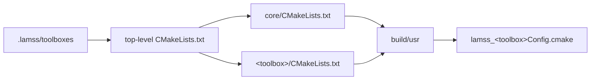

# Build system

*This page written by Claude*

Each toolbox is a CMake project of its own. `lamss build` configures a top-level project that adds every active toolbox, in dependency order, into one build tree, and installs into `build/usr`. Each toolbox can also be built alone against an installed `core`, which CI checks.



## A toolbox

```text
<toolbox>/
  CMakeLists.txt        lamss_toolbox(NAME <toolbox> REQUIRES core ...)
  dependencies.yml      packages, see lamss dependencies
  src/bin/<app>/        applications
  src/lib/<library>/    libraries; src/lib/protobuf/ holds the toolbox's messages
  src/python/           Python packages
  src/doc/              pages for this site
  src/test/             tests
  missions/             mission components, platforms and cruises
```

## CMake helpers

[`cmake/LamssToolbox.cmake`](../../cmake/LamssToolbox.cmake) is included by every toolbox and installed with `core`, so toolboxes outside this repository use the same helpers:

| Helper | Does |
|---|---|
| `lamss_toolbox(NAME <tb> [REQUIRES <tb>...])` | declares the toolbox and finds the toolboxes it requires (in the joint build, or installed) |
| `lamss_add_library(<name> SOURCES … [PROTOS …] [LINK_LIBRARIES …] [NO_EXPORT])` | a library, exported in the toolbox's CMake package unless `NO_EXPORT` |
| `lamss_add_proto(<name> PROTOS …)` | a protobuf library; runs `protoc` and the DCCL plugin |
| `lamss_add_app(<name> SOURCES … [PROTOS …] [LINK_LIBRARIES …] [NO_GOBY] [MOOS])` | an application, installed into `bin` |
| `lamss_find_moos()`, `lamss_find_ivp(<lib>...)` | MOOS and MOOS-IvP targets (MOOS-IvP ships no CMake package); recorded for downstream toolboxes with `lamss_export_code` |
| `lamss_add_python(<package_dir>)` | installs a Python package into `lib/python3/dist-packages` |
| `lamss_add_test(<name> SOURCES …)`, `lamss_add_dccl_test(…)` | a ctest executable; the DCCL variant checks messages against `DCCL_IDS.md` |
| `lamss_toolbox_export()` | writes `lamss_<tb>Config.cmake` for downstream toolboxes |

`-D LAMSS_WERROR=ON` turns warnings into errors, as CI builds. The design is in [plan 02](../../core/src/doc/plan/claude/02-repository-layout-and-build.md).
