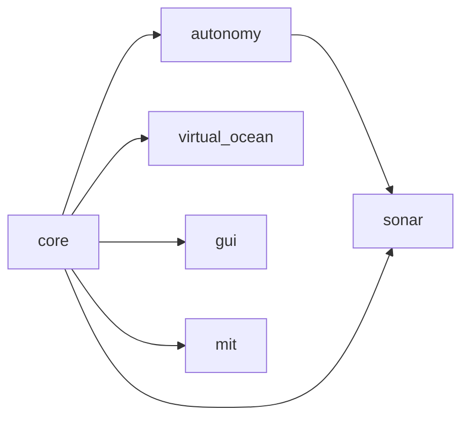

# lamss3

*This page written by Claude*

lamss3 is version 3 of the MIT Laboratory for Autonomous Marine Sensing Systems (LAMSS) software: the applications, IvP behaviors, simulators and mission configuration that run LAMSS autonomous underwater vehicles, moorings and topside stations. It brings the code of the old `lamss`, `lamss-shared`, `lamss-internal` and `missions-lamss` repositories into one open-source project built on [Goby3](https://goby.software) and [MOOS-IvP](https://oceanai.mit.edu/moos-ivp).

The code is split into **toolboxes**, each built and activated separately. Arrows point from a toolbox to those that require it:

| Toolbox | Holds |
|---|---|
| [core](../core/src/doc/index.md) | the `lamss` tool, shared messages and libraries, the Goby3–MOOS gateway, mission engine |
| [autonomy](../autonomy/src/doc/index.md) | mission state machine, IvP behaviors, vehicle autonomy |
| [sonar](../sonar/src/doc/index.md) | sonar processing chain and tracking |
| [virtual_ocean](../virtual_ocean/src/doc/index.md) | simulators: vehicles, targets, acoustic modems and sonar |
| [gui](../gui/src/doc/index.md) | displays, kept apart because of their dependencies |
| [mit](../mit/src/doc/index.md) | MIT's cruises and platforms |

## Where to start

- [Getting started](getting-started.md): install, build, and set up your shell.
- [The lamss tool](tool/index.md): building, toolboxes, dependencies and these docs.
- [Messages](reference/messages/index.md): every protobuf and DCCL message.
- [Developing](developing/index.md): how the build works, porting old code, tests, writing pages.
- [Plans](../core/src/doc/plan/core.md): where lamss3 is going and why.

!!! note "Inferred documentation"
    Most code ported from the old repositories had no documentation. Its pages are written from the code by Claude and marked **Inferred by Claude** until a maintainer reviews them; see [Documentation](developing/documentation.md).
