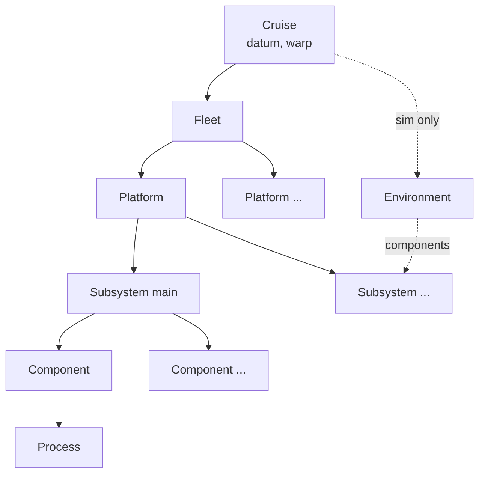

# Concepts

*This page written by Claude*

Six kinds of concept describe a mission. Each is a class in [`lamss.mission`](../../core/src/python/lamss/mission/concept.py) that mission trees subclass.



| Concept | Is | Holds |
|---|---|---|
| `Cruise` | one bounded deployment | `fleet`, `environment`, `overrides`, parameters `datum`, `warp`, `port_base`, `port_ranges` and `supervisor` |
| `Fleet` | the platforms taking part | `platforms`, `overrides` |
| `Platform` | a vehicle, mooring, ship or topside | `components`, `sim_components`, `run_components`, `subsystems`, `main_subsystem`, parameters `type` and `modem_id` |
| `Subsystem` | part of a platform with its own processes, often its own computer | its components, a `mode`, parameters `host` and `ports` |
| `Component` | anything that contributes processes, configuration templates or parameters | `requires`, `sim_only`, `run_only`, `processes`, `templates`, `fragments`, `ports`, `data_files` |
| `Environment` | bathymetry, sound speed, currents, ice, time window; simulation only | `components`, `subsystem` |

A `Process` is not a concept but a description of one program a component launches: `name`, `command`, `config_template`, `priority`, `autorestart`, `startsecs`, `stopsignal` and `environment`. Each becomes a supervisord program ([Output](output.md#the-subsystems-supervisordconf)).

## Classes are definitions

A mission class says what something *is* through class attributes. Nothing is instantiated by hand; [resolving](parameters.md) a cruise builds one resolved instance per use.

```python
class Auv(Platform):
    params = dict(type="auv", max_depth=100, speed=1.5)
    components = [Interprocess, Logging]


class Glider(Auv):
    params = dict(max_depth=200, speed=0.3)
    components = Auv.components + [Health, SimOnlyThing]
```

**Inheritance** builds the taxonomy: `Glider` is an `Auv` and inherits its parameters and components. `params` merge along the class hierarchy, so `Glider` has `type: auv`, `max_depth: 200` and `speed: 0.3`. Lists such as `components` do not merge: a subclass that sets one replaces it, so it extends the parent's list explicitly.

**Composition** assembles a mission: a cruise names a fleet, a fleet lists platforms, a platform lists components.

```python
class Pair(Fleet):
    platforms = [Topside, Glider(modem_id=2, speed=0.4)]


class Trial(Cruise):
    fleet = "pair"
    environment = "flat"
    params = dict(datum=dict(lat=42.5, lon=-70.5))
```

## Entries in lists

Wherever a concept is named (a cruise's `fleet` and `environment`, a fleet's `platforms`, a platform's `components`) the entry can be:

- **a class**: `Glider`.
- **a spec**: the class called with parameter overrides, `Glider(modem_id=2)`, or with a name first, `Glider("g2", modem_id=2)`. The overrides apply only to this use; see [Parameters](parameters.md).
- **a name**: `"pair"` or a path `"platform/auv/glider"`, looked up in the [registry](layout.md). Names avoid importing a class from another toolbox.
- **`optional("viewer")`** (components only): used when an active toolbox defines `viewer`, otherwise left out with a note on stderr. This lets a platform list a component from a toolbox, such as one with display dependencies, that is not always active.

## Names

Every resolved concept has a `name`, the key it appears under in the mission dictionary:

- **cruise, fleet, platform, environment**: the directory that holds its class (`glider`), or the name given in a spec (`Glider("g2")`), or a `name` class attribute.
- **component**: the directory directly beneath `component/`, so every implementation of `component/acomms/` (`acomms/udp`, `acomms/micromodem`, ...) is named `acomms`. A platform therefore has at most one of each.
- **subsystem**: the name given to `Subsystem("main", ...)`.

Two platforms of one class need names: `platforms = [Glider("g1", modem_id=1), Glider("g2", modem_id=2)]`.

## Platforms and subsystems

A platform has `subsystems = [Subsystem("main")]` by default. Its `components`, plus `sim_components` in simulation or `run_components` at run time, go to its `main_subsystem` (`"main"`). Other subsystems list their own components:

```python
class Glider(Auv):
    subsystems = Auv.subsystems + [Subsystem("frontseat_sim", [Interprocess], mode="sim", host="sim")]
```

A subsystem with `mode="sim"` or `mode="run"` exists only in that mode. Keyword arguments to `Subsystem` other than `components` and `mode` override its parameters (here `host`).

## Modes: simulation and run time

A mission is resolved in mode `sim` (the default) or `run`. The mode decides:

- whether the cruise's environment exists: only in `sim`;
- which subsystems exist (their `mode`);
- which of a platform's `sim_components` or `run_components` are added;
- which components are dropped: `sim_only = True` components exist only in `sim`, `run_only = True` only in `run`.

Every resolved concept knows the mode as `self.mode`, and the mission dictionary has it at the top.

## Components

| Attribute | Meaning |
|---|---|
| `params` | parameters and their defaults |
| `requires` | components (classes or names) that must be in the same subsystem; a missing one is an error |
| `sim_only`, `run_only` | exist only in that mode |
| `processes` | the `Process` entries to launch |
| `templates` | configuration templates to render into the subsystem's directory ([Templates](templates.md)) |
| `fragments` | templates rendered into a file another component owns ([Templates](templates.md#fragments)) |
| `ports` | names of the TCP/UDP ports it needs ([Templates](templates.md#ports)) |
| `data_files` | data files the component uses (declared only; the engine does not read it) |

`active_processes()` returns `processes`; override it when the processes depend on the parameters or the mode. `environment()` returns variables for the subsystem's processes ([Templates](templates.md#environment-variables)). Inside methods, `self.params` holds the merged parameters, `self.subsystem` and `self.platform` the resolved owners.

## Environments

An environment exists only in simulation. Its `components` simulate it (ocean models, propagation, sensor simulators) and are added to every platform subsystem whose name is the environment's `subsystem` attribute (default `"sensor_sim"`). Classes for such components live under `environment/component/` and are components, not environments.

## The mission dictionary

Each resolved concept turns into a plain dictionary (`to_dict()`): its `name`, its merged parameters, values from `derived()`, and its children. Templates see nothing else. `python3 -m lamss.mission show trial` prints it:

```yaml
mode: sim
variant: null
cruise: {name: trial, datum: {lat: 42.5, lon: -70.5}, warp: 1, port_base: 9000, port_ranges: {http: 50000, supervisor: 51000}, supervisor: {http_port: null, http_address: 127.0.0.1}}
fleet: {name: pair, platforms: [topside, glider]}
environment: {name: flat, depth: 50}
platform:
  topside: ...
  glider:
    name: glider
    type: auv
    modem_id: 2
    max_depth: 200
    speed: 0.5
    subsystem:
      main:
        name: main
        host: localhost
        ports: {}
        component:
          interprocess: {name: interprocess, socket: gobyd, moos: {enabled: false, port: 9000}}
          logging: {name: logging, level: DEBUG, dir: log}
          health: {name: health, interval: 1}
          sim_only_thing: {name: sim_only_thing}
```

(Shown in flow style for brevity; `show` prints block style.)

`derived()` computes values from the merged parameters, such as unit conversions or lookups in the platform, so templates need no arithmetic:

```python
class Depth(Component):
    params = dict(feet=10)

    def derived(self):
        return {"meters": round(self.params["feet"] * 0.3048, 3),
                "platform_max": self.platform.params["max_depth"]}
```

## Built-in parameters

| Concept | Parameter | Default |
|---|---|---|
| Cruise | `datum.lat`, `datum.lon` | `0.0`, `0.0` |
| Cruise | `warp` | `1` |
| Cruise | `port_base` | `9000`: the first port [allocated](templates.md#ports) to components |
| Cruise | `port_ranges` | `{http: 50000, supervisor: 51000}`: where ports declared with a range come from ([Templates](templates.md#ports)) |
| Cruise | `supervisor.http_port` | `null`: supervisord's web page uses the first port of `port_ranges.supervisor`; set it to fix another ([Output](output.md#supervisords-web-page)) |
| Cruise | `supervisor.http_address` | `127.0.0.1`: the address the web page listens on; `"*"` for every interface |
| Platform | `type` | `platform` |
| Platform | `modem_id` | `null`; when set, unique in the fleet |
| Subsystem | `host` | `localhost` |
| Subsystem | `ports` | `{}`; ports set here are used instead of allocated ones |

`name`, `subsystem` and `component` are reserved and cannot be parameters.

## Checks

Resolving fails with a message naming the class or key when:

- a cruise has no fleet, or a fleet no platforms;
- two platforms, two subsystems of a platform, or two components of a subsystem share a name;
- a component's `requires` is not met in its subsystem;
- two platforms have the same `modem_id`;
- an entry is not of the expected kind (a platform where a component belongs).
