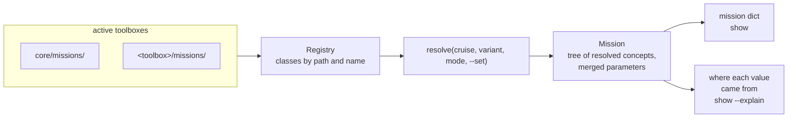

# Missions

*This page written by Claude*

A lamss3 mission is described by Python classes, not by preprocessor macros. A **cruise** names a **fleet** of **platforms** and an **environment**; each platform is made of **subsystems**, and each subsystem of **components**. The `lamss.mission` package finds these classes in the active toolboxes' `missions/` directories, applies the variant and the overrides you ask for, and resolves the cruise into one plain dictionary: the mission.



## Trying it

`lamss build` installs the package into the prefix. From anywhere in the checkout:

```sh
export PYTHONPATH=$PWD/build/usr/lib/python3/dist-packages   # or core/src/python, without building
python3 -m lamss.mission list                    # cruises and their variants
python3 -m lamss.mission list <cruise>           # its platforms, subsystems and components
python3 -m lamss.mission show <cruise> [variant] # the resolved mission as YAML
python3 -m lamss.mission show <cruise> --explain <key>
```

The checkout is the nearest directory above the current one that holds `.lamss/`, or `LAMSS_ROOT`. Errors in a mission definition are printed as `lamss mission: error: ...` with exit status 1.

The examples on these pages use the cruise `trial` from the test fixture tree in [`core/src/test/mission/conftest.py`](../../core/src/test/mission/conftest.py): a fleet `pair` of a `topside` and a `glider`, in two toolboxes (`core` and `extra`).

## Pages

| Page | What it covers |
|---|---|
| [Concepts](concepts.md) | cruise, fleet, platform, subsystem, component, environment; inheritance and composition |
| [Layout and registry](layout.md) | the `missions/` directories and how classes are found across toolboxes |
| [Parameters](parameters.md) | where a value comes from, `--set` and `--explain` |
| [Variants](variants.md) | named alternatives of a concept, and combining them |
| [Python API](api.md) | the `lamss.mission` package |

The design is in [plan 06](../../core/src/doc/plan/claude/06-missions-framework.md), from the "Missions" section of the [core plan](../../core/src/doc/plan/core.md#missions).
