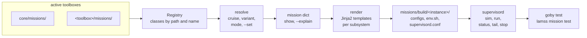

# Missions

*This page written by Claude*

A lamss3 mission is described by Python classes, not by preprocessor macros. A **cruise** names a **fleet** of **platforms** and an **environment**; each platform is made of **subsystems**, and each subsystem of **components**. `lamss mission` finds these classes in the active toolboxes' `missions/` directories, resolves the cruise into one plain dictionary, renders each subsystem's configuration files from Jinja2 templates, and runs the processes under one `supervisord`.



## Trying it

The [tutorial](tutorial.md) walks through `core`'s `example` cruise. In short:

```sh
lm m list                         # cruises and their variants
lm m list <cruise>                # its platforms, subsystems and components
lm m show <cruise> [variant]      # the resolved mission as YAML
lm m generate <cruise>            # write the configuration only
lm m sim <cruise>                 # generate and start the whole fleet on this machine
lm m status
lm m stop
lm m test <cruise>                # run the cruise's goby test files against it
```

`lm m` is short for `lamss mission`; the [command guide](cli.md) has every option.

## Pages

| Page | What it covers |
|---|---|
| [Tutorial](tutorial.md) | the `example` cruise: look, generate, run, test, add a variant and a component |
| [Concepts](concepts.md) | cruise, fleet, platform, subsystem, component, environment; inheritance and composition |
| [Layout and registry](layout.md) | the `missions/` directories and how classes are found across toolboxes |
| [Parameters](parameters.md) | where a value comes from, `--set` and `--explain` |
| [Variants](variants.md) | named alternatives of a concept, and combining them |
| [Templates](templates.md) | Jinja2 templates and the context dictionary they see |
| [Output](output.md) | the generated files, and how supervisord starts and stops the processes |
| [Testing](testing.md) | checking a running mission with `goby test`, in ctest and CI |
| [`lamss mission`](cli.md) | the command line |
| [Python API](api.md) | the `lamss.mission` package |

`core`'s own [components](../../core/src/doc/missions/components.md), [platforms](../../core/src/doc/missions/platforms.md) and [example cruise](../../core/src/doc/missions/example.md), and `gui`'s [viewer](../../gui/src/doc/missions/viewer.md), are documented with their toolboxes.

The design is in [plan 06](../../core/src/doc/plan/claude/06-missions-framework.md), from the "Missions" section of the [core plan](../../core/src/doc/plan/core.md#missions).
