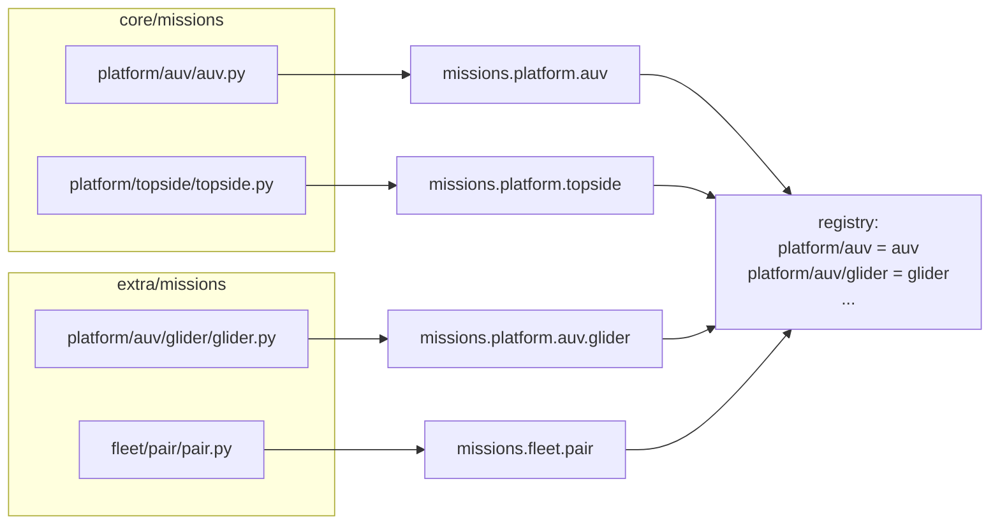

# Layout and registry

*This page written by Claude*

Mission classes live in each toolbox's `missions/` directory, in a tree that mirrors the class hierarchy. The [registry](../../core/src/python/lamss/mission/registry.py) walks the trees of the active toolboxes and registers every class it finds.

## One directory, one class

A directory `x/` holds `x.py`, which defines class `X`. Its subdirectories hold subclasses of `X`; its other `.py` files hold [variants](variants.md) of `X`.

```
core/missions/
├── component/
│   ├── interprocess/interprocess.py      class Interprocess(Component)
│   ├── logging/logging.py                class Logging(Component)
│   └── acomms/acomms.py                  class Acomms(Component)
│       └── udp/udp.py                    class Udp(Acomms)
├── platform/
│   ├── auv/auv.py                        class Auv(Platform)
│   └── topside/topside.py                class Topside(Platform)
└── environment/flat/flat.py              class Flat(Environment)

extra/missions/
├── platform/auv/                         (no auv.py: Auv comes from core)
│   └── glider/glider.py                  class Glider(Auv)
│       ├── glider_deep.py                @variant("deep") class GliderDeep(Glider)
│       └── glider_quiet.py               @variant("quiet") class GliderQuiet(Glider)
├── fleet/pair/pair.py                    class Pair(Fleet)
└── cruise/trial/trial.py                 class Trial(Cruise)
```

(The fixture tree of [`core/src/test/mission/conftest.py`](../../core/src/test/mission/conftest.py).)

- The top-level directories are the concept kinds: `cruise/`, `fleet/`, `platform/`, `subsystem/`, `component/` and `environment/`. Their base classes are built into `lamss.mission`, so no toolbox defines `cruise/cruise.py`.
- `templates/`, `data/`, `build/`, `log/`, `run/` and `test/` are reserved at any depth and hold no classes. Directories starting with `.` or `_` are skipped, as are `.py` files starting with `_`.
- Any other top-level directory is an error.
- Under `environment/`, a `component/` subtree holds components that simulate the environment (`environment/component/ocean_model/...`); its classes are components.

## The `missions` package

The trees of all active toolboxes are importable together as one Python package, `missions`, whatever toolbox a file is in:

```python
# extra/missions/platform/auv/glider/glider.py
from lamss.mission import Platform
from missions.platform.auv import Auv          # core/missions/platform/auv/auv.py
from missions.component.health import Health


class Glider(Auv):
    params = dict(max_depth=200, speed=0.3)
    components = Auv.components + [Health]
```

`x/x.py` is the code of package `missions.<path>.x`, so `from missions.platform.auv import Auv` works. A variant file is a module of that package: `from missions.platform.auv.glider.glider_deep import GliderDeep`.

To avoid an import from a toolbox that may be inactive, name the class instead: `fleet = "pair"`, `requires = ["interprocess"]`, `components = [optional("viewer")]`.

## Toolboxes extend each other's trees

A toolbox adds to another's tree by placing a directory at the same path. Above, `extra` has `platform/auv/glider/` beneath `core`'s `platform/auv/`, without an `auv.py` of its own. The active toolboxes are `core` and those listed in `.lamss/toolboxes` (see [`lamss toolbox`](../tool/toolbox.md)); a toolbox without a `missions/` directory contributes nothing.



## Lookup by path and by name

Each class is registered by its path (`platform/auv/glider`) and by its short name, the last part of the path (`glider`). Anywhere a concept can be named, a string with a `/` is a path, otherwise a short name (or a top-level path such as `platform`, the built-in base).

`python3 -m lamss.mission list` shows the cruises of the active toolboxes:

```
trial  extra         acomms, deep, deep_quiet, fast, quiet
```

## Rules the registry enforces

Loading fails, naming the file, when:

| Problem | Example message |
|---|---|
| two classes have the same short name | `name clash: component/udp (extra) and component/acomms/udp (core) are both 'udp'` |
| the same file exists in two toolboxes | `... ImportError: missions.platform.auv is defined twice: core/missions/platform/auv/auv.py and extra/missions/platform/auv/auv.py` (paths shortened) |
| a class does not subclass its parent directory's class | `Boat (...) must subclass Auv, the class of the directory above it` |
| a class is under the wrong tree | `Thing (...) is under platform/ but is not a Platform` |
| `x.py` defines several concept classes | `... defines A, B; a directory holds one class` (unless exactly one is named after the directory: `example_fleet/` → `ExampleFleet`) |
| `x.py` defines none | `... defines no concept class` |
| another `.py` file holds a class that is not a `@variant` | `Extra (...) is neither platform/auv/glider's class (which belongs in glider.py) nor a @variant` |
| a file fails to import | `cannot load missions.component.broken (.../broken.py:2): NameError: ...` |

Only classes defined in a file count; imported ones are ignored, so `glider.py` can import `Auv`.

Short names are global across toolboxes, so choose specific ones: a component directory is also the component's name in the mission (see [Concepts](concepts.md#names)).
