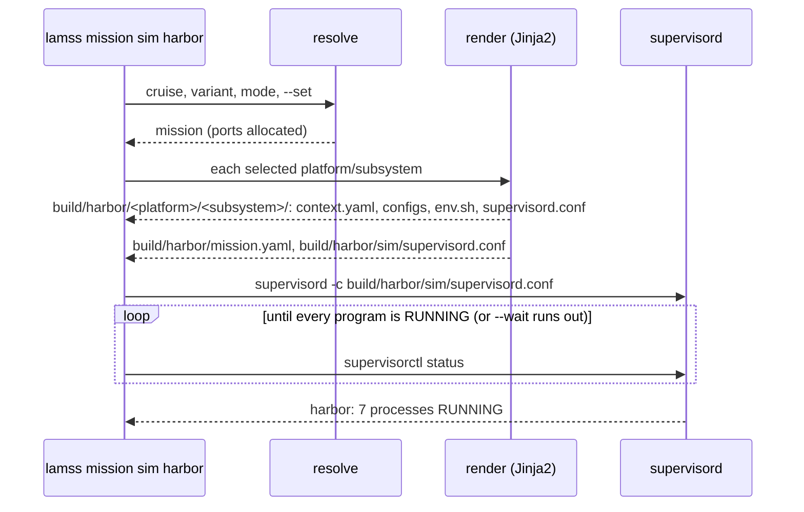

# Output

*This page written by Claude*

`lamss mission generate` writes a mission's configuration; `sim` and `run` also start it under one [supervisord](http://supervisord.org/), which starts, watches, logs and stops every process. The code is in [`render.py`](../../core/src/python/lamss/mission/render.py) and [`supervisor.py`](../../core/src/python/lamss/mission/supervisor.py).



## Instances

The output of one generation is an **instance**, named `<cruise>` or `<cruise>_<variant>` (`harbor`, `harbor_quick`), or as given by `--instance NAME`. Instances have separate directories and supervisords, so a variant can run beside the plain cruise (with a different `--set port_base=...` when both use ports).

## The tree

Output goes into the `missions/` directory of the toolbox that holds the cruise class (`extra/missions/` for `harbor`). Nothing in it is committed.

```
extra/missions/
├── build/harbor/                         generated; replaced by each generate
│   ├── mission.yaml                      the whole mission dictionary
│   ├── shore/main/
│   │   ├── context.yaml                  what this subsystem's templates saw
│   │   ├── daemon.cfg, last.moos         rendered templates
│   │   ├── env.sh                        environment, for running a process by hand
│   │   └── supervisord.conf              one group, one program per process
│   ├── buoy/main/...
│   ├── buoy/sensors/...
│   └── sim/supervisord.conf              the mode's supervisord.conf: includes every subsystem
├── run/harbor/                           created at launch
│   ├── supervisor.sock, supervisord.pid
│   ├── http.url                          address of supervisord's web page, for status
│   ├── shore/main/, buoy/main/, ...      per-subsystem scratch: sockets, databases
│   └── log -> ../../log/harbor/2026-11-03T14-00-05Z
└── log/harbor/2026-11-03T14-00-05Z/      one directory per launch
    ├── supervisord.log
    └── shore/main/daemon.out, ...        each process's output
```

- `generate` deletes `build/<instance>/` and writes it afresh. Nothing written depends on the time or the order of a directory listing, so generating twice gives identical files, and a diff between two generations shows only what changed.
- `--platform` and `--subsystem` (each repeatable) generate only the subsystems they select; `mission.yaml` always has the whole mission.
- In `run` mode the mode directory is `run/supervisord.conf` beside the subsystems, and `--platform` is required: a machine runs one platform's subsystems.

## The subsystem's `supervisord.conf`

Each subsystem is one supervisord group, `<platform>_<subsystem>`, and each process of its components one program:

```ini
; harbor: shore/main, generated by lamss mission

[group:shore_main]
programs=shore_main_daemon,shore_main_moosdb,shore_main_app

[program:shore_main_daemon]
process_name=daemon
command=sleep 300
directory=%(here)s
priority=10
autostart=true
autorestart=unexpected
startsecs=1
stopsignal=TERM
stopasgroup=true
killasgroup=true
stdout_logfile=%(here)s/../../../../run/harbor/log/shore/main/daemon.out
redirect_stderr=true
environment=LAMSS_ROOT="...",LAMSS_INSTANCE="harbor",...,DAEMON_PORT="24000",PATH="/home/me/lamss3/build/usr/bin:%(ENV_PATH)s",LD_LIBRARY_PATH="/home/me/lamss3/build/usr/lib"
```

- Each process runs in its subsystem's build directory, so commands name their configuration by file name: `gobyd gobyd.pb.cfg`.
- `supervisorctl` shows a program as `shore_main:daemon`.
- **Start order** comes from the component order: `priority` is `10 × (component index + 1) + process index`, so the first component's processes start first (supervisord starts lower priorities first). A component has at most 10 processes. A `Process(priority=...)` sets it explicitly.
- Paths to the run and log directories are relative to the file (`%(here)s`).
- Output and errors of each process go to `<process>.out` in its log directory.

`Process` fields and the program settings they become:

| Field | Default | Setting |
|---|---|---|
| `name` | | `process_name`, and the program name `<group>_<name>` |
| `command` | | `command`, after rendering as a template |
| `config_template` | `None` | rendered into the build directory ([Templates](templates.md)) |
| `priority` | from the component order | `priority` |
| `autorestart` | `"unexpected"` | `autorestart` (`true`, `false` or `unexpected`) |
| `startsecs` | `1` | `startsecs`: how long it must stay up to count as started |
| `stopsignal` | `"TERM"` | `stopsignal` |
| `environment` | `{}` | added to `environment` for this process only |

Every program also gets `autostart=true`, `stopasgroup=true` and `killasgroup=true`, so stopping a program stops its children.

## The mode's `supervisord.conf`

`build/<instance>/sim/supervisord.conf` (or `run/`) runs one supervisord for every generated subsystem:

```ini
; harbor (sim), generated by lamss mission

[unix_http_server]
file=%(here)s/../../../run/harbor/supervisor.sock
chmod=0700

[supervisord]
logfile=%(here)s/../../../run/harbor/log/supervisord.log
pidfile=%(here)s/../../../run/harbor/supervisord.pid
childlogdir=%(here)s/../../../run/harbor/log
identifier=lamss_harbor

[rpcinterface:supervisor]
supervisor.rpcinterface_factory = supervisor.rpcinterface:make_main_rpcinterface

[supervisorctl]
serverurl=unix://%(here)s/../../../run/harbor/supervisor.sock

[inet_http_server]
port=127.0.0.1:51000

[include]
files=../shore/main/supervisord.conf ../buoy/main/supervisord.conf ../buoy/sensors/supervisord.conf
```

supervisord is controlled through the unix socket, readable by its owner only. A socket path longer than a unix socket allows (90 characters here) moves to `$TMPDIR/lamss-<uid>/<hash>.sock`.

## `env.sh`

`. env.sh` in a subsystem's build directory sets the environment its processes get under supervisord ([Templates](templates.md#environment-variables)), so one process can be run by hand, under a debugger for instance:

```sh
cd extra/missions/build/harbor/shore/main
. ./env.sh
sleep 300        # the daemon's command, as in supervisord.conf
```

## Logs

Each launch makes a new directory `log/<instance>/<UTC time>/` and points the link `run/<instance>/log` at it. Generated files name only the link, which is why they do not change from one launch to the next, while each launch's logs are kept. Templates find a subsystem's log directory in `paths.log`.

## Starting

`sim` and `run` generate, then:

1. create the run and log directories;
2. start `supervisord -c build/<instance>/<mode>/supervisord.conf`, which daemonizes;
3. poll `supervisorctl status` until every program is `RUNNING`.

When a program fails (any state other than `RUNNING`, `STARTING` or `BACKOFF`) or `--wait` seconds (default 60) pass first, everything is stopped and the command fails, naming the programs and where their logs are. On success it prints:

```
harbor: 7 processes RUNNING
  web:     http://127.0.0.1:51000/
  logs:    /home/me/lamss3/extra/missions/log/harbor/2026-11-03T14-00-05Z
  status:  lamss mission status harbor
  stop:    lamss mission stop harbor
```

Starting an instance that is already running is refused. `--execute` starts what an earlier `generate` wrote, without generating; `--generate` only generates.

With `--foreground`, supervisord stays in the foreground, the command prints `lamss mission: harbor: all 7 processes RUNNING` once every program runs, and SIGINT or SIGTERM (Ctrl-C) stops supervisord and every program. Test fixtures wait for that line.

## Watching and stopping

- `status [instance]` lists every program of the running instances with its state (exit status 3 unless all are `RUNNING`, or when none is running).
- `tail <program>` prints a program's output (`-f` to follow); without a program, the last 40 lines of `supervisord.log`.
- `stop [instance]` shuts supervisord down, which stops every program (`stopsignal`, then SIGKILL after supervisord's wait), and waits up to 60 seconds for it to exit before killing it.

See [`lamss mission`](cli.md) for the options.

## supervisord's web page

supervisord serves a web page listing every program, with buttons to start, stop and restart them and to read their output.

- It listens on `127.0.0.1` at the first port of `port_ranges.supervisor` (51000 by default), written into the mode's `supervisord.conf`, so every launch of a cruise has the same address: bookmark it, or forward it once over SSH. `sim` and `run` print it and `status` shows it (from `run/<instance>/http.url`).
- `--set supervisor.http_port=<port>` fixes another port, and `--set port_ranges.supervisor=<port>` moves the range, for example to run two cruises at once.
- `--set supervisor.http_address='*'` makes the page reachable from other computers, such as a topside watching a vehicle. It has no password: anyone who can reach the port can stop the mission.
