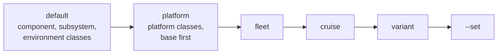

# Parameters

*This page written by Claude*

Every resolved concept has `params`: its parameters merged from several layers, each an explicit dictionary from one source. Because each layer is kept, `--explain` can say where any value came from. The code is in [`params.py`](../../core/src/python/lamss/mission/params.py) and [`resolve.py`](../../core/src/python/lamss/mission/resolve.py).

## Precedence



Later layers override earlier ones; within one kind, later layers override earlier ones (a subclass's `params` over its base's).

| Kind | Comes from |
|---|---|
| `default` | `params` of a component, subsystem or environment class and its bases |
| `platform` | `params` of a platform class and its bases; specs in a platform's lists, such as `components = [Logging(level="WARN")]` |
| `fleet` | `params` of the fleet class; specs in its `platforms` (`Glider(modem_id=2, speed=0.4)`); its `overrides` |
| `cruise` | `params` of the cruise class; specs in its `fleet` and `environment`; its `overrides` |
| `variant` | anything a [variant](variants.md) class sets (`params`, `overrides`, specs), wherever the class sits |
| `set` | `--set key=value` on the command line |

So a value set by a variant beats one from the cruise's `overrides` even when the variant is of a platform, and `--set` beats everything.

## Merging

- Nested dictionaries merge key by key: a cruise with `params = dict(datum=dict(lat=42.5))` keeps the default `datum.lon`.
- Any other value, lists included, replaces what was there.
- Values must be plain data: strings, numbers, booleans, `None`, lists and dictionaries. Keys are non-empty strings without `.`.

## Overriding a parameter

Three ways, besides a subclass's own `params`:

```python
class Topside(Platform):
    components = [Interprocess, Logging(level="WARN")]        # a spec: this use only


class Pair(Fleet):
    platforms = [Topside, Glider(modem_id=2, speed=0.4)]
    overrides = {"platform.glider.subsystem.main.component.logging.level": "DEBUG"}


class Trial(Cruise):
    fleet = "pair"
    overrides = {"platform.glider.speed": 0.5}
```

```sh
python3 -m lamss.mission show trial --set platform.glider.speed=3 --set warp=20
```

- A spec's keyword arguments override that component's, platform's or subsystem's parameters where it is listed.
- `overrides` (on a fleet or cruise) and `--set` take **dotted keys**: a path into the mission dictionary, such as `platform.glider.subsystem.main.component.logging.level`. A key whose first part is not `cruise`, `fleet`, `environment` or `platform` is a cruise parameter, so `warp=20` is `cruise.warp=20`. A dotted key can also reach inside a dictionary parameter: `--set cruise.datum.lat=42.6`.
- `--set` values are parsed as YAML: `3` is a number, `true` a boolean, `{lat: 1, lon: 2}` a dictionary, `ship` a string.
- An override may only change a parameter that a lower layer defines. A typo is an error, with the known keys:

```
$ python3 -m lamss.mission show trial --set platform.glider.max_dept=3
lamss mission: error: --set platform.glider.max_dept sets 'max_dept' on platform.glider, which has no such parameter (known: max_depth, modem_id, speed, type)
```

  A class's own `params` can add new parameters; only specs, `overrides` and `--set` are checked.
- `overrides` keys for the environment are ignored in `run` mode, where there is none.

## `--explain`

`show --explain KEY` prints the final value and every layer that set it, lowest first, marking the winner:

```
$ python3 -m lamss.mission show trial fast --set platform.glider.speed=3 --explain platform.glider.speed
platform.glider.speed = 3
  platform  Auv.params                   speed = 1.5
  platform  Glider.params                speed = 0.3
  fleet     Pair.platforms               speed = 0.4
  cruise    Trial.overrides              speed = 0.5
  variant   TrialFast.overrides          speed = 2.0
  set       --set platform.glider.speed  speed = 3  <- wins
```

A dictionary key lists each of its leaves:

```
$ python3 -m lamss.mission show trial --explain datum
datum = {lat: 42.5, lon: -70.5}
  cruise    Cruise.params  datum.lat = 0.0
  cruise    Cruise.params  datum.lon = 0.0
  cruise    Trial.params   datum.lat = 42.5  <- wins
  cruise    Trial.params   datum.lon = -70.5  <- wins
```

`--explain` is repeatable. An unknown key is an error that lists the known parameters, or the concepts the key could have meant.

### Everything in the mission

Any key `show` prints can be explained, not only parameters:

| Key | Explained by |
|---|---|
| a parameter | its layers, as above |
| a concept (`platform.glider`, `...component.logging`) | the list that named it (`Pair.platforms`, `Auv.components`), the variant that replaced its class, and its class and file |
| `name` | the name given in the list (`Glider('glider2')`), or the class's registered name |
| a value from `derived()` | the class whose `derived()` computes it (derived values cannot be set) |
| `fleet.platforms` | the fleet's `platforms` list |
| `mode`, `variant` | the command |

```
$ python3 -m lamss.mission show trial deep --explain platform.glider
platform.glider = GliderDeep
  listed    Pair.platforms                                      platform.glider = GliderDeep
  variant   GliderDeep replaces Glider (variant deep)           platform.glider = GliderDeep
  class     GliderDeep (extra:platform/auv/glider/glider_deep)  platform.glider = GliderDeep  <- wins
```

A key with `*`, `?` or `[...]` is a pattern: every matching key is printed on one line with its value and the source that wins (for a concept, all of its sources):

```
$ python3 -m lamss.mission show trial --explain 'platform.*.subsystem.main.component.logging*'
platform.topside.subsystem.main.component.logging = Logging       <- listed Topside.components; class Logging (core:component/logging)
platform.topside.subsystem.main.component.logging.name = logging  <- name  the name of Logging (core:component/logging)
platform.topside.subsystem.main.component.logging.level = WARN    <- platform  Topside.components
platform.topside.subsystem.main.component.logging.dir = log       <- default  Logging.params
platform.glider.subsystem.main.component.logging = Logging        <- listed Auv.components; class Logging (core:component/logging)
platform.glider.subsystem.main.component.logging.name = logging   <- name  the name of Logging (core:component/logging)
platform.glider.subsystem.main.component.logging.level = DEBUG    <- fleet  Pair.overrides
platform.glider.subsystem.main.component.logging.dir = log        <- default  Logging.params
```

`show --explain-all` does the same for the whole mission, in the order `show` prints it: a complete account of where every value came from.
