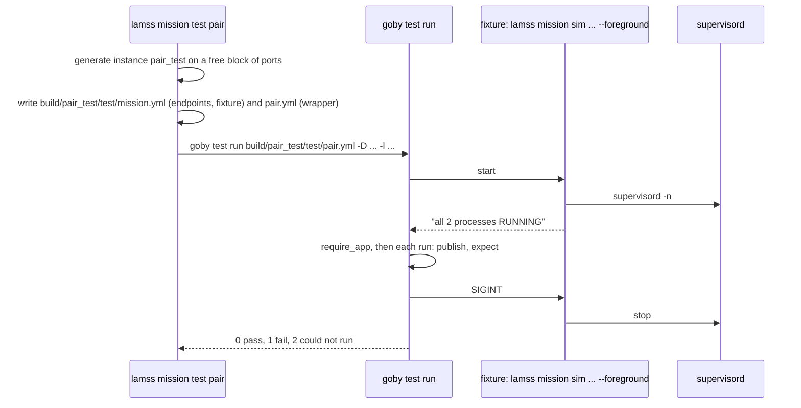

# Testing missions

*This page written by Claude*

`lamss mission test` checks a running mission with [`goby test`](https://github.com/GobySoft/goby3/blob/3.0/src/doc/markdown/doc010_cli.md#goby-test): declarative publish/subscribe tests in YAML, run against the mission's own `gobyd`s. A cruise keeps its test files beside its class; the command starts a fresh instance of the mission for each file, runs it, and stops the mission again. The code is in [`missiontest.py`](../../core/src/python/lamss/mission/missiontest.py).

The examples use the test fixture checkout [`core/src/test/mission/fixtures/goby`](../../core/src/test/mission/fixtures/goby): cruise `pair`, fleet `two` of platforms `alpha` and `beta`, each with one `gobyd`.



## Writing a test file

Test files go in `test/` in the cruise's directory (or a base cruise's): `core/missions/cruise/pair/test/pair.yml`. Files ending `.yml`, `.yaml`, `.json` or `.pb.cfg` there are run in name order. They hold only the `test:` section: `lamss mission test` supplies the endpoints and the fixture.

```yaml
test:
  name: two gobyd, kept apart
  default_timeout: 5
  require_app:
    - { endpoint: alpha_main, name: [gobyd], timeout: 20 }
    - { endpoint: beta_main, name: [gobyd], timeout: 20 }
  run:
    - name: alpha hears itself, beta hears nothing
      publish:
        - { endpoint: alpha_main, group: hello, type: JSON/Hello, value: '{"cruise": "${LAMSS_CRUISE}", "port_base": ${CRUISE_port_base}}', delay: 0.5 }
      expect:
        - { endpoint: alpha_main, group: hello, type: JSON/Hello, match: '{"cruise": "pair"}' }
        - { endpoint: beta_main, group: hello, count: 0, timeout: 2 }
```

- **Endpoints** are named `<platform>_<subsystem>`: one for each selected subsystem that has a component giving a test endpoint (its `gobyd`; see [below](#endpoints-from-components)).
- **Values from the mission** are available as `${NAME}`, passed with `-D`:

| Name | Value |
|---|---|
| `LAMSS_ROOT`, `LAMSS_PREFIX`, `LAMSS_INSTANCE`, `LAMSS_CRUISE`, `LAMSS_RUN` | the checkout, prefix, instance (`pair_test`), cruise and run directory |
| `CRUISE_<param>` | each scalar cruise parameter, dots as `_`: `CRUISE_warp`, `CRUISE_datum_lat`, `CRUISE_port_base` |
| `PLATFORM_<platform>_<param>` | each scalar platform parameter: `PLATFORM_alpha_type` |
| `PORT_<platform>_<subsystem>_<name>` | each allocated [port](templates.md#ports) |
| `RUN_<platform>_<subsystem>`, `LOG_<platform>_<subsystem>` | each subsystem's run and log directories |

- Message types from the lamss toolboxes can be used by name: every installed `liblamss_<toolbox>_protobuf.so` is loaded with `-l`.
- The syntax of `require_app`, `run`, `publish`, `expect`, `match` and `condition` is `goby test`'s; see its [documentation](https://github.com/GobySoft/goby3/blob/3.0/src/doc/markdown/doc010_cli.md#test-file).

## What the command does

```
lamss mission test [options] cruise [variant] [-- goby test run options]
```

1. Resolves the mission in `sim` mode and, unless they are given with `--set`, picks `port_base` and each port range the mission uses (`port_ranges.supervisor`, and `port_ranges.http` when a component draws from it) with as many consecutive free ports as each needs, between 20000 and 50000, so a test never meets another mission on the same machine.
2. Generates it as instance `<cruise>[_<variant>]_test` (or `--instance`), refusing if that instance is running.
3. Writes `build/<instance>/test/mission.yml`, with the endpoints and one fixture that runs the generated mission in the foreground and is ready once every process is `RUNNING`:

   ```yaml
   # Generated by lamss mission test
   endpoint:
   - name: alpha_main
     zeromq: {platform: alpha, socket_name: /home/me/lamss3/core/missions/run/pair_test/alpha/main/gobyd}
   - name: beta_main
     zeromq: {platform: beta, socket_name: /home/me/lamss3/core/missions/run/pair_test/beta/main/gobyd}
   fixture:
   - name: mission pair_test
     command: exec /usr/bin/python3 -m lamss.mission sim pair --set port_base=31000 --instance pair_test --execute --foreground --wait 60
     cwd: /home/me/lamss3
     env: [PYTHONPATH=..., LAMSS_ROOT=/home/me/lamss3, LAMSS_PREFIX=/home/me/lamss3/build/usr]
     ready: {output_regex: ['all [0-9]+ processes RUNNING'], timeout: 75}
     stop: {signal: SIGINT, grace: 30}
   ```

   and for each test file a wrapper of the same name (`test/pair.yml`) that includes `mission.yml` and the test file.
4. Runs `goby test run <wrapper>` with the `-D` values and `-l` libraries above, `--log_dir run/<instance>/goby_test/<name>` (unless given), and the arguments after `--`; then makes sure the mission is stopped.
5. Fails the file (status 1 when it had passed) if supervisord's log shows a process that ended on its own during the test (`exited:` or `gave up:`). supervisord restarts such a process, so a crash loop would otherwise go unnoticed.

It exits with the worst status of the files: 0 when all passed, 1 when an expectation failed, 2 when a test could not run (a fixture that never became ready, an application that never answered). A failed test's report names the fixture's log; the processes' own output is in `run/<instance>/log/`.

Since the file names the wrappers, two test files with the same name before the first `.` are an error, and a test file called `mission.yml` (the include's name) is refused.

```sh
lamss mission test pair                                     # every file in test/
lamss mission test pair --test-file other.yml               # just this one
lamss mission test pair -- -o JSON --output_file report.json
```

## Endpoints from components

A component that runs a subsystem's `gobyd` says how to reach it by overriding `test_endpoint(paths)`, returning `goby test` endpoint settings without the name. `paths` is the context's `paths`, as for `environment(paths)` ([Templates](templates.md#environment-variables)):

```python
from pathlib import Path

from lamss.mission import Component, Process
from lamss.mission.render import socket_path


class Gobyd(Component):
    processes = [Process("gobyd", "gobyd gobyd.pb.cfg", "gobyd.pb.cfg.j2")]

    def interprocess(self, paths):
        return {"platform": self.platform.name,
                "socket_name": str(socket_path(Path(paths["run"]), "gobyd"))}

    def test_endpoint(self, paths):
        return {"zeromq": self.interprocess(paths)}
```

with the matching template:

```jinja
interprocess {
  platform: {{ platform.name | pb_string }}
  socket_name: {{ paths.run | socket_path("gobyd") | pb_string }}
}
```

Each subsystem's `gobyd` has its own socket in its run directory, so platforms on one machine are kept apart, as the test above checks. At most one component per subsystem may give an endpoint.

## In CMake and CI

`lamss_add_mission_test`, from [`cmake/LamssToolbox.cmake`](../../cmake/LamssToolbox.cmake), registers a mission test with ctest:

```cmake
lamss_add_mission_test(NAME <test name> CRUISE <cruise> [VARIANT <variant>] TEST <file>
                       [SET <key=value>...] [WAIT <seconds>] [TIMEOUT <seconds>])
```

| Argument | Meaning |
|---|---|
| `NAME` | the ctest name, also used as the instance, so tests of one cruise can run in parallel |
| `CRUISE`, `VARIANT` | what to test |
| `TEST` | the test file |
| `SET` | `--set` values |
| `WAIT` | how long processes may take to start (default 60 s) |
| `TIMEOUT` | the ctest timeout (default `WAIT` + 240 s) |

It runs `lamss mission test` with the `goby` from `find_package(goby)` (`GOBY_EXECUTABLE`), or else `goby` on `PATH`. The mission's programs come from the install prefix, so the test belongs after the install step; `lamss build --test` installs before testing. Guard it when its programs may be missing:

```cmake
find_program(LAMSS_GOBYD gobyd)
if(LAMSS_GOBYD)
  lamss_add_mission_test(NAME <toolbox>_mission_<cruise> CRUISE <cruise>
    TEST ${PROJECT_SOURCE_DIR}/missions/cruise/<cruise>/test/<cruise>.yml)
endif()
```

The CI jobs that run `lamss build --test` run these tests with the rest of ctest ([Testing and CI](../developing/testing.md)).

The engine's own tests are pytest suites in [`core/src/test/mission/`](../../core/src/test/mission), registered with `lamss_add_pytest(<name> <file> PYTHONPATH <dirs>)`, which runs `python3 -m pytest` on the source tree, without installing, and is skipped with a note when pytest is missing. Those that need `supervisord`, `gobyd` or `goby test` skip themselves when they are not installed.
