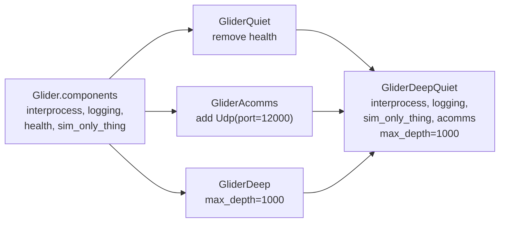

# Variants

*This page written by Claude*

A variant is a named alternative of a concept, applied only when asked for: a deeper glider, a fleet with one more vehicle, a cruise at ten times real time. It is a subclass of the concept, decorated with `@variant("<name>")`, in its own file beside the concept's class. The code is in [`variant.py`](../../core/src/python/lamss/mission/variant.py).

```python
# extra/missions/platform/auv/glider/glider_deep.py
from lamss.mission import variant
from missions.platform.auv.glider import Glider


@variant("deep")
class GliderDeep(Glider):
    params = dict(max_depth=1000)
```

```sh
python3 -m lamss.mission show trial deep
```

Only one variant is named on the command line, after the cruise. Every runnable configuration therefore has a name, a file and a history.

## What a variant can change

Anything its class can set:

- **parameters**: `params`, and on a cruise or fleet `overrides`. These form the `variant` layer, which beats the cruise and fleet (see [Parameters](parameters.md#precedence)).
- **lists**: `components`, `sim_components`, `run_components`, `subsystems`, a fleet's `platforms`. Two helpers edit an inherited list, each taking a class, spec or name:

  ```python
  @variant("quiet")
  class GliderQuiet(Glider):
      components = remove(Glider.components, Health)


  @variant("acomms")
  class GliderAcomms(Glider):
      components = Glider.components + [Udp(port=12000)]
  ```

  `replace(entries, old, new)` puts `new` in `old`'s place, which swaps one implementation for another (`replace(Glider.components, FrontseatBluefin, FrontseatHybrid)`). Both raise an error when `old` is not in the list.
- **methods**, like any subclass.

A spec that a variant adds (`Udp(port=12000)`) is in the variant layer; an entry it inherits from its base keeps the base's precedence.

## How a variant is applied

Asking for variant `deep` replaces each concept it changes by the variant class wherever the cruise uses it. The fleet above lists `Glider(modem_id=2, speed=0.4)`; with `deep` that entry becomes a `GliderDeep` with the same overrides, still named `glider`.

- One name may be defined for several concepts, once each: a `hybrid` variant of each AUV class, applied together by `show <cruise> hybrid`. Defining it twice for one concept is an error.
- The variant must change something the cruise uses: `variant 'deep' does not apply to cruise trial (it changes platform/auv/glider)`.
- An unknown name lists the known ones: `no variant named 'nope' (variants: acomms, deep, deep_quiet, fast, quiet)`.
- Variant names are letters, digits and `_`.

`list` shows, for each cruise, the variants that apply to it:

```
$ python3 -m lamss.mission list trial
trial (extra): fleet pair, environment flat
  topside/main: interprocess, logging
  glider/main: interprocess, logging, health, sim_only_thing
  variants: acomms, deep, deep_quiet, fast, quiet
```

## Combining variants

A combination is a variant of its own that inherits from the variants it combines:

```python
# extra/missions/platform/auv/glider/glider_deep_quiet.py
@variant("deep_quiet")
class GliderDeepQuiet(GliderDeep, GliderQuiet, GliderAcomms):
    pass
```

Its lists are merged from each parent's changes to the common base, in place, so it needs no body. Here the glider gets `max_depth: 1000`, loses `health` and gains `acomms`:



When two parents change the same thing differently (replace one component with different ones, set one parameter to different values, change the same spec), defining the class fails at import with every conflict listed:

```
variant OneThree (one_three) combines One, Three, which conflict; set these in OneThree to resolve them:
  components: B is replaced differently by One and Three
```

Setting the attribute in the combination resolves it:

```python
@variant("one_three")
class OneThree(One, Three):
    components = [A, D, E, C]
```

The parents must be variants of the same concept; a cruise variant and a platform variant cannot be combined into one class.

## Variants of cruises and fleets

They work the same way. The fixture cruise has one:

```python
# extra/missions/cruise/trial/trial_fast.py
@variant("fast")
class TrialFast(Trial):
    params = dict(warp=10)
    overrides = {"platform.glider.speed": 2.0}
```

A fleet variant might add or remove platforms (`platforms = Pair.platforms + [Glider("g2", modem_id=3)]`).
