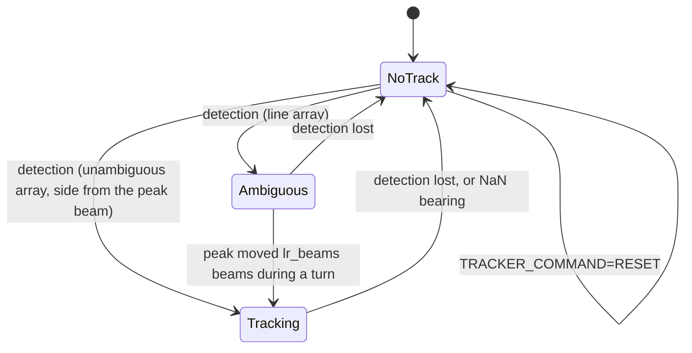

# pLamssBearingTracker

!!! warning "Inferred by Claude"
    Written by Claude from the source at `992a171`, not from a design document or by the app's
    authors.
    Each statement below is tagged: **[code]** read from the code, **[test]** observed in a test or
    a run, **[guess]** inferred intent that nobody has confirmed. Corrections are welcome; a
    maintainer sets `status: reviewed` once the page has been checked.

## Purpose

pLamssBearingTracker detects a target in the beam powers of a line array and tracks its bearing
**[code]**. It decides when the strongest beam stands out from the noise, resolves the left/right
ambiguity of a line array from how the beam moves while the vehicle turns, and then follows the
bearing with an alpha–beta filter, giving an absolute (true) bearing **[code]**. It is the third
app of the passive sonar chain: it reads `BEAM_DATA`, `BEAM_ANGLES` and `BEAMFORMING_VARS_PB` from
[pLamssCBF](pLamssCBF.md) and `AEL_NAV` from [pLamssAEL](pLamssAEL.md), and its `BEARING_TRACKS`
feed [pLamssTrackManager](pLamssTrackManager.md), which also switches it on, off and resets it with
`TRACKER_COMMAND` **[code]**. The algorithm comes from SAIC's pBearingTracker for the MIT Bluefin
arrays, generalised by Henrik Schmidt (file header) **[code]**.

## Interfaces

### Subscribes

<!-- BEGIN GENERATED subscribes -->
| Name | Transport | Type / format | Handler | Meaning | Notes |
|---|---|---|---|---|---|
| `BEAM_DATA` | MOOS | string: comma-separated linear power per beam | `handle_beam_data` | one bearing–time record line **[code]** | ignored until `BEAM_ANGLES` and `BEAMFORMING_VARS_PB` have arrived, and when the count differs from the number of beams **[code]**; scaled by 1e12 **[code]** |
| `BEAM_ANGLES` | MOOS | string: comma-separated degrees | `handle_beam_angles` | beam steering angles **[code]** | sizes the beam arrays; the array is taken as unambiguous (volumetric) unless all angles lie in (-5°, 185°) **[code]** |
| `ael_nav_variable` (built at run time) | MOOS | string: serialized `lamss.sonar.ArrayNavigation` | `handle_ael_nav` | array position, depth, heading (degrees) and pitch (radians) **[code]** | `AEL_NAV` by default, from pLamssAEL **[code]**; nothing is processed before the first one **[code]** |
| `BEAMFORMING_VARS_PB` | MOOS | string: serialized `lamss.sonar.BeamformingVars` | `handle_beamforming_vars` | beamformer settings, used for the integration time and the bearing accuracy **[code]** | also overwrites the number of beams, see open questions |
| `TRACKER_COMMAND` | MOOS | string: `ON`, `RESET`, other | `handle_tracker_command` | `ON` enables detection (resetting if it was off), `RESET` resets, anything else disables detection **[code]** | from pLamssTrackManager **[code]** |
| `SONAR_CONTROL` | MOOS | string: `ON` / `OFF` | `handle_sonar_control` | sonar on **[code]** | processing needs both this and `SONAR_PROCESS` ON **[code]** |
| `SONAR_PROCESS` | MOOS | string: `ON` / `OFF` | `handle_sonar_process` | processing on **[code]** |  |
<!-- END GENERATED subscribes -->

### Publishes

<!-- BEGIN GENERATED publishes -->
| Name | Transport | Type / format | Where | Meaning | Notes |
|---|---|---|---|---|---|
| `STAB_AZ` | MOOS | double, degrees | `LamssBearingTracker.cpp` | target azimuth relative to the array heading **[code]** | only while the vehicle is turning **[code]**; no consumer in lamss3 **[code]** |
| `IPS` | MOOS | double: -1 port, 1 starboard | `LamssBearingTracker.cpp` | side of the target **[code]** | only while turning **[code]**; no consumer in lamss3 **[code]** |
| `CW` | MOOS | double: 1 / -1 | `LamssBearingTracker.cpp` | direction of the turn used to resolve left/right **[code]** | debugging aid **[guess]** |
| `DETECTOR_STAT` | MOOS | string: `noise_mean = …, noise_sigma = …, threshold = …, (maxpow-mean)/sigma = …, maxpow/threshold = …` | `LamssBearingTracker.cpp` | detector statistics, powers ×1e-12 **[code]** | each time the noise statistics are updated **[code]**; seen in the smoke test **[test]** |
| `moosvar` (built at run time) | MOOS | string: `track=1,priority=…,template=0,state=…,ips=…,ael_x=…,ael_y=…,bearing=…,bearing_sigma=…,rate=…,rate_sigma=…,snr=…,time=…,nfeat=0` | `LamssBearingTracker.cpp` | always `BEARING_TRACKS` (set by `CTrack::postTrack`) **[code]** | `state` 0 no track, 1 ambiguous (`bearing` is the conical angle, `ips=0`), 2 tracking (`bearing` true, degrees) **[code]**; read by pLamssTrackManager **[code]** |
<!-- END GENERATED publishes -->

### Configuration

<!-- BEGIN GENERATED config -->
| Parameter | Type | Default | Required | Meaning |
|---|---|---|---|---|
| `common` | GobyMOOSAppConfig |  | no | Configuration common to all Goby MOOS applications |
| `ael_nav_variable` | string | `AEL_NAV` | no | variable to read the array navigation from **[code]** |
| `alpha` | double | `0.075` | no | alpha of the bearing (cosine) alpha–beta filter; beta = alpha²/(2-alpha) **[code]** |
| `dep_angle` | double | `0` | no | assumed depression angle of the target, radians **[code]** |
| `lr_beams` | int32 | `7` | no | beams the peak must move before left/right is decided; also sets the endfire guard (1.5×) **[code]** |
| `alpha_head` | double | `0.075` | no | alpha of the heading alpha–beta filter **[code]** |
| `turn_rate_threshold` | double | `0.1` | no | filtered turn rate above which the vehicle is turning, degrees/s **[code]** |
| `beam_changed_threshold` | int32 | `11` | no | a jump of the peak by more beams than this is ignored **[code]** |
| `max_ubias_iter` | int32 | `25` | no | Newton iterations of the beam-interpolation bias correction **[code]** |
| `abs_uerror_threshold` | double | `1` | no | larger cosine innovations are replaced by the predicted change **[code]** |
| `theta_min` | double | `30` | no | degrees from endfire within which the bearing coasts during a turn **[code]** |
| `detection_count_threshold` | int32 | `5` | no | consecutive hits to declare, and misses to drop, a detection **[code]** |
| `detector_type` | int32 | `2` | no | 0: mean/σ of the peak power; 1: cumulative mean/σ of sorted beam powers; 2: exponentially smoothed mean/σ of sorted beam powers **[code]** |
| `detector_number_bins` | int32 | `15` | no | sorted beams used for the noise estimate (types 1, 2) **[code]** |
| `detector_first_noise_bin` | int32 | `10` | no | first of those, counting from the weakest beam (1-based) **[code]** |
| `detector_alpha` | double | `0.9` | no | smoothing factor of detector type 2 **[code]** |
| `noise_depth` | double | `5` | no | the noise statistics are updated only below this array depth, m **[code]** |
| `detection_threshold` | double | `20` | no | threshold = noise mean + `detection_threshold`·σ **[code]** |
<!-- END GENERATED config -->

Example (from `pLamssBearingTracker.moos`):

```
ProcessConfig = pLamssBearingTracker
{
  common { app_tick: 4 comm_tick: 4 }

  ael_nav_variable: "AEL_NAV"
  alpha: 0.075
  dep_angle: 0.0
  lr_beams: 7
  alpha_head: 0.075
  turn_rate_threshold: 0.1
  beam_changed_threshold: 11
  max_ubias_iter: 25
  abs_uerror_threshold: 1.0
  theta_min: 30.0
  detection_count_threshold: 5
  detector_type: 2
  detector_number_bins: 15
  detector_first_noise_bin: 10
  detector_alpha: 0.9
  noise_depth: 5.0
  detection_threshold: 20.0
}
```

### Files, devices and external programs

None **[code]**.

## Behaviour

- `loop()` works only while `SONAR_CONTROL` and `SONAR_PROCESS` are `ON` and after `AEL_NAV` and
  `BEAMFORMING_VARS_PB` have arrived; it initialises once `BEAM_ANGLES` has also arrived, then
  processes each new `BEAM_DATA` line once **[code]**.
- **Per line:** filter the heading (alpha–beta, wrapped to 0–360) and flag a turn when the filtered
  rate exceeds `turn_rate_threshold`; run the detector; then act on the tracking state **[code]**.
- **Detector:** the noise statistics are updated while the array is deeper than `noise_depth`
  (types 0 and 1 stop updating after the first hit) and `DETECTOR_STAT` is published **[code]**.
  Only with `TRACKER_COMMAND=ON` are hits counted: `detection_count_threshold` hits in a row declare
  a detection, as many misses drop it **[code]**.
- **Tracking states** (`IPS`): -100 no detection, 0 ambiguous, -1/1 tracking on port/starboard
  **[code]**:



- **Ambiguous:** posts the conical angle of the peak beam (`state=1`) **[code]**. Once the peak is
  away from endfire it remembers beam and heading; when the peak has moved by `lr_beams` beams, the
  sign of the heading change decides the side **[code]**.
- **Tracking:** interpolates the peak between neighbouring beams with a bias-corrected estimator
  (Newton iteration, `max_ubias_iter`), runs an alpha–beta filter on the cosine, converts it to a
  bearing with the array heading, pitch and `dep_angle`, and posts it with an accuracy from the
  SNR, array length and frequency (`state=2`) **[code]**. Near endfire it holds the last bearing;
  during a turn towards endfire (within `theta_min`) it coasts on the last bearing **[code]**.
- Each post goes through `CTrack` (sonar henrik_util), which also computes the bearing rate from the
  previous post **[code]**.

## Running it

- Not launched by any mission component yet **[code]**.
- Standalone: `MOOSDB`, `pLamssBearingTracker pLamssBearingTracker.moos` in
  `sonar/src/bin/pLamssBearingTracker/`, fed by pLamssAEL and pLamssCBF, with `SONAR_CONTROL=ON`,
  `SONAR_PROCESS=ON` and `TRACKER_COMMAND=ON`.
- Tested by `lamss_sonar_moos_smoke`: started from its example; then behind a moored pLamssAEL and
  pLamssCBF on a synthetic plane wave, where it publishes `DETECTOR_STAT` **[test]**. The test does
  not send `TRACKER_COMMAND=ON`, so detection and tracking are not exercised **[test]**.

## Known issues and open questions

- [GobySoft/lamss3#30](https://github.com/GobySoft/lamss3/issues/30): `else if ((beam_no =
  num_beams))` in `Track_Bearing()` assigns instead of comparing.
- A second `BEAM_ANGLES` frees the beam arrays with `delete` instead of `delete[]` and leaks the
  sort buffers.
- `BEAMFORMING_VARS_PB` overwrites `num_beams` after `BEAM_ANGLES` sized the arrays. With
  azimuth/elevation steering pLamssCBF's `number_beams` is not the number of beams it publishes, and
  `BEAM_DATA` can then overrun the arrays. Should the count come from `BEAM_ANGLES` only?
- Detector types 1 and 2 read sorted beams `detector_first_noise_bin` to
  `detector_first_noise_bin + detector_number_bins - 1` (10–24 by default) without checking the
  number of beams.
- When every beam power is zero or negative, `Max_Index()` returns 0 and index 0 of the cosine and
  sine arrays, which is never set, is read.
- `missed_count`, `head_filt_sv` and `head_filt_dot_sv` are read before they are set.
- If `CTrack::postTrack()` refuses a NaN bearing, `postTrack()` still notifies, with an empty
  variable name.
- `CTrack::bearingRate()` does not unwrap 359°→1°, and it differences the new bearing against the
  previous post even when that was an ambiguous conical angle.
- `STAB_AZ`, `IPS` and `CW` have no reader in lamss3. Debugging only?
- `pi = 3.14159` is defined and unused; `K = 0.1185/err_const` is a magic number from SAIC.

## History

- From GobySoft/lamss-shared `src/moos/pLamssBearingTracker`; first commit 2017-11-20 (Henrik
  Schmidt, "GobyMOOSified pBearingTracker -> pLamssBearingTracker"); 6 commits by Henrik Schmidt and
  Toby Schneider before the port, the last on 2021-05-19. It started as a copy of pBearingTracker,
  whose history (back to SAIC's 2006–2007 revisions in the file header) stays with that app.
- lamss3 port (GobySoft/lamss3#22): clang-format; built against Ubuntu's newmat
  (`namespace NEWMAT`) instead of a vendored copy; an unused lib_anrp_util include dropped; config
  proto in `package lamss.sonar`, proto2; warning fixes with no change of behaviour (the #30
  assignment kept, with extra parentheses); example `.moos` and smoke test added.
