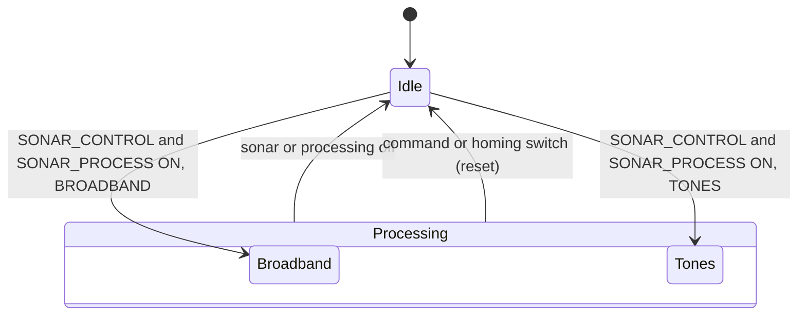

# pLamssCBF

!!! warning "Inferred by Claude"
    Written by Claude from the source at `992a171`, not from a design document or by the app's
    authors.
    Each statement below is tagged: **[code]** read from the code, **[test]** observed in a test or
    a run, **[guess]** inferred intent that nobody has confirmed. Corrections are welcome; a
    maintainer sets `status: reviewed` once the page has been checked.

## Purpose

pLamssCBF is a conventional (delay-and-sum, frequency-domain) beamformer **[code]**. It reads each
raw multichannel data file named in `SONAR_FILENAME`, computes the power in each beam over a
frequency band, integrates it over `integration_time`, and publishes a bearing–time record line
(`BEAM_DATA`, `BTR_DATA_DB`, `BTR_POWER`) **[code]**. It is the second app of the passive sonar
chain: the data files and their numbers come from the acquisition system, or from virtual_ocean's
`uSimPassiveSonar` in simulation **[code]**; the array pitch comes from
[pLamssAEL](pLamssAEL.md) (`AEL_PITCH`) **[code]**; its `BEAM_DATA`, `BEAM_ANGLES` and
`BEAMFORMING_VARS_PB` feed [pLamssBearingTracker](pLamssBearingTracker.md) **[code]**. The mission
manager and [pLamssTrackManager](pLamssTrackManager.md) switch it on and off and change its band
**[code]**. `BTR_DATA_DB` is a DCCL message, presumably sent to the topside over the acoustic
link **[guess]**.

## Interfaces

### Subscribes

<!-- BEGIN GENERATED subscribes -->
| Name | Transport | Type / format | Handler | Meaning | Notes |
|---|---|---|---|---|---|
| `SONAR_CONTROL` | MOOS | string: `ON` / other | `handle_sonar_control` | sonar on **[code]** | processing needs both this and `SONAR_PROCESS` ON **[code]**; published by pLamssTrackManager **[code]** |
| `SONAR_PROCESS` | MOOS | string: `ON` / other | `handle_sonar_process` | processing on **[code]** | published by pLamssTrackManager **[code]** |
| `SONAR_PROCESSING_COMMAND` | MOOS | string: serialized `lamss.sonar.SonarProcessingCommand` | `handle_sonar_processing_command` | active-sonar ping parameters **[code]** | only written into the `.stft` file header; the samples to skip/read it computes are never used **[code]** |
| `SONAR_FILENAME` | MOOS | string: path | `handle_sonar_filename` | data file to process next **[code]** | empty strings ignored **[code]**; published by uSimPassiveSonar **[code]** |
| `SONAR_DIR` | MOOS | string: path | `handle_sonar_dir` | data directory **[code]** | stored, never used **[code]** |
| `SONAR_FILE_NUM` | MOOS | double: frame number | `handle_sonar_file_num` | a new file is ready **[code]** | a change of number triggers processing; consecutive numbers carry the leftover samples over **[code]** |
| `SOUND_SPEED` | MOOS | double, m/s | `handle_sound_speed` | sound speed for steering **[code]** | any change recomputes (or looks up) the steering vectors **[code]** |
| `cfg_.ael_pitch_variable()` (built at run time) | MOOS | double, radians | `handle_ael_pitch` | array pitch **[code]** | `AEL_PITCH` by default, from pLamssAEL **[code]**; 15-sample moving average; used only for azimuth/elevation steering **[code]** |
| `HOMING_BEACON_FREQUENCY` | MOOS | double, Hz | `handle_homing_beacon_frequency` | homing beacon tone **[code]** | from pLamssMissionManager **[code]** |
| `HOMING_ACTIVE` | MOOS | string: `true` / `false` | `handle_homing_mode` | switch to tone processing at the beacon frequency **[code]** | from pLamssMissionManager **[code]** |
| `VEHICLE_ID` | MOOS | double | `handle_vehicle_id` | own modem id **[code]** | commands are applied only if `_rcv_id` matches **[code]** |
| `LAMSS_PROSECUTE_IN` | MOOS | string: serialized `lamss.autonomy.LAMSS_PROSECUTE` | `handle_prosecute` | prosecute command: tones or band **[code]** | from pLamssMissionManager **[code]** |
| `LAMSS_PROCESSING_IN` | MOOS | string: serialized `lamss.sonar.LAMSS_PROCESSING` | `handle_processing` | processing command: tones or band **[code]** | no publisher in lamss3 **[code]**; from the acoustic link **[guess]** |
| `LAMSS_DEPLOY_IN` | MOOS | string: serialized `lamss.autonomy.LAMSS_DEPLOY` | `handle_deploy` | deploy command: back to configured processing **[code]** | from pLamssMissionManager **[code]** |
<!-- END GENERATED subscribes -->

### Publishes

<!-- BEGIN GENERATED publishes -->
| Name | Transport | Type / format | Where | Meaning | Notes |
|---|---|---|---|---|---|
| `publish_queue_.front()` (built at run time) | MOOS |  | `LamssCBF.cpp` | messages queued by the state machine: `PROCESSING_STATE` (`IDLE`, `PROCESSING`, `BROADBAND`, `TONES`) and `IN_RANGE=FALSE` **[code]** | names are in `LamssCBF_fsm.h`; no consumer in lamss3 **[code]** |
| `BEAM_ANGLES` | MOOS | string: comma-separated degrees, 2 decimals | `LamssCBF.cpp` | steering angle of each beam **[code]** | published at start-up and whenever steering is reconfigured **[code]**; read by pLamssBearingTracker **[code]** |
| `BEAMFORMING_VARS_PB` | MOOS | string: serialized `lamss.sonar.BeamformingVars` | `LamssCBF.cpp` | FFT size, beams, overlap, integration time, sound speed, sampling rate, elements used, mean frequency and element spacing **[code]** | read by pLamssBearingTracker **[code]**; the smoke test sees `number_beams: 31` **[test]** |
| `BEAMFORMING_VARS` | MOOS | string: the same nine values, comma-separated | `LamssCBF.cpp` | older format of `BEAMFORMING_VARS_PB` **[code]** | no consumer in lamss3 **[code]** |
| `BTR_DATA_DB` | MOOS | string: serialized `lamss.sonar.BTR` | `LamssCBF.cpp` | beam power in dB, at most 60 values (interpolated) **[code]** | DCCL id 5130 **[code]**; for the topside **[guess]** |
| `BTR_POWER` | MOOS | string: serialized `lamss.sonar.BTRPower` | `LamssCBF.cpp` | linear power per beam with angle (or azimuth/elevation), time at the centre of the integration **[code]** | the `angle` field is wrong, see open questions |
| `MAX_BEAM_POWER` | MOOS | double | `LamssCBF.cpp` | highest normalized beam power of the integration **[code]** | no consumer in lamss3 **[code]** |
| `BEAM_DATA` | MOOS | string: comma-separated linear power per beam | `LamssCBF.cpp` | one bearing–time record line **[code]** | read by pLamssBearingTracker **[code]**; peaks on the plane wave's beam in the smoke test **[test]** |
| `BEAM_STFT_FILE` | MOOS | string: path | `LamssCBF.cpp` | `.stft` file just written **[code]** | only with `save_beam_stft` **[code]** |
| `ACTIVE_PROCESSING_PARAMETERS` | MOOS | string: serialized `lamss.sonar.ActiveSonarParameters` | `LamssCBF.cpp` | active processing parameters **[code]** | the function that publishes it is never called **[code]** |
<!-- END GENERATED publishes -->

### Configuration

<!-- BEGIN GENERATED config -->
| Parameter | Type | Default | Required | Meaning |
|---|---|---|---|---|
| `common` | GobyMOOSAppConfig |  | no | Configuration common to all Goby MOOS applications |
| `array_type` | ArrayTypeEnum | `HYD` | no | data file format and spatial window: `VSA`, `DURIP`, `HYD` read float32 samples; `SINGLE`, `DUAL`, `TEE` read two int32 time tags then int16 samples; `VOLUME` reads nothing **[code]** |
| `sampling` | SamplingEnum | `EQUALLY_SPACED_WAVENUMBER` | no | beams equally spaced in cosine or in angle **[code]** |
| `array_configuration` | ArrayDefinitionEnum | `UNIFORM_SPACING` | no | how element positions are given: uniform, three spacing groups, a list, or x/y/z lists **[code]** |
| `number_elements` | int32 | `1` | no | channels in the file **[code]**; overwritten from the positions for the group, list and volumetric configurations **[code]** |
| `element_spacing` | double | `1` | no | element spacing for `UNIFORM_SPACING`, m **[code]** |
| `number_spacing_groups` | int32 | `3` | no | groups used of the three below (`GROUP_SPACING`) **[code]** |
| `spacing_group_1` | double | `1` | no | spacing in group 1, m **[code]** |
| `number_spacings_group_1` | int32 | `1` | no | spacings in group 1 **[code]** |
| `spacing_group_2` | double | `1` | no | spacing in group 2, m **[code]** |
| `number_spacings_group_2` | int32 | `1` | no | spacings in group 2 **[code]** |
| `spacing_group_3` | double | `1` | no | spacing in group 3, m **[code]** |
| `number_spacings_group_3` | int32 | `1` | no | spacings in group 3 **[code]** |
| `array_element_locations` | string |  | no | comma-separated element positions along the array, m (`ELEMENT_LOCATIONS`) **[code]** |
| `volumetric_array_x` | string |  | no | element x, positive starboard (`VOLUMETRIC`) **[code]** |
| `volumetric_array_y` | string |  | no | element y, positive forward **[code]** |
| `volumetric_array_z` | string |  | no | element z, positive up **[code]** |
| `number_samples` | int32 | `1` | no | samples per channel in each file **[code]** |
| `sampling_frequency` | double | `4000` | no | Hz **[code]** |
| `fft_size` | int32 | `1024` | no | FFT length, samples **[code]** |
| `number_beams` | int32 | `47` | no | beams for `ARRAY_ANGLE` steering (0–180° from forward endfire) **[code]** |
| `overlap` | double | `50` | no | FFT block overlap as a fraction of `fft_size` **[code]**; the default of 50 is not a valid fraction, see open questions |
| `hydrophone_gain` | double | `1` | no | gain in dB removed from the samples **[code]** |
| `integration_time` | double | `1` | no | seconds of FFT blocks summed per output **[code]** |
| `sound_speed` | double | `1500` | no | initial sound speed, m/s, until `SOUND_SPEED` **[code]** |
| `array_elements_used` | string |  | no | 1-based channel ranges, e.g. `6:28` or `1:4,9:12` **[code]** |
| `angular_steering_type` | AngularSteeringTypeEnum |  | no | `ARRAY_ANGLE` (conical angle, ambiguous), `AZIMUTH_ONLY`, `ELEVATION_ONLY`, `AZIMUTH_AND_ELEVATION` **[code]** |
| `number_beams_azimuth` | int32 | `47` | no | azimuth beams (non-`ARRAY_ANGLE` steering) **[code]** |
| `min_azimuth` | int32 | `0` | no | degrees **[code]** |
| `max_azimuth` | int32 | `360` | no | degrees; the single azimuth when `number_beams_azimuth` is 1 **[code]** |
| `number_beams_elevation` | int32 | `1` | no | elevation beams **[code]** |
| `min_elevation` | int32 | `0` | no | degrees **[code]** |
| `max_elevation` | int32 | `90` | no | degrees **[code]** |
| `delete_data_files` | bool | `false` | no | never read **[code]** |
| `check_consecutive_zeros` | bool | `false` | no | log a warning when channel 1 has more than 10 zeros in a row **[code]** |
| `processing_type` | ProcessingTypeEnum | `BROADBAND` | no | `BROADBAND` (band around `center_frequency`) or `TONES` (`frequency_bins`) **[code]** |
| `center_frequency` | double | `900` | no | Hz **[code]** |
| `bandwidth` | double | `200` | no | Hz **[code]** |
| `frequency_bins` | string |  | no | tone frequencies or ranges in Hz, e.g. `800,1000:1010`, for `TONES` **[code]** |
| `save_beam_stft` | bool | `false` | no | write a `.stft` file of the per-beam spectra next to each data file **[code]** |
| `sonar_mode` | SonarModeEnum |  | no | never read **[code]** |
| `ael_pitch_variable` | string | `AEL_PITCH` | no | variable to read the array pitch from **[code]** |
<!-- END GENERATED config -->

Example (from `pLamssCBF.moos`):

```
ProcessConfig = pLamssCBF
{
  common { app_tick: 2 comm_tick: 5 }

  ael_pitch_variable: "AEL_PITCH"
  array_type: DURIP
  sampling: EQUALLY_SPACED_WAVENUMBER
  array_configuration: ELEMENT_LOCATIONS
  number_elements: 32
  array_element_locations: "0,1.5,3,4.5,6,7.5,8.25,9,9.75,10.5,11.25,12,12.75,13.5,14.25,15.0,15.75,16.5,17.25,18,18.75,19.5,20.25,21,21.75,22.5,23.25,24,25.5,27,28.5,30"
  array_elements_used: "6:28"

  angular_steering_type: ARRAY_ANGLE
  number_beams_elevation: 1
  min_elevation: 0
  max_elevation: 0
  number_beams_azimuth: 47
  min_azimuth: 0
  max_azimuth: 180

  number_samples: 24000
  sampling_frequency: 12000
  fft_size: 2048
  number_beams: 47
  overlap: 0.5
  integration_time: 4.0
  sound_speed: 1435
  hydrophone_gain: 0

  processing_type: BROADBAND
  center_frequency: 800
  bandwidth: 400
  frequency_bins: "205:258"
}
```

### Files, devices and external programs

- Reads the raw data file named in `SONAR_FILENAME` **[code]**: for `VSA`, `DURIP`, `HYD`,
  `number_samples` float32 samples of channel 1, then channel 2, and so on; for `SINGLE`, `DUAL`,
  `TEE`, two int32 time tags then int16 samples in the same order **[code]**. The smoke test's
  `lamss_sonar_array_data` writes the float32 format **[code]**.
- With `save_beam_stft`, writes `<data file up to its first '.'>.stft`: a binary header (processing
  objective, steering type, beam angles, ping parameters, bins and frequencies, pitch) followed by
  the real and imaginary per-beam spectra and the integrated power **[code]**.

## Behaviour

- **Start-up:** parses the array, builds the windows, picks the FFT bins (`BROADBAND`: the bins
  within `bandwidth/2` of `center_frequency`; `TONES`: the bins of `frequency_bins`) and computes the
  steering vectors **[code]**.
- **Processing** runs in `loop()` while `SONAR_CONTROL` and `SONAR_PROCESS` are both `ON` and a new
  `SONAR_FILE_NUM` has arrived **[code]**:
    1. Load the file; if its number follows the last processed one, the unprocessed tail of the
       previous file is kept in front of it **[code]**.
    2. For each block of `fft_size` samples (advancing by `fft_size·(1-overlap)`), apply a Hann
       window, FFT each used channel, keep the selected bins and remove the hydrophone gain
       **[code]**.
    3. Steer every beam (spatially Hann-weighted for line arrays, uniform for `VOLUME`) and add
       the power summed over the bins into the beam's total **[code]**.
    4. After `integration_time` worth of blocks, normalise and publish `BEAM_DATA`, `BTR_DATA_DB`,
       `BTR_POWER` and `MAX_BEAM_POWER`, optionally write the `.stft` file, and start a new
       integration **[code]**.
- `ARRAY_ANGLE` steering measures the conical angle from forward endfire and does not depend on
  pitch **[code]**. Azimuth/elevation steering rotates the element positions by the filtered
  pitch and recomputes the steering vectors when the pitch changes by 1° or more **[code]**.
  Computed steering vectors are cached by pitch (±1°) and sound speed (±5 m/s) **[code]**.
- **Commands** (only for this vehicle's `_rcv_id`): `LAMSS_PROSECUTE_IN` and `LAMSS_PROCESSING_IN`
  switch to `TONES` (when tones are given) or to `BROADBAND` with the commanded band;
  `LAMSS_DEPLOY_IN` returns to the configured processing; `HOMING_ACTIVE=true` switches to the
  homing beacon frequency **[code]**. Each re-selects the bins, recomputes the steering vectors and
  resets the state machine **[code]**.
- **State machine:** a Boost.Statechart machine on its own thread only reports the mode in
  `PROCESSING_STATE`; the processing above does not depend on it **[code]**.



## Running it

- Not launched by any mission component yet **[code]**.
- Standalone: `MOOSDB` and `pLamssCBF pLamssCBF.moos` in `sonar/src/bin/pLamssCBF/`, then post
  `SONAR_CONTROL=ON`, `SONAR_PROCESS=ON`, a `SONAR_FILENAME` and a numeric `SONAR_FILE_NUM`.
- Tested by `lamss_sonar_moos_smoke`: started from its example; then with a 16-element line array,
  three files of a 1 kHz plane wave from 70.5° in noise, checking `BEAMFORMING_VARS_PB` and that
  `BEAM_DATA` peaks on beam 10 of 31 **[test]**.

## Known issues and open questions

- `BTR_POWER`: in `ARRAY_ANGLE` mode each beam's `angle` is `beam_angles[i]·180/π`, but
  `beam_angles` is already in degrees, so the angle is 57.3 times too large.
- `EQUALLY_SPACED_THETA` with `ARRAY_ANGLE`: `(k-1)·π/number_beams - 1` subtracts one radian
  instead of dividing by `number_beams - 1`.
- A single elevation beam is set to `max_elevation` in degrees, while every other elevation is in
  radians.
- The `.stft` file writes `beam_angles[1..number_beams]` (one past the end), writes `fft_size` and
  `num_overlapping_samples_` (doubles) with `sizeof(int)`, writes P with the azimuth/elevation beam
  counts even in `ARRAY_ANGLE` mode, and its buffers are sized at start-up before the number of
  bins is known and never resized after a band change. Has `save_beam_stft` been used since the
  move to pLamssCBF?
- `overlap` defaults to 50, but the code uses it as a fraction (`overlap·fft_size`); the
  examples use 0.5. Should the default be 0.5?
- `frequency_bins` is read in Hz (`1000:1010`), but the example's `"205:258"` and the commented-out
  code read like bin numbers. Which is intended? (It is unused in `BROADBAND`.)
- `new_file_flag_`, `vehicle_id_` and `homing_beacon_frequency_` are read before they are first
  set, and `set_processing_mode()` changes `processing_enable_` without the state-machine mutex.
- The data file name is copied into a 256-byte buffer with `sprintf`; a longer path overflows it.
- `check_consecutive_zeros`: the comment says it posts a MOOS variable and replaces the spike; the
  code only logs. `delete_data_files`, `sonar_mode`, `SONAR_DIR` and `SONAR_PROCESSING_COMMAND`'s
  sample window are unused, and `ACTIVE_PROCESSING_PARAMETERS` is never published. Is active
  processing still wanted?
- `array_type: VOLUME` reads no samples in `LoadData()`. How were volumetric arrays fed?
- `BTR.beam_power_db` is `int32` with a DCCL range of 20–83 dB; values are truncated and may fall
  outside the range.
- A single azimuth beam uses `max_azimuth`, but `ELEVATION_ONLY` uses `min_azimuth`. Intended?
- No consumer of `PROCESSING_STATE`, `IN_RANGE`, `BEAMFORMING_VARS` or `MAX_BEAM_POWER` exists in
  lamss3.

## History

- From GobySoft/lamss-shared `src/moos/pLamssCBF`; first commit 2015-11-06 (Henrik Schmidt,
  "started cleanup of pCBF"); 45 commits by Henrik Schmidt, Toby Schneider and Andrew Poulsen
  before the port, the last on 2020-09-24. Some files started as copies of pLamssTrackManager's,
  whose history stays with that app.
- lamss3 port (GobySoft/lamss3#22): clang-format; the `SLITA` array type and its file reader
  (lib_anrp_util) removed; the FSM namespace moved to `lamss::sonar::fsm`; config proto in
  `package lamss.sonar`, proto2; warning fixes with no change of behaviour (a short `fread` is now
  logged); example `.moos` and smoke test added.
