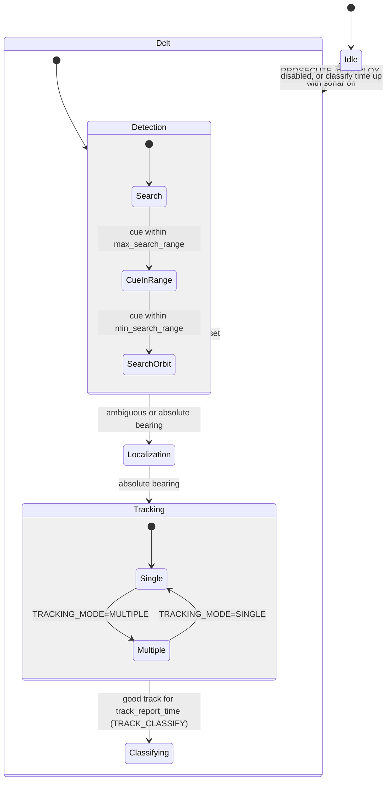

# pLamssTrackManager

!!! warning "Inferred by Claude"
    Written by Claude from the source at `992a171`, not from a design document or by the app's
    authors.
    Each statement below is tagged: **[code]** read from the code, **[test]** observed in a test or
    a run, **[guess]** inferred intent that nobody has confirmed. Corrections are welcome; a
    maintainer sets `status: reviewed` once the page has been checked.

## Purpose

pLamssTrackManager runs the detect–classify–localize–track ("DCLT") sequence of a sonar vehicle
**[code]**. It turns the bearing tracker on and off with the mission state, picks the
highest-priority bearing track, turns it into a single bearing for the tracking behaviors and for
target motion analysis, judges the quality of the resulting geographic track, and decides when to
give up, report or classify, sending deploy and prosecute commands **[code]**. It is the last app of
the passive sonar chain: it reads `BEARING_TRACKS` from
[pLamssBearingTracker](pLamssBearingTracker.md) and `AEL_HEADING` from [pLamssAEL](pLamssAEL.md);
its `BEARING_STAT` feeds [pGeoTracker](pGeoTracker.md), whose `TRACK_STAT` and `CLOSE_RANGE` come
back to it **[code]**. Its `TRACKER_COMMAND` drives pLamssBearingTracker and pGeoTracker, its
`SONAR_CONTROL`/`SONAR_PROCESS` drive [pLamssCBF](pLamssCBF.md), and its `TRACKING`,
`TARGET_BEARING` and `SURVEY_COMPLETED` are read by autonomy's pLamssMissionManager **[code]**.
`CONTACT_REPORT`, `TRACK_REPORT` and the `LAMSS_*_OUT` commands are meant for the acoustic link
**[guess]** (example `.moos` comment).

## Interfaces

### Subscribes

<!-- BEGIN GENERATED subscribes -->
| Name | Transport | Type / format | Handler | Meaning | Notes |
|---|---|---|---|---|---|
| `LAMSS_DEPLOY_IN` | MOOS | string: serialized `lamss.autonomy.LAMSS_DEPLOY` | `handle_deploy` | deploy command **[code]** | only for this vehicle's `_rcv_id`; sets sonar on/off and `auto_prosecute`, resets tracking twice **[code]** |
| `LAMSS_PROSECUTE_IN` | MOOS | string: serialized `lamss.autonomy.LAMSS_PROSECUTE` | `handle_prosecute` | prosecute command with the target cue **[code]** | the command is stored only for this vehicle, but the cue is reprocessed for every message, see open questions |
| `LAMSS_TRACK_IN` | MOOS | string: serialized `lamss.sonar.LAMSS_TRACK` | `handle_track_report` | a collaborator's track report **[code]** | only from `COLLABORATOR_ID`; may trigger an intercept prosecute **[code]** |
| `MISSION_STATE` | MOOS | string: `DEPLOY`, `PROSECUTE`, `ABORT`, … | `handle_mission_state` | mission state **[code]** | from pLamssMissionManager **[guess]**; DEPLOY and ABORT reset tracking **[code]** |
| `VEHICLE_ID` | MOOS | double | `handle_vehicle_id` | own modem id **[code]** |  |
| `LAT_ORIGIN` | MOOS | double | `handle_lat_origin` | new local-grid origin latitude **[code]** | NaN ignored; cue and collaborator track converted again in `loop()` **[code]** |
| `LONG_ORIGIN` | MOOS | double | `handle_lon_origin` | new local-grid origin longitude **[code]** | NaN ignored **[code]** |
| `NAV_DATA` | MOOS | string: serialized `goby.middleware.frontseat.protobuf.NodeStatus` | `handle_nav_data` | vehicle position, depth and speed **[code]** |  |
| `COLLABORATOR_ID` | MOOS | double | `handle_collaborator_id` | modem id of the collaborating vehicle **[code]** |  |
| `COLLABORATOR_NAME` | MOOS | string | `handle_collaborator_name` | name of the collaborating vehicle **[code]** | subscribes to `<name>_BEARING_TRACK` **[code]** |
| `BEARING_TRACKS` | MOOS | string: CTrack format (`track=…,priority=…,state=…,ips=…,bearing=…,…`) | `handle_bearing_tracks` | bearing tracks **[code]** | from pLamssBearingTracker **[code]**; a NaN bearing resets tracking **[code]** |
| `PROSECUTE_HEADING` | MOOS | string: `heading=…` | `handle_prosecute_heading` | target cue heading **[code]** | published by this app itself **[code]**; chooses the side of `BROADSIDE_HEADING` **[code]** |
| `AEL_HEADING` | MOOS | double, degrees | `handle_ael_heading` | array heading **[code]** | from pLamssAEL **[code]**; moving average of `filter_length` **[code]** |
| `TRACK_STAT` | MOOS | string: `node=…,state=…,x=…,y=…,heading=…,speed=…,time=…` | `handle_track_stat` | geographic track solution **[code]** | only `state=2` for this vehicle, from pGeoTracker **[code]** |
| `BEARING_STAT` | MOOS | string: `node=…,state=…,bearing=…,xp=…,yp=…,…,time=…` | `handle_bearing_stat` | own bearing, for the bearing-rate give-up test **[code]** | its own output; ignored unless `node` equals `VEHICLE_ID`, see open questions |
| `CLOSE_RANGE` | MOOS | string: `TRUE` / other | `handle_close_range` | target within tracking range **[code]** | from pGeoTracker **[code]** |
| `CLASS_DONE` | MOOS | string: `TRUE` | `handle_class_done` | classification finished: redeploy **[code]** | also published by this app **[code]** |
| `TRACKING_MODE` | MOOS | string: `SINGLE` / `MULTIPLE` | `handle_tracking_mode` | single- or multi-vehicle tracking **[code]** | changes the track quality thresholds **[code]** |
| `SONAR_CONTROL` | MOOS | string: `ON` / other | `handle_sonar_control` | sonar on **[code]** | in DEPLOY, DCLT runs only with the sonar on **[code]** |
| `ACTIVE_TRACK_TRAIL` | MOOS | string: `TRUE` / other | `handle_active_track_trail` | track-and-trail active **[code]** | stored, never used **[code]** |
| `collaborator_name + "_BEARING_TRACK"` (built at run time) | MOOS | string: CTrack format | `handle_collaborator_bearing_tracks` | the collaborator's bearing tracks **[code]** | name built at run time |
<!-- END GENERATED subscribes -->

### Publishes

<!-- BEGIN GENERATED publishes -->
| Name | Transport | Type / format | Where | Meaning | Notes |
|---|---|---|---|---|---|
| `NODE_REPORT` | MOOS | string: `NAME=…,TYPE=track,UTC_TIME=…,X=…,Y=…,LAT=…,LON=…,SPD=…,HDG=…` | `LamssTrackManager.cpp` | the dead-reckoned target cue (`target_cue`) or a good track (`priority_trk`) as a contact **[code]** | for contact-based behaviors and displays **[guess]** |
| `MY_TARGET` | MOOS | string: `contact=target_cue` | `LamssTrackManager.cpp` | names the contact to follow **[code]** | while searching in PROSECUTE **[code]** |
| `PROSECUTE_LOITER` | MOOS | string: `polygon=radial:x,y,r` | `LamssTrackManager.cpp` | loiter around the vehicle with `orbit_radius` **[code]** | when the cue is within `min_search_range` **[code]** |
| `TRACK_STAT` | MOOS | string: `node=…,state=4,x=…,y=…,heading=…,speed=…,time=…` | `LamssTrackManager.cpp` | dead-reckoned cue **[code]** | "for CloseRange behavior" (code comment) **[code]** |
| `CLASS_DONE` | MOOS | string: `TRUE` | `LamssTrackManager.cpp` | classification time is up **[code]** | after `max_classify_time` **[code]** |
| `publish_queue_.front()` (built at run time) | MOOS |  | `LamssTrackManager.cpp` | messages queued by the state machine: `TRACKING` (`IDLE`, `DCLT`, `NO_TRACK`, `AMBIGUOUS`, `TRACKING`, `CLASSIFYING`), `TRACKER_COMMAND` (`OFF` in Idle, `ON` in DCLT) and `IN_RANGE` **[code]** | names are in `LamssTrackManager_fsm.h`; `TRACKING=IDLE`, `TRACKING=NO_TRACK` and `TRACKER_COMMAND=ON` are seen in the smoke test **[test]** |
| `SONAR_CONTROL` | MOOS | string: `ON` | `LamssTrackManager.cpp` | turn the sonar on for a prosecute **[code]** | read by pLamssCBF and pLamssBearingTracker **[code]** |
| `SONAR_PROCESS` | MOOS | string: `ON` | `LamssTrackManager.cpp` | turn processing on for a prosecute **[code]** |  |
| `INIT_TRACK_HEADING` | MOOS | string: `heading=…` | `LamssTrackManager.cpp` | heading to pass behind or in front of the cued target **[code]** | consumer not in lamss3 **[code]** |
| `PROSECUTE_HEADING` | MOOS | string: `heading=…` | `LamssTrackManager.cpp` | cued target heading **[code]** | read by `BHV_WiggleTail` and by this app **[code]** |
| `ARRAY_TRACK_ANGLE` | MOOS | string: `bearing_mode=quad#desired_angle=…` or `dual#…` | `LamssTrackManager.cpp` | array angle to hold while tracking **[code]** | behavior update string **[guess]** |
| `LAMSS_DEPLOY_OUT` | MOOS | string: serialized `lamss.autonomy.LAMSS_DEPLOY` | `LamssTrackManager.cpp` | redeploy this vehicle (loiter at its position for `STATION`) **[code]** | addressed to itself **[code]**; returns as `LAMSS_DEPLOY_IN` through the gateway or link **[guess]** |
| `LAMSS_PROSECUTE_OUT` | MOOS | string: serialized `lamss.autonomy.LAMSS_PROSECUTE` | `LamssTrackManager.cpp` | automatic prosecute of this vehicle **[code]** | addressed to itself **[code]** |
| `TRACK_REPORT` | MOOS | string: the `TRACK_STAT` string with `,lon=…,lat=…` added | `LamssTrackManager.cpp` | a good geographic track **[code]** | when the buffered solutions agree within `xy_sigma` **[code]** |
| `PRIORITY_TRK` | MOOS | string: `contact=priority_trk` | `LamssTrackManager.cpp` | names the good track as the contact **[code]** | pLamssMissionManager also publishes it **[code]** |
| `SURVEY_COMPLETED` | MOOS | string: `TRUE` | `LamssTrackManager.cpp` | tracking done in PROSECUTE **[code]** | read by pLamssMissionManager **[code]** |
| `TRACKER_COMMAND` | MOOS | string: `RESET` | `LamssTrackManager.cpp` | reset the bearing tracker and pGeoTracker **[code]** | on every tracking reset **[code]** |
| `BEARING_STAT` | MOOS | string: `node=…,state=…,bearing=…,xp=…,yp=…,beamno=0,sigma=…,rate=…,rate_sigma=…,snr=…,time=…` | `LamssTrackManager.cpp` | the selected bearing, true degrees, with the array position **[code]** | read by pGeoTracker, `BHV_MaintainBearing`, `BHV_WiggleTail` **[code]**; `node` is always 0 **[code]**; seen in the smoke test **[test]** |
| `collaborator_name + "_BEARING_STAT"` (built at run time) | MOOS | string: as `BEARING_STAT` | `LamssTrackManager.cpp` | the collaborator's selected bearing **[code]** | name built at run time |
| `TARGET_BEARING` | MOOS | double, degrees | `LamssTrackManager.cpp` | true bearing of the tracked target **[code]** | read by pLamssMissionManager **[code]** |
| `BROADSIDE_HEADING` | MOOS | string: `heading=…` | `LamssTrackManager.cpp` | heading that puts the target broadside **[code]** | the side closer to `PROSECUTE_HEADING` (or the current heading) **[code]** |
| `SENSOR_DEPTH_TRACKING` | MOOS | string: `depth=…` | `LamssTrackManager.cpp` | hold the current depth while tracking **[code]** | pLamssMissionManager also publishes it **[code]** |
| `CONTACT_REPORT` | MOOS | string: `MessageType=CONTACT_REPORT,node=…,time=…,track=…,priority=…,template=…,ael_x=…,ael_y=…,bearing=…,…` | `LamssTrackManager.cpp` | new absolute bearing tracks **[code]** | for the topside **[guess]** |
<!-- END GENERATED publishes -->

### Configuration

<!-- BEGIN GENERATED config -->
| Parameter | Type | Default | Required | Meaning |
|---|---|---|---|---|
| `common` | GobyMOOSAppConfig |  | no | Configuration common to all Goby MOOS applications |
| `priority_threshold` | int32 | `5` | no | never read: the code uses 0 **[code]** |
| `filter_length` | int32 | `1` | no | moving average length on `AEL_HEADING` **[code]** |
| `auto_prosecute` | bool | `false` | no | prosecute automatically after a detection in DEPLOY (until a deploy command sets it) **[code]** |
| `track_delay` | double | `30` | no | bearing tracks older than this many seconds are dropped **[code]** |
| `track_report_time` | double | `1200` | no | seconds of good track reports before the survey is completed or classification starts **[code]** |
| `bearing_rate_threshold` | double | `20` | no | give up when the bearing rate falls below this percentage of its maximum **[code]** |
| `min_search_range` | double | `500` | no | cue range at which to loiter, m **[code]** |
| `max_search_range` | double | `5000` | no | cue range beyond which to give up, m **[code]** |
| `min_tracking_time` | double | `30` | no | seconds of tracking before an automatic prosecute is sent **[code]** |
| `max_tracking_time` | double | `1200` | no | seconds of tracking without a good track before giving up **[code]** |
| `max_classify_time` | double | `600` | no | seconds in Classifying **[code]** |
| `buffer_length_single` | int32 | `20` | no | geo-track solutions needed for a good track, single-vehicle **[code]** |
| `xy_sigma_single` | double | `100` | no | position scatter allowed for a good track, m, single-vehicle **[code]** |
| `buffer_length_multiple` | int32 | `5` | no | as above, multi-vehicle **[code]** |
| `xy_sigma_multiple` | double | `50` | no | as above, multi-vehicle **[code]** |
| `deploy_location` | DeployLocationEnum | `STATION` | no | `STATION`: redeploy to loiter where the vehicle is; `CURRENT`: repeat the last deploy command **[code]** |
| `orbit_radius` | double | `500` | no | radius of `PROSECUTE_LOITER`, m **[code]** |
| `auto_prosecute_range` | double | `2000` | no | assumed target range along the bearing for an automatic prosecute, m **[code]** |
| `auto_prosecute_speed` | double | `0` | no | assumed target speed **[code]** |
| `auto_prosecute_duration` | double | `1800` | no | prosecute duration, s **[code]** |
| `auto_prosecute_array_angle` | double | `80` | no | array angle for the prosecute **[code]** |
| `auto_prosecute_center_frequency` | double | `900` | no | processing band centre, Hz **[code]** |
| `auto_prosecute_bandwidth` | double | `200` | no | processing bandwidth, Hz **[code]** |
| `use_geo_commands` | bool | `false` | no | redeploy with longitude/latitude instead of x/y **[code]** |
<!-- END GENERATED config -->

Example (from `pLamssTrackManager.moos`):

```
ProcessConfig = pLamssTrackManager
{
  common { app_tick: 1 comm_tick: 10 }

  priority_threshold: 5
  filter_length: 1
  buffer_length_single: 10
  xy_sigma_single: 100
  auto_prosecute: false
  auto_prosecute_duration: 3600
  track_report_time: 3600
  auto_prosecute_range: 2000
  auto_prosecute_speed: 0
  auto_prosecute_array_angle: 60
  auto_prosecute_center_frequency: 800
  auto_prosecute_bandwidth: 400
  max_tracking_time: 3600
  min_tracking_time: 60
}
```

### Files, devices and external programs

None **[code]**.

## Behaviour

- **Enable:** DCLT runs while `MISSION_STATE` is `PROSECUTE`, or `DEPLOY` with the sonar on; otherwise
  the state machine is sent back to Idle every tick **[code]**. The smoke test sees `TRACKING=IDLE`,
  then `TRACKING=NO_TRACK` and `TRACKER_COMMAND=ON` after `MISSION_STATE=DEPLOY` and
  `SONAR_CONTROL=ON` **[test]**.
- **Every tick** (`postStateVars()`): drop tracks older than `track_delay`, pick the
  highest-priority track (reset when the choice changes), and for a new one **[code]**:
    - absolute bearing (`state=2`): publish `TARGET_BEARING`, `BROADSIDE_HEADING` and
      `SENSOR_DEPTH_TRACKING`, go to Tracking, and in DEPLOY with `auto_prosecute` prepare a prosecute
      `auto_prosecute_range` along the bearing;
    - ambiguous (`state=1`, `ips=0`): publish `SENSOR_DEPTH_TRACKING` and go to Localization;
    - relative with a side (`state=1`, `ips=±1`): convert to absolute with the array heading;
    - then publish `BEARING_STAT`, and a `CONTACT_REPORT` of the new absolute tracks.
- **Track quality** (`TRACK_STAT` from pGeoTracker): once `buffer_length` solutions are buffered, their
  positions are compared with a constant-velocity track through their mean position and mean
  velocity; a good track (scatter below `xy_sigma`) is published as
  `TRACK_REPORT`, `NODE_REPORT` and `PRIORITY_TRK` **[code]**. After `track_report_time` of good
  reports in PROSECUTE, a track-only mission redeploys and sets `SURVEY_COMPLETED`, a
  track-and-classify mission goes to Classifying **[code]**. Without a good track for
  `max_tracking_time`, it redeploys **[code]**.
- **Every 10 s** (`slow_loop()`): send a pending automatic prosecute after `min_tracking_time` of
  tracking; while searching in PROSECUTE, dead-reckon the cue, publish it, check that the target can
  still be reached (else redeploy), loiter within `min_search_range`; end Classifying after
  `max_classify_time` **[code]**.
- **Resets** publish `TRACKER_COMMAND=RESET` and a zero `BEARING_STAT`, and a deploy or a prosecute
  with `reset_tracker` schedules a second reset intended 10 s later **[code]** (see open questions).
- **State machine** (Boost.Statechart on its own thread; the state name is published in
  `TRACKING`) **[code]**:



## Running it

- Not launched by any mission component yet **[code]**.
- Standalone: `MOOSDB` and `pLamssTrackManager pLamssTrackManager.moos` in
  `sonar/src/bin/pLamssTrackManager/`, then post `MISSION_STATE=DEPLOY` and `SONAR_CONTROL=ON`.
- Tested by `lamss_sonar_moos_smoke`: started from its example, checking `TRACKING=IDLE` and
  `BEARING_STAT`, then the DEPLOY/sonar-on transition above **[test]**.

## Known issues and open questions

- `reset_time_` is declared `bool`, so `reset_time_ = MOOSTime()` stores `true` and the second
  reset runs on the next tick instead of 10 s later.
- `updateTrackBuffer()` writes element `m_buffer_length_` of vectors of that size (one past the
  end) once the buffer is full, and does not shrink the buffer when Multiple lowers
  `m_buffer_length_`.
- `updateTrackBuffer()` computes `90.0 - track_hdg·π/180` instead of `(90 - track_hdg)·π/180`, so
  the track velocities used for the quality test point the wrong way.
- `node` is always 0: `BEARING_STAT` and `CONTACT_REPORT` carry node 0, and `handle_bearing_stat()`
  (which compares with `VEHICLE_ID`) never runs its bearing-rate give-up test unless the vehicle id
  is 0. Should `node` be the vehicle id?
- `priority_threshold` in the configuration is never read; the threshold is 0.
- `handle_bearing_tracks()` indexes `Tracks[track - 1]` without checking `track > 0`.
- `handle_prosecute()` stores the command only for this vehicle but recomputes and republishes the
  cue, headings and array angle for every prosecute message, using the last stored command.
- `handle_track_report()` checks `cfg_.auto_prosecute()`, while the rest of the app uses
  `auto_prosecute_`, which a deploy command can change.
- `loop()` writes `dclt_enable_` and notifies the Idle state without the state-machine mutex; the
  notification can be lost.
- `computeSigma()` computes `m_heading_mean` from `atan2` in radians and subtracts it from 90; the
  value is unused.
- `ACTIVE_TRACK_TRAIL`, `IN_RANGE` and `INIT_TRACK_HEADING` have no use or reader in lamss3.

## History

- From GobySoft/lamss-shared `src/moos/pLamssTrackManager`; first commit 2015-10-06 (Henrik Schmidt,
  "pLamssTrackManager template functional"); 69 commits by Henrik Schmidt, Toby Schneider and Supun
  Randeni before the port, the last on 2024-08-30 (`use_geo_commands`). Three of its files started
  as copies of pLamssMissionManager's, whose history stays with that app.
- lamss3 port (GobySoft/lamss3#22): moved to sonar rather than autonomy, because it uses
  sonar's `LAMSS_TRACK`, `LAMSS_CONTACT` and CTrack; clang-format; FSM namespace moved to
  `lamss::sonar::fsm`; config proto in `package lamss.sonar`, proto2; warning fixes with no change
  of behaviour; example `.moos` and smoke test added.
