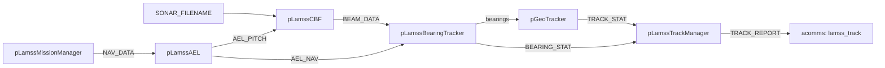

# Mission components

*This page written by Claude*

`sonar` processes array data into bearings and tracks. Its components live in [`sonar/missions/component/`](../../../missions/component).

| Component | Processes | Requires |
|---|---|---|
| [`sonar`](../../../missions/component/sonar/sonar.py) (`passive`) | [pLamssAEL](../apps/pLamssAEL.md), [pLamssCBF](../apps/pLamssCBF.md), [pLamssBearingTracker](../apps/pLamssBearingTracker.md), [pGeoTracker](../apps/pGeoTracker.md), [pLamssTrackManager](../apps/pLamssTrackManager.md) | `interprocess`, `mission_manager` |

The chain runs while `SONAR_CONTROL` and `SONAR_PROCESS` are `ON`, which a `LAMSS_DEPLOY` with `Sonar_Control: SONAR_CONTROL_ON` and `Sonar_Process: SONAR_PROCESS_ON` sets. The defaults are the DURIP towed array on macrura from `missions-lamss`: 31 elements in three spacing groups, 47 beams, broadband processing around 800 Hz (`center_frequency`, `bandwidth`, `frequency_bins`), and the array centre 38.8 m behind the vehicle (`array_center_offset`).

[`templates/acomms/lamss_track.pb.cfg.j2`](../../../missions/templates/acomms/lamss_track.pb.cfg.j2) adds `lamss_track` to the messages a cruise can name in `acomms.messages`. Where it is received it posts `LAMSS_TRACK_IN` and `NODE_REPORT`s of the vehicle and of the track (`<vehicle>_track_<n>`, type `track`), so the topside's goby_liaison map shows the track. The vehicle's own `pLamssTrackManager` posts the track as `priority_trk`.
