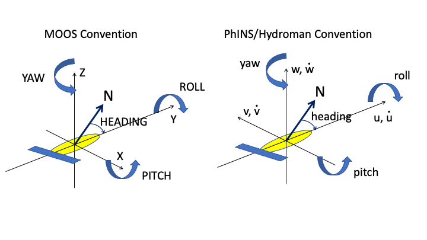

# uSimPhinsINS

## Functionality

`uSimPhinsINS` is a C++ *MOOSApp* used for simulating a IXBlue INS. It subscribes to the simulated 'ground truth' computed by a dynamic model for the vehicle, typically executed in a *frontseatsim* MOOS community, and publishes the simulated INS response in the form of a text-format protobuf message to the frontseat MOOSDB.

## Coordinate System Convention



Fig. 1. Sign convenntions for MOOS and the Phins INS.

Figure 1 shows the legacy platform coordinate convention used by MOOS to the left, with the  coordinate convention for the INS-HydroMAN interface shown to the right. Note here that both are right-handed coordinate systems aligned with the vehicle axis, but while the sign convenvention for the MOOS attitudes are consistent, the sign convention for the INS/HydromAN is not, with the pitch being inconsistent.

## MOOS Varible Subscriptions

The INS simulator subscribes to the following required variables in the frontseat MOOSDB:

    MOOS variable           Type    Description
    FRONTSEAT_SPEED         double  Forward speed in m/s for the vehicle.
    FRONTSEAT_HEADING       double  Heading of the vehicle in degrees, clockwise from geographical North.
    FRONTSEAT_DEPTH         double  Depth of vehicle in meters.
    FRONTSEAT_PITCH         double  Pitch of the vehicle in radians, positive nose up.
    FRONTSEAT_ROLL          double  Roll of vehicle, positive starboard down
    FRONTSEAT_BODY_VEL_Y    double  Forward velocity v in MOOS platfom coordinates (m/s).
    FRONTSEAT_BODY_VEL_X    double  Starboard velocity u in MOOS platfom coordinates (m/s).
    FRONTSEAT_BODY_VEL_Z    double  Upward velocity w  in MOOS platfom coordinates (m/s).

In addition 'uSimPhinINS' subscribes to MOOS variables solely used for internal evaluation of the INS simulator error in the presence of current:

    FRONTSEAT_LATITUDE      double  Latitude in decimal degrees of current location.
    FRONTSEAT_LONGITUDE     double  Longitude in decimal degrees of current location.
    CURRENT_X               double  Local current in m/s, positive towards east
    CURRENT_Y               double  local current in m/s, positive towards north.

## MOOS Variable Publications

The simulated INS response is published in a text-formatted protobuf message to the MOOS variable:

    FRONTSEAT_PHINS_DATA, with the following definition:

```
import "dccl/protobuf/option_extensions.proto";
import "goby/protobuf/option_extensions.proto";
import "dccl/option_extensions.proto";

package lamss.hydroman.protobuf;

message IXBlueINSData
{
    option (dccl.msg).unit_system = "si";
    // Header message
    required Header header = 1;

    // Attitude Quaternion
    optional AttitudeQuaternion attitude_quaternion = 2;

    // Attitude Quaternion Stdev
    optional AttitudeQuaternionStdev attitude_quaternion_stdev = 3;

    // Rotation Rate Vessel Frame
    optional RotationRateVesselFrame rot_rate_vessel_frame_degsec = 4;

    // Rotation Rate Vessel Frame Stdev
    optional RotationRateVesselFrameDeviation rot_rate_vessel_frame_stdev = 5;
    
    // Linear Acceleration Vessel Frame
    optional AccelerationVesselFrame acce_vessel_frame_msec2 = 6;

    // Linear Acceleration Vessel Frame Stdev
    optional AccelerationVesselFrameDeviation acce_vessel_frame_stdev = 7;

    // Position
    optional Position position = 8;

    // Position Stdev
    optional PositionDeviation position_stdev = 9;

    // Attitude
    optional Attitude attitude_deg = 10;

    // Attitude Stdev
    optional AttitudeDeviation attitude_stdev = 11;
    
    // Speed Vessel Frame
    optional speedVesselFrame speed_vessel_frame_msec = 12;

    // Speed geographic Frame
    optional speedGeographicFrame speed_geographic_frame_msec = 13;

    // Speed geographic Frame Stdev
    optional speedGeographicFrameDeviation speed_geographic_frame_stdev = 14;
    
}

// Header message
message Header
{
    
    optional int32 protocol_version = 1;
    optional int32 navigation_bit_mask = 2;
    optional int32 extended_navigation_bit_mask = 3;
    optional int32 external_sensor_bit_mask = 4;
    optional int32 telegram_size = 5;
    optional int32 navigation_data_validity_time_100us = 6;
}

// Attitude quaternion data
message AttitudeQuaternion 
{
    optional double q0 = 1;
    optional double q1 = 2;
    optional double q2 = 3;
    optional double q3 = 4;
}

// Attitude quaternion stdev data
message AttitudeQuaternionStdev 
{
    optional double xi1 = 1;
    optional double xi2 = 2;
    optional double xi3 = 3;
}

// Rotation Rate Vessel Frame
message RotationRateVesselFrame 
{
    option (dccl.msg).unit_system = "si";
    optional double xv1 = 1 [(dccl.field).units = {system: "angle::degree" base_dimensions: "AT^-1"}];
    optional double xv2 = 2 [(dccl.field).units = {system: "angle::degree" base_dimensions: "AT^-1"}];
    optional double xv3 = 3 [(dccl.field).units = {system: "angle::degree" base_dimensions: "AT^-1"}];
}

// Rotation Rate Vessel Frame Stdev
message RotationRateVesselFrameDeviation 
{
    optional double xv1 = 1;
    optional double xv2 = 2;
    optional double xv3 = 3;
}

// Linear Acceleration
message AccelerationVesselFrame 
{
    option (dccl.msg).unit_system = "si";
    optional double xv1 = 1 [(dccl.field).units = {base_dimensions: "LT^-2"}]; // udot
    optional double xv2 = 2 [(dccl.field).units = {base_dimensions: "LT^-2"}]; // vdot
    optional double xv3 = 3 [(dccl.field).units = {base_dimensions: "LT^-2"}]; // wdot
}

// Linear Acceleration Vessel Frame Stdev
message AccelerationVesselFrameDeviation 
{
    optional double xv1 = 1;           // udot stdv in m/s^2
    optional double xv2 = 2;           // vdot stdv in m/s^2
    optional double xv3 = 3;           // wdot stdv in m/s^2
}

// Position
message Position 
{
    optional double latitude = 1;       // Latidude in degrees  (-90 - 90)
    optional double longitude = 2;      // Longitude in degrees (-180 - 180)
    optional double altitude = 3;       // Altitude ( negative depth )
}

// Position Stdev
message PositionDeviation
{
    optional double north_stddev = 1;
    optional double east_stddev = 2;
    optional double north_east_corr = 3;
    optional double altitude_stddev = 4;
}

// Attitude
message Attitude 
{
    option (dccl.msg).unit_system = "si";
    optional double roll = 1 [(dccl.field).units = {system: "angle::degree" base_dimensions: "A"}];
    optional double pitch = 2 [(dccl.field).units = {system: "angle::degree" base_dimensions: "A"}];
    optional double heading = 3 [(dccl.field).units = {system: "angle::degree" base_dimensions: "A"}];
}

// Attitude Stdev
message AttitudeDeviation
{
    optional double roll = 1;
    optional double pitch = 2;
    optional double heading = 3;
}

// Speed Vessel Frame
message speedVesselFrame
{
    option (dccl.msg).unit_system = "si";
    optional double xv1 = 1 [(dccl.field).units.base_dimensions = "LT^-1"]; // udot
    optional double xv2 = 2 [(dccl.field).units.base_dimensions = "LT^-1"];  //vdot
    optional double xv3 = 3 [(dccl.field).units.base_dimensions = "LT^-1"];  //wdot
}

// Speed geographic Frame
message speedGeographicFrame
{
    option (dccl.msg).unit_system = "si";
    optional double north = 1 [(dccl.field).units.base_dimensions = "LT^-1"];
    optional double east = 2 [(dccl.field).units.base_dimensions = "LT^-1"];
    optional double up = 3 [(dccl.field).units.base_dimensions = "LT^-1"];
}

// Speed geographic Frame Stdev
message speedGeographicFrameDeviation
{
    option (dccl.msg).unit_system = "si";
    optional double north = 1 [(dccl.field).units.base_dimensions = "LT^-1"];
    optional double east = 2 [(dccl.field).units.base_dimensions = "LT^-1"];
    optional double up = 3 [(dccl.field).units.base_dimensions = "LT^-1"];
}
```

The entire message is not required to be completed, a minimum publication is as follows:

```
PHINS_DATA     "@PB[lamss.hydroman.protobuf.IXBlueINSData] header { protocol_version: 3 navigation_bit_mask: 2145648639 extended_navigation_bit_mask: 3 telegram_size: 390 navigation_data_validity_time_100us: 299149998 } 
acce_vessel_frame_msec2 { xv1: -0.0088289668122777248 xv2: -0.0068793532609167391 
                          xv3: 0.008971029162415347 } 
acce_vessel_frame_stdev { xv1: 0.01 xv2: 0.01 xv3: 0.01 } 
attitude_deg { roll: 0 pitch: -15.98068855410431 heading: 22 } 
speed_vessel_frame_msec { xv1: 1.0676560932883106 xv2: -0.071048257540984983 
                          xv3:0.0047070799642347991 } "
```


