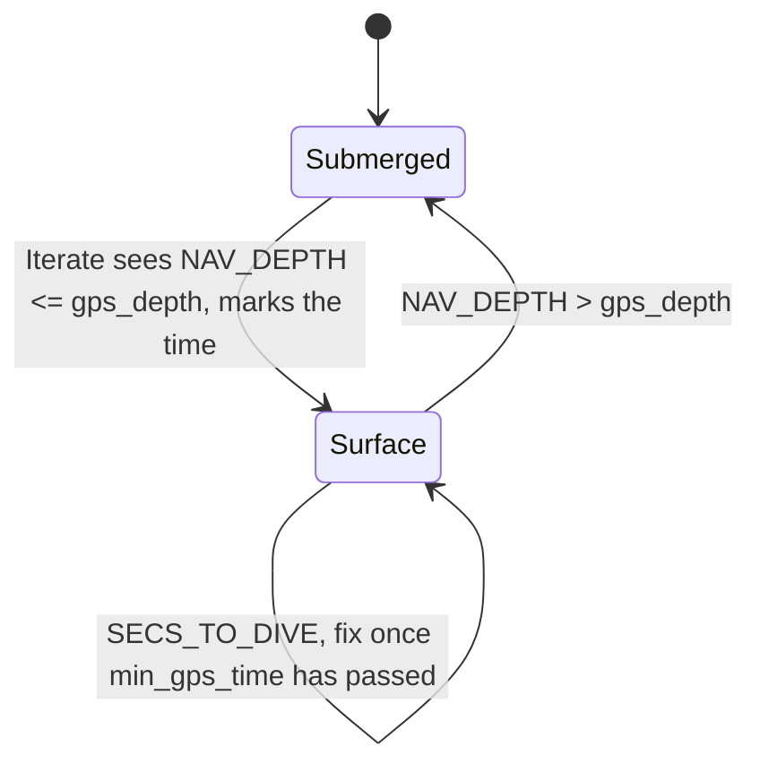

# uSimGPS

!!! warning "Inferred by Claude"
    Written by Claude from the source at `992a171`, not from a design document or by the app's
    authors.
    Each statement below is tagged: **[code]** read from the code, **[test]** observed in a test or
    a run, **[guess]** inferred intent that nobody has confirmed. Corrections are welcome; a
    maintainer sets `status: reviewed` once the page has been checked.

## Purpose

uSimGPS simulates GPS fixes for a simulated vehicle: while the vehicle is shallower than
`gps_depth` it publishes the true position (`TRUE_X`/`TRUE_Y`, from the vehicle simulator) as
`GPS_X`/`GPS_Y` and as latitude/longitude, every `gps_interval` seconds **[code]**. After surfacing
it holds back fixes for `min_gps_time` seconds and counts down `SECS_TO_DIVE` **[code]**, modelling
the time a vehicle needs on the surface to get a fix **[guess]**. `GPS_SIM_UPDATE_RECEIVED` is the
string iBackSeatServer uses to set the GPS flag in the Bluefin `BFNVG` message (commit of
2017-05-11) **[code]**; the other outputs feed the navigation filter under test, e.g. uSimPhinsINS
or HydroMAN **[guess]**.

## Interfaces

### Subscribes

<!-- BEGIN GENERATED subscribes -->
| Name | Transport | Type / format | Handler | Meaning | Notes |
|---|---|---|---|---|---|
| `LAT_ORIGIN` | MOOS | double | `SimGPS.cpp`, `OnNewMail` | new local-grid origin latitude **[code]** | see open questions |
| `LONG_ORIGIN` | MOOS | double | `SimGPS.cpp`, `OnNewMail` | new local-grid origin longitude **[code]** | see open questions |
| `TRUE_X` | MOOS | double, m | `SimGPS.cpp`, `OnNewMail` | true vehicle east position in the local grid **[code]** | from the vehicle simulator, e.g. uMVS_Bluefin **[guess]** |
| `TRUE_Y` | MOOS | double, m | `SimGPS.cpp`, `OnNewMail` | true vehicle north position **[code]** |  |
| `NAV_DEPTH` | MOOS | double, m | `SimGPS.cpp`, `OnNewMail` | vehicle depth **[code]** | deeper than `gps_depth` ends the surface interval **[code]** |
<!-- END GENERATED subscribes -->

### Publishes

<!-- BEGIN GENERATED publishes -->
| Name | Transport | Type / format | Where | Meaning | Notes |
|---|---|---|---|---|---|
| `SECS_TO_DIVE` | MOOS | double | `SimGPS.cpp` | `min_gps_time` minus the time since surfacing, truncated to whole seconds **[code]** | every `Iterate` while on the surface, except the one that detects surfacing; goes negative **[code]** |
| `GPS_SIM_UPDATE_RECEIVED` | MOOS | string: `Timestamp=<int s>,Latitude=<deg>,Longitude=<deg>` | `SimGPS.cpp` | GPS fix **[code]** | read by iBackSeatServer for the `BFNVG` GPS flag **[code]** (commit message) |
| `GPS_X` | MOOS | double, m | `SimGPS.cpp` | fix east position, equal to `TRUE_X` (no noise) **[code]** | published after a surface fix in `lamss_virtual_ocean_moos_smoke` **[test]** |
| `GPS_Y` | MOOS | double, m | `SimGPS.cpp` | fix north position, equal to `TRUE_Y` **[code]** |  |
| `GPS_LONG` | MOOS | double, deg | `SimGPS.cpp` | fix longitude **[code]** |  |
| `GPS_LAT` | MOOS | double, deg | `SimGPS.cpp` | fix latitude **[code]** |  |
<!-- END GENERATED publishes -->

### Configuration

<!-- BEGIN GENERATED config -->
| Parameter | Type | Default | Required | Meaning |
|---|---|---|---|---|
| `LatOrigin` | double |  | yes | global (mission file); origin latitude of the local grid **[code]** |
| `LongOrigin` | double |  | yes | global (mission file); origin longitude **[code]** |
| `gps_interval` | int, s |  | yes | fixes are published when the integer MOOS time is a multiple of this **[code]** |
| `gps_depth` | double, m |  | yes | depth at or above which the vehicle is on the surface **[code]** |
| `min_gps_time` | double, s | `0` | no | time after surfacing before the first fix **[code]** |
<!-- END GENERATED config -->

Example (from `uSimGPS.moos`):

```
LatOrigin  = 42.358
LongOrigin = -71.087

ProcessConfig = uSimGPS
{
   AppTick = 1
   CommsTick = 1

   gps_depth = 2.0
   gps_interval = 2
   min_gps_time = 10
}
```

### Files, devices and external programs

None **[code]**.

## Behaviour



- The app starts in the submerged state with the surfacing time at 0, so a vehicle that is
  already shallow gets fixes at once only if `min_gps_time` is 0 **[code]**.
- On each `Iterate` (`AppTick`), a fix is published when all three hold **[code]**:
  - at least `min_gps_time` s have passed since surfacing was detected;
  - the integer MOOS time is a multiple of `gps_interval`;
  - `NAV_DEPTH` ≤ `gps_depth`.
- With `AppTick` above 1 Hz, every iteration in a matching second publishes a fix; at 1 Hz or
  less, a matching second can be skipped **[code]**.
- The fix is the true position without noise or dropout **[code]**. Latitude/longitude come from
  the current origin; if the conversion fails the previous values are published **[code]**.

## Running it

- No mission component launches it yet.
- Standalone, in `virtual_ocean/src/bin/uSimGPS/`: run `MOOSDB uSimGPS.moos`, then
  `uSimGPS uSimGPS.moos`, and post `NAV_DEPTH`, `TRUE_X`, `TRUE_Y`.
- Tested by `lamss_virtual_ocean_moos_smoke` (`min_gps_time = 0`, `gps_interval = 1`): posting
  `NAV_DEPTH=0`, `TRUE_X=10`, `TRUE_Y=20` produces `GPS_X` **[test]**.

## Known issues and open questions

- `nav_x`, `nav_y`, `nav_depth`, `gps_lat` and `gps_lon` are not initialised in the constructor
  **[code]**. `Iterate` compares the uninitialised `nav_depth` with `gps_depth` until `NAV_DEPTH`
  arrives, and may publish a fix from uninitialised positions (undefined behaviour) **[code]**.
- A mail batch with only one of `LAT_ORIGIN`/`LONG_ORIGIN` re-initialises the geodesy with 0 for the
  other (`OnNewMail`) **[code]**. Same pattern as iNoaaBathy.
- `gps_interval = 0` divides by zero in `int_time % gps_interval` **[code]**.
- `SECS_TO_DIVE` keeps counting into negative values while the vehicle stays on the surface
  **[code]**. Do consumers expect it to stop at 0?
- The fix has no noise. Is a noise model wanted, or is that left to the navigation simulator?
- The start-up banner says `pSimGPS` V1.0 2007 (Henrik Schmidt) **[code]**; the app was renamed
  uSimGPS at some point **[guess]**.

## History

- From GobySoft/lamss `src/moos/uSimGPS`; first commit 2011-04-26 (Toby Schneider), when the MOOS
  processes used in missions-lamss were added; the code itself dates from 2007 (start-up banner)
  **[code]**.
- 7 commits before the port, by Toby Schneider (MOOS V10 2013, `GPS_SIM_UPDATE_RECEIVED` for
  iBackSeatServer 2017, IvP 17.7 build 2017, `goby::moos::CMOOSGeodesy` 2019) and Henrik Schmidt
  (dynamic origin from `LAT_ORIGIN`/`LONG_ORIGIN`, 2021-06-08).
- lamss3 port (GobySoft/lamss3#23): build with `lamss_add_app`; the origin locals in `OnNewMail`
  initialised to 0 (they were uninitialised); new `uSimGPS.moos` example.
