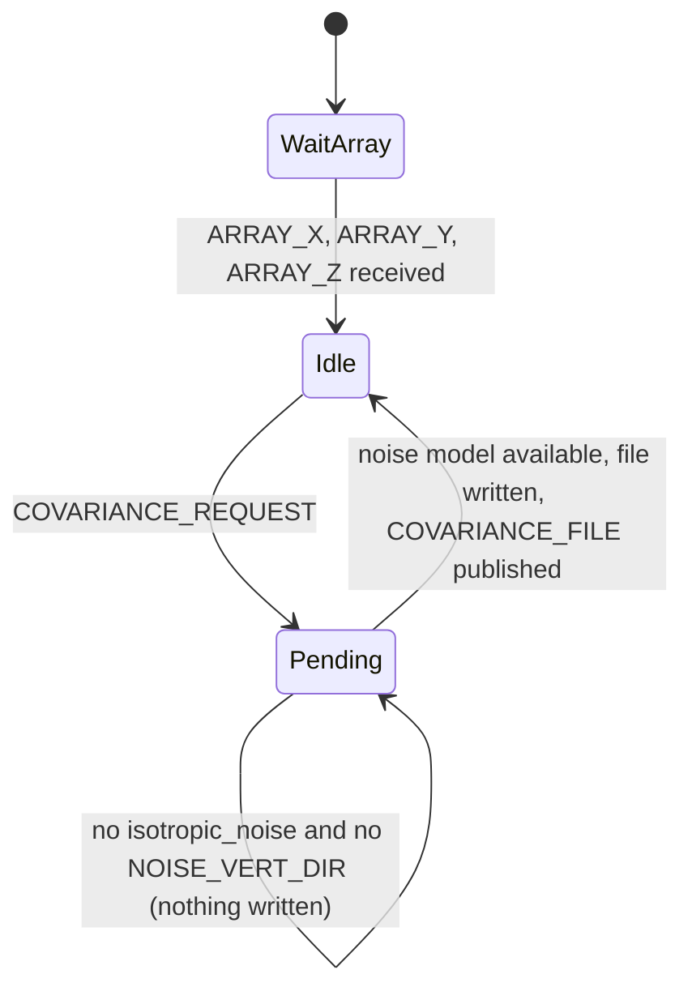

# uSimNoiseCovariance

!!! warning "Inferred by Claude"
    Written by Claude from the source at `992a171`, not from a design document or by the app's
    authors.
    Each statement below is tagged: **[code]** read from the code, **[test]** observed in a test or
    a run, **[guess]** inferred intent that nobody has confirmed. Corrections are welcome; a
    maintainer sets `status: reviewed` once the page has been checked.

## Purpose

uSimNoiseCovariance computes cross-spectral covariance matrices of ambient noise for the elements
of a simulated receiving array and writes them, with their Cholesky factors, to a binary file
**[code]**. It works on request: `COVARIANCE_REQUEST` triggers one computation, and the file name is
published as `COVARIANCE_FILE` **[code]**. uSimPassiveSonar is the requester and reader in lamss3:
it posts `COVARIANCE_REQUEST` and reads the file named in `COVARIANCE_FILE` **[code]**. It was split
out of the passive sonar simulator so that the slow computation does not block the generation of
sonar data **[guess]**. The array geometry comes from uSimTowedArray (`ARRAY_X/Y/Z`) **[code]**.

## Interfaces

### Subscribes

<!-- BEGIN GENERATED subscribes -->
| Name | Transport | Type / format | Handler | Meaning | Notes |
|---|---|---|---|---|---|
| `ARRAY_X` | MOOS | string: comma-separated doubles | `SimNoiseCovariance.cpp`, `OnNewMail` | x of each array element (m, local grid) **[code]** | count must equal `num_array_elements`, otherwise the app exits **[code]**; published by uSimTowedArray **[code]** |
| `ARRAY_Y` | MOOS | string: comma-separated doubles | `SimNoiseCovariance.cpp`, `OnNewMail` | y of each array element **[code]** | as `ARRAY_X` |
| `ARRAY_Z` | MOOS | string: comma-separated doubles | `SimNoiseCovariance.cpp`, `OnNewMail` | z of each element, negative down **[guess]**; the mean gives the array depth `-ael_z` **[code]** | as `ARRAY_X` |
| `ARRAY_HEADING` | MOOS | string: comma-separated doubles | `SimNoiseCovariance.cpp`, `OnNewMail` | heading of each element **[code]** | stored, not used in the covariance **[code]** |
| `ARRAY_PITCH` | MOOS | string: comma-separated doubles | `SimNoiseCovariance.cpp`, `OnNewMail` | pitch of each element (rad) **[guess]**; the mean is only logged **[code]** |  |
| `AMBIENT_NL_DEPTH` | MOOS | string: `depths=...,NL=...` or `depths=...,delta=...` | `SimNoiseCovariance.cpp`, `OnNewMail` | noise level versus depth, in dB (`NL`) or dB relative to `noise_level` (`delta`) **[code]** | `inf` allowed in either list **[code]** |
| `NOISE_VERT_DIR` | MOOS | string: `theta=...` or `elevation=...`, with `S=...` or `delta=...` | `SimNoiseCovariance.cpp`, `OnNewMail` | vertical noise directionality: power in dB versus polar angle (or elevation, converted to `90 - elevation`) **[code]** | enables the directional noise model **[code]** |
| `COVARIANCE_REQUEST` | MOOS | string: `nfft=N,sampling_frequency=F[,min_frequency=..][,max_frequency=..][,num_array_elements=..]` | `SimNoiseCovariance.cpp`, `OnNewMail` | request one covariance file **[code]** | the optional keys are read only if `nfft` is present; they override the configuration for this request only **[code]** |
<!-- END GENERATED subscribes -->

### Publishes

<!-- BEGIN GENERATED publishes -->
| Name | Transport | Type / format | Where | Meaning | Notes |
|---|---|---|---|---|---|
| `COVARIANCE_FILE` | MOOS | string: path | `SimNoiseCovariance.cpp` | path of the covariance file just written, `<base_dir_name>/NoiseCovariance.cov` **[code]** | read by uSimPassiveSonar **[code]** |
<!-- END GENERATED publishes -->

### Configuration

<!-- BEGIN GENERATED config -->
| Parameter | Type | Default | Required | Meaning |
|---|---|---|---|---|
| `minimum_frequency` | double (Hz) | `0` | no | lowest frequency with correlated noise **[code]**; see open questions on the unset case |
| `maximum_frequency` | double (Hz) | `1e20` | no | highest frequency with correlated noise **[code]** |
| `isotropic_noise` | bool (`true`/`false`) | `false` | no | use the 3-D isotropic noise model; otherwise covariances are built only once `NOISE_VERT_DIR` has arrived **[code]** |
| `num_array_elements` | int |  | yes (exits) | number of elements; `ARRAY_*` must match **[code]** |
| `base_dir_name` | string |  | yes (exits) | directory for `NoiseCovariance.cov` **[code]** |
| `array_type` | string |  | yes (exits) | `VSA` (4 channels per element: pressure and 3 velocity components) or anything else (1 channel) **[code]** |
| `water_depth` | double (m) |  | yes (exits) | read but not used **[code]** |
| `svp_surface` | double (m/s) | none | no | global (mission file); surface sound speed used in the covariance **[code]** |
| `water_c` | double (m/s) | none | no | global (mission file); alternative name for `svp_surface` **[code]** |
| `svp_gradient` | double | none | no | global (mission file); read but not used **[code]** |
| `sampling_frequency` | double (Hz) |  | yes (exits) | sampling frequency of the sonar data **[code]** |
| `noise_level` | double (dB re 1 µPa) |  | yes (exits) | reference noise level **[code]** |
| `num_samples` | int |  | yes (exits) | samples per file; the FFT length is the next power of two **[code]** |
<!-- END GENERATED config -->

`AppTick` and `CommsTick` are the usual MOOS settings; the example's comment asks for an `AppTick`
above 10 **[code]**.

Example (from `uSimNoiseCovariance.moos`):

```
ProcessConfig = uSimNoiseCovariance
{
  AppTick =   25           // should be > 10
  CommsTick = 5

  // Environmental Parameters
  water_depth = 100             // used for spherical spreading (m)
  noise_level = 60              // dB re 1 uPa
  minimum_frequency = 800       // Minimum frequency of processing
  maximum_frequency = 1000      // Maximum frequency of processing
  isotropic_noise = true        // Use isotropic noise model

  // Array and sampling parameters
  array_type = DURIP                 // DURIP or VSA
  num_array_elements = 32           // number of elements in the array
  sampling_frequency = 4000       // Hz
  num_samples = 8000              // number of samples per file

  // where the covariance files go, with the final forward slash
  base_dir_name = ./
}
```

### Files, devices and external programs

- Writes `<base_dir_name>/NoiseCovariance.cov`, overwritten on each request **[code]**. Binary,
  native byte order **[code]**:
  - header: time (double), noise level (double), two doubles (both `minimum_frequency`, see open
    questions), frequency step (double), first and last frequency index (int, int), number of
    channels (int);
  - per frequency from first to last index: frequency (double), then the lower triangle of the
    covariance matrix and the lower triangle of its Cholesky factor, each as (real, imaginary)
    double pairs.
- Exits if the file cannot be opened **[code]**.
- `notes.txt` in the source directory describes `pSimpleAcousticSim` (2008), not this app
  **[code]**.

## Behaviour

- Startup reads the configuration and exits on a missing required parameter **[code]**. It
  precomputes Bessel-function tables for the covariance model (core's `ComputeCovariance`)
  **[code]**.
- Each iteration waits for `ARRAY_X`, `ARRAY_Y` and `ARRAY_Z` **[code]**. When they are present and
  a request is pending, it computes the noise level at the array depth from the `AMBIENT_NL_DEPTH`
  profile (linear in depth, plus `noise_level`) or uses `noise_level` **[code]**.
- Covariances are computed only when `isotropic_noise` is set or a `NOISE_VERT_DIR` has been
  received **[code]**. Then, for each frequency bin between the first and last index:
  - the hydrophone (or VSA 4×4 block) covariance between each pair of elements comes from core's
    `ComputeCovariance`, using element separations and the sound speed **[code]**;
  - each matrix is scaled so that its mean diagonal equals the noise intensity
    `10^(NL/10) · fs/2 · nfft` **[code]**;
  - the matrices are stored in core's `CovMat`; the Cholesky factor is formed when the file is
    written, adding white noise (from 1e-6, ten times more on each failure) until the
    factorisation succeeds (see also
    [GobySoft/lamss3#31](https://github.com/GobySoft/lamss3/issues/31)) **[code]**.
- The file is written, `COVARIANCE_FILE` is published and the request is cleared **[code]**.
  Request overrides are then restored to the configured values **[code]**.
- The last frequency index is `maximum_frequency / Δf`, or `nfft/2 + 1` when
  `maximum_frequency` is at or above half the sampling frequency **[code]**.



## Running it

- No mission component launches it yet.
- Standalone: `MOOSDB` and `uSimNoiseCovariance uSimNoiseCovariance.moos` in
  `virtual_ocean/src/bin/uSimNoiseCovariance/`. It needs `ARRAY_X/Y/Z` (from uSimTowedArray) and a
  `COVARIANCE_REQUEST` (from uSimPassiveSonar, or posted by hand) before it writes anything.
- Tested by `lamss_virtual_ocean_moos_smoke`: the app starts with a 4-element configuration and
  connects to the MOOSDB **[test]**. The test sends no request, so no covariance is computed.

## Known issues and open questions

- The file header writes `minimum_frequency` twice; the second value was presumably meant to be
  `maximum_frequency` **[code]**. uSimPassiveSonar reads it as `f_max` but does not use it
  **[code]**. uSimModemNetwork has the same pattern.
- `sampling_frequency_save` is never set, and `minimum_frequency_save` / `maximum_frequency_save`
  are set only when configured **[code]**. After the first request the app "restores"
  `sampling_frequency`, and possibly the frequency limits, from uninitialised values **[code]**. A
  later request without `sampling_frequency` (or without the limits) would use garbage.
- `c_0` (and so `water_c`) is never initialised when neither `svp_surface` nor `water_c` is set
  globally; the "using default" message prints an uninitialised value **[code]**. What should the
  default sound speed be?
- With `maximum_frequency` at or above `fs/2` (the default), the last index is `nfft/2 + 1`, one
  bin above Nyquist **[code]**. uSimPassiveSonar keeps `nfft/2 + 1` matrices (indices up to
  `nfft/2`) and then reads this file into index `nfft/2 + 1`, past the end **[code]**.
- A request with `num_array_elements` larger than the configured value makes the next iteration
  index `array_x_rel` past its end (`std::out_of_range`) **[code]**; an `ARRAY_X` arriving while
  such a request is pending makes the app exit ("Array inconsistency") **[code]**.
- A request is never cleared when neither `isotropic_noise` nor `NOISE_VERT_DIR` is set, so the
  restore step runs on every iteration **[code]**. Should the app answer such requests with a
  white-noise file, or reject them?
- `water_depth`, `svp_gradient`, `ARRAY_HEADING` and `ARRAY_PITCH` are read but not used
  **[code]**. Are they leftovers from the passive sonar simulator this app was split from?
- The output name is fixed, so two arrays (two vehicles in one community) would overwrite each
  other's file **[code]**.
- The startup banner says "pSimNoiseCovariance V 2.0 9/29/2010" and error messages say
  "pSimPassiveSonar" **[code]**.

## History

- From GobySoft/lamss-shared `src/moos/uSimNoiseCovariance` (imported with its history at
  `043f556`). It began as a copy of uSimPassiveSonar, whose earlier history stays with that app.
  First commit 2011-04-29 (Henrik Schmidt, "Preparing for splitting out covariance matrix
  process"); 19 commits before the port, by Henrik Schmidt and Toby Schneider.
- Main changes in the old history: correlated noise operational (2012), noise directionality by
  elevation (2013), relative noise profile (`delta`, 2014), `ComputeCovariance` moved to
  henrik_util (2019), covariance file in double precision (2025-12-15).
- lamss3 port (Phase 2, GobySoft/lamss3#21–#23): clang-format; noise level initialised for depths
  outside the noise profile; the FFT length read through `memcpy` instead of a type-punned pointer;
  newmat include dropped; MIT/GPL-3.0-or-later headers.
