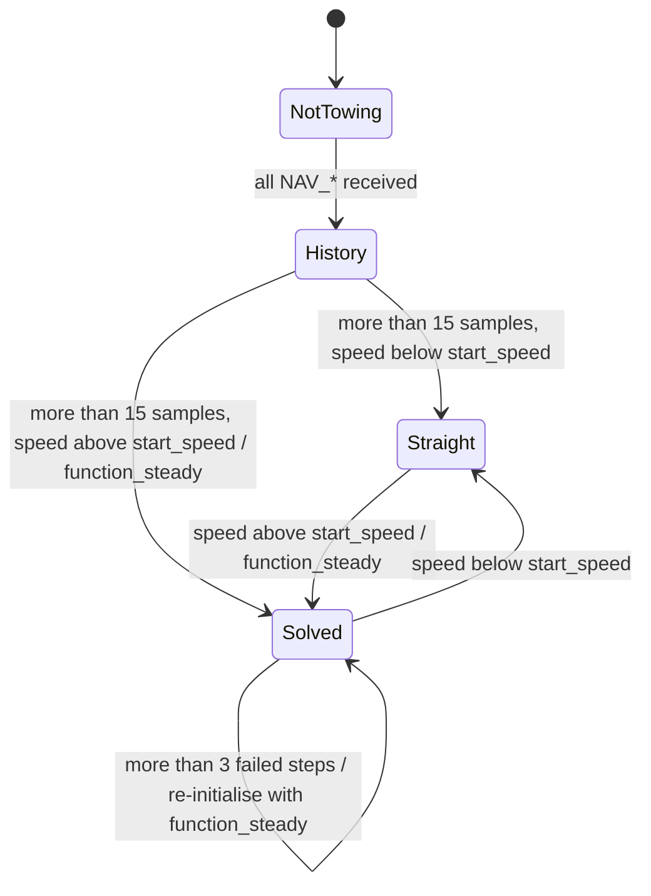

# uSimTowedArray

!!! warning "Inferred by Claude"
    Written by Claude from the source at `992a171`, not from a design document or by the app's
    authors.
    Each statement below is tagged: **[code]** read from the code, **[test]** observed in a test or
    a run, **[guess]** inferred intent that nobody has confirmed. Corrections are welcome; a
    maintainer sets `status: reviewed` once the page has been checked.

## Purpose

uSimTowedArray simulates the geometry of a hydrophone array carried by a vehicle: a towed array
whose shape follows a cable-dynamics model, or a fixed array (vertical, horizontal or an arbitrary
3-D "volume" array) attached to the vehicle **[code]**. From the vehicle's navigation it publishes
the position, heading and pitch of every array element and of the array centre **[code]**. The
passive sonar simulators use these positions as receiver locations: uSimPassiveSonar and
uSimNoiseCovariance subscribe to `ARRAY_X/Y/Z`, `ARRAY_HEADING` and `ARRAY_PITCH` **[code]**.
Beamformers and trackers on a real vehicle read the same variables from the array's navigation
**[guess]**. The towed-cable solver is a C++ translation of a MATLAB model: Milinazzo, Wilkie and
Latchman (Ocean Engng. 14(6), 1987), as implemented by R. B. Evans (SAIC, 2002), per the code
comments **[code]**.

## Interfaces

### Subscribes

<!-- BEGIN GENERATED subscribes -->
| Name | Transport | Type / format | Handler | Meaning | Notes |
|---|---|---|---|---|---|
| `NAV_X` | MOOS | double | `SimTowedArray.cpp`, `OnNewMail` | vehicle x (m, local grid) **[code]** | all six `NAV_*` are needed before anything is published **[code]** |
| `NAV_Y` | MOOS | double | `SimTowedArray.cpp`, `OnNewMail` | vehicle y **[code]** |  |
| `NAV_Z` | MOOS | double | `SimTowedArray.cpp`, `OnNewMail` | vehicle z, positive up **[guess]** (negated to a depth for the cable model) **[code]** |  |
| `NAV_SPEED` | MOOS | double | `SimTowedArray.cpp`, `OnNewMail` | vehicle speed (m/s) **[code]** | a new `NAV_SPEED`, `NAV_HEADING` and `NAV_PITCH` must all arrive before each model step **[code]** |
| `NAV_HEADING` | MOOS | double | `SimTowedArray.cpp`, `OnNewMail` | heading in degrees, converted to yaw `-heading·π/180` **[code]** | replaced `NAV_YAW` in 2013 **[code]** |
| `NAV_PITCH` | MOOS | double | `SimTowedArray.cpp`, `OnNewMail` | vehicle pitch, used as radians **[code]** |  |
| `LOCAL_ARRAY_X` | MOOS | string: comma-separated doubles | `SimTowedArray.cpp`, `OnNewMail` | element x in the vehicle frame, for `array_type = volume` **[code]** | alternative to the `local_array_x` parameter; element counts must agree or the app exits **[code]** |
| `LOCAL_ARRAY_Y` | MOOS | string: comma-separated doubles | `SimTowedArray.cpp`, `OnNewMail` | element y in the vehicle frame **[code]** | as `LOCAL_ARRAY_X` |
| `LOCAL_ARRAY_Z` | MOOS | string: comma-separated doubles | `SimTowedArray.cpp`, `OnNewMail` | element z in the vehicle frame **[code]** | as `LOCAL_ARRAY_X` |
| `LOCAL_DIR_X` | MOOS | string: comma-separated doubles | `SimTowedArray.cpp`, `OnNewMail` | x of each element's directivity vector, vehicle frame **[code]** | missing directivity means omnidirectional **[code]** |
| `LOCAL_DIR_Y` | MOOS | string: comma-separated doubles | `SimTowedArray.cpp`, `OnNewMail` | y of the directivity vector **[code]** |  |
| `LOCAL_DIR_Z` | MOOS | string: comma-separated doubles | `SimTowedArray.cpp`, `OnNewMail` | z of the directivity vector **[code]** |  |
<!-- END GENERATED subscribes -->

### Publishes

<!-- BEGIN GENERATED publishes -->
| Name | Transport | Type / format | Where | Meaning | Notes |
|---|---|---|---|---|---|
| `ARRAY_TYPE` | MOOS | string | `SimTowedArray.cpp` | `towed`, `fixed`, `hla`, `vla` or `volume` **[code]** | posted once, from `OnStartUp` **[code]** |
| `CABLE_TENSION` | MOOS | double | `SimTowedArray.cpp` | tow-point tension, moving average over `filter_length` model steps **[code]**; N **[guess]** | `0` whenever the cable model is not solved or the tension is outside (0, 200) **[code]** |
| `ARRAY_HEADING` | MOOS | string: comma-separated doubles | `SimTowedArray.cpp` | heading of each element, degrees **[code]** | read by uSimPassiveSonar and uSimNoiseCovariance **[code]** |
| `ARRAY_PITCH` | MOOS | string: comma-separated doubles | `SimTowedArray.cpp` | pitch of each element, radians **[code]** |  |
| `CABLE_SHAPE_X` | MOOS | string: comma-separated doubles | `SimTowedArray.cpp` | x of the cable discretisation nodes **[code]** | for plotting the whole cable **[guess]** |
| `CABLE_SHAPE_Y` | MOOS | string: comma-separated doubles | `SimTowedArray.cpp` | y of the cable nodes **[code]** |  |
| `CABLE_SHAPE_Z` | MOOS | string: comma-separated doubles | `SimTowedArray.cpp` | z of the cable nodes **[code]** |  |
| `ARRAY_X` | MOOS | string: comma-separated doubles | `SimTowedArray.cpp` | x of each array element, local grid **[code]** | read by uSimPassiveSonar and uSimNoiseCovariance **[code]** |
| `ARRAY_Y` | MOOS | string: comma-separated doubles | `SimTowedArray.cpp` | y of each element **[code]** |  |
| `ARRAY_Z` | MOOS | string: comma-separated doubles | `SimTowedArray.cpp` | z of each element, positive up **[guess]** | the sonar simulators use `-ARRAY_Z` as depth **[code]** |
| `AEL_PITCH` | MOOS | double | `SimTowedArray.cpp` | array pitch, radians **[code]** | towed: mean element pitch, or `-acos((v/start_speed)^2)` below the start speed; vla: `NAV_PITCH - π/2`; otherwise `NAV_PITCH` **[code]** |
| `AEL_HEADING` | MOOS | double | `SimTowedArray.cpp` | array heading, degrees 0–360 **[code]** |  |
| `AEL_X_OFFSET` | MOOS | double | `SimTowedArray.cpp` | array centre x minus tow point x **[code]** |  |
| `AEL_Y_OFFSET` | MOOS | double | `SimTowedArray.cpp` | array centre y minus tow point y **[code]** |  |
| `AEL_X` | MOOS | double | `SimTowedArray.cpp` | array centre x (mean of the element positions) **[code]** |  |
| `AEL_Y` | MOOS | double | `SimTowedArray.cpp` | array centre y **[code]** |  |
| `ARRAY_DIR_X` | MOOS | string: comma-separated doubles | `SimTowedArray.cpp` | element directivity vectors in the local grid **[code]** | `volume` arrays only **[code]** |
| `ARRAY_DIR_Y` | MOOS | string: comma-separated doubles | `SimTowedArray.cpp` | as `ARRAY_DIR_X` **[code]** |  |
| `ARRAY_DIR_Z` | MOOS | string: comma-separated doubles | `SimTowedArray.cpp` | as `ARRAY_DIR_X` **[code]** |  |
<!-- END GENERATED publishes -->

### Configuration

<!-- BEGIN GENERATED config -->
| Parameter | Type | Default | Required | Meaning |
|---|---|---|---|---|
| `cond_check` | int |  | yes | read but not used **[code]**; the Jacobian condition check it switched is commented out **[code]** |
| `start_speed` | double (m/s) |  | yes | below this tow speed the array is not solved and is drawn straight **[code]** |
| `filter_length` | int | `40` | yes | length of the tension moving average and of the tow-velocity history **[code]** |
| `history_time` | double (s) | `20` | no | read but not used **[code]** |
| `array_type` | string | `towed` | no | `fixed`, `hla`, `vla`, `volume`; any other value means `towed` **[code]** |
| `tow_point_x` | double (m) | `0` | no | tow point offset in the vehicle frame **[code]** |
| `tow_point_y` | double (m) | `0` | no | tow point offset, along the vehicle axis **[guess]** |
| `tow_point_z` | double (m) | `0` | no | tow point offset, vertical **[code]** |
| `number_elements` | double, used as int |  | for `volume` and `array_definition_type = 0` | number of elements **[code]** |
| `local_array_x` | string: comma-separated doubles |  | no | `volume` arrays: element x in the vehicle frame **[code]** |
| `local_array_y` | string: comma-separated doubles |  | no | as `local_array_x` |
| `local_array_z` | string: comma-separated doubles |  | no | as `local_array_x` |
| `local_dir_x` | string: comma-separated doubles |  | no | `volume` arrays: element directivity vectors **[code]** |
| `local_dir_y` | string: comma-separated doubles |  | no | as `local_dir_x` |
| `local_dir_z` | string: comma-separated doubles |  | no | as `local_dir_x` |
| `number_sectors` | int |  | yes, unless `volume` | number of cable sectors; each needs `sector_<n>` (see below) **[code]** |
| `tow_body` | int |  | yes for `towed` | `1`: a tow body at the end, described by `towbody_parameters` **[code]** |
| `towbody_parameters` | string: 3 doubles |  | if `tow_body = 1` | weight (N), drag coefficient, area (m²) **[code]** |
| `array_section_number` | int |  | yes, unless `volume` | the sector that carries the elements **[code]** |
| `first_phone_offset` | double (m) |  | yes, unless `volume` | first element's distance from the start of that sector **[code]** |
| `array_definition_type` | int | `1` | no | `0`: `number_elements` and `element_spacing`; `1`: spacing groups; `2`: `array_element_locations` **[code]** |
| `element_spacing` | double (m) |  | for type 0 | uniform element spacing **[code]** |
| `phone_spacing_groups` | int |  | for type 1 | number of spacing groups; each needs `spacing_group_<n>` and `num_spacings_group_<n>` **[code]** |
| `array_element_locations` | string: comma-separated doubles |  | for type 2 | element positions along the array **[code]** |
<!-- END GENERATED config -->

Parameters whose names are built at run time, and so are not in the table **[code]**:

| Parameter | Type | Meaning |
|---|---|---|
| `sector_<n>`, n = 1…`number_sectors` | 7 doubles | `Nsub` (segments), length (m), weight (N/m), diameter (m), tangential drag, normal drag, modulus of elasticity (N/m²) **[code]** |
| `spacing_group_<n>` | double (m) | element spacing in group n **[code]** |
| `num_spacings_group_<n>` | int | number of spacings in group n **[code]** |

A missing required parameter makes `OnStartUp` return false, so the app does not start **[code]**.

Example (from `uSimTowedArray.moos`, comments shortened):

```
ProcessConfig = uSimTowedArray
{
  AppTick =   2
  CommsTick = 4

  cond_check =	1
  start_speed  =   0.5
  create_dir_frame = 0
  write_out_files  = 0
  filter_length   = 40
  array_type = 2 	// 1: VSA, 2: HYDROPHONE

  // DURIP array with 3 sections (tow cable+acoustic section+drogue)
  number_sectors = 3
  //        Nsub, len(m),   wgt(N/m),  dia(m),  td,     nd,   Mod of Elas (N/m^2)
  sector_1 = 20,	20.0,    .0000,     .0095,    .001,   0.2,       1.8e9
  sector_2 = 30,	36.0,    .0000,     .035,   .0024,   0.5,       1.8e8
  sector_3 = 20,	20.0,    .0000,     .0095,   .001,   0.2,       1.8e9
  tow_body = 0
  //                 Wgt(N),drgcoef,area(m^2)
  towbody_parameters = -10.0,   1.0,     0.01

  array_section_number = 2
  first_phone_offset   = 3.0

  array_definition_type = 1
  phone_spacing_groups = 3
  spacing_group_1      = 1.5
  num_spacings_group_1 = 5
  spacing_group_2      = 0.75
  num_spacings_group_2 = 22
  spacing_group_3      = 1.5
  num_spacings_group_3 = 4
}
```

The example file also keeps a commented-out four-sector "Fatline VSA" configuration.

### Files, devices and external programs

None in normal operation **[code]**. The cable solver has debug dumps (`nt_<n>_inv.m` and others in
the working directory) behind a local `debug` flag that is compiled as `false` **[code]**.

## Behaviour

- Every `AppTick` (2 Hz in the example) **[code]**:
  - with all six `NAV_*` received, the tow point is the vehicle position plus the rotated
    `tow_point_*` offset, and its velocity comes from speed, heading and pitch **[code]**;
  - the step continues only after a fresh `NAV_SPEED`, `NAV_HEADING` and `NAV_PITCH`; the tow
    velocity is then pushed into a `filter_length` history **[code]**.
- `towed` arrays, once more than 15 velocity samples are in the history **[code]**:
  - at a mean tow speed above `start_speed`, the steady-state cable shape for the mean velocity is
    solved (`function_steady`), then each step integrates the cable dynamics by Newton–Raphson
    (`function_cable`, `find_configf`, up to 50 iterations) **[code]**;
  - element positions, headings and pitches are interpolated along the cable **[code]**;
  - a step whose Jacobian condition number exceeds 1e7, or that does not converge, counts as a
    failure; after more than three the steady-state solution is recomputed on the next step and
    `CABLE_TENSION` is 0 **[code]**;
  - outputs are published only while the filtered tension lies in (0, 200) **[code]**;
  - below `start_speed` the array is drawn straight behind the tow point, pitched down by
    `acos((v/start_speed)^2)` **[code]**.
- `vla`: a straight array along the vehicle's pitch minus 90° **[code]**. `fixed` and `hla`: a
  straight array at the vehicle's pitch **[code]**. `volume`: the configured element positions and
  directivities rotated by the vehicle's yaw and pitch **[code]**. These are recomputed every step
  and need no cable model **[code]**.
- Element positions along the array come from the sector lengths, `array_section_number`,
  `first_phone_offset` and the element spacing definition **[code]**.
- The cable model uses water density 1025 kg/m³, g = 9.81 m/s² and a zero current profile
  **[code]**.



The diagram is for `array_type = towed`; the other types publish a rigid geometry on every step
**[code]**.

## Running it

- No mission component launches it yet.
- Standalone: `MOOSDB` and `uSimTowedArray uSimTowedArray.moos` in
  `virtual_ocean/src/bin/uSimTowedArray/`, with something publishing `NAV_X`, `NAV_Y`, `NAV_Z`,
  `NAV_SPEED`, `NAV_HEADING` and `NAV_PITCH` (a vehicle simulator) **[code]**.
- Tested by `lamss_virtual_ocean_moos_smoke`: the app starts with a three-sector, four-element
  configuration and connects to the MOOSDB **[test]**. The test publishes no navigation, so the
  array model does not run.

## Known issues and open questions

- `MOOSTrace("ael_heading = %f\n")` has no argument, in `straight_array` and `volumetric_array`
  **[code]**. It reads a missing variadic argument (undefined behaviour), and prints garbage
  **[guess]**.
- `if (int ll = vx_hist.size() > 0)` assigns the comparison (1), not the size, so the velocity
  history is padded with its first element rather than its last **[code]**. Was the last element
  intended?
- `cond_check` is required but unused, and `history_time` is read but unused (the line computing
  the filter length from it is commented out) **[code]**. Can they be removed, or should they work?
- The example's `array_type = 2 // 1: VSA, 2: HYDROPHONE` does not match the code, which expects a
  name; `2` means `towed` **[code]**. `create_dir_frame` and `write_out_files` are not read
  **[code]**. Is the example from an older version?
- With `array_definition_type` unset, the log says "setting array_definition_type=0", but the value
  used is 1 **[code]**.
- The 0–200 tension window and the 15-sample start-up history are fixed in the code **[code]**.
  What are the units and the reason for the upper limit?
- A missing `LOCAL_ARRAY_*` for a `volume` array makes `Iterate()` return false **[code]**. What
  MOOS does with that depends on the MOOS version **[guess]**.
- `ARRAY_TYPE` is notified from `OnStartUp`, possibly before the MOOSDB connection is up
  **[guess]**. Does it reach the database?

## History

- From GobySoft/lamss-shared `src/moos/uSimTowedArray` (imported with its history at `043f556`).
  First commit 2011-04-27 (Toby Schneider, "working src-shared from revision 3258"; the app's banner
  dates it to 2007–2008, Henrik Schmidt). 21 commits before the port, mostly by Henrik Schmidt, with
  Toby Schneider and Andrew Poulsen.
- Main changes in the old history: vertical arrays (2012), volumetric arrays and element
  directivity (2013), heading from `NAV_HEADING` instead of `NAV_YAW` (2013), array configuration
  clean-up (2017).
- lamss3 port (Phase 2, GobySoft/lamss3#23): clang-format; `ntol`/`jtol` initialised; 32-byte
  buffers for the `sprintf`'d parameter names; explicit parentheses on the assignment in `if`;
  `ProcessConfig` name in the example fixed; MIT/GPL-3.0-or-later headers.
